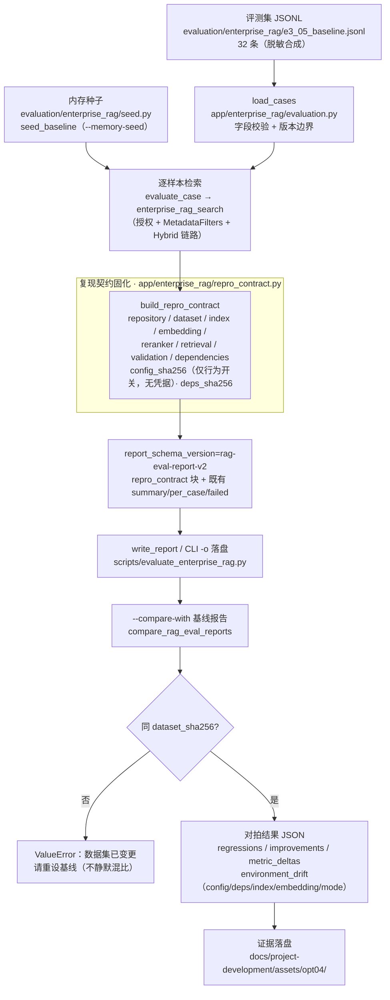

# OPT-04 RAG 报告复现契约

> 阶段：交付后优化池（OPT-04）
> 前置：E3-04 离线评测基线、E3-05 质量基线、E3-09 Cross-Encoder 对比（均已在本地隔离环境可运行）

## 1. 目标、范围与前缀依赖

目标：让每一份 RAG 评测报告自带**可复现边界**，任何人拿到报告都能回答“这份数字在什么仓库版本、什么索引、
什么 Embedding/Reranker、什么检索参数、什么依赖与配置下产生的”，并能**离线对拍**判定复跑是否一致：

- 固化：仓库版本（commit/ref）、数据集 SHA-256、索引标识（index_id/collection/commit）、
  Embedding（provider/model/dimension）、Reranker（含 Cross-Encoder 配置）、检索参数与过滤（mode/top-k/租户/用户/角色）、
  依赖版本（python + 关键包）、RAG 配置 hash（`config_sha256`）与依赖 hash（`deps_sha256`）；
- 区分 `verified / local_only / blocked` 并给出原因列表（无真实 Milvus 时绝不写 verified）；
- 对拍：同一 `dataset_sha256` 下输出案例回归/改善、指标 delta、**环境漂移**（配置/依赖/索引/Embedding 变更）；
  旧版（v1）报告缺契约时如实标记 `not_collected`，不假装环境可比；
- 脱敏：`config_sha256` 只覆盖 RAG 行为开关，**不含 token/密码/数据库地址**（有专项测试验证）。

范围外：真实 Milvus 云端复跑（E3-06/07 已单独取证）；修改评测集后对拍（视为新基线，直接拒绝）。

## 2. 主链路（Mermaid）



源码位置注解：契约构建与对拍在 `app/enterprise_rag/repro_contract.py`；报告装配在 `app/enterprise_rag/evaluation.py`
的 `evaluate_dataset`；CLI 入口与 `--compare-with` 在 `backend/scripts/evaluate_enterprise_rag.py`。

## 3. 关键代码说明

- `backend/app/enterprise_rag/repro_contract.py`（新增）：
  - `REPORT_SCHEMA_VERSION="rag-eval-report-v2"` / `REPRO_SCHEMA_VERSION="rag-eval-repro-v1"`：新旧报告可通过
    `report_schema_version` 判代；旧报告（无该键）在对拍中被识别为 v1。
  - `rag_settings_snapshot()`：只取 25 个 RAG 行为开关（top-k/rerank/cross-encoder/query-rewrite 等），
    **刻意不含** `milvus_token / database_url / celery_broker_url` —— 配置 hash 不承载凭据。
  - `embedding_identity()`：只用配置与已缓存维度（`last_real_embedding_dimension`），不触发真实探针/外网；
    取不到如实标 `not_collected` + 异常类型名（不含堆栈正文）。
  - `dependencies_snapshot()`：python 版本 + 6 个关键包版本（缺包记 `not_installed`）。
  - `build_repro_contract(...)`：装配 repository/dataset/index/embedding/reranker/retrieval/validation/
    dependencies；`index.source ∈ {cli_index_identity, per_case_echo, not_collected}` 标明索引身份来源；
    `config_sha256 = sha256({mode, top_k, settings})`（64 位全量，替换原 16 位截断摘要的语义但保留旧键兼容）。
  - `compare_rag_eval_reports(baseline, current)`：不同 `dataset_sha256` 直接 `ValueError`；输出
    `regressions/improvements/missing_cases/new_cases/metric_deltas/environment_drift/drift_detected`；
    契约缺失时 `environment_drift={"contract": "not_collected"}` 且 `drift_detected=true`。
- `backend/app/enterprise_rag/evaluation.py`（修改）：
  - `evaluate_dataset` 新增可选参数 `index_identity / repository_url`（既有调用方零影响）；
    报告新增 `report_schema_version` 与 `repro_contract` 块；`validation.reasons` 明确
    `require_milvus / milvus_unavailable:* / vector_backend_not_milvus:*` 三类原因；
  - 修复 `config_snapshot.retrieval_mode` 写死 `"hybrid"` 的缺陷——现在如实反映实际评测 mode（bm25 就写 bm25）。
- `backend/scripts/evaluate_enterprise_rag.py`（修改）：
  - 新增 `--compare-with` / `--comparison-out`；`index_identity/repository_url` 传入 `evaluate_dataset`（契约可见）；
  - 补 `sys.path` 前缀，CLI 现在**任意 cwd 可直接以脚本路径运行**（此前仅支持 `-m scripts.*` 形式）。

## 4. 报告契约（repro_contract 字段）

| 字段 | 说明 |
| --- | --- |
| `repository` | `url（去 .git）/ project_ids / repository_ids / versions / commit_sha` |
| `dataset` | `sha256 / size`（sha256 与顶层 `dataset_sha256` 一致，对拍键） |
| `index` | `index_ids / index_commit_sha / collection_name / source` |
| `embedding` | `provider / model / dimension / configured / status(configured·not_configured·not_collected)` |
| `reranker` | `enabled / provider / top_n / timeout_seconds / max_candidates / cross_encoder{...}` |
| `retrieval` | `mode / top_k / filters{tenant_id,user_id,role,project_ids,repository_ids,versions,source_types} / settings(25 开关)` |
| `validation` | `status(verified·local_only·blocked) / vector_backend / milvus_verified / fallback_used / reasons[]` |
| `dependencies` | `python / packages{fastapi,pydantic,sqlalchemy,numpy,pymilvus,llama-index-core}` |
| `config_sha256` / `deps_sha256` | 64 位 SHA-256；配置 hash 仅覆盖行为开关（无凭据） |
| 对拍输出 | `same_dataset / baseline_schema / current_schema / regression(s) / improvement(s) / missing_cases / new_cases / metric_deltas / environment_drift / drift_detected` |

## 5. 复现命令

```bash
cd backend
# 首次评测（任意 cwd 均可）
.venv/Scripts/python.exe scripts/evaluate_enterprise_rag.py \
  evaluation/enterprise_rag/e3_05_baseline.jsonl --memory-seed --mode bm25 \
  -o ../docs/project-development/assets/opt04/opt04_repro_run1.json
# 复跑 + 对拍（同一数据集 hash；输出回归/改善/环境漂移）
.venv/Scripts/python.exe scripts/evaluate_enterprise_rag.py \
  evaluation/enterprise_rag/e3_05_baseline.jsonl --memory-seed --mode bm25 \
  -o ../docs/project-development/assets/opt04/opt04_repro_run2.json \
  --compare-with ../docs/project-development/assets/opt04/opt04_repro_run1.json \
  --comparison-out ../docs/project-development/assets/opt04/opt04_repro_comparison.json
# 云端真实性口径（需配置真实 Milvus；不可用即 blocked，绝不静默降级）
.venv/Scripts/python.exe scripts/evaluate_enterprise_rag.py <dataset> --require-milvus -o report.json
```

## 6. 测试证据（全部本会话真实执行）

```bash
cd backend
# OPT-04 专项（契约字段/配置 hash 稳定性与凭据排除/三级 validation/离线稳定投影/对拍/CLI 端到端）
.venv/Scripts/python.exe -m pytest tests/test_opt04_rag_report_contract.py -q
# → 15 passed in 32.98s

# RAG 全回归（E3-02/03/04/05/06/07/08/09 + E3 基线）
.venv/Scripts/python.exe -m pytest tests/test_enterprise_e3_04_evaluation.py tests/test_enterprise_e3_05_quality_baseline.py \
  tests/test_enterprise_e3_09_cross_encoder.py tests/test_enterprise_e3_08_rag_console.py tests/test_enterprise_e3_02_rig.py \
  tests/test_enterprise_e3_03_rerank.py tests/test_enterprise_e3_rag.py tests/test_enterprise_e3_06_cloud_hardening.py \
  tests/test_enterprise_e3_06_cloud_verify.py tests/test_enterprise_e3_07_precision_tuning.py -q
# → 118 passed in 264.32s
```

覆盖矩阵：契约块字段齐全 / index 来源三分支（cli·per_case·not_collected）/ config_snapshot mode 如实 /
config_sha256 稳定且随设置变化 / MILVUS_TOKEN 不进报告且不改 hash（凭据排除）/ local_only·blocked·verified 三分支 /
离线复跑稳定投影（剔除 latency 后逐字节一致）/ 对拍回归·改善·Case 集变化 / 数据集不一致拒绝 /
v1 旧报告兼容（contract=not_collected）/ CLI `--compare-with` 子进程端到端。

## 7. 真实运行证据

两轮真实评测（**不同 cwd**：`backend/` 与 `backend/.data/`），同数据集同配置，32 条样本（bm25 内存态）：

- 两轮 `dataset_sha256=e306b418…319d` 一致；`report_schema_version=rag-eval-report-v2`；
- 对拍结果（`opt04_repro_comparison.json`）：`regression_count=0 / improvement_count=0`、
  `recall_at_k·precision_at_k·mrr·ndcg_at_k delta 全为 0.0`（非时间字段逐项一致），
  仅 latency 出现真实测量噪声（p50 +0.2ms / p95 +0.5ms）；`environment_drift={}`、`drift_detected=false`；
- 契约实测值：Embedding `zhipu/embedding-3/dimension=2048/configured`；Reranker 关闭（heuristic 默认档）；
  `deps.python=3.12.10`、6 个关键包版本齐全；`config_sha256=c874f493…`、`deps_sha256=86923a4e…`；
- 真实性口径：本轮 `USE_MILVUS=false` → `validation.status=local_only`、
  `reasons=["milvus_unavailable:local_no_milvus"]`，报告**明确不声明 verified**；
- 32 条样本真实指标：recall@k=0.8438（29/32 通过）；3 条失败样本 `q18(source_type)/q20(stale)/q21(empty)`
  与仓库内既有 `e3_05_baseline_report.json` 完全一致（属既有评测语义：空结果 200 判 retrieval 失败，非本次引入），如实保留在 `failed_cases`。

证据文件：
`docs/project-development/assets/opt04/opt04_repro_run1.json`（第一轮报告）、
`opt04_repro_run2.json`（第二轮报告 + 契约）、`opt04_repro_comparison.json`（对拍）。
本项为报告契约/CLI 能力，无页面截图；以上命令输出与报告 JSON 为真实运行记录。

## 8. 联调注意点

- 对拍硬门槛是 `dataset_sha256`：评测集任何字段变更都会 hash 改变，旧基线不可再混比；换数据集请显式重设基线。
- `config_sha256` 覆盖的是“会影响检索行为/打分”的开关；仅改 `MILVUS_TOKEN` 等凭据不会造成漂移（防泄密也防误报）。
  真实运行环境（Milvus 地址等）不参与 hash，由 `validation` 块的 verified/local_only 区分。
- `embedding.dimension` 在未配置 Embedding 且无缓存时可能为 `null`（`status=not_collected`）；这是如实缺失，
  不代表维度为零；真实模型首次向量化后才会有缓存维度。
- 对拍报告里的 latency delta 是真实测量噪声，不是质量问题；案例级判定只看 `passed` 与 IR 指标。
- 云端 `--require-milvus` 复跑需 E3-06 的 Milvus 环境；本机无 Milvus 时结果一律 `local_only/blocked`，
  不得把本地报告当作云端质量证据。

## 9. 复盘与边界

- 关键技术选择：契约与评测解耦——`repro_contract.py` 只从 ctx/cases/运行时设置装配事实，
  不参与打分；对拍函数纯字典比对，v1 报告可按“契约缺失=不可比环境”安全降级；
  修复了 `config_snapshot.retrieval_mode` 写死 hybrid 的老缺陷（本次由 TDD 用例暴露）。
- 已知边界（如实记录）：本轮为内存态 bm25 口径，未做真实 Milvus 云端复跑（E3-06/07 已有单独云端证据但未按本契约重录）；
  `deps_sha256` 只覆盖 6 个关键包（其余依赖未纳入，若需更严格可扩展 `_DEP_PACKAGES`）；
  对拍不比较 embedding 向量的数值一致性（离线内存态无向量落盘）。
- 本次未触碰：真实 Milvus/云端调用、真实模型调用、生产数据、外部服务写操作。
