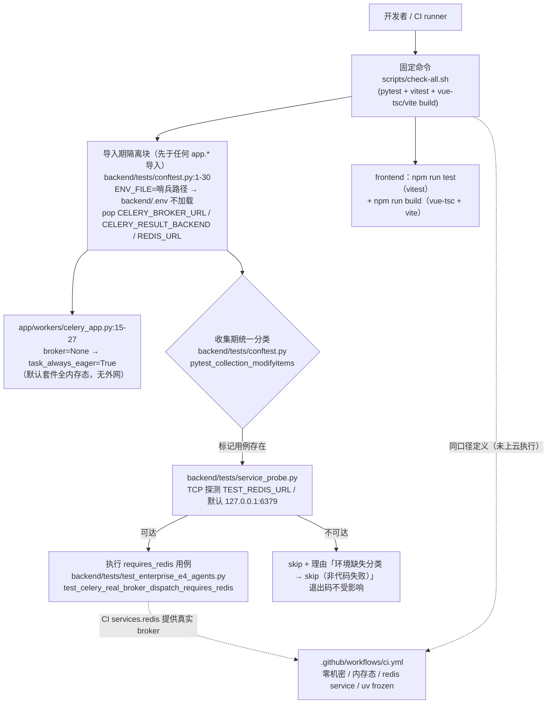

# OPT-05 测试环境与 CI 稳定性

> 状态：DONE（2026-10-15）· 对应任务：OPT-05 · 证据目录 `docs/project-development/assets/opt05/`
> 关联代码：`backend/tests/conftest.py`、`backend/tests/service_probe.py`、`backend/pyproject.toml`、
> `backend/tests/test_opt05_service_classification.py`、`backend/tests/opt05_marked_demo.py`、
> `backend/tests/test_enterprise_e4_agents.py`、`scripts/check-all.sh`、`.github/workflows/ci.yml`

## 1. 目标、范围与前缀依赖

**目标**（OPT-05 验收口径）：

1. Redis / Celery 依赖可重复隔离——默认测试套件不依赖本机任何外部服务；
2. 服务缺失与代码失败可区分——依赖真实服务的用例在服务不可达时**显式 skip 并标注分类**，绝不把环境问题伪装成代码失败，也绝不把代码失败吞成 skip；
3. 固定后端 / 前端 / 类型检查 / 生产构建命令，本地与 CI 同一口径；
4. CI 定义不依赖本地状态、机密与生产地址（不读 `.env`、无密钥、无生产端点）。

**非目标（本项不做）**：不在本机/CI 空口承诺真实 Redis、MySQL、Milvus 的服务可用性；不在云端 runner 实际执行 CI（需显式授权后另行确认）；不改动业务代码与既有用例语义。

**前缀依赖**：OPT-01/OPT-02/OPT-03 证据中一直对 `test_celery_task_registered_and_submit_dispatch` 采用 `--deselect` 约定（"Redis Celery 项归 OPT-05"），本项即该欠账的收口。

## 2. 缺陷定位（修复前，本会话真实复现）

`backend/.env` 中含有 `CELERY_BROKER_URL=redis://127.0.0.1:6379/0`。`app/core/runtime_config.py`
在模块导入时执行 `_load_env_file()` 把 `.env` 注入 `os.environ`；`app/workers/celery_app.py`
在导入时读取该值绑定 broker，并据此把 `task_always_eager` 置为 `False`。结果：

- 整套 pytest 进程在**导入期**就被悄悄绑定到本机 Redis；
- 本机 Redis 未启动时，`enterprise_agent_execute.delay()` 真实发起 TCP 连接并抛错：

```text
# 修复前复现（真实执行）：
#   cd backend && .venv/Scripts/python.exe -m pytest
#   "tests/test_enterprise_e4_agents.py::test_celery_task_registered_and_submit_dispatch" -q
E   kombu.exceptions.OperationalError: Error 10061 connecting to 127.0.0.1:6379.
    由于目标计算机积极拒绝，无法连接。
FAILED tests/test_enterprise_e4_agents.py::test_celery_task_registered_and_submit_dispatch
# 本机 TCP 探测：redis 6379 unreachable
```

同一份 `.env` 还把 `DATABASE_URL`、`MILVUS_URI`、`GITEE_TOKEN`、`LLM_API_KEY`、`ZHIPU_API_KEY`
等本地机密/生产地址带入测试进程——测试结果因此随"谁的本机、装没装服务"漂移，CI 天然不可复现。

## 3. 主链路（Mermaid，含源码位置）



## 4. 关键代码说明

| 文件 | 说明 |
| --- | --- |
| `backend/tests/conftest.py` | 文件顶层（`from app import main` 之前）设置 `ENV_FILE` 指向永不存在的哨兵路径 `.env.hermetic-nonexistent`，并 `pop` `CELERY_BROKER_URL`/`CELERY_RESULT_BACKEND`/`REDIS_URL`——保证 `celery_app` 导入即 eager、测试进程零 `.env` 泄漏。`pytest_collection_modifyitems` 对 `requires_redis` 标记用例做收集期探测：不可达即加 skip 标记并给出脱敏理由（仅 `host:port`）。autouse fixture 追加 `delenv` 两项 Celery 变量做纵深防御。 |
| `backend/tests/service_probe.py` | 探测与地址解析纯函数：`redis_broker_url()`（`TEST_REDIS_URL` 优先，默认 `redis://127.0.0.1:6379/0`）、`tcp_reachable()` / `redis_reachable()`、`target_label()`（脱敏输出 `host:port`，不含凭据）。 |
| `backend/pyproject.toml` | `markers` 注册 `requires_redis`（附分类说明）；`addopts = "--strict-markers"` 防止后续拼错标记被静默忽略。 |
| `backend/tests/test_enterprise_e4_agents.py` | `test_celery_task_registered_and_submit_dispatch` 用例内显式锁定 `task_always_eager=True`/`broker_url=None`（monkeypatch 自动还原），不再受本机 broker 影响；新增 `@pytest.mark.requires_redis` 的 `test_celery_real_broker_dispatch_requires_redis`：broker 可达时 `PING` + `apply_async` 投递到本用例专属队列 `opt05.requires_redis.probe` 并校验 `LLEN`，结束后只删除该唯一队列键（不动 broker 其它数据）。 |
| `backend/tests/test_opt05_service_classification.py` | 回归测试：隔离断言（ENV_FILE 哨兵、无 broker、celery 导入即 eager）、探测函数正/反分支（真实 TCP：监听端口可达 / 关闭端口不可达、URL 凭据脱敏）；两个子进程用例真跑 `pytest` 验证分类双向行为。 |
| `backend/tests/opt05_marked_demo.py` | 分类演示用例（文件名不匹配 `test_*.py`，默认套件不收集），仅供子进程显式指定运行。 |
| `scripts/check-all.sh` | 固定检查命令（见 §5）；脚本进程内显式声明隔离环境并 `unset` 机密/生产变量（只影响脚本子进程，不影响使用者 shell）。 |
| `.github/workflows/ci.yml` | CI 定义（见 §5）；backend job 提供 `redis:7-alpine` service 使 `requires_redis` 用例真实执行；frontend job 跑 vitest + vue-tsc + vite build。 |

## 5. 固定命令（本地 / CI 同口径）

```bash
# 全量固定命令（根目录，任意 shell）
bash scripts/check-all.sh                # 后端 pytest -q -rs + 前端 vitest + vue-tsc/vite build
bash scripts/check-all.sh --backend-only
bash scripts/check-all.sh --frontend-only

# 等价的单条命令（用于排障/局部复跑；隔离由 conftest 保证）
cd backend && .venv/Scripts/python.exe -m pytest -q -rs      # Windows
cd backend && .venv/bin/python -m pytest -q -rs              # Linux/macOS
cd frontend && npm run test && npm run build                 # vitest + 类型检查/生产构建

# 可选：本机启动任意 Redis（默认端口 6379）后直接重跑，requires_redis 用例自动转为真实执行；
# 或显式指定：export TEST_REDIS_URL=redis://host:port/0
```

CI 口径（`.github/workflows/ci.yml`）：backend 用 `uv sync --frozen` + `uv run python -m pytest -q -rs`
（`services.redis` 提供真实 broker、`ENV_FILE`/`USE_*` 与本地同值），frontend 用 `npm ci && npm run test && npm run build`；
全程无 secrets、无生产地址。**该 workflow 尚未在云端 runner 执行过（需仓库托管方显式授权后生效）。**

## 6. 测试证据（全部本会话真实执行）

```text
# 1) 修复前复现（见 §2）：单测真连 127.0.0.1:6379 → kombu OperationalError 10061 FAILED

# 2) 修复后 · OPT-05 专项 + Celery 投递（-q -rs）
#    7 passed, 1 skipped in 17.31s
#    SKIPPED [1] tests\test_enterprise_e4_agents.py:526: requires_redis: broker 不可达
#      （127.0.0.1:6379，TCP 探测超时 0.6s）——环境缺失分类 → skip（非代码失败）
#    （7 passed 中两个子进程用例分别证明：不可达→"1 skipped"+环境缺失理由；可达→"1 passed" 真执行）
#    证据文件：docs/project-development/assets/opt05/opt05_classification_focus.txt

# 3) 全量后端（固定命令 bash scripts/check-all.sh --backend-only，cwd=仓库根）
#    → 890 passed, 17 skipped, 4 warnings in 886.55s (0:14:46)，exit 0，CHECK-ALL: OK
#    17 skipped 全部为显式环境门控/服务缺失分类，无一条代码失败：
#      MYSQL_TEST_URL 未配置 ×8、Milvus 不可用/未开启 ×5、MILVUS_STANDALONE_TEST ×1、
#      GITEE_E2E/PR 未开启 ×2、requires_redis（环境缺失分类）×1
#    证据文件：docs/project-development/assets/opt05/opt05_backend_pytest_full.txt

# 4) 前端（固定命令 bash scripts/check-all.sh --frontend-only）
#    vitest：Test Files 31 passed (31)、Tests 272 passed (272)
#    vue-tsc -b + vite build：✓ built in 25.85s；CHECK-ALL: OK，exit 0
#    证据文件：docs/project-development/assets/opt05/opt05_frontend_test_build.txt
```

分类机制的自证（子进程真跑 pytest，非空想）：

| 场景 | TEST_REDIS_URL | 结果 | 断言 |
| --- | --- | --- | --- |
| 服务缺失 | `redis://127.0.0.1:9/0`（关闭端口） | `1 skipped` | 输出含 `requires_redis` 与「环境缺失」，退出码 0（≠失败） |
| 服务可达 | `redis://127.0.0.1:<临时监听端口>/0` | `1 passed` | 演示用例真被执行（stdout 出现 `OPT05_MARKED_DEMO_EXECUTED`） |

## 7. 真实运行证据

- `assets/opt05/opt05_backend_pytest_full.txt`：全量 890 passed / 17 skipped / 4 warnings（886.55s），含逐条 skip 分类。
- `assets/opt05/opt05_classification_focus.txt`：专项 7 passed / 1 skipped，含 requires_redis 的脱敏 skip 理由。
- `assets/opt05/opt05_frontend_test_build.txt`：vitest 272 passed + 生产构建通过。

## 8. 联调注意点

1. **真实服务显式 opt-in，不再靠 `.env` 暗渡**：测试进程不读 `backend/.env`；需要真实 MySQL/Milvus/Gitee E2E 时在 shell 显式导出对应变量（`MYSQL_TEST_URL`、`MILVUS_STANDALONE_TEST`+`MILVUS_URI`、`GITEE_E2E`+`GITEE_TOKEN` 等），相关用例的自行 skip 门控保持不变。
2. **Celery 导入期绑定**：`celery_app` 的 broker/eager 在首次导入时冻结（`app/workers/celery_app.py:15-27`）。测试内不要依赖环境变量改变它，需按用例 monkeypatch `celery_app.conf`（参考 §4 两个用例）；uvicorn / celery worker 的真实运行不受影响，仍正常读 `.env`。
3. **新增外部服务依赖必须先注册标记**：`--strict-markers` 下未注册标记直接报错；新标记（如未来的 `requires_mysql`）应同时在 `pyproject.toml` 与 conftest 分类钩子里登记。
4. **`scripts/check-all.sh` 的 `unset` 只作用于脚本子进程**，不会污染你的 shell 环境；CI 与本地因此天然同口径。
5. **skip ≠ 通过**：分类原则是不可达才 skip、代码错误必须 fail；如发现 requires_* 用例在服务可达时失败，属代码失败，照常红。

## 9. 复盘与边界（如实声明）

- **已验证**：默认套件与 `.env`/Redis/机密完全解耦（导入期断言 + 全量 890 passed 无外服依赖）；`requires_redis` 分类双向行为（子进程真跑证明）；修复前缺陷可复现、修复后定向与全量均绿；前端固定命令全绿。
- **未在本机执行**：`test_celery_real_broker_dispatch_requires_redis` 的真实 Redis 正向路径——本机未安装 Redis，Docker CLI 存在但 daemon 未运行（`docker ps` 超时），为避免引入外部依赖未拉起容器。该用例在 CI 定义中由 `services.redis` 覆盖；本地可用任意 Redis 或 `TEST_REDIS_URL` 验证。当前它被**如实标记为环境缺失 skip**。
- **未在云端执行**：`.github/workflows/ci.yml` 为定义 + 本地等价命令已验证，尚未在云端 runner 运行（需要仓库托管方授权/推送触发）——不宣称 CI 已通过。
- 本项不改业务逻辑；`--deselect` 旧约定废除，OPT-01..03 记录中的 "1 deselected（Redis Celery 项归 OPT-05）" 已由本项收口。
