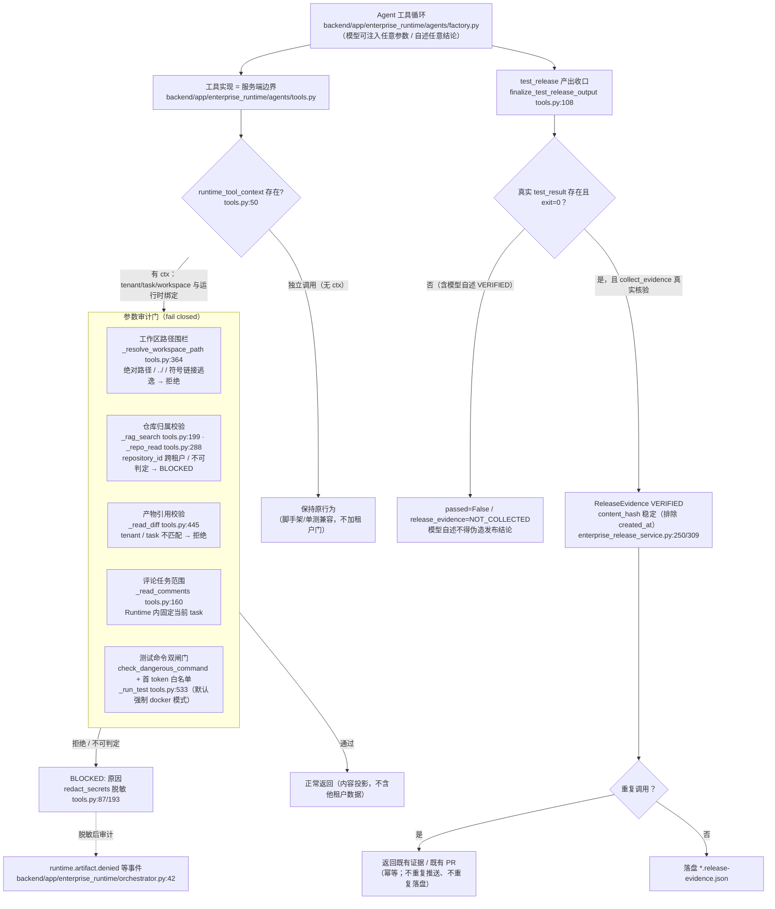

# OPT-06 Agent 工具安全回归

> 状态：DONE（2026-10-15）· 对应任务：OPT-06 · 证据目录 `docs/project-development/assets/opt06/`
> 关联代码：`backend/app/enterprise_runtime/agents/tools.py`（六维边界修复主体）、
> `backend/app/enterprise_runtime/agents/executor.py`（产物投影确定性，跨项修复见 §9）、
> `backend/app/services/enterprise_release_service.py`（证据指纹稳定化）、
> `backend/tests/test_opt06_agent_tool_security.py`（25 用例）、
> `backend/tests/test_opt03_e2e_demo.py`（顺序稳定性回归）

## 1. 目标、范围与六个安全维度

**目标**（OPT-06 验收口径）：「Agent 工具安全回归 — 覆盖注入、跨租户参数篡改、路径越权、超时重试、重复副作用与凭据脱敏」。
测试对象是 E4 真实工具层（`app/enterprise_runtime/agents/tools.py`）的**服务端边界**：即使模型
（真实 LLM 或 deterministic 桩）在参数里注入越权值、在输出里自述虚假成功，服务端也必须按真实
工具结果与运行时上下文（tenant/task/workspace）裁决，不可判定一律 **fail closed（BLOCKED）**。

| # | 维度 | 边界规则 | 对应用例（`test_opt06_agent_tool_security.py`） |
| --- | --- | --- | --- |
| 1 | 注入 | `run_test` 命令双闸门：危险命令正则（`rm -rf /`、管道进 shell、curl/wget）+ 首 token 白名单；模型自述不得覆盖真实测试/证据结果 | `test_run_test_blocks_dangerous_compound_command_despite_allowlisted_first_token`、`test_run_test_blocks_pipe_to_shell_and_non_allowlisted_command`、`test_model_cannot_claim_pass_when_real_test_failed`、`test_model_cannot_self_assert_verified_release_evidence` |
| 2 | 跨租户参数篡改 | 模型传入的 `repository_id` / artifact ref / task ref 一律与 runtime ctx 比对；跨租户、跨任务、不可判定 → BLOCKED，绝不返回他租户内容 | `test_rag_search_rejects_cross_tenant_repository`、`test_rag_search_allows_same_tenant_repository`、`test_repo_read_rejects_cross_tenant_repository`、`test_repo_read_empty_repository_id_stays_within_tenant`、`test_repo_read_fails_closed_for_unowned_repository`、`test_read_diff_rejects_cross_tenant_and_cross_task_artifacts`、`test_read_diff_allows_same_task_artifact`、`test_read_comments_is_scoped_to_current_task_in_runtime` |
| 3 | 路径越权 | 工作区读写 `resolve + containment`：绝对路径、`../`、符号链接逃逸一律拒绝；未配置工作区 BLOCKED | `test_workspace_read_blocks_parent_traversal`、`test_workspace_read_blocks_absolute_path_outside_root`、`test_workspace_read_allows_file_inside_root`、`test_workspace_write_blocks_parent_traversal_and_keeps_files_inside`、`test_workspace_tools_blocked_without_configured_root` |
| 4 | 超时重试 | runner 超时（exit 124）/不可用/异常不得升级为成功；默认环境必须 docker 隔离模式；不缓存成功 | `test_run_test_timeout_stays_failed_and_never_fakes_success`、`test_run_test_runner_exception_leaves_no_partial_success_state`、`test_run_test_requires_docker_mode_in_default_env` |
| 5 | 重复副作用 | `draft_pr` / `collect_evidence` 同一 task 幂等：重复调用返回既有 PR/证据，不重复推送、不重复落盘 | `test_draft_pr_tool_is_idempotent_and_returns_same_pr`、`test_collect_evidence_is_gated_by_real_results_and_idempotent` |
| 6 | 凭据脱敏 | BLOCKED / 错误 / 测试输出不回显 token、密码与带凭据连接串（URL 凭据、查询串 token、环境真实凭据值） | `test_redact_secrets_masks_url_credentials_query_tokens_and_env_values`、`test_draft_pr_error_never_leaks_token`、`test_run_test_output_redacts_known_tokens` |

**非目标（本项不做）**：不做 LLM 红队式对抗评测（属「真实模型评测」范畴，需显式 opt-in）；
不改 MCP/Semgrep 工具边界（OPT-01 已收口）；不触发真实 Gitee 写入与真实 Docker 超时（本项
全部用例内存态 + monkeypatch，零外呼）；不改前端。

## 2. 缺陷定位（修复前，TDD 红阶段真实复现）

按「先写测试确认缺口，再最小修复」执行：首轮 25 用例中 **15 failed**，逐条对应真实缺口：

| 缺口 | 现象（红阶段） |
| --- | --- |
| 工作区路径无围栏 | `_workspace_read/../secret.txt` 与绝对路径可读到工作区外文件（demo 中读到 `TOPSECRET-OUTSIDE`） |
| 仓库参数无归属校验 | `_rag_search`/`_repo_read` 直接采信模型传入的 `repository_id`，可返回其它租户仓库的代码切片 |
| 产物引用无 tenant/task 校验 | `_read_diff` 可读取其它租户、其它任务的 DiffArtifact 内容 |
| 评论范围未绑定任务 | Runtime 内 `_read_comments(ref=其它任务)` 可读到其它任务评论 |
| 模型自述覆盖真实结果 | `finalize_test_release_output` 保留模型 `passed=True`；模型可自述 `release_evidence.status=VERIFIED` |
| 证据指纹不稳定 | `write_release_evidence` 的 `content_hash` 把 `created_at` 计入哈希 → 同一组输入重复收集产生不同指纹（重复调用＝产生"新证据"） |
| 错误路径可能回显凭据 | BLOCKED / 测试输出直接透传原始文本（含 `https://oauth2:<token>@`、`?access_token=` 等） |

## 3. 主链路（Mermaid，含源码位置）



## 4. 关键代码说明

| 文件 | 说明 |
| --- | --- |
| `agents/tools.py:50` `runtime_tool_context` | 运行时上下文（task_id/run_id/tenant_id/workspace_root + `test_result`/`pr`/`evidence` 可变状态）。**所有门以 ctx 为真源**：有 ctx 才启用租户/任务/工作区围栏；无 ctx（独立工具调用）保持原行为，避免误伤脚手架与既有单测。 |
| `agents/tools.py:87` `redact_secrets` | 统一脱敏：①环境真实凭据值（`GITEE_TOKEN`/`LLM_API_KEY`/`ZHIPU_API_KEY`/`MILVUS_TOKEN`/`DATABASE_URL` 等，长度≥8 才替换避免误伤）②带凭据 URL `scheme://user:pass@` ③查询串 `access_token=…&password=…`。所有 BLOCKED 文案、`_run_test` 输出、`_draft_pr` 错误都经它出口。 |
| `agents/tools.py:108` `finalize_test_release_output` | 产出收口（约束 #10/#13）：真实 `test_result` 存在时**强制**用其 exit_code 生成 test_cases，非 0 → `passed=False` + 「真实测试未通过」；ctx 无真实 evidence 时把模型自述 `VERIFIED` 降级为 `NOT_COLLECTED` 并 `passed=False`；runner blocked/unavailable → 明确失败文案。 |
| `agents/tools.py:160` `_read_comments` | Runtime 内 `ref` 固定为 ctx 的 task_id，只回本任务评论；独立调用保留 ref 匹配语义。 |
| `agents/tools.py:199` `_rag_search` | 顺序：`reads.latest_completed_index(repository_id)` → 无已完成索引 BLOCKED → **索引租户 ≠ ctx 租户 → BLOCKED「跨租户仓库引用被拒」** → Milvus 配置门 → 检索。先做归属判定再做能力判定，避免用"索引未就绪"掩盖越权。 |
| `agents/tools.py:288` `_repo_read` | 构造 `allowed_repos`（内存 `main.REPOSITORIES` 租户匹配 ∪ DB `list_repositories(tenant_id=ctx)`）；模型传 `repository_id` 不在集合内 → BLOCKED「跨租户/未授权」；空 id → 仅跨授权仓库的切片；租户零授权 → BLOCKED。顺带修复 `getattr(...) or c.get(...)` 投影在 pydantic 记录上的 AttributeError 隐患（`_field` 取值助手）。 |
| `agents/tools.py:364` `_resolve_workspace_path` | 路径围栏纯函数：绝对路径/盘符/`\` 前缀 → 拒绝；`root/raw` resolve 后必须等于 root 或在其 parents 内（天然覆盖 `../` 与符号链接逃逸）。读写工具共用。 |
| `agents/tools.py:533` `_run_test` | 命令先过 `check_dangerous_command`（危险模式）再过白名单首 token；runner 出参整包脱敏后写入 ctx；异常 → BLOCKED 且 ctx 不残留任何可伪造成功的结果。 |
| `agents/tools.py:561/581` `_draft_pr`/`_collect_evidence` | 幂等：`create_runtime_pr` 命中既有 `.pr.json` 直接返回（不重复 push/create）；`write_release_evidence` 先校验真实 test_result(docker 且 exit=0) + 审查 + PR，未核验 BLOCKED 不落盘；重复调用同指纹。 |
| `services/enterprise_release_service.py:309` | **指纹稳定化**：`content_hash` 只覆盖可复核输入（排除 `created_at` 等易变字段），同一 diff/测试/审查/PR 组合重复收集得到同一指纹。 |
| `agents/executor.py:29` `_PROJECTION` | 产物投影容器由 `set` 改为**元组（有序声明）**：写入顺序决定 ArtifactStore/审计事件顺序，set 的跨进程迭代顺序不稳定（见 §9 跨项修复）。 |

## 5. 固定命令

```bash
cd backend
# 专项（Windows；Linux/macOS 用 .venv/bin/python）
.venv/Scripts/python.exe -m pytest tests/test_opt06_agent_tool_security.py -v -rs
# 相关既有回归（E4 Agents/Eval/MCP/Dev012/OPT-03/04/05/06）
.venv/Scripts/python.exe -m pytest tests/test_enterprise_e4_agents.py tests/test_enterprise_agent_evaluation.py \
  tests/test_enterprise_agent_evaluation_cli.py tests/test_enterprise_mcp_client.py tests/test_enterprise_mcp_server.py \
  tests/test_dev012_test_execution_module.py tests/test_opt03_e2e_demo.py tests/test_opt04_rag_report_contract.py \
  tests/test_opt05_service_classification.py tests/test_opt06_agent_tool_security.py -q -rs
# 全量（隔离口径与 OPT-05 一致：conftest 保证不读 .env、Celery eager、无外服）
.venv/Scripts/python.exe -m pytest -q -rs
```

全部用例默认内存态 + monkeypatch：不访问外部服务、不产生真实外部写入（Gitee 推送/PR 创建均为替身注入）。

## 6. 测试证据（全部本会话真实执行）

```text
# 1) 红阶段：25 用例首跑 15 failed（逐条对应 §2 缺口；绿阶段见下）

# 2) 修复后 · OPT-06 专项（-v -rs）
#    → 25 passed in 0.64s
#    证据文件：docs/project-development/assets/opt06/opt06_security_suite.txt

# 3) 相关既有回归（E4 Agents/Agent Eval/MCP/Dev012/OPT-03/04/05/06，-q -rs）
#    → 143 passed, 1 skipped in 108.91s
#    1 skipped 为 requires_redis 环境缺失分类（本机无 Redis，非代码失败）
#    证据文件：docs/project-development/assets/opt06/opt06_regression_related.txt

# 4) 全量后端（-q -rs）
#    → 916 passed, 17 skipped, 4 warnings in 853.16s (0:14:13)
#    17 skipped 与 OPT-05 基线一致（全为显式环境门控：MySQL/Milvus/Gitee/requires_redis）
#    证据文件：docs/project-development/assets/opt06/opt06_full_backend.txt

# 5) OPT-03 跨进程复现稳定性修复验证（5 连跑）
#    → 5/5 通过（修复前同命令约 6 成失败；见 §9）
```

## 7. 真实运行证据

- `assets/opt06/opt06_security_suite.txt`：专项 25 passed（6 维度逐条用例名可见）。
- `assets/opt06/opt06_regression_related.txt`：相关回归 143 passed / 1 skipped（环境缺失分类）。
- `assets/opt06/opt06_full_backend.txt`：全量后端 916 passed / 17 skipped。
- 红阶段 15 failed 为会话内 TDD 记录（修复后未保留失败快照文件，如实说明）。

## 8. 联调注意点

1. **BLOCKED 文案是契约**：`BLOCKED: <原因>` 前缀与中文关键词（「跨租户」「路径越界」「未授权」「不在测试白名单」……）被编排器 `classify_test_release_output` 与测试共同依赖；改文案需同步 `tests/test_opt06_agent_tool_security.py` 与 `test_enterprise_e4_agents.py`。
2. **ctx 决定门是否生效**：真实链路（executor 注入 `runtime_tool_context`）全门开启；独立调用不加租户门。新增工具沿用该约定，不要自造第二套上下文。
3. **fail closed 优先于「更具体的原因」**：归属不可判定（查不到仓库/索引/产物）一律按拒绝处理，不要退化为"未就绪"文案，避免越权探测被掩盖。
4. **`_PROJECTION` 必须保持有序元组**：新增产物类型时按声明顺序追加；回归由 `test_opt03_e2e_demo.py::test_artifact_projection_order_is_process_stable` 锁定。
5. **证据指纹稳定性**：`content_hash` 只允许纳入可复核输入；新增字段若含时间/随机值会重新引入「重复副作用」。
6. **脱敏的边界**：环境真实凭据替换要求值长度 ≥8（避免把 `true`/短标志误伤为 `***`）；新增长期凭据变量时同步 `_REDACT_ENV_KEYS`。
7. **真实外部写入仍逐项确认**：本项对 `draft_pr`/`collect_evidence` 的幂等验证走替身注入，真实 Gitee 推送/建 PR 不在本项执行范围。

## 9. 复盘与边界（如实声明）

- **已验证（本会话真实执行）**：六维度 25 用例红→绿；相关回归 143 passed / 1 skipped；全量后端 916 passed / 17 skipped；`_run_test` 超时 exit 124 不伪造成功（runner 层替身，两次调用均真实触达 runner）；`draft_pr`/`collect_evidence` 幂等（push/建 PR 计数=1、证据文件=1、指纹一致）；脱敏覆盖 URL 凭据/查询串/环境真实值三条路径。
- **跨项修复（OPT-03 可复现性缺陷根因，登记于本项）**：为采集 OPT-06 证据执行相关回归时，`test_opt03_e2e_demo.py::test_opt03_demo_reproducible_across_cwd` 出现约 6 成概率失败（5 连跑 3 失败）。定位：`executor.py` 的 `_PROJECTION` 是 **set 字面量且元素含 lambda**，其迭代顺序随进程级字符串 hash 随机化与 lambda 地址漂移，导致产物写入顺序跨进程不稳定 → 审计回放中被拒引用摘要顺序互换。修复：改为有序元组（`executor.py:29`），并新增结构性回归用例（`test_artifact_projection_order_is_process_stable`）。修复后同命令 5 连跑全绿；该缺陷与 OPT-06 改动无关，属 OPT-03 交付后在更高频采集下暴露的既有确定性缺口，如实记录。
- **未执行（超出本项隔离边界，未伪造）**：真实 LLM 注入对抗评测（`--allow-real-model` 范畴）；真实 Docker daemon 的超时终止路径（用例在 runner 调用层替身注入 124，真实 `docker run` 超时未复现）；真实 Gitee 写入（幂等验证为替身注入）；生产环境的工具层攻击面扫描。
- **遗留**：`_repo_read` 对 DB 仓储列表的查询在纯内存态依赖 `main.REPOSITORIES`；DB 直连场景的租户过滤复用了既有 `reads.list_repositories(tenant_id=…)`（其自身租户语义已由 E1/E2 系列回归覆盖）。
