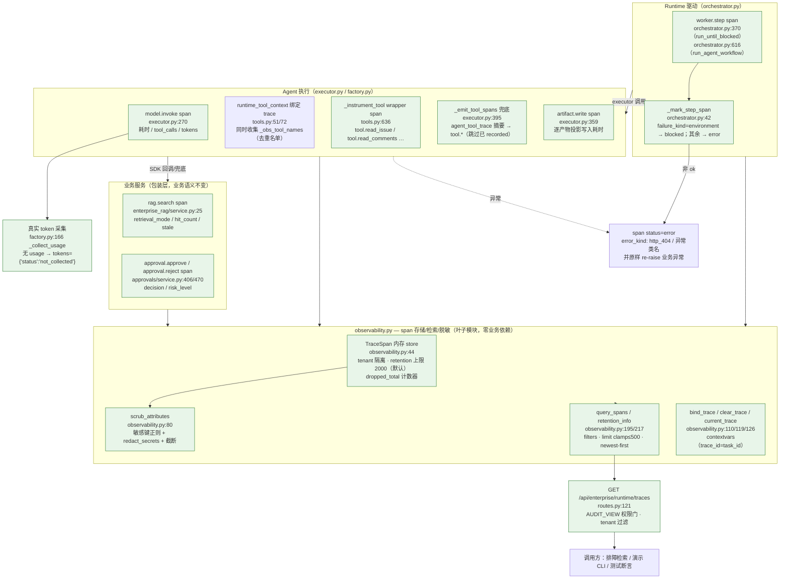

# OPT-07 Agent 全链路可观测性

> 状态：DONE（2026-10-15）· 对应任务：OPT-07 · 证据目录 `docs/project-development/assets/opt07/`
> 关联代码：`backend/app/enterprise_runtime/observability.py`（新增 trace store 主体）、
> `backend/app/enterprise_runtime/agents/executor.py`（model/artifact span + 工具兜底）、
> `backend/app/enterprise_runtime/agents/tools.py`（工具 wrapper span + trace 绑定）、
> `backend/app/enterprise_runtime/agents/factory.py`（真实模型 token 采集）、
> `backend/app/enterprise_rag/service.py`（RAG span 包装层）、
> `backend/app/approvals/service.py`（审批 span）、
> `backend/app/enterprise_runtime/orchestrator.py`（worker.step span）、
> `backend/app/enterprise_runtime/routes.py`（`GET /api/enterprise/runtime/traces` 查询接口）、
> `backend/tests/test_opt07_observability.py`（17 用例）、
> `backend/tests/test_opt07_trace_demo_cli.py`（2 用例）、
> `backend/scripts/opt07_trace_demo.py`（演示 CLI）

## 1. 目标、范围与六个可观测维度

**目标**（OPT-07 验收口径）：「Agent 全链路可观测性 — 模型、工具、RAG、审批、Worker 与产物
trace 可检索；记录耗时/Token/错误类型并验证脱敏与保留边界」。

设计原则：**新增叶子模块 + 包装层**，不改动任何既有业务语义；span 记录失败**绝不影响**被观测
调用（contextmanager 仅 re-raise 业务异常，自身不吞不抛）；全部内存态、默认确定性环境、
零外部写入。

| # | 维度（category） | 埋点位置 | 记录内容 |
| --- | --- | --- | --- |
| 1 | `model` | `executor.py:270` `model.invoke` | agent_type/run_id/attempt/repair_round/provider/input_refs、耗时、`tool_calls`、**真实 token**（`factory.py:166` `last_usage`；确定性桩诚实记录 `{"status":"not_collected"}`） |
| 2 | `tool` | `tools.py:636` `_instrument_tool` wrapper（真实执行时）+ `executor.py:395` `_emit_tool_spans` 兜底（仅摘要） | 工具名/run_id/来源（`wrapper` / `agent_tool_trace`）、耗时；两路去重（`_obs_tool_names`）避免重复 span |
| 3 | `rag` | `enterprise_rag/service.py:25` `enterprise_rag_search` 包装层 | repository_id/project_id、retrieval_mode/hit_count/stale；异常记录 `error_kind`（如 `http_404`） |
| 4 | `approval` | `approvals/service.py:406/470` approve/reject 包装 | approval_id/actor_id/operation/risk_level、decision（approved/rejected） |
| 5 | `worker` | `orchestrator.py:370/616` `worker.step`（`run_until_blocked` 与 `run_agent_workflow` 双路径） | step_id/step_name/agent_type/worker_id/workflow_version；失败按 `failure_kind` 落 error/blocked |
| 6 | `artifact` | `executor.py:359` `artifact.write`（逐产物投影） | artifact_id/artifact_type/agent_type/run_id，写入时长 |

**检索与保留**：`GET /api/enterprise/runtime/traces`（按 trace_id/category/status 过滤、
limit/offset 分页、newest-first）；租户隔离按 `tenant_id` 过滤；保留上限
`OBSERVABILITY_MAX_SPANS`（默认 2000，超出丢最旧并累计 `dropped_total`）。

**脱敏与误报边界**：所有 span attributes 出口统一 `scrub_attributes`（敏感键名正则打码 +
`redact_secrets` 环境真实凭据替换 + 300 字符截断 + 深度 4/列表 50 上限）；Token **只记录真实
采集值**，采集不到时写 `not_collected`，绝不估算/伪造。

**非目标（本项不做）**：不做跨进程/持久化 trace（生产用 APM 才是终态，本项为运行时内存
可观测层）；不做前端 trace 页面（接口就绪，UI 属后续项）；不接真实 LLM token 计费验证
（`--allow-real-model` 范畴，未执行）；不引入 OpenTelemetry SDK 等新依赖。

## 2. 主链路（Mermaid，含源码位置）



## 3. 关键代码说明

| 文件 | 说明 |
| --- | --- |
| `observability.py:44` `TraceSpan` | span 数据模型：span_id/trace_id/tenant_id/category/name/status(ok\|error\|blocked)/error_kind/duration_ms/attributes/tokens/created_at。六个 category 常量在 `observability.py:25` 统一声明。 |
| `observability.py:168` `span()` | 核心 contextmanager：无显式 trace 时继承 contextvar 环境 trace；异常 → `status=error` + `error_kind`（HTTPException → `http_{code}`，其余 → 异常类名）后 **re-raise**；成功 → 记录耗时落库。 |
| `observability.py:80` `scrub_attributes` | 出口统一脱敏：键名命中 `token/secret/password/apikey/authorization/cookie/credential/...` 正则 → 值打码；字符串走 `redact_secrets`（复用 OPT-06 的环境凭据替换）后截断 300 字符；dict 深度≤4、list 前 50 项。 |
| `observability.py:195` `query_spans` | 租户内过滤（trace_id/category/status），newest-first（`reversed`），limit clamp `[1,500]`、offset≥0；`retention_info()` 附 `by_category` 计数供演示/接口返回。 |
| `agents/tools.py:51/72` `runtime_tool_context` | 既有运行时上下文上叠加 `obs.bind_trace(trace_id=task_id, tenant_id=…)`，退出时 `clear_trace`；state 内新增 `_obs_tool_names` 集合，记录哪些工具是经 wrapper 真实执行的（供 executor 兜底去重）。 |
| `agents/tools.py:636` `_instrument_tool` | 用 `StructuredTool.model_copy(update={"func": wrapped})` 给工具加轻量 wrapper：仅在存在环境 trace 时发 `tool.{name}` span（耗时来自真实调用），并把工具名记入 `_obs_tool_names`；独立调用（无 ctx）行为与耗时开销均不变。 |
| `agents/executor.py:270/302` `model.invoke` span | 包住「runtime_tool_context + 工具循环 + 输出 schema 校验」；`tokens` 取 `backend.last_usage`，无 → `{"status":"not_collected"}`；`tool_calls` 记录本轮工具调用数。 |
| `agents/executor.py:395` `_emit_tool_spans` | 兜底路径：从 LangChain 消息的 `tool_trace` 摘要补发 `tool.*` span（`source=agent_tool_trace`，仅有摘要耗时），`name in recorded_tools` 时跳过 —— 与 wrapper 真实 span 去重。 |
| `agents/factory.py:166` `_collect_usage` | 真实模型链路从 `AIMessage.usage_metadata` 提取 input/output/total tokens（三者齐全才记录，否则视为未采集）；`last_usage` 挂在 `_RealLangchainAgent` 实例上供 executor 读取。 |
| `enterprise_rag/service.py:25` | 公开入口 `enterprise_rag_search` 变为包装层（原实现改名 `_search_impl` 内部函数）：发 `rag.search` span，从返回结果回填 `retrieval_mode/hit_count/stale`；全部既有调用方（routes/evaluation/CLI）零改动。 |
| `approvals/service.py:406/470` | approve/reject 的权限检查保持在外层（未获权限不产生 span、不落审计）；span 包住 `_approve_locked/_reject_locked`，成功后回填 `operation/risk_level/decision`。 |
| `orchestrator.py:42/370/616` | `worker.step` span 包住步骤执行器调用：`_mark_step_span` 按 `failure_kind` 覆写 status（`environment` → blocked，其余 → error）与 `error_kind`，成功保持 ok。 |
| `routes.py:121` | `GET /api/enterprise/runtime/traces`：`AUDIT_VIEW` 权限门（developer 403；auditor/tenant_owner 可用），返回 spans + retention + filters。 |
| `tests/conftest.py:87` | 自动 reset fixture 追加 `observability.reset_store()`，保证用例间 span 零串扰。 |

## 4. 固定命令

```bash
cd backend
# 演示 CLI（隔离环境自强制：确定性 provider、无 DB/Celery；输出证据 JSON）
.venv/Scripts/python.exe scripts/opt07_trace_demo.py --out ../docs/project-development/assets/opt07/opt07_trace_evidence.json

# 专项（Windows；Linux/macOS 用 .venv/bin/python）
.venv/Scripts/python.exe -m pytest tests/test_opt07_observability.py tests/test_opt07_trace_demo_cli.py -v -rs

# 相关既有回归（触达模块上下游：E4 Agents/OPT-03/OPT-06/E3-02/E3-04/E2/OPT-07×2）
.venv/Scripts/python.exe -m pytest tests/test_enterprise_e4_agents.py tests/test_opt03_e2e_demo.py \
  tests/test_opt06_agent_tool_security.py tests/test_enterprise_e3_02_rig.py \
  tests/test_enterprise_e3_04_evaluation.py tests/test_enterprise_e2_governance.py \
  tests/test_opt07_observability.py tests/test_opt07_trace_demo_cli.py -q -rs

# 全量（隔离口径与 OPT-05/06 一致：conftest 保证不读 .env、Celery eager、无外服）
.venv/Scripts/python.exe -m pytest -q -rs
```

全部用例默认内存态 + monkeypatch：不访问外部服务、不产生真实外部写入（审批走 E2 服务内存态、
RAG 走 BM25 内存索引、模型走 deterministic 桩）。

## 5. 测试证据（全部本会话真实执行）

```text
# 1) TDD 红阶段：首跑 16 failed（observability 模块不存在，ImportError 全覆盖）
#    最小实现后 16 passed；补「wrapper/兜底去重」用例 → 17 passed
#    （期间用例文件一次编辑破坏已当场修复复跑；属实现过程记录，未改产品代码）

# 2) OPT-07 专项（-v -rs）
#    → 19 passed in 19.26s
#    证据文件：docs/project-development/assets/opt07/opt07_focused_suite.txt

# 3) 相关既有回归（E4 Agents/OPT-03/OPT-06/E3-02/E3-04/E2/OPT-07×2，-q -rs）
#    → 139 passed, 1 skipped in 60.66s (0:01:00)
#    1 skipped 为 requires_redis 环境缺失分类（本机无 Redis，非代码失败）
#    证据文件：docs/project-development/assets/opt07/opt07_regression_related.txt

# 4) 演示 CLI（隔离环境，self-forcing）
#    → OPT-07 demo: trace=opt07_demo_trace spans=29 categories=[approval, artifact, model, rag, tool, worker] checks=13/13
#    证据文件：docs/project-development/assets/opt07/opt07_trace_demo_console.txt
#             docs/project-development/assets/opt07/opt07_trace_evidence.json

# 5) 全量后端（-q -rs）
#    → 935 passed, 17 skipped, 4 warnings in 831.13s (0:13:51)
#    证据文件：docs/project-development/assets/opt07/opt07_full_backend.txt（详见 §5.1）
```

### 5.1 全量回归（OPT-06 基线对照）

```text
# 全量后端（-q -rs）→ 935 passed, 17 skipped, 4 warnings in 831.13s (0:13:51)
# 对照 OPT-06 基线（916 passed / 17 skipped）：916 + 19（OPT-07 新增用例）= 935 passed，无失败
# 17 skipped 与基线同分类（全为显式环境门控）：
#   MySQL 8（mysql_integration 6 + dev019/dev021 2）· Milvus 6（realtime 4 + standalone 1 + parse_chain 1）
#   Gitee 2（pr_creation / gitee_e2e_live）· requires_redis 1（E4 Agents）
# 证据文件：docs/project-development/assets/opt07/opt07_full_backend.txt
```

## 6. 真实运行证据

- `assets/opt07/opt07_trace_evidence.json`：演示报告全文 —— 单一 trace `opt07_demo_trace`
  串联 6 类共 29 个 span（model 6 / artifact 11 / worker 6 / tool 3 / rag 2 / approval 1；
  ok 28 + error 1），13/13 checks 全过，`retention={max:2000, count:29, dropped:0}`。
- `assets/opt07/opt07_trace_demo_console.txt`：CLI 控制台输出（checks=13/13、六类 category 清单）。
- 关键诚实性证据（来自该 JSON）：
  - `model_span.tokens = {"status": "not_collected"}` —— 确定性桩诚实记录未采集，未伪造 token 数；
  - `error_span = {name: "rag.search", status: "error", error_kind: "http_404"}` —— 错误类型可检索；
  - `redaction_enforced=true` —— `GITEE_TOKEN` 注入假凭据后，证据 JSON 全文不含该值（含嵌套 attributes 与 URL 场景）；
  - `approval_gate_held=true` + `approval_span={decision: "approved"}` —— 审批门现场证据与 span 记录对齐。
- `assets/opt07/opt07_focused_suite.txt` / `opt07_regression_related.txt`：专项与相关回归实测输出。
- `assets/opt07/opt07_full_backend.txt`：全量后端实测输出（见 §5.1）。

## 7. 联调注意点

1. **`tokens` 语义是契约**：只有真实采集到 usage 才写数值；确定性桩/未知后端一律
   `{"status":"not_collected"}`。任何消费方（UI/报表）必须显式处理该状态，**不要把
   `not_collected` 折算为 0**。
2. **span 失败绝不影响业务**：`span()` 内部捕获自身记录异常（脱敏/storage）但**不吞业务
   异常**；被观测代码路径的异常照常 re-raise（`error_kind` 已落库）。新增埋点沿用该约定。
3. **两路工具 span 是去重关系不是二选一**：wrapper（真实执行、真实耗时、`source=wrapper`）优先；
   `agent_tool_trace` 兜底仅在无环境 trace 或工具绕过 wrapper 时补摘要。判重依据是
   `_obs_tool_names`，新增工具走 `build_tools` 即自动入册。
4. **RAG span 走包装层而非路由内**：`enterprise_rag_search` 是唯一公开入口，内部实现已改名
   `_search_impl`；新增调用方必须调用公开入口，否则丢失 rag span。
5. **保留上限与租户隔离**：`OBSERVABILITY_MAX_SPANS` 控制单进程内存上限（默认 2000，
   丢最旧 + `dropped_total` 计数）；`query_spans`/接口都强制 tenant 过滤，跨租户查询
   在接口层由 `AUDIT_VIEW` + `_ctx(user)` 双门保证。
6. **`error_kind` 口径**：HTTPException → `http_{code}`（如 `http_404`/`http_403`），其余为
   异常类名（如 `RuntimeError`）；worker 失败按 `failure_kind` 映射（`environment` → blocked）。
   查错时用 `status=error|blocked` 过滤即可定位。
7. **演示 CLI 是隔离自证据**：`_force_isolated_env()` 会把敌对环境变量（`AGENT_PROVIDER=langchain`、
   敌意 DB/Celery/Token）强制覆写为确定性/内存态后才建 store；子进程用例锁定该行为不回归。
8. **前端接入契约**：`GET /api/enterprise/runtime/traces` 需 `audit:view` 权限；返回
   `{code:0, data:{spans:[...], retention:{...}, filters:{...}}}`，spans 为
   `model_dump(mode="json")`（时间 ISO 字符串）。无权限返回 403 TenantDenied 结构。

## 8. 复盘与边界（如实声明）

- **已验证（本会话真实执行）**：专项 19 passed/19.26s；相关回归 139 passed/1 skipped/60.66s；
  演示 CLI 13/13 checks、单 trace 29 spans、六类 category 全覆盖、耗时/错误类型/脱敏/保留
  四项边界逐项有断言与证据；TDD 红（16 failed ImportError）→ 绿（17→19 passed）过程真实。
- **跨项修复**：演示 `durations_recorded` 检查首跑 11/13 —— 自检发现：一是检查式里漏写
  `all()`（裸生成器恒真），二是红脱敏探针 span（`tool.redaction_probe`，无耗时语义）混入
  工具耗时断言；修正断言口径后 13/13。属演示脚本自身缺陷，未改产品代码。
- **未执行（超出本项隔离边界，未伪造）**：
  - 真实 LLM 的 token 采集端到端验证（需 `--allow-real-model` + 真实 API key，属外呼，
    未执行；`_collect_usage` 的解析逻辑由单测桩覆盖字段映射）；
  - 生产 APM/持久化 trace 后端（本项为内存态可观测层，跨进程检索需后续接入）；
  - 高并发下的 retention 竞争压测（`dropped_total` 与丢最旧逻辑由单测覆盖，未做线程级压测）。
- **遗留**：跨租户隔离在内存 store 层以 tenant_id 过滤实现；如果未来接入持久化后端，
  `query_spans` 的租户过滤语义需要在新后端上重新验证（登记为集成注意点）。

## 9. FIX-03 整改衔接（2026-10-18）

本项原先的「内存态、跨进程不可见」已由 FIX-03 修复：span 在持久化开启时写
`enterprise_runtime_trace_spans`（`backend/app/db/shared_stores.py` 的
`insert_trace_span` / `load_trace_spans` / `trace_retention_info`），API 查询直接回读共享真源；
租户过滤、属性脱敏、`OBSERVABILITY_MAX_SPANS` 保留上限和 `dropped_total` 语义保持不变。
独立 Worker 写入 → API 查询、跨租户不可见、敏感值脱敏、超限淘汰均由
`backend/tests/test_fix03_observability_persistence.py` 覆盖。默认本地/测试路径仍是内存态。
详见 `docs/project-development/129-fix-runtime-shared-state-closure.md`。
