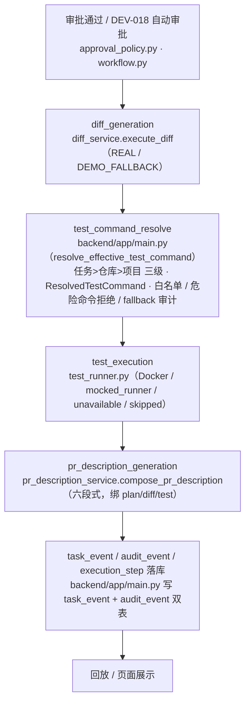
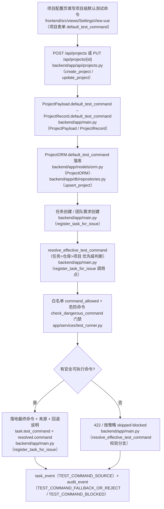

# Diff、测试和 PR 描述自动生成 —— 测试执行

> 与 `11-diff-generation-and-display.md`、`13-pr-description.md` 统一口径。本卷聚焦测试执行。

## 功能目标

本模块在 Diff 生成后执行任务验证，并把结果回写给任务详情、Diff 页面与任务回放。系统现在优先走真实 Docker Runner；Docker 不可用时如实标记 `unavailable/skipped`，不冒充 `mocked_runner` 或真实通过。

核心目标：

- 只有 `DIFF_GENERATED` 或 `TEST_FAILED` 的任务能触发测试，其余 `409`。
- 测试命令来源为**任务 > 仓库 > 项目**三级（见下），前端不能随手传命令绕过；任何来源都过仓库白名单 + 危险命令门禁。
- 危险命令先拦截并落库为 `skipped` 记录，不进入 Runner。
- 结果记录命令、退出码、stdout、stderr、状态、耗时、尝试次数、`runner_mode`。
- 失败可有限重试，超上限进入 `FAILED` 终态；测试失败不覆盖已有 Diff。
- 每次执行写 `task_event` + `audit_event` + `execution_step`，回放可追踪。

## 主流程



本卷负责 `C → D → F` 一段：命令解析与白名单 → 真实/降级执行 → 结果与审计落库。

## 执行门禁

- **未生成 Diff 不能测试**：任务非 `DIFF_GENERATED`/`TEST_FAILED`、或没有最新成功 Diff，返回 `409`。
- **命令来源统一过白名单**：以任务命令为准（创建任务时经 `resolve_effective_test_command` 三级来源解析并保存最终命令）；未命中仓库 `command_whitelist` 且仓库开启回退时，回退仓库默认命令；仓库无安全默认时回退项目默认命令；任何来源最后都过 `command_allowed`。
- **危险命令拦截**：`check_dangerous_command` 先拦截 `rm -rf`、`curl|sh`、`Invoke-WebRequest|iex` 等高危片段，写 `blocked_reason` + `TEST_BLOCKED` 事件；解析阶段命中即 `422`（message 含「白名单」），永不 fallback 绕过到低层级。
- **Docker 不可用如实标记**：不可用/daemon 不可用/超时统一记 `unavailable/skipped`，不写 `passed`，不伪装 `mocked_runner`。

## 核心能力

### 命令解析与白名单（任务 > 仓库 > 项目 三级）

- 命令来源优先级与回退：任务级 → 仓库默认（仅当仓库 `test_command_fallback=true`）→ 项目默认（仓库无安全默认时）；统一入口 `backend/app/main.py（resolve_effective_test_command）` 返回 `ResolvedTestCommand(command/source/warnings)`，落地任务 `test_command`。
- 任意层级命令都必须命中仓库白名单；仓库/项目默认命令自身含危险操作同样拒绝（`422`），不得以「项目级无需校验」绕过。
- 结果同时记录 `command` 与回退告警（source=repository/project 时的 warnings），前端如实展示最终命令与来源。

### Runner 优先级与降级（Docker / mock / unavailable / skipped 的区别）

- **Docker**：`TEST_RUNNER_MODE=docker` 时 `DockerRunner` 在独立临时目录构造隔离工作区 → `docker run --rm` 真实执行，记录真实 `exit_code/stdout/stderr/duration`；容器退出后清理临时目录（test_runner.py）。
- **mock（mocked_runner）**：`TEST_RUNNER_MODE=mock`/默认仅用于 MVP/dev 演示，结果必须在 `runner_mode=mocked_runner` 字段如实标注，页面不冒充真实。
- **unavailable**：Docker CLI 未装 / daemon 不可用 / 探测或执行超时 → `runner_mode=unavailable`，记为 `skipped` 并写 `TEST_RUN_UNAVAILABLE` 事件，任务回到可重试态，不伪装成功。
- **skipped**：危险命令被拦截（`TEST_BLOCKED`，写 `blocked_reason`）或环境不可用（`unavailable`）的统一落库状态；与 `failed`（真实执行 exit!=0）严格区分。

### 项目级命令失败时的处理

- 解析阶段：项目级命令命中危险命令 → `422`「未通过白名单（含危险操作），禁止执行」；不在白名单 → `422` 提示先配置白名单内默认命令。均不执行、不 fallback。
- 执行阶段：若落库后的项目级命令经第二道防线 `check_dangerous_command` 拦截 → `TEST_BLOCKED` + 全局 `TEST_COMMAND_BLOCKED` 审计，任务转人工；环境不可用 → `unavailable/skipped` 可重试。

### 失败处理

- `exit_code != 0` 记 `failed` + `TEST_FAILED`，可重试；超过 `TEST_MAX_ATTEMPTS`（默认 2）任务进入 `FAILED` 终态。
- 测试失败**不覆盖**已有成功 Diff，Diff 页面仍显示最新成功 Diff。

## 数据与审计

| 产物 | 关联字段 |
| --- | --- |
| `TestRunRecord` | `task_id`、`diff_artifact_id`、`plan_id`、`plan_version`、`command`、`exit_code`、`stdout`、`stderr`、`status`、`duration`、`attempt`、`runner_mode`、`failure_reason`、`blocked_reason` |
| 事件 | `TEST_RUN_STARTED` / `TEST_RUN_PASSED` / `TEST_RUN_FAILED` / `TEST_BLOCKED` |
| 落库 | `task_event` + `audit_event` 双表 + `execution_step` |

任务详情显示最近一次测试摘要；Diff 页展示执行面板与记录列表；回放页展示对应事件与详细执行信息。

## 降级边界

- `mocked_runner` / `unavailable` / `skipped` 都是**显式状态**，写入字段与审计，不伪装为真实通过。
- 测试环境不可用记 `skipped(TESTED)` 继续流转；`exit!=0` 记 `failed(TEST_FAILED)`，超限任务 `FAILED`。
- 危险命令的 `blocked_reason` 前端原样展示，不伪装成普通失败。

## 关键源码

| 文件 | 职责 |
| --- | --- |
| `backend/app/services/test_runner.py` | Runner seam：Docker 执行、`check_dangerous_command`、`clip_output` |
| `backend/app/agent/workflow.py` | `run_test` 图节点，LangGraph 主链内自动推进 |
| `backend/app/main.py` | 命令解析 `resolve_effective_test_command`（任务>仓库>项目 统一入口）、`resolve_request_test_command`（草稿上下文）、`POST /tests/run`、门禁、`TestRunRecord`、审计事件 |
| `frontend/src/views/DiffView.vue` | 测试执行面板与重试入口 |

## 测试与验收

关键覆盖：无 Diff 门禁、权限矩阵、成功流转、失败重试、危险命令拦截、Docker 不可用、超时、输出截断、回放事件。

```text
python -m pytest backend/tests -q
406 passed, 14 skipped, 0 failed
```

## 当前结论

功能链路已通过源码与测试验收；真实 Docker 执行为配置化能力（`TEST_RUNNER_MODE=docker`），页面真实截图待补。

## 附：项目级默认测试命令（三级来源 任务 > 仓库 > 项目）

> 功能归属：DEV-018b。后端闭环 + 前端配置入口 + 专项测试均已通过；缺真实页面截图。

### 功能目标

项目级默认测试命令用于为项目提供**最后一级**安全测试命令。当**任务级命令未提供或按策略回退、而仓库级默认命令也未提供或按策略回退**时，系统使用项目级命令作为兜底。完整优先级：

1. **任务级命令** → **仓库级默认命令** → **项目级默认命令**

所有层级必须依次经过：命令白名单校验（`command_allowed`）→ 危险命令拦截（`check_dangerous_command`）→ fallback/无安全默认时的 `422`（或按需求记录 skipped/blocked）→ 最终命令持久化保存与重启恢复。

### 主流程（Mermaid，节点标注真实源码）



### 命令解析规则（Section 四）

1. 任务级命令存在且安全（命中白名单）时，使用任务级命令（source=task）。
2. 任务级命令为空，或未命中白名单且仓库策略允许回退（`test_command_fallback`）时，尝试仓库级默认命令（source=repository）。
3. 仓库级默认命令不存在、不安全或不可用，或策略不允许回退时，尝试项目级默认命令（source=project）。
4. 项目级命令同样必须命中仓库白名单，绝不「项目级无需校验」。
5. 任意层级命中危险命令（`rm -rf`、`curl|sh`、`iwr|iex` 等）都**不得执行**，解析阶段 → `422`，执行阶段 → `TEST_BLOCKED` 转人工。
6. 没有安全可执行命令时返回 `422`；执行阶段环境不可用按 `skipped` 记录可重试。
7. fallback/reject 必须记录实际来源、原因与最终命令（`ResolvedTestCommand.warnings` + `TEST_COMMAND_SOURCE`/`TEST_COMMAND_FALLBACK_OR_REJECT`）。

### 数据持久化（Section 五）

| 层 | 字段/位置 |
| --- | --- |
| `backend/app/main.py（ProjectRecord）` | `default_test_command` 字段 |
| `backend/app/main.py（ProjectPayload）` | `default_test_command` 字段（可 null、max_length=160） |
| `backend/app/models/orm.py（ProjectORM）` | `default_test_command` String(160) |
| `backend/app/db/repositories.py（upsert_project）` | 经 `backend/app/main.py（_persist_project）` 在创建/更新项目后落库 |
| `backend/app/db/repositories.py（load_projects）` | 读取 |
| `backend/app/db/bootstrap.py（restore_from_db）` → `backend/app/db/bootstrap.py（_restore_projects）` | 重启时灌回 `PROJECTS` |

要点：持久化开启时不能只依赖内存 `PROJECTS`（DB 为唯一真源）；创建/编辑项目后即落库，重启由 `restore_from_db` 恢复，任务创建时 `resolve_effective_test_command` 能使用恢复后的项目级命令。DB roundtrip 有专测：`test_team_test_command_resolution.py::test_project_default_test_command_db_roundtrip`。

### 审计（Section 六）

- **task_event**：任务时间线与执行过程——创建时非「任务直接指定」通道写 `TEST_COMMAND_SOURCE`（记录最终命令、来源、回退说明）；执行阶段危险命令写 `TEST_BLOCKED`。
- **audit_event**：全局审计——fallback/reject 写 `TEST_COMMAND_FALLBACK_OR_REJECT`；执行阶段拦截写 `TEST_COMMAND_BLOCKED`（actor=任务发起者，兜底 system，`backend/app/main.py（_audit_task_command_blocked）`）。
- 覆盖场景：命令未命中白名单、回退到仓库级、回退到项目级、危险命令被拒绝、执行阶段危险命令被拦截。
- 审计内容含：`task_id`/`request_id`、命令来源（source）、最终采用命令、reject/fallback 原因、`actor_id`（或 system actor）、`created_at`（plan_version 若任务已绑计划则在关联事件中体现）。

### 前端配置入口（Section 三）

**前端入口已完成**（源码 + 前后端测试通过）：

- `frontend/src/views/SettingsView.vue` 项目表单：创建项目 `projectCreator.default_test_command`、编辑项目 `projectDraft.default_test_command`（项目名所属表单，line 389）。
- 项目创建可填（POST 提交，`default_test_command` 空则提交 null）；项目编辑可改（PUT 提交）；页面加载经 `syncProjectDraft` 正确回显项目 `default_test_command`。
- 字段名 `default_test_command`；接口 `POST /api/projects`、`PUT /api/projects/{id}`，与 `ProjectPayload` 对应。
- **权限**：无 `project:manage` 时页面顶部显示只读提示、保存仓库按钮被禁用；项目创建/名称编辑输入框未逐个禁用，最终读写由后端 `require_permission(project:manage)` 以 403 强制（提交仅包 `default_test_command.trim() || null`）。
- 前端专项测试：`frontend/src/views/__tests__/SettingsAutoCreate.spec.ts` DEV-018b（回显 / PUT 携带 / 清空提交 null）。

### 测试与结论（Section 九/十）

- 后端专项：`python -m pytest tests/test_team_test_command_resolution.py -q` → **20 passed**（含来源回退、白名单、危险命令 422、DB roundtrip 持久化恢复）。
- 执行模块：`python -m pytest tests/test_dev012_test_execution_module.py -q` → **16 passed**。
- 前端专项：`npm test -- SettingsAutoCreate` → **6 passed**。
- **缺真实页面截图**（本轮未取真实浏览器截图），不得以示意图/编造图替代。
- 判定：**有条件通过（B）**——后端三级来源、白名单、危险命令、审计、持久化与测试全部有证据，前端配置入口已完成且有专项测试；唯一缺口为项目配置页真实运行截图待补。
