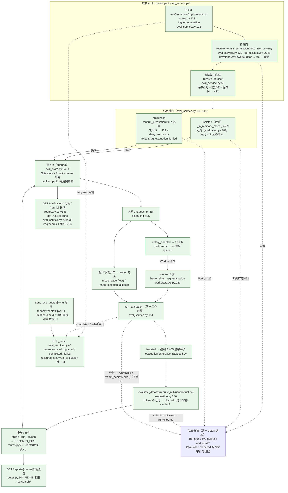

# OPT-08 RAG 在线评测入口

> 状态：DONE（2026-10-16）· 对应任务：OPT-08 · 证据目录 `docs/project-development/assets/opt08/`
> 关联代码：`backend/app/enterprise_rag/eval_service.py`（新增：授权触发/异步派发/状态推进/失败脱敏/审计）、
> `backend/app/enterprise_rag/eval_store.py`（新增：EvaluationRun 内存 store，租户隔离 + 可重置）、
> `backend/app/enterprise_rag/models.py`（`EnterpriseRagEvaluationPayload` 触发请求模型）、
> `backend/app/enterprise_rag/routes.py`（`POST/GET/GET {run_id} /api/enterprise/rag/evaluations`；报告复用既有 `GET /reports/{name}`）、
> `backend/app/tenancy/permissions.py`（权限 `rag:evaluate` 与四角色授权）、
> `backend/app/tenancy/context.py`（修复 `deny_and_audit` 兜底 id 冲突导致拒绝审计互相覆盖）、
> `backend/app/workers/tasks.py`（Worker 任务 `backend.run_rag_evaluation`）、
> `backend/app/workers/dispatch.py`（复用 `enqueue_or_run`：redis 队列 / eager 内联）、
> `backend/tests/test_opt08_rag_eval_online.py`（12 用例）、`backend/tests/test_opt08_eval_demo_cli.py`（1 用例）、
> `backend/scripts/opt08_rag_eval_online_demo.py`（演示 CLI，16 项自检）

## 1. 目标、范围与权限矩阵

**目标**（OPT-08 验收口径）：「授权触发异步评测、状态查询和报告查看；默认仅隔离数据，
生产评测另行确认」。本项补齐 E3-08 前端评测台的最后一处后端缺口（108 文档「残余：在线
评测触发入口未做」；前端触发按钮属后续 UI 项）。

设计原则：**不改任何既有评测语义** —— 复用 E3-04 `evaluate_dataset`（同一过滤/口径）、
E3-08 报告读取接口与 `reports/` 规范目录、OPT-05 的 dispatch 降级框架；新增的只有
「授权入口 + 运行记录 + 两道作用域门」。

### 1.1 端点与权限矩阵

| 操作 | 端点 | 权限门 | 允许 | 拒绝 |
| --- | --- | --- | --- | --- |
| 触发在线评测 | `POST /api/enterprise/rag/evaluations` | `rag:evaluate` | tenant_owner / tenant_admin / security_admin / project_owner | developer / reviewer / auditor → 403 + `deny_and_audit`（`tenant.tenant.denied`，summary 含 `tenant.permission.rag:evaluate`） |
| 运行列表 | `GET /api/enterprise/rag/evaluations` | `rag:search` | 上述四角色 + developer / reviewer | auditor → 403 |
| 运行详情 | `GET /api/enterprise/rag/evaluations/{run_id}` | `rag:search` | 同上；仅租户内可见（跨租户 → 404，不泄露存在性） | auditor → 403 |
| 报告查看 | `GET /api/enterprise/rag/reports/{name}`（复用 E3-08） | `rag:search` | 同上 | auditor → 403 |

### 1.2 作用域门（默认仅隔离数据）

- `execution_scope=isolated`（默认）：仅允许内存态运行（`evaluation.py:382 _in_memory_mode()`，
  即 `USE_SQLALCHEMY=false`）且强制注入 E3-05 脱敏基线种子（`seed_baseline()`），不触碰
  运行态数据；持久化环境触发 → 422。
- `execution_scope=production`：必须 `confirm_production=true` 显式确认（未确认 → 422 +
  `tenant.rag_evaluation.denied` 拒绝审计且不落 run）；确认后按 `require_milvus=True` 语义
  执行 —— Milvus 不可用 → run/report `blocked`（**绝不静默回退冒称 `verified`**）。

### 1.3 非目标（本项不做）

不做前端触发 UI（E3-08 页面未改）；不做 run 持久化（内存 store，与运行时可观测层同口径，
重启即清空）；不执行真实生产评测（本机 Milvus 未起，按门语义诚实 blocked，真实生产评测
须另行确认）；不做定时/批量评测。

## 2. 缺陷定位（TDD 红阶段真实复现）

**用例先行**：`test_opt08_rag_eval_online.py`（11 用例）+ `test_opt08_eval_demo_cli.py`（1 用例）
先写，首跑 `12 failed in 2.45s` —— `app.enterprise_rag.eval_service`/`eval_store` 与演示脚本
尚不存在（ImportError / 404 / `[Errno 2] No such file or directory` 全覆盖），属预期红。
随后最小实现（eval_store → eval_service → routes → Worker 任务 → 演示脚本），
在线接口文件先绿（11 passed in 355.83s），专项整体再绿（12 passed in 362.28s）。

**演示取证发现并修复的真实产品缺陷（本项顺带修复）**：演示 CLI 首跑 `checks=14/16`，
`audit_events_recorded` 为 False —— 生产门拒绝审计事件缺失。定位：`deny_and_audit`
（`app/tenancy/context.py:101`）的事件 id 直接 fallback 到固定字符串
`audit_{user_id}_{tenant_id}`（`main.next_id_audit` 并不存在；`main.AUDIT_EVENTS` 是 dict
事件表），同一 actor+tenant 的多次拒绝键冲突互相覆盖（后一条把前一条挤掉）。补回归用例
先红（`tests/test_opt08_rag_eval_online.py` 第 9 组）：

```text
assert {'opt08_p2'} == {'opt08_p1', 'opt08_p2'}   # 第一条拒绝（opt08_p1）被覆盖丢失
1 failed in 1.26s
```

修复（`context.py:111`）：id 改为唯一 `f"audit_{uuid.uuid4().hex[:16]}"`（保留
`next_id_audit` 兼容分支）→ 回归用例绿；演示 CLI 复跑 `checks=16/16`。

## 3. 主链路（Mermaid，含源码位置）



## 4. 关键代码说明

| 文件 | 说明 |
| --- | --- |
| `eval_service.py:128` `trigger_evaluation` | 触发主入口：权限门 → 数据集白名单 → 作用域门 → 建 run(queued) → `enqueue_or_run` 派发 → `triggered` 审计；返回 `{run, dispatch:{mode,enqueued,label}}`。派发异常回退内联（`eager(dispatch-fallback)`），不丢触发。 |
| `eval_service.py:184` `run_evaluation` | Worker 与内联共用的同一段工作函数：`running` →（isolated）`seed_baseline` → `load_cases` → `evaluate_dataset(require_milvus=production)` → `write_report` 写 `online_{run_id}.json` → 终态 `blocked/succeeded` + validation + 脱敏 summary → `completed` 审计；异常 → `redact_secrets` 截断 300 → `failed` + `failed` 审计，**不重抛**（自动重试=人工重触发，避免重复消费算力）。 |
| `eval_service.py:59` `resolve_dataset` | 数据集白名单：`^[A-Za-z0-9][A-Za-z0-9_.\-]*\.(jsonl|json)$` + 目录包含性 + 必须存在 → 422；评测集固定 `backend/evaluation/enterprise_rag/`。 |
| `eval_service.py:106` `_execution_ctx` | Worker 无请求上下文：按 run 记录的 `requested_role` 重建 `TenantContext`（`permissions_for`），保证 Worker 侧审计归属正确。 |
| `eval_service.py:80` `_audit` | 事件类型 `tenant.rag.eval.{action}`、`resource_type=rag_evaluation`、唯一 id；审计失败不阻断主流程。 |
| `eval_store.py:24/53/85` | `EvaluationRun` 模型（五个状态、时间戳、report_name/validation_status/脱敏 summary）+ `reset_store` + `list_by_tenant`（newest-first，租户过滤）。 |
| `routes.py:128/137/146` | 三个新端点；延迟导入 eval_service（保持 routes 轻量、避免循环）；`context_for_current_user()` 取租户上下文。 |
| `models.py:66` | `EnterpriseRagEvaluationPayload`：dataset / retrieval_mode / top_k(1..50) / execution_scope(\"isolated\"|\"production\") / confirm_production。 |
| `permissions.py:26/48` | `RAG_EVALUATE = \"rag:evaluate\"` 仅授予 tenant_owner / tenant_admin / security_admin / project_owner。 |
| `workers/tasks.py:233` | Celery 任务 `backend.run_rag_evaluation`：STARTED/SUCCESS meta + 调用 `run_evaluation`（与内联同函数）；含 `_TASK_RETRY` 重试配置。 |
| `workers/dispatch.py:25` | 复用 `enqueue_or_run`：`celery_enabled` → `delay`（mode=redis）；否则 `run_inline`（mode=eager(test)）；派发异常由 eval_service 兜底。 |
| `evaluation.py:246/382` | `evaluate_dataset(require_milvus)` 与 `_in_memory_mode`：评测引擎与内存态判定（复用，未改语义）。 |
| `tenancy/context.py:111` | `deny_and_audit` 唯一 id 修复（详见 §2）：同 actor+tenant 的多次拒绝各自留档。 |
| `tests/conftest.py:91` | 每用例 `reset_store()`，run 真源零串扰。 |
| `scripts/opt08_rag_eval_online_demo.py:46/83` | 演示 CLI：`_force_isolated_env` 自压制敌对环境 → 权限探针（403/403/200/403）→ 主链（触发/详情/列表/报告回读）→ 生产门（未确认 422 不落 run；确认后 blocked + 报告可回读）→ 16 项自检 + 证据 JSON。 |

## 5. 固定命令

```bash
cd backend
# 演示 CLI（隔离自强制：内存态、无 DB/Celery/Milvus；输出证据 JSON 与控制台）
.venv/Scripts/python.exe scripts/opt08_rag_eval_online_demo.py \
  --out ../docs/project-development/assets/opt08/opt08_eval_evidence.json \
  --reports-dir .data/opt08-demo/reports-assets

# 专项（Windows；Linux/macOS 用 .venv/bin/python）
.venv/Scripts/python.exe -m pytest tests/test_opt08_rag_eval_online.py tests/test_opt08_eval_demo_cli.py -q -rs

# 相关既有回归（租户 E1 / 硬化 E2 / E3-01 RAG / E3-04 离线评测 / E3-08 报告控制台 / OPT-04 报告契约 / Celery worker / E4 Runtime）
.venv/Scripts/python.exe -m pytest tests/test_enterprise_e1_tenancy.py tests/test_enterprise_e2_hardening.py \
  tests/test_enterprise_e3_rag.py tests/test_enterprise_e3_04_evaluation.py tests/test_enterprise_e3_08_rag_console.py \
  tests/test_opt04_rag_report_contract.py tests/test_celery_worker_runtime.py tests/test_enterprise_e4_runtime.py -q -rs

# 全量（隔离口径与 OPT-05/06/07 一致：conftest 保证不读 .env、Celery eager、无外服）
.venv/Scripts/python.exe -m pytest -q -rs
```

全部用例默认内存态 + monkeypatch：不访问外部服务、不产生真实外部写入或生产数据读写。

## 6. 测试证据（全部本会话真实执行）

```text
# 1) TDD 红阶段（用例先行，模块/脚本不存在）：12 failed in 2.45s
#    随后实现转绿；演示取证发现的审计 id 覆盖缺陷补回归用例：
#    先红 1 failed in 1.26s（assert {'opt08_p2'} == {'opt08_p1', 'opt08_p2'}）→ 修复 → 绿

# 2) OPT-08 专项（-q -rs，12 API 用例 + 1 CLI 子进程用例）
#    → 13 passed in 361.85s (0:06:01)
#    证据文件：docs/project-development/assets/opt08/opt08_focused_suite.txt

# 3) 相关既有回归（-q -rs，8 个触达模块文件）
#    → 102 passed in 77.38s (0:01:17)
#    证据文件：docs/project-development/assets/opt08/opt08_regression_related.txt

# 4) 演示 CLI（隔离自强制，敌对环境注入被压制）
#    → OPT-08 demo: run=rageval_e83a40c8e922 status=succeeded validation=local_only checks=16/16
#    证据文件：docs/project-development/assets/opt08/opt08_demo_console.txt
#             docs/project-development/assets/opt08/opt08_eval_evidence.json

# 5) 全量后端（-q -rs，OPT-05 隔离口径）
#    → 948 passed, 17 skipped, 4 warnings in 1162.47s (0:19:22)
#    = OPT-07 基线 935 passed + 本项新增 13（12 API + 1 CLI）；17 skipped 全为显式环境门控
#    证据文件：docs/project-development/assets/opt08/opt08_full_backend.txt
```

## 7. 真实运行证据

- `assets/opt08/opt08_eval_evidence.json`：演示证据全文（`checks=16/16`，`all_passed=true`）。
  关键诚实性证据（均来自该 JSON）：
  - 隔离自证：`environment = {stores: in_memory, database/celery/milvus: disabled,
    production_real_executed: false}`；`no_remote_write_module=true`（远端写模块未加载）；
  - 权限探针：developer/auditor 触发 403/403；developer 查看 200 / auditor 403；
  - 主链：`run=rageval_e83a40c8e922` `succeeded` / `local_only`，基线复现 32 案 29 通过
    （`recall@K=0.8438 / mrr=0.8281 / ndcg@K=0.8322`，确定性内存态 p50 2.3ms / p95 5.1ms，
    非生产延迟口径）；`dispatch={mode: eager(test), enqueued: false}`（未启用真实队列，如实标注）；
    时间戳有序（created ≤ started ≤ finished）；报告经既有 `GET /reports/{name}` 回读，
    `dataset_sha256` 完整；
  - 生产门：未确认 → 422（`生产评测需显式确认：confirm_production=true（默认仅隔离数据）`）
    且 runs 数量不变；确认后 `run=rageval_025809b066c8` `blocked` / `blocked`（Milvus 不可用），
    证据报告 `online_rageval_025809b066c8.json` 可回读 —— 未冒称 verified；
  - 审计：`total=70`（`tenant.rag.eval.triggered=2 / completed=2 / tenant.rag_evaluation.denied=1 /
    tenant.tenant.denied=3 / rag.query=60 / tenant.repository.denied=2`）。
- `assets/opt08/opt08_demo_console.txt`：CLI 控制台（两行摘要 + EXIT=0；168 行 RAG 向量
  回退提示属确定性内存态预期噪声，已过滤，完整数据在证据 JSON）。
- `assets/opt08/opt08_focused_suite.txt` / `opt08_regression_related.txt` / `opt08_full_backend.txt`：
  专项、相关回归与全量后端实测输出。
- 后端/API 能力项：无前端页面改动（E3-08 评测台 UI 未动），故本项不以截图冒充证据，
  以真实接口 JSON/控制台/测试输出为准（与 OPT-04~07 口径一致）。

## 8. 联调注意点

1. **run 生命周期与轮询契约**：`queued → running → succeeded | blocked | failed`；客户端按
   `GET /api/enterprise/rag/evaluations/{run_id}` 轮询。`dispatch.mode` 是诚实性字段：
   `redis` = 真实队列（只入队）；`eager(test)`/`eager(dispatch-fallback)` = 内联执行
   （本地/测试/降级），UI 不得把 eager 当「已异步排队」展示。
2. **isolated 与持久化互斥是设计约束**：持久化环境（`USE_SQLALCHEMY=true`）只能走
   production + 显式确认；这是为了不让「隔离评测」悄悄读写运行态数据。新增调用方不要绕过
   `trigger_evaluation` 直接建 run。
3. **production 的 blocked 是诚实口径**：Milvus 不可用/维度不匹配时绝不回退 local 评测冒称
   verified；消费方（UI/报表）必须把 blocked 当「未验证」展示（E3-08 页面已有 blocked 徽章）。
4. **审计事件契约（供审计中心筛选）**：`tenant.rag.eval.triggered/completed/failed`（点号）+
   `tenant.rag_evaluation.denied`（生产门，下划线）+ `tenant.tenant.denied`（权限门，summary
   携带 `tenant.permission.rag:evaluate` 字样）。`deny_and_audit` 现保证同 actor 多次拒绝
   各自留档（此前固定 id 在 dict 事件表键冲突会丢审计）。
5. **报告文件命名与目录**：`online_{run_id}.json` 写入 `REPORTS_DIR`
   （`backend/evaluation/enterprise_rag/reports`），由既有 `GET /reports/{name}` 回读；
   测试/演示通过 monkeypatch `rag_routes.REPORTS_DIR` 隔离，生产走 canonical 目录。
6. **`_reports_dir()` 惰性读取 `rag_routes.REPORTS_DIR`**：新增调用方不要在导入期缓存该路径，
   否则 monkeypatch/换目录失效。
7. **数据集白名单**：仅允许文件名（无路径分隔符/穿越）；新增评测集必须放入
   `backend/evaluation/enterprise_rag/` 才可被引用。
8. **Worker 上下文重建**：run 记录 `requested_role` → `_execution_ctx` 重建权限；调整角色/
   权限表时注意 Worker 侧同步（否则审计归属或门禁漂移）。
9. **失败不自动重试**：`run_evaluation` 异常落 `failed` 不重抛；重试=再次触发（避免 Celery
   自动重试风暴重复消费算力）。

## 9. 复盘与边界（如实声明）

- **已验证（本会话真实执行）**：专项 13 passed/361.85s（12 API + 1 CLI）；相关回归
  102 passed/77.38s；全量后端 948 passed, 17 skipped/1162.47s（= OPT-07 基线 935 + 本项
  新增 13；17 skipped 全为显式环境门控）；演示 CLI 16/16（`run=rageval_e83a40c8e922`、
  succeeded/local_only、生产确认 blocked 诚实口径、敌对环境自压制、无远端写模块）；
  TDD 红 12 failed → 绿；审计 id 覆盖缺陷回归红 1 failed → 修复 → 绿。
- **跨项修复**：a) `deny_and_audit` 唯一 id（产品代码，见 §2）；b) 演示脚本字面量
  点/下划线笔误（`tenant.rag.evaluation.denied` vs 真实事件 `tenant.rag_evaluation.denied`，
  属脚本自身缺陷；hex 字节级核验后修复 —— 教训：字符串字面量必须字节核验，不能只目视）。
- **未执行（超出本项隔离边界，未伪造）**：
  - 真实 Redis+Celery 队列端到端（`mode=redis` 分支由 monkeypatch 单测覆盖；生产级
    多 Worker 恢复与长稳属 OPT-13）；
  - 真实生产 Milvus 评测（本机 Milvus 未起，按门语义 blocked；生产评测须另行确认）；
  - 前端触发入口（E3-08 页面未改，UI 接入属后续项）。
- **遗留**：run store 为进程内存（重启即空）；如未来持久化，需把 `eval_store` 换为 DB
  仓储并对齐租户过滤（登记为演进注意点）。

## 10. FIX-01 整改衔接（2026-10-18）

`eval_store` 已升级为「持久化开启时 DB 为唯一真源」：表 `enterprise_rag_evaluation_runs`
（`backend/app/models/orm.py` 的 `EnterpriseRagEvaluationRunORM`）+ 仓储
`backend/app/db/shared_stores.py`。`eval_store.claim_for_execution` 在单事务内处理
终态幂等、`running` 租约与崩溃接管；Worker 与 API 共享同一记录，API 清空内存后仍可回读
Worker 终态。`run_evaluation` 为每次运行绑定 `trace_id=run_id` 并写 worker span，
报告写入失败会落 `failed` 而非永久 `running`。
`backend/tests/test_fix01_cross_process.py` 使用本次专用 fake broker + 独立 Celery Worker
进程完成真实跨进程验收；真实 Redis/生产 Milvus/真实模型仍未执行。
详见 `docs/project-development/129-fix-runtime-shared-state-closure.md`。
