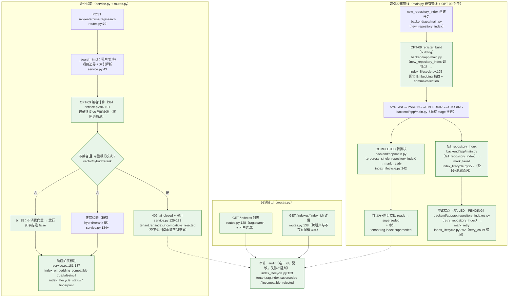

# OPT-09 Embedding 与索引生命周期

> 状态：DONE（2026-10-16）· 对应任务：OPT-09 · 证据目录 `docs/project-development/assets/opt09/`
> 关联代码：`backend/app/enterprise_rag/index_lifecycle.py`（新增：指纹记录 / 兼容判定 / 生命周期状态与审计）、
> `backend/app/enterprise_rag/service.py`（搜索守卫：3b 兼容计算 + 129 行 fail-closed + 181 行如实标注）、
> `backend/app/enterprise_rag/routes.py`（新增只读接口 `GET /indexes`、`GET /indexes/{index_id}`）、
> `backend/app/main.py`（4 个真实管线钩子：`new_repository_index:1901`、`fail_repository_index:3066`、
> `progress_single_repository_index:3210`、重试端点 `6524`）、
> `backend/tests/conftest.py`（每用例重置生命周期 store）、
> `backend/tests/test_opt09_index_lifecycle.py`（12 用例）

## 1. 目标、范围与设计契约

**目标**（OPT-09 验收口径）：「记录模型/维度/索引版本；不兼容拒绝；过期、重建、失败恢复有状态和审计」。

本项补齐企业 RAG 索引的一个真实工程缺口：**索引构建时用什么 Embedding 没有任何记录**
—— 若运维更换 embedding 提供商/模型/维度后继续用旧索引检索，向量空间不同会导致结果
静默劣化甚至语义错乱，而系统无从发现。本项建立「构建时固化指纹 → 检索时对账 →
向量相关模式不兼容即 fail-closed」闭环，并把过期/重建/失败恢复的状态与审计接进真实索引管线。

设计原则：

- **绝不静默**：不兼容时宁可 409 拒绝，也不返回跨向量空间的结果；无法验证（记录缺失/
  维度未知）时放行但如实标注 `unknown`，**不冒称兼容**；
- **不触发网络探测**：指纹只读配置（`EMBEDDING_DIMENSIONS`）与进程内维度缓存
  （`last_real_embedding_dimension()`），测试/检索路径零外呼；
- **只锚真实管线**：状态推进全部挂在既有索引管线钩子上（创建/COMPLETED/FAILED/retry），
  不新建并行管线、不改既有索引语义。

### 1.1 生命周期状态机与兼容矩阵

| 状态 | 进入时机（真实钩子） | 含义 |
| --- | --- | --- |
| `building` | `register_build`（`new_repository_index` 创建后）/ `mark_retry`（重试端点） | 构建中；已固化 Embedding 指纹与 commit/collection |
| `ready` | `mark_ready`（管线 COMPLETED 块） | 可检索；记录切片数/完成时间；**同仓库+分支的旧 ready 记录转 `superseded`（+审计）** |
| `failed` | `mark_failed`（管线失败块） | 记录失败阶段 + 脱敏原因（≤400 字符） |
| `superseded` | `mark_ready` 内部联动 | 有新索引 ready，本索引过期（`superseded_by` 指向新索引） |

兼容判定矩阵（`assess_compatibility`）：

| 记录 vs 当前 | 判定 | 检索行为 |
| --- | --- | --- |
| 维度/模型均一致 | `compatible` | 正常检索，`index_embedding_compatible=true` |
| 维度不同（如记录 64 → 当前 2048） | `incompatible` | **vector/hybrid/rerank → 409 + 审计**；bm25 放行但标注 false |
| 维度相同但 provider/model 变化 | `incompatible` | 同上（同维度不同模型 = 不同向量空间） |
| 任一侧维度未知（`EMBEDDING_DIMENSIONS` 未设且无缓存） | `unknown` | 放行，`index_embedding_compatible=null`（不冒称兼容） |
| 无生命周期记录（历史索引/重启后） | `unknown` | 同上，`index_lifecycle_status=null` |

### 1.2 非目标与边界（如实声明）

- **不做持久化**：记录存进程内存（与 eval_store/observability 同口径，重启即空），重启后
  一律 `unknown` 放行 + 如实标注；如未来持久化需换 DB 仓储（登记为演进注意点）；
- **不做跨进程共享**：多 Worker 各自进程内 store，仅以各自构建/推进的索引为准（不影响
  检索语义：检索读的是当前进程能看到的记录，读不到即 unknown）；
- **不替代 Milvus 维度核对**：真实 Milvus 集合维度核对仍由既有 `inspect_milvus_collection`
  承担（E3 门槛语义）；本模块只负责「构建指纹 vs 当前配置」的一致性；
- **不改前端**：无 UI 改动，新增只读接口供后续接入。

## 2. TDD 红→绿（用例先行，真实执行）

**用例先行**：`test_opt09_index_lifecycle.py` 一次写全 12 用例（覆盖验收六组：指纹 / 兼容矩阵 /
生命周期 / fail-closed / 只读接口 / 脱敏），首跑真实红：

```text
# 12 failed in 16.49s
# 根因：ImportError: cannot import name 'index_lifecycle' from 'app.enterprise_rag'
#      （模块与钩子尚不存在，属预期红）
```

随后最小实现（`index_lifecycle.py` → `main.py` 4 钩子 → `service.py` 守卫 → `routes.py`
只读接口 → `conftest.py` 重置），复跑转绿：`12 passed in 17.66s`。

## 3. 主链路（Mermaid，含源码位置）



## 4. 关键代码说明

| 文件 | 说明 |
| --- | --- |
| `index_lifecycle.py:43/57` | `EmbeddingFingerprint`（provider/model/dimension/source/16-hex 指纹）与 `IndexLifecycleRecord`（索引版本全量：tenant/repo/project/branch/commit/collection/状态/切片数/retry_count/error/superseded_by/时间戳）；`to_public()` 只暴露脱敏字段。 |
| `index_lifecycle.py:82` `make_fingerprint` | sha256(`provider\|model\|dimension`) 取前 16 位；`dimension=None` 以 `auto` 参与（仍可记录，但判定降级 unknown）。 |
| `index_lifecycle.py:93` `current_embedding_fingerprint` | 未配置 Key → `mock/token-hash-64/64`；已配置 → settings 维度或**进程内缓存**（`last_real_embedding_dimension`），**绝不触发网络探测**。 |
| `index_lifecycle.py:111` `assess_compatibility` | 兼容矩阵唯一实现：无记录 → `unknown/no_lifecycle_record`；维度未知 → `unknown/dimension_unverified`；维度不同 → `incompatible/dimension_mismatch`；同维不同模型 → `incompatible/embedding_model_changed`。 |
| `index_lifecycle.py:133` `_audit` | 事件 `tenant.rag.index.{action}`、`resource_type=repository_index`、唯一 id、失败不阻断主流程（与 eval_service 同口径）。 |
| `index_lifecycle.py:195/242/279/292` | `register_build`（building，固化指纹）/`mark_ready`（ready + 旧索引 superseded + 审计）/`mark_failed`（failed + 阶段/原因）/`mark_retry`（building + retry_count 对齐索引记录）。`_entry_for` 对「未登记就推进」的旧路径自愈补建记录（兼容 direct-construct 的历史记录）。 |
| `backend/app/main.py（new_repository_index 调用点）` | 索引创建成功持久化后 `register_build(...)`（在 `_dedupe_or_create_index` 竞争回读语义之后，保证登记的是 canonical 记录）。 |
| `backend/app/main.py（fail_repository_index）` | 管线失败块 `mark_failed(record, stage=..., message=...)`（脱敏截断 400）。 |
| `backend/app/main.py（progress_single_repository_index）` | COMPLETED 块 `mark_ready(record)`（在 INDEX_COMPLETED 自动化审计之后、`resume_tasks_waiting_for_index` 之前）。 |
| `backend/app/api/repository_indexes.py（retry_repository_index）` | 重试端点（FAILED→PENDING）审批后 `mark_retry(record)`（retry_count 与索引记录对齐）。 |
| `service.py:94-101` | 搜索 3b 段：取记录 + 当前指纹 + 判定；**在候选生成之前**完成（拒绝时不进入检索链）。 |
| `service.py:129-133` | fail-closed：`incompatible` 且模式 ∈ `VECTOR_CONSUMING_MODES`（vector/hybrid/rerank）→ `audit_incompatible_rejection` + 409（消息含双方维度，不含任何结果字段）。bm25 不在此列。 |
| `service.py:181-187` | 响应如实标注四字段：`index_embedding_compatible`（true/false/null=unknown）、`index_embedding_compat_reasons`、`index_lifecycle_status`、`index_embedding_fingerprint`。 |
| `routes.py:128/138` | 只读接口：`GET /indexes`（租户过滤，newest-first，≤200 条）与 `GET /indexes/{index_id}`（跨租户与不存在同样 404，不泄漏存在性）；均 `rag:search` 门。 |
| `tests/conftest.py:94-97` | `reset_in_memory_state` 每用例 `reset_store()`，记录真源零串扰。 |

## 5. 固定命令

```bash
cd backend
# 专项（Windows；Linux/macOS 用 .venv/bin/python）
.venv/Scripts/python.exe -m pytest tests/test_opt09_index_lifecycle.py -q -rs

# 相关既有回归（DEV-008 索引管线 / 等待索引恢复 / E3-01 RAG / E3-08 控制台 / E3-04 评测 / OPT-04 / OPT-08 / 解析链 / 检索质量 / 持久化 / Milvus 实时 / Celery worker）
.venv/Scripts/python.exe -m pytest tests/test_dev008_rag_index.py tests/test_wait_index_resume.py \
  tests/test_enterprise_e3_rag.py tests/test_enterprise_e3_08_rag_console.py tests/test_rag_evaluation.py \
  tests/test_opt04_rag_report_contract.py tests/test_opt08_rag_eval_online.py tests/test_rag_parse_chain.py \
  tests/test_rag_retrieval_quality.py tests/test_rag_persistence.py tests/test_rag_milvus_realtime.py \
  tests/test_celery_worker_runtime.py -q -rs

# 全量（隔离口径与 OPT-05~08 一致：conftest 保证不读 .env、Celery eager、无外服）
.venv/Scripts/python.exe -m pytest -q -rs
```

全部用例默认内存态 + monkeypatch：不访问外部服务、不产生真实外部写入或生产数据读写。

## 6. 测试证据（全部本会话真实执行）

```text
# 1) TDD 红阶段（用例先行，模块/钩子不存在）：12 failed in 16.49s
#    根因 ImportError: cannot import name 'index_lifecycle' from 'app.enterprise_rag'

# 2) OPT-09 专项（-q -rs，12 用例）
#    → 12 passed in 17.66s
#    证据文件：docs/project-development/assets/opt09/opt09_focused_suite.txt

# 3) 相关既有回归（-q -rs，12 个触达模块文件）
#    → 115 passed, 5 skipped in 483.61s (0:08:03)
#    5 skipped 全为 Milvus 显式环境门控（rag_parse_chain×1 + rag_milvus_realtime×4）
#    证据文件：docs/project-development/assets/opt09/opt09_regression_related.txt

# 4) 全量后端（-q -rs，OPT-05 隔离口径）
#    → 960 passed, 17 skipped, 4 warnings in 1253.22s (0:20:53)
#    = OPT-08 基线 948 passed + 本项新增 12；17 skipped 全为显式环境门控
#    证据文件：docs/project-development/assets/opt09/opt09_full_backend.txt
```

## 7. 真实运行证据

- `assets/opt09/opt09_focused_suite.txt`：专项 12 用例全绿（含 TDD 红→绿交替记录在 §2）。
  关键断言（均来自真实运行）：
  - 指纹：mock 未配置 → `mock/token-hash-64/64` + 16-hex；配置 `ZHIPU_API_KEY` +
    `EMBEDDING_DIMENSIONS=2048` → `zhipu/embedding-3/2048`（**无网络调用**，维度缓存被显式置空）；
    配置但维度未设 → `dimension=None` 且判定必须 unknown；
  - 兼容矩阵：compatible / 维度不同 incompatible（`recorded=64 current=2048`）/ 同维不同模型
    incompatible / 任一侧维度未知 unknown / 无记录 unknown；
  - 生命周期（真实管线驱动）：building →（COMPLETED）ready + `chunk_count>0` + `completed_at`；
    失败 → failed（`error_stage=SYNCING`，原因含「超时」）；retry 端点 → `retry_count=1` + building；
    新索引 ready → 旧记录 superseded + `superseded_by` + 审计 `tenant.rag.index.superseded`
    （resource_id/tenant 逐字段核对）；
  - fail-closed：维度 64→2048 后 hybrid 检索 → **409**，消息含「不兼容 & 64 & 2048」且响应体
    不含任何结果字段；审计 `tenant.rag.index.incompatible_rejected` 含被拒索引 id；
    bm25 同条件下 200 且 `index_embedding_compatible=false`；
  - 如实标注：兼容检索 `true` + `index_lifecycle_status=ready`；直建历史索引（无记录）
    → `null`/`null`（unknown 放行，不冒称兼容）；
  - 只读接口：admin 列表/详情 200（status=ready、dimension=64）、不存在 404、auditor 403、
    跨租户记录不可见且详情 404；
  - 脱敏：公开投影不含 `api_key`/`ZHIPU`/代码正文。
- `assets/opt09/opt09_regression_related.txt` / `opt09_full_backend.txt`：相关回归与全量后端实测输出。
- 后端/API 能力项：无前端页面改动，故不以截图冒充证据，以真实接口 JSON/测试输出为准
  （与 OPT-04~08 口径一致）。

## 8. 联调注意点

1. **409 是新契约的一部分**：`POST /api/enterprise/rag/search` 在「记录指纹不兼容 +
   vector/hybrid/rerank」时返回 409（此前从不返回该码）。前端/调用方需把 409 当
   「索引与当前 Embedding 配置不兼容，请重建索引或恢复配置」处理，而不是网络错误重试。
2. **`index_embedding_compatible` 三态语义**：`true`=已验证兼容；`false`=已确认不兼容
   （bm25 会以 200 + false 出现，消费方不要当结果不可信处理）；`null`=无法验证（重启后/
   历史索引），**不得把 null 当 true 展示**。
3. **模式与消费面匹配**：只有 bm25 在 `false` 时仍放行（纯关键词不消费向量）；新增检索
   模式时必须同步 `VECTOR_CONSUMING_MODES`（`index_lifecycle.py:31`），否则防护有缺口。
4. **重试语义**：重试端点只允许 FAILED（既有语义）；重试时生命周期回 building 且
   `retry_count` 与索引记录对齐；`mark_ready` 的 supersede 以「同仓库 + 同分支」为界，
   跨分支/跨仓库互不影响。
5. **记录内存态**：重启后所有判定为 unknown（放行+标注）；如生产要求「重启后仍拒绝」，
   需先把记录持久化（DB 仓储）再收紧判定 —— 属演进项，不在本项范围。
6. **审计筛选**：新增点号事件 `tenant.rag.index.superseded` / `tenant.rag.index.incompatible_rejected`
   （resource_type=repository_index）；构建/完成/失败/重试沿用既有 `INDEX_*` 团队审计，不重复留痕。
7. **指纹零外呼**：`current_embedding_fingerprint` 只读配置与缓存；不要在检索热路径加
   `probe_embedding_dimension`（会引入真实网络调用与延迟）。

## 9. 复盘与边界（如实声明）

- **已验证（本会话真实执行）**：专项 12 passed/17.66s（TDD 红 12 failed/16.49s → 绿）；
  相关回归 115 passed, 5 skipped/483.61s（skip 全为 Milvus 环境门控）；全量后端
  960 passed, 17 skipped/1253.22s（= OPT-08 基线 948 + 本项新增 12；17 skipped 全为显式
  环境门控）。
- **未执行（超出本项隔离边界，未伪造）**：
  - 真实 Milvus 集合维度核对（本机 Milvus 未起；既有 `inspect_milvus_collection` 语义未改，
    跳过用例属显式环境门控）；
  - 生产环境跨配置更换 Embedding 的真实拒绝演练（须生产数据 + 真实配置变更，另行确认）；
  - 多进程/多 Worker 共享生命周期记录（内存态各自为政，见 §1.2）。
- **遗留**：记录生命周期为进程内存（重启即空 → unknown 放行）；如未来持久化，需把
  `index_lifecycle` store 换为 DB 仓储并对齐租户过滤与重置钩子。

## 10. FIX-02 整改衔接（2026-10-18）

生命周期记录已落共享表 `enterprise_rag_index_lifecycles`
（`backend/app/models/orm.py` 的 `EnterpriseRagIndexLifecycleORM`），
`backend/app/enterprise_rag/index_lifecycle.py` 在持久化开启时读写 DB；API 与 Worker、
重启后的判定一致。检索守卫已从「只有 `incompatible` 拒绝」收紧为：
`vector` / `hybrid` / `rerank` 只在 `compatible` 时放行；无记录、维度未知、指纹缺失、
building/failed/superseded 一律 409 + `tenant.rag.index.incompatible_rejected` 审计；
`bm25` 放行但返回 `index_embedding_compatible=false/null` 与
`index_embedding_compat_state`。隔离种子（`backend/evaluation/enterprise_rag/seed.py`）
已显式登记 ready 生命周期，避免把隔离评测误拒。
详见 `docs/project-development/129-fix-runtime-shared-state-closure.md`。
