# OPT-10 RAG 检索参数消融

> 状态：DONE（2026-10-16）· 对应任务：OPT-10 · 证据目录 `docs/project-development/assets/opt10/`
> 关联代码：`backend/app/core/runtime_config.py`（新增 `RAG_HYBRID_VECTOR_WEIGHT`/`RAG_HYBRID_BM25_WEIGHT` + `_env_float` 助手）、
> `backend/app/enterprise_rag/hybrid.py`（RRF 两路权重与 0 权重禁用门控）、
> `backend/app/enterprise_rag/service.py`（检索入口透传权重）、
> `backend/app/enterprise_runtime/agents/tools.py`（Agent 工具 `_rag_search` 同步透传）、
> `backend/app/enterprise_rag/repro_contract.py`（配置 hash 纳入新权重）、
> `backend/app/retrieval/parsing_config.py`（切片常量 import-time 环境覆盖）、
> `backend/scripts/opt10_rag_ablation.py`（新增消融编排）、
> `backend/tests/test_opt10_rag_ablation.py`（16 用例）、
> `backend/tests/test_opt10_rag_ablation_cli.py`（1 条端到端）

## 1. 目标、范围与设计契约

**目标**（OPT-10 验收口径）：「对比 top-k、混合权重、符号 boost、切片和 reranker；保留基线/失败样本；真实生产评测另行确认」。

本项建立**可复现的 RAG 检索参数消融**：以 E3-05 基线数据集（32 用例 · 固定 SHA256）为锚，
在同一套本地确定性子进程环境里跑 12 个检索配置 + 1 次基线复跑（确定性校验）+ 5 个切片探针，
逐配置产出样本级结果、失败样本、指标 delta 与 `config_sha256`，合成一份可用于回归对拍的消融报告。

设计原则：

- **确定性优先**：子进程强制 `APP_ENV=local / USE_MILVUS=false / MODEL_MOCK_FALLBACK=true /
  RAG_MOCK_FALLBACK=true / RAG_QUERY_LLM=false` + 哨兵 `ENV_FILE`（不读本地 `.env`/凭据/生产地址）；
  基线复跑除延迟外逐位对拍（`determinism.identical=true`）；
- **子进程隔离**：切片常量是 import-time 值，配置差异必须新进程生效 —— 每个配置一个子进程，
  结果经 `ABLATION_CHILD_JSON:` 标记回传父进程；
- **可复现指纹**：每配置 `config_sha256 = sha256(sorted(生效 knobs) + dataset_sha256)[:16]`，
  与数据集 SHA256 一并留档；
- **绝不冒称**：环境口径如实标注 `local_only / local_no_milvus / milvus_verified=false`；
  切片探针只度量 BM25 可检索性，不含向量语义质量（写入报告 `limitations`）。

### 1.1 12 个检索配置与 5 个切片探针

| 配置 | 子进程环境变量 | config_sha256 | 消融目的 |
| --- | --- | --- | --- |
| `baseline` | —（默认） | `c34b1dcbd9418d7c` | 锚定基线 + 确定性复跑对拍 |
| `topk_4` | `RAG_FINAL_TOP_K=4` | `d4212a166f8b9030` | 最终 top-k |
| `topk_16` | `RAG_FINAL_TOP_K=16` | `2407f5719a552f52` | 最终 top-k |
| `legs_small` | `RAG_VECTOR_TOP_K=10` `RAG_BM25_TOP_K=5` | `00c8c94e6166b6ec` | 两路候选深度 |
| `legs_large` | `RAG_VECTOR_TOP_K=40` `RAG_BM25_TOP_K=20` | `93ea89e088f111c7` | 两路候选深度 |
| `vector_only` | `RAG_HYBRID_BM25_WEIGHT=0.0` | `3c031c0540f9fb62` | 禁用 BM25 路 |
| `bm25_only` | `RAG_HYBRID_VECTOR_WEIGHT=0.0` | `c6f717d75923d1fc` | 禁用向量路 |
| `vector_weight_2` | `RAG_HYBRID_VECTOR_WEIGHT=2.0` | `4054490994ca16c7` | RRF 路权重放大 |
| `bm25_weight_2` | `RAG_HYBRID_BM25_WEIGHT=2.0` | `6ca6927b41d4b250` | RRF 路权重放大 |
| `symbol_boost_0` | `RAG_SYMBOL_BOOST=0.0` | `dea2dd1d37a4bf44` | 符号 boost 关 |
| `symbol_boost_2` | `RAG_SYMBOL_BOOST=2.0` | `c32a6cd85ad2e00e` | 符号 boost 强 |
| `rerank_on` | `RAG_RERANK_ENABLED=true` | `dbe42f998a47982d` | reranker（heuristic provider） |

切片探针 5 个：`max_chars_4000`（默认）/`max_chars_1200`/`max_chars_8000`（`RAG_CHUNK_MAX_CHARS`）、
`lines_20`/`lines_80`（`RAG_CHUNK_LINES`）。

### 1.2 非目标与边界（如实声明）

- 只用**本地内存态 + 脱敏合成语料**（`seed_baseline`）：不代表云端 Milvus / 真实仓库质量，
  `validation_status=local_only`；
- 子进程强制 `USE_MILVUS=false`（零网络、零真实模型）；云端/生产消融需显式确认后另行执行；
- 切片探针只度量 **BM25 可检索性**（本地确定性词法），不含向量语义质量；
- `rerank_on` 使用本地 heuristic provider（非真实 cross-encoder / 云 rerank）。

## 2. TDD 红→绿（用例先行，真实执行）

**用例先行**：两个测试文件一次写全 17 用例（16 + 1），覆盖 8 组：默认公式逐位一致 / RRF 权重缩放与
0 权重禁用（含「不查询」断言）/ settings 环境映射（负值钳制 0、非法值回退默认）/ service 透传 spy /
repro_contract 字段与快照 / 切片常量子进程覆盖 / `parse_and_chunk` 按 `MAX_CHUNK_CHARS` 截断 /
消融纯函数（sha 稳定性与敏感性、配置集合、delta、失败样本、确定性排除延迟）+ CLI 端到端。首跑真实红：

```text
# 15 failed, 2 passed in 30.67s
# 根因：消融脚本/新增配置项尚不存在（ImportError / AttributeError），属预期红
```

随后最小实现（`runtime_config.py` → `hybrid.py` → `service.py`/`tools.py` → `repro_contract.py` →
`parsing_config.py` → 消融脚本），复跑转绿：`17 passed in 290.91s (0:04:50)`。

## 3. 主链路（Mermaid，含源码位置）

```mermaid
flowchart TD
    subgraph ORCH ["消融编排父进程（scripts/opt10_rag_ablation.py）"]
        A1["main() opt10_rag_ablation.py:429<br/>12 检索配置 + 5 切片配置"] --> A2["_child_env: 每配置独立子进程<br/>APP_ENV=local / USE_MILVUS=false / mock embedding<br/>RAG_QUERY_LLM=false / ENV_FILE=hermetic 哨兵"]
        A2 --> A3["run_eval_child:211 / run_chunk_child:217<br/>超时与返回码校验 · 解析 ABLATION_CHILD_JSON:37"]
        A3 --> A4["assemble_report:360<br/>config_sha256:101 / deltas / failure_samples<br/>determinism / environment / limitations"]
        A4 --> A5["opt10_ablation_report.json<br/>assets/opt10/"]
    end
    subgraph CHILD_EVAL ["子进程 A：检索消融（每配置一进程）"]
        B1["_child_eval:224<br/>load_runtime_settings → knobs 回显<br/>runtime_config.py:195-196"] --> B2["seed_baseline + load_cases<br/>enterprise_rag/evaluation.py"]
        B2 --> B3["_build_context('user_admin')<br/>scripts/evaluate_enterprise_rag.py"]
        B3 --> B4["evaluate_dataset → enterprise_retrieve_by_mode<br/>hybrid.py:169"]
        B4 --> B5["per_case 压缩 + summary<br/>stdout 回传 ABLATION_CHILD_JSON"]
    end
    subgraph RETRIEVE ["真实检索链路（消融生效点）"]
        C1["service.py:135 检索入口<br/>透传 settings 权重 :142-143"] --> C2
        C3["Agent 工具 _rag_search<br/>tools.py:252 同参数透传 :264-265"] --> C2
        C2["enterprise_hybrid_retrieve hybrid.py:43<br/>use_vector = w > 0 :84 / use_bm25 = w > 0 :85"] --> C4["两路门控：0 权重不查询、不注册候选<br/>dense 查询 :102 / bm25 查询 :103"]
        C4 --> C5["RRF：rrf += weight × uw / (60 + rank) :113<br/>rrf += weight × bw / (60 + rank) :121"]
    end
    subgraph CHILD_CHUNK ["子进程 B：切片探针（每配置一进程）"]
        D1["_child_chunk_probe:297<br/>合成 4 个确定性支付模块（各含唯一标记+handle_* 符号）"] --> D2["parse_and_chunk parsing.py:165<br/>常量按 RAG_CHUNK_* 覆盖 parsing_config.py:34-38"]
        D2 --> D3["retrieve_bm25 × 8 查询<br/>切片签名 = sha256(file/行号/checksum)"]
    end
```



## 4. 关键代码说明

### 4.1 融合权重与禁用语义（`hybrid.py`）

- `enterprise_hybrid_retrieve` 新增 `vector_weight/bm25_weight`（默认 1.0）：权重 `>0` 才查询该路
  （`use_vector:84` / `use_bm25:85` 同时约束**查询调用** :102/:103 与 **RRF 累加** :113/:121）——
  0 权重时该路**连候选都不会注册进 `by_chunk`**，从结果集彻底消失；两路皆 0 → 结果为空；
- 默认路径逐位等于历史公式（专项用例以手算分对拍 `[A,B,C]` 顺序与分数，并断言默认=显式 1.0/1.0）；
- `enterprise_retrieve_by_mode:169` 同步透传两 kwargs，`service.py:135-143` 与 Agent 工具
  `tools.py:252-265` 两条消费路径都从 settings 取值，保证行为一致。

### 4.2 配置面（`runtime_config.py`）

- 新助手 `_env_float(name, default, minimum):62`：解析失败回退 default，负值钳制到 minimum；
- dataclass 字段 :115-116；loader :195-196 `RAG_HYBRID_VECTOR_WEIGHT`/`RAG_HYBRID_BM25_WEIGHT` 默认 1.0。

### 4.3 复现契约（`repro_contract.py`）

- `_RAG_SETTINGS_FIELDS:31` 纳入两权重 → OPT-04 报告对拍的 `config_sha256` 对权重变化敏感，
  「改了融合权重」会被如实识别为配置漂移。

### 4.4 切片常量（`parsing_config.py` / `parsing.py`）

- `RAG_CHUNK_LINES`（:34）/`RAG_CHUNK_OVERLAP_LINES`（:35）/`RAG_CHUNK_MAX_CHARS`（:38）为
  **import-time 环境覆盖**，默认 40/10/4000，clamp ≥1，malformed→default；
  `parse_and_chunk`（`parsing.py:165`）消费 `MAX_CHUNK_CHARS` 做内容截断。

### 4.5 消融编排（`scripts/opt10_rag_ablation.py`）

- 父进程 `main():429` 生成配置 → `run_eval_child:211`/`run_chunk_child:217` 子进程执行；
- 子进程 A `_child_eval:224`：settings 回显（knobs 实测值随报告留档）→ `seed_baseline`/`load_cases` →
  `_build_context("user_admin")` → `evaluate_dataset` → 逐用例紧凑 JSON 经 `ABLATION_CHILD_JSON:` 回传；
- 子进程 B `_child_chunk_probe:297`：4 个合成模块（`refund/callback/orders/gateway`，各含唯一标记与
  `handle_*` 符号）→ `parse_and_chunk` → 8 条查询逐条 `retrieve_bm25` 记录命中排名 →
  切片签名 `sha256(file_path/start_line/end_line/checksum)`；
- `config_sha256:101` / `deltas_vs_baseline`（指标 + 回归/改善/缺失/新增用例四分类）/
  `failure_samples`（`status_mismatch | recall_zero`）/ `determinism_compare`（除延迟外逐位对拍）。

## 5. 真实运行证据（本机实测数字）

命令与完整输出见 §6 证据文件头（Windows 本机 / 内存态 / mock embedding / hermetic `ENV_FILE`）。

### 5.1 基线（32 用例 · 数据集 sha256 `e306b418…8319d`）

| 指标 | 值 |
| --- | --- |
| total / passed / success | 32 / 29 / 30 |
| recall@k（=@5=@10） | 0.8438 |
| precision@k / @5 | 0.1172 / 0.1875 |
| mrr | 0.8281 |
| ndcg@k（=@5） | 0.8322 |
| freshness / empty_result | 0.9667 / 0.0667 |
| unauthorized_pass | 1.0（越权用例全拦） |
| latency p50 / p95 | 1.9 / 3.3 ms（本机参考值，非性能结论） |

### 5.2 各配置指标 delta（vs baseline）

| 配置 | recall@5 Δ | precision@k Δ | mrr Δ | ndcg@k Δ | empty Δ | 解读 |
| --- | --- | --- | --- | --- | --- | --- |
| `topk_4` | 0 | **+0.1172** | 0 | 0 | 0 | 仅 k 分母变化（命中数不变时 precision=命中/k），排名未变 |
| `topk_16` | 0 | **−0.0586** | 0 | 0 | 0 | 同上（分母 16） |
| `legs_small` | 0 | 0 | **−0.0302** | **−0.021** | 0 | 唯一改变**排名**的候选深度配置：两路收窄后 1 个命中跌出首位 |
| `legs_large` | 0 | 0 | 0 | 0 | 0 | 候选变多但 top-8 结果未变 |
| `vector_only` | **−0.125** | 0 | **−0.1374** | **−0.1048** | 0 | 禁用 BM25：recall@5 与排名同步下降（本地 mock embedding 信号弱） |
| `bm25_only` | 0 | 0 | 0 | 0 | **+0.0333** | 禁用向量：本地几乎无损失，仅 1 个用例转空结果 |
| `vector_weight_2` | 0 | 0 | 0 | 0 | 0 | 权重放大未改变这 32 用例排序 |
| `bm25_weight_2` | 0 | 0 | 0 | 0 | 0 | 同上 |
| `symbol_boost_0` | 0 | 0 | 0 | 0 | 0 | 符号 boost 开关未影响该数据集 |
| `symbol_boost_2` | 0 | 0 | 0 | 0 | 0 | 同上 |
| `rerank_on` | 0 | 0 | 0 | 0 | 0 | heuristic rerank 未改变排序（本地 provider） |

### 5.3 切片探针（合成 4 文件 / 8 条 BM25 查询）

| 探针 | 切分结果 | avg / max 字符 | 切片签名 | 与基线一致 | BM25 recall@8 / mrr |
| --- | --- | --- | --- | --- | --- |
| `max_chars_4000`（默认） | 4（1/文件） | 3192.0 / 3271 | `9d02c8650b72a8a9` | ✔ | 1.0 / 1.0 |
| `max_chars_1200` | 12（3/文件） | 1062.7 / 1198 | `71a5c9bbbbf8a513` | ✘（唯一变化） | 1.0 / 1.0 |
| `max_chars_8000` | 4 | 3192.0 / 3271 | `9d02c8650b72a8a9` | ✔ | 1.0 / 1.0 |
| `lines_20` | 4 | 3192.0 / 3271 | `9d02c8650b72a8a9` | ✔ | 1.0 / 1.0 |
| `lines_80` | 4 | 3192.0 / 3271 | `9d02c8650b72a8a9` | ✔ | 1.0 / 1.0 |

### 5.4 失败样本（12 配置完全一致：`q18` / `q20` / `q21`，均 `recall_zero`）

- `q18`（tags: `source_type`）、`q20`（`stale`）、`q21`（`empty`）在全部 12 个配置下均未命中 ——
  属合成语料 + 本地环境的**结构性缺失（与旋钮无关）**，如实保留在报告 `failure_samples` 供后续
  语料/索引建设对照，而不是随手调参掩盖。

### 5.5 确定性与环境

- `determinism`: checked=true / identical=true / differences=[]（基线复跑逐位一致：指标 + 逐用例，
  延迟外全对齐）；
- `environment`: execution=`local_in_memory`、validation_status=`local_only`、
  vector_backend=`local_no_milvus`、milvus_verified=false、fallback_used=true、use_milvus=false、
  query_llm_enabled=false、rerank_provider=`heuristic`。

## 6. 证据文件清单

- `assets/opt10/opt10_ablation_report.json`（147,990 bytes，schema_version=`rag-ablation-report-v1`，
  generated_at `2026-10-16T00:59:58Z`）：完整报告（12 配置逐用例 + 5 探针 + delta + failure_samples +
  determinism + environment + limitations）；
- `assets/opt10/opt10_ablation_run.txt`：消融演示完整 stdout（19 行进度 + 摘要 JSON + `EXIT=0`）；
- `assets/opt10/opt10_focused_suite.txt`：专项 `17 passed in 290.91s (0:04:50)`；
- `assets/opt10/opt10_regression_related.txt`：相关回归（RAG/E3/Agent 工具/OPT-04/06/08/09 共 14 文件）
  `188 passed, 1 skipped in 586.44s (0:09:46)`（skip 为 Milvus 环境门控）；
- `assets/opt10/opt10_full_backend.txt`：全量后端 `977 passed, 17 skipped in 2104.48s (0:35:04)`
  （= OPT-09 基线 960 + 本项新增 17；17 skipped 全为显式环境门控：MySQL×8/Milvus×6/Gitee×2/requires_redis×1）。

## 7. 联调注意点

1. **`RAG_HYBRID_*_WEIGHT` 是新契约**：默认 1.0/1.0 与历史公式逐位一致（专项用例对拍默认=显式 1.0/1.0）；
   `0.0` = 禁用该路（不查询、不产生候选；两路皆 0 → 结果为空）；负值钳制到 0。排查现场先看响应
   `sources` 是否含 `vector`/`bm25`。
2. **`config_sha256` 已覆盖新权重**：`repro_contract._RAG_SETTINGS_FIELDS:31` 加入两字段后，OPT-04
   报告对拍会把权重变化识别为「配置变化」，不会误判为质量回归。
3. **切片参数是 import-time 常量**：改 `RAG_CHUNK_*` 必须**新进程**生效（本工具以子进程编排正是
   为此）；进程内改 env 不生效。且当前 llama-index 版本 `chunk_lines/overlap` **只校验不参与切分**，
   行窗口参数实测无差异（§5.3），`max_chars` 才是实际控制项。
4. **延迟指标口径**：确定性对拍刻意排除 `latency_p50/p95`（本地抖动），只对拍指标与逐用例结果；
   报告延迟仅作同机参考，不得当性能结论。
5. **`topk_*` 的 precision 变化是分母效应**：top-k 变化会机械地改变 `precision@k`（分母 k），
   解读时以 recall/mrr/ndcg 为准（§5.2 已区分）。

## 8. 复盘与边界（如实声明）

- **已验证（本会话真实执行）**：专项 17 passed/290.91s（TDD 红 15 failed/2 passed/30.67s → 绿）；
  消融演示 `EXIT=0`（12 配置 + 基线复跑 + 5 切片探针，报告 JSON 落盘）；相关回归
  `188 passed, 1 skipped`/586.44s（skip 为 Milvus 环境门控）；全量后端 `977 passed, 17 skipped`/2104.48s
  （= OPT-09 基线 960 + 本项新增 17）。
- **重要发现（实测修正认知）**：当前 llama-index 的 `CodeSplitter` 中 `chunk_lines/chunk_lines_overlap`
  仅被 pydantic 校验（要求 >0），**不参与切分** —— `lines_20`/`lines_80` 与默认签名逐位一致
  （`9d02c8650b72a8a9`）；实际粒度由 `max_chars` 驱动（1200 → 12 切片 / 签名 `71a5c9bbbbf8a513`）。
  该结论已写入 `parsing_config.py` 注释与报告 `chunking.note`，避免后续误用行窗口参数。
- **本地 mock embedding 信号弱**：`vector_only` mrr 0.6907（较基线 −0.1374），本地 BM25 反而更强；
  该结论**只对本地 mock 环境成立**，不代表云端真实 embedding 质量 —— 云端消融另行确认。
- **未执行（超出本项隔离边界，未伪造）**：云端/生产 Milvus 消融；真实 cross-encoder/云 rerank 对比；
  真实仓库语料质量评测。
- **遗留**：`rerank_on` 仅覆盖本地 heuristic provider 路径；如接真实 reranker，需按 OPT-04 口径补
  provider 指纹后复跑。
