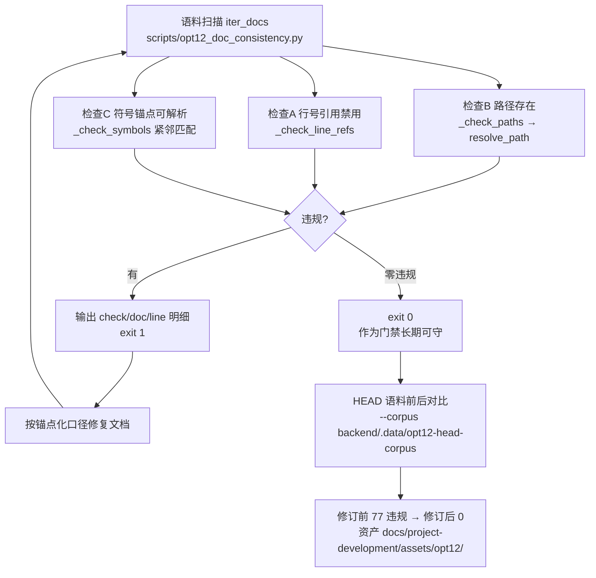
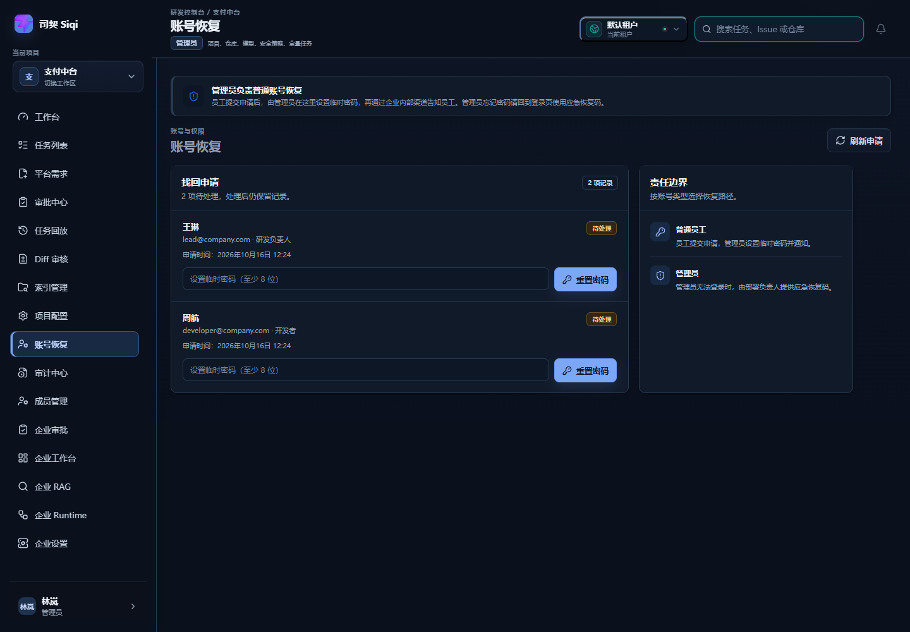

# OPT-12 文档状态与时间线一致性

> 目标：把 OPT-11（`main.py` 9177→7651 行、12 个 APIRouter 迁出）之后失效的历史文档引用一次性修净，
> 并把「引用会不会再次漂移」变成**机器可校验**的问题；同时核实并处理若干时间线/状态陈旧项
> （00-log 截图状态、`docs/22` 存根、`docs/23` 检查点口径、`03` 截图节）。

## 1. 目标、范围与设计契约

### 1.1 问题与修订口径

- 问题：历史开发文档大量使用 `main.py:<行号>` 引用；OPT-11 拆分后行号整体漂移，按行号跳转会指到错误位置。
- 修订口径（全文统一）：
  1. **禁止行号引用**：`main.py:<数字>` 形态一律改写；
  2. 改用「**文件路径（符号名）**」锚点（全角括号），例如 `backend/app/main.py（generate_task_plan）`；
  3. 被 OPT-11 迁移到 `backend/app/api/` 的处理函数，锚点指向**新模块**，例如 `backend/app/api/audit.py（list_pending_approvals）`；
  4. Mermaid 图内标注源码位置的节点文本**不加反引号**（Mermaid 渲染兼容）。

### 1.2 范围（登记输入 → 处理结果）

| 输入 | 处理 |
| --- | --- |
| 11 份文档 83 处 `main.py:<行号>` 漂移 | 全部锚点化（明细见 §2） |
| 检查器新发现的 4 处真实坏引用 | 一并修复（§2.3） |
| `docs/mentor/` 历史语料 | 加行号漂移免责声明（保真不改写） |
| 00-log DEV-003 / DEV-008 截图状态 | 核实后修正（§6.1/§6.2） |
| `docs/22` 陈旧存根 | 加 2026-10-16 复核记录（§6.3） |
| `docs/23` 检查点「MySQL」矛盾 | 加检查点口径注记（§6.4） |
| `03` 截图节（无嵌入图） | 4 张真实截图重拍回填（§6.5） |

## 2. 修订明细（锚点化）

### 2.1 修订前基线（git HEAD 语料，60 份已跟踪文档）

`HEAD` 版语料跑同一检查器：**77 处违规 = 73 stale_line_ref + 4 missing_path**，按文档分布：

| 文档 | stale_line_ref | 说明 |
| --- | --- | --- |
| `10-approval-module.md` | 15 | 审批模块（Mermaid + 源码表 + `_APPROVAL_LOCK`） |
| `16-team-request-draft.md` | 10 | 团队需求草稿（权限/记录/校验函数） |
| `12-test-execution.md` | 9 | 测试执行（统一入口 + 持久化表） |
| `19-team-context-fill.md` | 8 | 团队上下文补齐（相似任务/检索注入） |
| `17-team-request-sync-gitee.md` | 7 | Gitee 同步（含失败分流） |
| `18-team-request-create-task.md` | 7 | 需求转任务（自动建任务） |
| `20-team-analysis-plan.md` | 6 | 分析计划增强（数据源/结构门禁） |
| `94-repository-lifecycle-isolation.md` | 6 | 仓库生命周期（更新入口/归档/替换审计） |
| `14-task-replay-audit.md` | 4 | 回放与审计（事件/步骤/时间线） |
| `90-fix-refresh-redirect-to-login.md` | 1 | 刷新跳登录（CORS 配置） |
| `19-framework-alignment-rag-agent-db.md` | 0 | （见 §2.3 路径修复） |
| `32-replay-summary-audit.md` | 0 | （见 §2.3 路径修复） |
| `92` / `93` 面试复盘 | 0 | （见 §2.3 路径修复） |

另有 `121-opt09-embedding-index-lifecycle.md` 的 **10 处**（Mermaid B1–B5/B7 + 表 L132-135），
该文档为 OPT-09 会话未提交产物（untracked），无法用 `git show HEAD:` 复现修订前形态，按实测记录。

**83 = 73（10 份已跟踪）+ 10（121 未跟踪）**，与登记数完全一致。

### 2.2 锚点化示例（每份文档逐一核实现役位置后再改写）

| 原写法（修订前） | 修订后锚点 |
| --- | --- |
| `main.py` 原第 3147 行（审批人指派） | `backend/app/main.py（assign_task_approval_owner）` |
| `main.py` 原第 1234 行（待审批队列，已迁出） | `backend/app/api/audit.py（list_pending_approvals）` |
| `main.py` 原第 5015 行（上下文恢复） | `backend/app/main.py（resume_task_contexts）` |
| `main.py` 原第 207–222 行（CORS 区间） | `backend/app/main.py（CORSMiddleware 注册）` |
| `reads.py:251`（已漂移到 413） | `backend/app/db/reads.py（list_pending_approvals）` |
| `models/orm.py:172`（已漂移到 219） | `backend/app/models/orm.py（RepositoryORM）` |

### 2.3 检查器新发现的 4 处真实坏引用（一并修复）

原引用字面量存于 `assets/opt12/before-head-corpus.json` 的 `missing_path` 明细（本表按「不含失效路径 token」的写法转述）：

| 文档 | 原引用（不存在） | 修正为 |
| --- | --- | --- |
| `19-framework-alignment-rag-agent-db.md:40` | `backend/app/db/models/` 段下的 `orm.py`（目录层级不存在） | `backend/app/models/orm.py`（真实类位置） |
| `32-replay-summary-audit.md:88` | `dev_demo_dev007` 起五个脚本的斜杠串写 | 五个显式文件名（`dev_demo_dev007.py`、`dev_demo_dev009.py`、`dev_demo_dev010.py`、`dev_demo_dev017.py`、`dev_demo_dev018.py`，逐一存在） |
| `92-rag-llamaindex-interview-review.md:147` | `backend/tests/` 下缺 `rag_` 中缀的 `test_milvus_realtime` 写法 | `backend/tests/test_rag_milvus_realtime.py::...` |
| `93-project-problem-interview-review.md:321` | 同上 | 同上 |

## 3. 一致性检查器（新增）

`backend/scripts/opt12_doc_consistency.py` —— 扫描 `docs/project-development/**.md`（**排除 `assets/`**，历史证据文件不得改写）：

| 检查 | 代号 | 规则 |
| --- | --- | --- |
| A | `stale_line_ref` | 正文不得出现 `main.py:<数字>`（含区间 `-`）行号引用 |
| B | `missing_path` | 正文引用的带路径 `.py` 必须真实存在（四前缀解析 + `../` 归一化 + 合成演示白名单 + 后缀唯一匹配） |
| C | `missing_symbol` | 「`路径.py（符号…）`」锚点中的标识符必须能在该文件中找到（防文件搬走后锚点悬空） |

退出码：`0` = 零违规；`1` = 有违规。`--json` 结构化输出（供测试断言）；`--corpus <dir>` 指向自定义语料（历史基线对比/回归实验）。

### 3.1 主链路（Mermaid，含源码位置）



### 3.2 关键代码说明

- **路径解析 `resolve_path`**：按 `仓库根 / backend / frontend / backend/app` 四前缀解析；`../` 前缀按「从 backend 出发」归一化；后缀唯一匹配兼容「包内相对写法」（如 `agents/tools.py`），仅全仓唯一命中才接受，避免掩盖歧义。
- **合成演示白名单 `_SYNTHETIC_DEMO_PATHS`**：评测/演示语料中脱敏虚构的被检仓库文件（`src/refund.py`、`src/payment/refund.py`、`services/callback/timeout_handler.py`），本就不存在，不报缺失。
- **检查 C 紧邻匹配**：锚点的路径 token 必须恰好止于 `.py`（`path_match.end() == match.start()+3`），防止把上一行的路径误配给本引用。
- **`_doc_label`**：输出标签对语料内外路径都健壮（仓库内取仓库相对路径，临时语料取语料相对路径），支撑 `--corpus` 与测试。

## 4. 前后对比证据（真实可复现）

| 语料 | 文档数 | 违规 | 产物 |
| --- | --- | --- | --- |
| **修订前**：git HEAD 导出（已跟踪文档） | 60 | **77**（73 stale_line_ref + 4 missing_path） | `assets/opt12/before-head-corpus.json` |
| **修订后**：当前工作区（含本文件） | 72 | **0**（98 个「路径（符号）」锚点被逐一校验） | `assets/opt12/after-current.json` |

复现命令：

```bash
# 修订前语料（从 HEAD 导出已跟踪文档）
git ls-tree -r HEAD --name-only docs/project-development/ | grep -v '/assets/' | while read -r f; do
  rel="${f#docs/project-development/}"; mkdir -p "backend/.data/opt12-head-corpus/$(dirname "$rel")"
  git show "HEAD:$f" > "backend/.data/opt12-head-corpus/$rel"
done
cd backend && python scripts/opt12_doc_consistency.py --corpus .data/opt12-head-corpus --json   # → 77 违规, exit 1
python scripts/opt12_doc_consistency.py --json                                                 # → 0 违规, exit 0
```

## 5. 测试（门禁 + 侦测能力）

`backend/tests/test_opt12_doc_consistency.py`（子进程隔离、hermetic 环境，真实执行输出；回填本文件后复跑）：

```text
.....                                                                    [100%]
5 passed in 2.56s
```

| 用例 | 断言 |
| --- | --- |
| `test_current_corpus_is_clean` | 当前正式语料零违规（门禁，文档再引入行号引用即红） |
| `test_stale_line_ref_detected_in_temp_corpus` | 临时语料写入 `main.py` 行号引用（第 123 行） → exit 1 + 明细 |
| `test_synthetic_demo_paths_allowed` | 合成演示路径放行（不误报） |
| `test_missing_path_and_symbol_detected` | 不存在路径 + 悬空符号锚点分别检出 |
| `test_valid_symbol_anchor_passes` | 真实符号锚点正向通过 |

## 6. 时间线/状态核实项处理结果

### 6.1 00-log DEV-008：截图状态陈旧 → 修正

08 文档 §真实内容截图已归档 2 张真实截图（`docs/assets/dev008-index-list-real.png`、`dev008-code-context-real.png`），且异常分支 2 张如实声明未采集（不用编造图替代）；00-log 索引表却仍写「待补截图」。**已修正**为「已完成（截图已归档，异常分支 2 张如实声明未采集）」。

### 6.2 00-log DEV-011/012/013：孤儿截图核实（如实记录，不擅自回填）

`docs/assets/` 存在 8 张 2026-09-05 采集的截图（`dev011-*` / `dev012-*` / `dev013-*`），但**全仓（含 git 全历史）零引用**。抽查确认其为旧品牌（「研发协作平台」时期）且存在渲染缺陷，与当前「司契」交互一致性无法核证 → **维持「待补真实截图」状态**，不使用未入档的旧图冒充结果。后续联调时按当前品牌重拍回填。

### 6.3 `docs/22-project-development-log.md`：加复核记录

该存根已有「旧入口」声明与快照警告；本次补充 **2026-10-16 复核记录**：7 行「未开始」为立项时规划快照，勿据此判断进度，当前进度以 `PROJECT_PROGRESS.md` 与新总表为准。

### 6.4 `docs/23` 检查点口径：加注记（正文保真）

核实结论：设计期口径「检查点持久化到 MySQL / langgraph checkpoint 序列化图状态 / 投递 resume_agent 恢复」与现行实现有 4 点差异（表落 `agent_checkpoints` 但介质随环境；仅存 `{status, next_action}` 摘要；恢复靠任务状态真源驱动同图继续；best-effort 不阻断）。已加 **检查点口径注记（2026-10-16 复核）**，正文按设计期快照保真。

### 6.5 `03` 截图节：4 张真实截图重拍回填

03 文档截图节原为文字验收记录、无嵌入图；assets 中的 4 张旧图为旧品牌。本次以隔离环境真实重拍并回填：

- 环境：前端 dev server `localhost:5181`（`VITE_API_PROXY_TARGET=http://127.0.0.1:8021`）＋后端隔离实例 `127.0.0.1:8021`（`USE_SQLALCHEMY=false` 内存态），1440×1000 视口；
- 数据：2 条经 `POST /api/auth/password/forgot` 真实提交的待处理申请（王琳/周航）；
- 同步修正 03 文档 Mermaid 与源码表中已迁移的 auth 域位置（`backend/app/main.py` → `backend/app/api/auth.py`）。



其余 3 张（找回密码/服务协议/隐私政策）见 `03-password-recovery-and-legal-pages.md` 截图节。

## 7. 相关源码文件位置

- `backend/scripts/opt12_doc_consistency.py`（检查器：A/B/C 三检查 + 路径解析 + `--corpus`）
- `backend/tests/test_opt12_doc_consistency.py`（5 用例门禁）
- `backend/.data/opt12-head-corpus/`（HEAD 修订前语料现场，`.data` 已 gitignore）
- `docs/project-development/assets/opt12/`（前后对比 JSON）
- `docs/mentor/README.md`（历史语料行号漂移免责声明）

## 8. 联调注意点

1. **新增文档引用规范**：禁止 `main.py:<行号>`；处理函数被迁移后锚点要指向 `backend/app/api/*.py` 新址；改完跑 `python backend/scripts/opt12_doc_consistency.py` 确认零违规。
2. **`assets/` 不被扫描**：历史证据文件（截图/JSON）按保真原则不改写；语料修订只作用于 `*.md` 正文。
3. **`docs/mentor/` 等历史语料不在扫描范围**：按「保真 + 免责声明」处理，不做锚点化改写。
4. **模拟/合成演示路径**：评测文档中的虚构仓库文件走白名单；新增此类文档时若报 `missing_path`，确认是合成语料后加白名单而不是改文档。
5. **截图重拍链路（03 复用）**：`VITE_API_PROXY_TARGET` 环境变量即可让 vite 代理指向隔离后端，无需改 `vite.config.ts`；截图前用 API 造真实数据（如找回申请），结束后停隔离实例。
