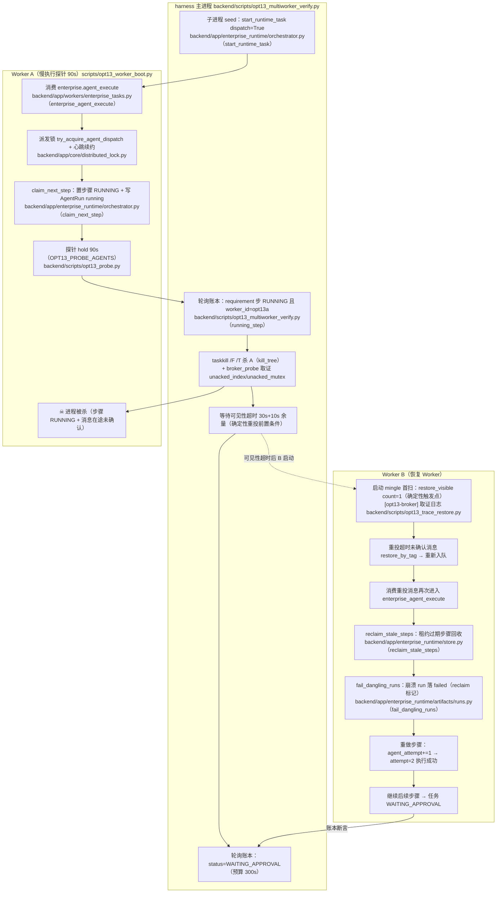
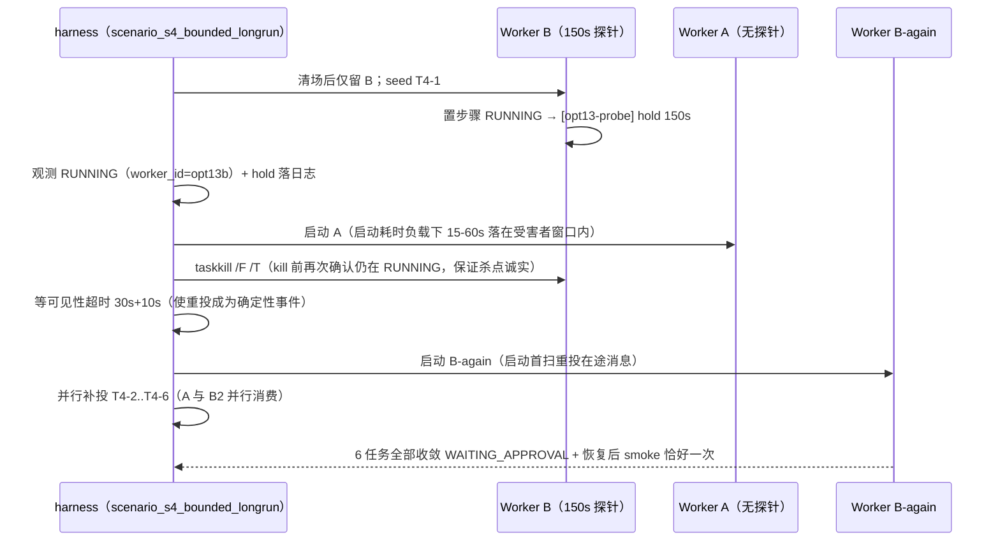

# OPT-13 Celery 多 Worker 恢复与长稳验证

> 目标：在**默认隔离环境**（真实双 Celery Worker 进程 + fakeredis TCP 协议 broker + 真实 SQLite +
> 真实 `taskkill` 故障注入）中，把「Worker 被杀后 v2 多 Agent 任务能否收敛」从承诺变成
> **可复现的真实运行证据**：竞争、重复投递、崩溃恢复、有界长稳四类场景全部机器断言。
> 本任务同时暴露并修复了多条真实缺陷链（NoScriptError 残锁抑制恢复、S4 受害者竞态、S2 跨子进程
> 冷启动竞态、append 日志断言污染），并针对环境冷启动方差（1.5-6s 与 30-90s 双峰）统一加固了
> 等待窗口与超时口径；全部证据来自 2026-10-16 三轮全量运行的原始日志与报告 JSON
> （前两轮失败保全对照，第三轮 36/36 全绿）。

## 1. 目标、范围与设计契约

### 1.1 问题

v2 多 Agent 任务链是**多步、跨消息**的：`requirement_agent → repository_research_agent → planner_agent`
每一步都由 Celery 消息驱动，任一步骤执行中都可能遇到 Worker 进程被杀（发布、OOM、机器故障）。
一次 kill 会留下「步骤 RUNNING + broker 在途未确认消息」的组合态。必须回答四个问题：

1. **恰好一次**：双 Worker 并存时，消息是否被恰好消费一次（S1）？
2. **锁竞争**：同一任务被重复投递（at-least-once 语义必然产物）时，是否被派发锁有界重试覆盖、
   且不产生重复 AgentRun（S2）？
3. **崩溃恢复**：执行期中部被杀后，任务能否在预算内收敛到 `WAITING_APPROVAL`，
   账本是否一致（崩溃 run 落 `failed`、redo `attempt=2`、无悬挂 `running`）（S3）？
4. **有界长稳**：多个任务并发运行中杀 Worker，恢复后整批收敛、消息链路仍健康（S4）？

### 1.2 范围

| 场景 | 内容 | 主要断言 |
| --- | --- | --- |
| S1 | smoke×6 双 Worker 分布消费 | 恰好一次、结果回读一致 |
| S2 | 同任务双投递（A 持锁窗口内投第二条） | B 锁忙有界重试、单链执行、各步 succeeded=1 |
| S3 | 崩溃恢复（kill A 中途 → 可见性超时 → B 首扫重投） | 崩溃 run failed + redo attempt=2、kill→收敛<300s、broker 取证 |
| S4 | 有界长稳（确定性受害者 T4-1 → 恢复后 6 任务收敛） | 杀点确定在步内、账本全绿、kill→全量收敛<300s（总墙钟仅报告）、恢复后 smoke 恰好一次 |

> 计时口径：S1-S4 的进程启动时间受环境冷启动方差影响（热 1.5-6s / 冷或负载下 30-90s 双峰），
> 因此断言用「kill→收敛」等事件间口径，不把启动耗时算进预算；总墙钟仅作报告字段。

明确不做（诚实边界，见 §7）：真实 `redis-server`、多机/网络分区、真实模型调用、生产库写操作。

### 1.3 设计契约（隔离配方）

- broker：`scripts/opt13_fake_redis.py`（fakeredis `TcpFakeServer`，**真实 RESP 协议 + Lua**，非本机 redis-server）；
- DB：真实 SQLite（`sqlite:///.../run/app.db`），真实 schema（`create_schema + migrate`）；
- Worker：真实生产 `celery_app`（仅替换 broker 指向）+ `--pool=solo -n opt13a/opt13b@127.0.0.1
  --prefetch-multiplier=1`，`taskkill /F /T` 真实杀进程树；
- Agent：`AGENT_PROVIDER=deterministic`（tests-only，**不调真实模型**）；
- 断言来源：DB 账本（`enterprise_runtime_tasks` / `enterprise_agent_runs`）+ Worker 原始日志 + broker 键取证，
  全部落 `backend/.data/opt13-exp/opt13_multiworker_report.json`。

## 2. 场景设计与业务流程

### 2.1 S3 崩溃恢复主链路（Mermaid，含源码位置）



**异常分流说明**：

- 消息未被重投（在途未确认、broker 可见性未超时）→ B 保持空转，harness 以 `redelivered_to_b=False` 如实失败；
- 恢复扫描被 `unacked_mutex` 残锁抑制（§3.3 缺陷）→ 重投被整体跳过，harness 以 `no_stale_mutex_before_recovery=False` 定位；
- 崩溃 run 未被标记 failed（reclaim 未生效）→ `crash_run_failed_and_redo_attempt2=False`；
- 幂等破坏（重复 AgentRun）→ `later_steps_single_clean_run` / 悬挂检查失败。

### 2.2 S4 确定性故障注入时序（重设计后）



> 旧设计缺陷：串行 seed 6 个任务（~60s）后才开始找「谁能观测到 RUNNING」，短探针窗口早已结束，
> `killed_mid_step` 恒 False（详见 §3.4）。

> 实证注记（最终运行）：重投并非必须由 B-again 触发——A 在受害者窗口内启动，其**启动首扫**先一步
> 完成 restore（§6.3 日志），B-again 的首扫见到队列已空则空转。两者都是「新 Worker 启动首扫」
> 这一确定性机制的有效实例，断言因此不绑定具体重投者（`victim_still_running_at_kill` 等只锚事实）。

## 3. 关键机制与缺陷修复（本任务的核心产出）

### 3.1 执行侧四组能力（TDD 覆盖，见 §5）

| 能力 | 位置 | 语义 |
| --- | --- | --- |
| F1 派发锁 TTL + 有界重试 | `backend/app/workers/enterprise_tasks.py`（enterprise_agent_execute） | 持锁心跳按 TTL 续约；崩溃后锁 ≤1 个 TTL 自动过期；锁忙不静默丢弃，有界重试覆盖 ≥1 个 TTL 窗口；重试耗尽=持有者存活，返回 skipped |
| F2 崩溃步骤回收 | `backend/app/enterprise_runtime/store.py`（reclaim_stale_steps） | 租约过期的 RUNNING 步骤可被重新 claim（条件 UPDATE，不越位抢占新鲜租约） |
| F3 崩溃重做记账 | `backend/app/enterprise_runtime/orchestrator.py`（claim_next_step）+ `backend/app/enterprise_runtime/artifacts/runs.py`（fail_dangling_runs） | 回收时崩溃 AgentRun 落 failed（error_reason 含 reclaim），步骤 agent_attempt+=1，重做 run attempt=2 |
| F4 Worker 运行前缓存刷新 | `backend/app/workers/runtime.py`（ensure_worker_runtime_ready） | Worker 不过 FastAPI lifespan，内存 runtime store 启动后新建任务需刷新才可见（S2 实测 KeyError 根因）；刷新失败直接上抛不吞 |

### 3.2 kombu 恢复扫描的确定性触发点（实证）

kombu redis transport 的可见性恢复扫描（`QoS.restore_visible`）由轮询周期驱动：

- **空闲 Worker 阻塞在 BRPOP 时不会周期扫描**（实测 B3 新进程仅 count=1 与 count=11 两个窗口，间隔 ~100s 而非 10s）；
- **新 Worker 启动的 mingle 广播（`inspect.hello` → `drain_events` → `get()` 尾部）首扫 count=1 必扫**，
  这是「崩溃后重投」的确定性触发点。

因此 harness 的恢复时序设计为：**杀 A → 等过可见性超时（30s+10s 余量，让在途消息"超时"）→ 再启动 B**，
使重投成为确定性事件；等待期同时让步骤租约（10s）先行过期，回收与重做顺序确定。

### 3.3 缺陷 1：NoScriptError 残锁整体抑制恢复扫描（本会话根因实证）

**症状**：全量运行 S3 零接收 350s、recovery 221.04s 超 180s 预算（5/13 checks）。

**根因链**（失败运行日志保全在 `backend/.data/opt13-exp/failed_run_20261016_1405/`）：

1. redis-py 的 `Lock.release()` 走 Lua（EVALSHA 未命中 → `NoScriptError` → 回退 `SCRIPT LOAD`）；
2. 本机 fakeredis（`TcpFakeServer`）在该回退路径上偶发「连接被服务端关闭」
   （A1 14:05:18：`NoScriptError` → `WinError 10053`；b-again 14:13:41：`NoScriptError` → `server closed`）；
3. kombu 的 `Mutex.release` 只捕获 `LockNotOwnedError`，连接异常直接冒泡 → **解锁从未执行**；
4. `unacked_mutex` 以 TTL=300s 残留 → 其后**所有** Worker 的恢复扫描全部 `MutexHeld` 静默跳过
   （A2/B2/A3/B3 四个新进程的窗口全被抑制）→ 崩溃重投被整体抑制；
5. B3 被杀时距残锁过期只剩 ~20s、距下个扫描窗口 ~22s —— 5/13 失败的完整解释。

**修复**（`backend/scripts/opt13_trace_restore.py`，仅 harness Worker 引导加载，生产代码零改动）：

- 以无 Lua 实现替换 `kombu.transport.redis.Mutex`：加锁 `SET name token NX PX expire`；
  解锁 `WATCH/GET 比对/MULTI/DEL` 原子 CAS 删除（`_release_quietly`）；
- 语义对齐：非阻塞、争用抛 `MutexHeld`、TTL = `unacked_mutex_expire`（300s）；
- **释放失败只记日志不上抛**（避免 fakeredis 抖动级联为连接丢失 + 残锁）；
- 同一模块输出 `[opt13-broker]` 取证日志（扫描窗口计数、mutex acquire/busy/release、
  restore-tag/restore-push、deliver/ack tag），供文档与报告的证据链引用。

> 生产边界说明：真实 `redis-server` 的 SCRIPT LOAD 路径远比 fakeredis 稳定，本缺陷是**测试台架代表性不足**暴露的
> 加固需求；但「释放失败 → 300s 残锁 → 恢复扫描停摆」的失效模式在生产同样成立（kombu 对连接类异常不设防线），
> 因此该加固对任何计划在故障演练中复现恢复行为的团队都有参考价值（§7 记入生产边界）。

### 3.4 缺陷 2：S4 受害者竞态（killed_mid_step 恒 False）

旧设计串行 seed 6 个任务（~60s）后才轮询「T4-x 在 B 上 RUNNING」，而 B 的短探针（8s）窗口早已结束 →
`victim_task=None`、`killed_mid_step=False` 恒成立（报告保全于失败运行目录）。重设计为
**确定性受害者**（§2.2）：先只留带 150s 长探针的 B 消费 T4-1，观测 RUNNING+hold 后才启动 A 并杀 B；
`killed_mid_step` 要求 kill 前再次确认受害者仍在 RUNNING（不虚构故障点）。

**S2 同源竞态**（2026-10-16 全量实测）：seed 与 send-execute 原为两个独立子进程，发送侧冷启动 ~35s，
重复消息在 A 探针窗口（旧 25s）结束后才到达，被已空闲的 A 自己消费（B 零接收、`busy_retry=0`）。
修复为 `seed-then-dup` 单子进程模式（观测 RUNNING 后立即发送）+ 探针 150s（须覆盖 B 启动上界）。

### 3.5 修复 3：append 日志的断言污染（harness 自检缺陷）

同一 Worker 名重启会 append 到同一日志文件，旧会话内容污染三类断言（ready 瞬时匹配、probe hold 残留、
redelivered 误报）。修复：`start_worker` 记录行数基线 `log_lines0`，新增 `wait_new_log` / `log_since` /
`count_received_enterprise_since` 全部按会话切片。

## 4. 关键代码说明

### 4.1 harness 主流程 —— `backend/scripts/opt13_multiworker_verify.py`

- `main`：拉起 fake-Redis → init-db（子进程）→ 按 `--scenarios` 顺序执行 s1..s4 → 汇总
  `checks_all_passed` 落报告 JSON；退出码 0=全过 / 2=有失败（如实报告，不伪造成功）。
- `scenario_s1_smoke`：6 条 smoke 消息按 `message=` 标记在双 Worker 日志中计数=1。
- `scenario_s2_double_dispatch`：A 带 150s 探针（`S2_PROBE_SLEEP`），重复消息由 `seed-then-dup`
  子进程在观测到 RUNNING 后立即发送（消除跨子进程冷启动竞态），B 锁忙重试（`retry: Retry in`）
  后接管空跑；账本断言各步 succeeded exactly once。
- `scenario_s3_crash_recovery`：§2.1 主链路 + 两处 `broker_probe` 取证（杀 A 后 / 起 B 前），
  新增检查 `in_flight_unacked_present`（unacked_index 存在途条目）与
  `no_stale_mutex_before_recovery`（unacked_mutex 无残锁；probe 出错则判 False，不伪造通过）。
- `scenario_s4_bounded_longrun`：§2.2 时序；检查项 `killed_mid_step` 三条件合取
  （RUNNING 已观测 + hold 落日志 + kill 时仍 RUNNING）。
- `broker_probe`：直连 fake-Redis 只读采集 `unacked_index` 在途条目、`unacked_hlen`、
  `unacked_mutex` TTL、队列 list 长度（异常时返回 error 字段如实记录）。
- `run_ledger_check`：S3 强断言（failed attempt=1 含 reclaim + succeeded attempt=2）/ S4 宽松断言
  （kill 落点毫秒窗口两种形态均合法，只需无悬挂）。
- `run_child` / `run_children_parallel`：子进程调用统一按环境冷启动上界设超时（240-300s），
  超时收敛为 `rc=-998` 的场景级失败检查（不升级为全局 fatal 跳过后续场景）；S4 的 5 个补投 seed
  并行启动（共享截止时间），摊平串行冷启动墙钟（每个 30-90s）。

### 4.2 Worker 引导 —— `backend/scripts/opt13_worker_boot.py`

真实生产 `celery_app`，仅注入 harness 环境（broker/DB/探针/可见性超时），并 import
`scripts.opt13_trace_restore` 侧效应模块（mutex 加固 + 取证），再加载 `scripts.opt13_probe`（确定性探针）。

### 4.3 子进程模式（隔离工程）

harness 主进程不 import 任何 app 模块；seed / send-execute / smoke / init-db 都通过
`run_child` 起独立子进程（`python -m scripts.opt13_multiworker_verify --mode ...`），
每个子进程使用同一套隔离环境配方（`build_env`）。

## 5. 测试

### 5.1 单测门禁

`backend/tests/test_opt13_multiworker_verify.py`（`16 passed`）：覆盖 F1-F4 四组机制
（派发锁 TTL/有界重试/心跳续约与失续停止、内存态与 SQLite 两种后端的
reclaim/touch_lease/不越位抢占、崩溃回收 failed+attempt 记账、运行前刷新与刷新失败不吞）。

`backend/tests/test_opt13_harness_gate.py`（`5 passed`）：harness 装配门禁（CLI `--help`
可解析、探针默认关闭且开启时才 patch `executor.build_agent`、worker_boot 的
visibility_timeout 覆盖接线生效、harness 主模块 import 不引入任何 `app.*`——保持
「主进程不碰 app」的子进程隔离设计）。命令：

```bash
cd backend && .venv/Scripts/python.exe -m pytest tests/test_opt13_multiworker_verify.py tests/test_opt13_harness_gate.py -q
```

### 5.2 全量回归

见 §6.5（全量 pytest 门禁结果）。

## 6. 真实运行证据（2026-10-16）

### 6.1 全量运行命令与报告

```bash
cd backend && .venv/Scripts/python.exe -m scripts.opt13_multiworker_verify --scenarios s1,s2,s3,s4
# 报告：backend/.data/opt13-exp/opt13_multiworker_report.json
```

**最终运行**（2026-10-16，全绿）：报告 `checks_all_passed=true`、`fatal_error=null`、harness 退出码 0。
运行产物双份保全：工作副本 `backend/.data/opt13-exp/final_run_20261016_1503/`（gitignored，本机对拍用），
以及**受版本管理的证据副本** `docs/project-development/assets/opt13/`——
`opt13_multiworker_report_final.json` + 四个 Worker/Redis 全量日志 + 两轮失败运行报告
（`..._run1_failed_1405.json` / `..._run2_failed_1445.json`，§6.4 对照）。

| 场景 | 检查 | 墙钟 | 关键数据（全部来自报告 JSON 与日志） |
| --- | --- | --- | --- |
| S1 恰好一次 | 4/4 | 88.62s | 6 条消息各被消费恰好 1 次（分布 A:4 / B:2）；结果回读全部一致 |
| S2 双投递 | 10/10 | 177.86s | A 在 150s 探针持锁期内出现 3 条投递（种子 + 可见性重投 + 主动 dup）；B 消费其中 2 条并各做 5 次锁忙重试（`retry: Retry in` ×10）后如实返回 skipped；终态 waiting_approval、3 步 completed、各步 succeeded run=1、`err=` 0 |
| S3 崩溃恢复 | 15/15 | 159.65s | kill→收敛 111.28s（≤300s）；杀 A 后在途未确认 1 条、恢复前无残锁；重投到 B 1 次；requirement attempt 1 failed(reclaim)→2 succeeded；其余步 attempt=1 干净；重做由 B 完成 |
| S4 有界长稳 | 7/7 | 183.89s | 受害者 T4-1 杀点三项确认（RUNNING + hold 落日志 + kill 时仍 RUNNING）；kill→全量收敛 104.7s（≤300s）；6 任务全 waiting_approval、账本 0 悬挂；恢复后 smoke 恰好一次 |

合计 **36/36 检查全过**。注：S2 的可见性重投为真实行为（A 持锁 150s > 可见性超时 30s 触发 restore），
使该场景同时覆盖「可见性重投 + 派发锁 + 有界重试 + 幂等跳过」组合，强于原始设计意图。

### 6.2 S3 崩溃恢复证据链

**时间线**（报告 `timeline`，UTC→本地 +8；对应 §2.1 主链路逐步落地）：

| 事件 | 时刻（本地） | 数据 |
| --- | --- | --- |
| seeded | 15:13:10.21 | 子进程 seed 派发 T3-crash |
| step_running_on_a | 15:13:10.22 | requirement 步 RUNNING，worker_id=opt13a，agent_attempt=0 |
| worker_a_killed | 15:13:11.50 | `probe_seen=true`（hold 已落日志）、taskkill 退出码 1 |
| visibility_elapsed | 15:13:50.94 | 等待 40.7s（30s 可见性 + 10s 余量） |
| broker_before_recovery | 15:13:50.97 | 在途未确认 1 条、unacked_mutex 不存在 |
| worker_b_started | 15:14:59.44 | B 就绪（含 68s 冷启动） |
| recovered | 15:15:01.55 | status=waiting_approval，**kill→收敛 111.28s** |

**broker 取证对比**（只读直连 fake-Redis）：

| 键 | 杀 A 后（15:13:11） | 起 B 前（15:13:50） |
| --- | --- | --- |
| `unacked_index` | 1 条：`940a9ba2-…` @ score 1792134782.22 | 不变（在途未确认=崩溃消息仍在 unacked 集合） |
| `unacked` hash | hlen=1 | hlen=1 |
| `unacked_mutex` | 不存在（ttl=-2） | 不存在（ttl=-2；无 NoScriptError 残锁） |

**账本断言**（`enterprise_agent_runs`）：requirement_agent `attempt=[1,2]`（1 条 failed，error_reason 含
reclaim；1 条 succeeded attempt=2），repository_research_agent / planner_agent 各 1 条 succeeded attempt=1，
全任务 0 条悬挂 running；完成后的步骤 worker_id 全部为 opt13b（重做由 B 承接）。

**B 侧原始日志**（`worker_opt13b.log`）：

```
15:14:58.099 mingle: searching for neighbors
15:14:59.186 [opt13-broker] restore-scan-window count=1 visibility_timeout=30s
15:14:59.189 [opt13-broker] mutex acquire name=unacked_mutex ttl=300s
15:14:59.193 [opt13-broker] restore-tag tag=b'940a9ba2-08f3-49a4-93c1-eae362589a32'
15:14:59.199 [opt13-broker] restore-push exchange= routing_key=celery leftmost=False
15:14:59.206 [opt13-broker] mutex release name=unacked_mutex
15:14:59.334 [opt13-broker] deliver tag=940a9ba2-…（同一 tag 重新投递）
15:14:59.340 Task enterprise.agent_execute[17ed8545-…] received
15:15:01.334 Task enterprise.agent_execute[17ed8545-…] succeeded in 2.0s: {'task_id': 'T3-crash', …}
```

### 6.3 [opt13-broker] 取证日志摘录

S4 的恢复链在同一次运行中由 **A 的启动首扫**触发（B 被杀后的确定性重投，与 S3 同机制）：

```
# worker_opt13a.log（S4 窗口）
15:16:20.604 [opt13-broker] restore-scan-window count=1 visibility_timeout=30s
15:16:20.606 [opt13-broker] mutex acquire name=unacked_mutex ttl=300s
15:16:20.606 [opt13-broker] restore-tag tag=b'da7ca5a6-…'（受害者 B 被杀时的在途消息）
15:16:20.608 [opt13-broker] restore-push exchange= routing_key=celery leftmost=False
15:16:20.611 [opt13-broker] mutex release name=unacked_mutex
15:16:20.864 Task enterprise.agent_execute[a1dd18d5-…] retry: Retry in 5s   # 锁仍被 B 持有（心跳未停）
15:16:26.167 Task enterprise.agent_execute[a1dd18d5-…] retry: Retry in 5s
15:16:31.232 Task enterprise.agent_execute[a1dd18d5-…] retry: Retry in 5s
15:16:37.039 Task enterprise.agent_execute[a1dd18d5-…] succeeded in 0.81s: {'task_id': 'T4-1', …}
             # B 死亡后派发锁 ≤1 个 TTL 过期 → 有界重试接棒 → reclaim + attempt=2 重做成功
```

```
# worker_opt13b-again.log（S4 第二个 Worker 启动首扫：队列已无在途 → 空转不重复重投）
15:17:23.333 [opt13-broker] restore-scan-window count=1 visibility_timeout=30s
15:17:23.334 [opt13-broker] mutex acquire name=unacked_mutex ttl=300s
15:17:23.341 [opt13-broker] mutex release name=unacked_mutex
```

**加固有效性复检**（`final_run_20261016_1503/` 四份日志全量 grep）：

| 模式 | 命中数 | 说明 |
| --- | --- | --- |
| `NoScriptError` | **0** | 无 Lua 加固后解锁不再走 EVALSHA 回退路径 |
| `mutex busy` / `MutexHeld` | **0** | 无残锁：每次扫描都拿到锁并正常释放 |
| `mutex release-error` / `release-abort` | **0** | CAS 释放全部成功 |

### 6.4 失败运行保全（对照证据）

本任务共三轮全量运行，前两轮失败全部保全并驱动了对应修复（不掩盖、不删除失败证据）：

| 轮次 | 报告保全（docs 侧副本前缀 `assets/opt13/`） | 结果 | 暴露的缺陷 → 修复 |
| --- | --- | --- | --- |
| 第 1 轮 14:05 | `opt13_multiworker_report_run1_failed_1405.json` | S1 4/4、S2 10/10、**S3 5/13**（recovery 221.04s 超 180s 预算、重投被抑制）、S4 5/7（`killed_mid_step=false`） | ① NoScriptError 残锁抑制恢复扫描 → `opt13_trace_restore.py` 无 Lua mutex 加固（§3.3）；② S4 受害者竞态 → 确定性受害者重设计（§3.4） |
| 第 2 轮 14:45 | `opt13_multiworker_report_run2_failed_1445.json` | S1 4/4、**S2 8/10**（`b_busy_retry_observed=false`）、**S3 fatal**（seed 子进程 90s TimeoutExpired）、S4 未执行 | ① S2 跨子进程冷启动竞态 → `seed-then-dup` 单子进程 + 探针 150s（§3.4）；② 环境启动方差暴露 → 全量超时按冷启动上界加固 + 子进程超时收敛为 rc=-998（§4.1） |
| 第 3 轮 15:03（最终） | `opt13_multiworker_report_final.json` | **36/36 全绿**，退出码 0 | — |

第 1/2 轮失败项的最终对应检查（第三轮全部转绿）：
`recovered_in_budget`、`final_waiting_approval`、`completed_steps_ok`、`crash_run_failed_and_redo_attempt2`、
`later_steps_single_clean_run`、`step0_redone_by_b`、`no_dangling_runs`（S3）；
`killed_mid_step`（S4）；`b_busy_retry_observed`（S2）。

### 6.5 单测与全量回归

**专项单测**（两个新增文件共 21 项，`21 passed in 45.02s`）：`test_opt13_multiworker_verify.py`
覆盖 F1-F4 机制（`16 passed`）；`test_opt13_harness_gate.py` 覆盖 harness 装配门禁
（`5 passed`：CLI 解析、探针默认关闭/开启才 patch、visibility_timeout 接线、
主模块零 `app.*` 导入）。命令见 §5.1。

**全量后端回归**（2026-10-16 实跑）：

```
cd backend && .venv/Scripts/python.exe -m pytest tests/ -q
1007 passed, 17 skipped, 4 warnings in 1601.60s (0:26:41)
PYTEST_EXIT=0
```

= OPT-11 基线 `981 passed` + OPT-12 门禁 `5`（`test_opt12_doc_consistency.py`）
+ 本轮新增 `21`；17 skipped 全为显式环境门控（Milvus 等），4 warnings 为既有
starlette deprecation。首启动曾误带 `--timeout=600`（本环境未装 pytest-timeout，
直接报 `unrecognized arguments` 且退出码被管道吞掉）——修正为无参命令并改用
`${PIPESTATUS[0]}` 暴露真实退出码后重跑，上述为最终数字。

### 6.6 复现说明

```bash
# 全量（S1-S4，约 10-20 分钟，视机器冷启动方差）
cd backend && .venv/Scripts/python.exe -m scripts.opt13_multiworker_verify --scenarios s1,s2,s3,s4

# 单场景（调试用；s2 依赖 s1 的 Worker 无探针状态，s3/s4 内部自行清场重建）
cd backend && .venv/Scripts/python.exe -m scripts.opt13_multiworker_verify --scenarios s3

# 退出码：0=全部检查通过；2=存在失败检查（报告如实落盘，不伪造成功）
```

注意事项：

1. **运行目录每次重建**（`--fresh` 默认开启，`run/` 会被 rmtree；Windows 句柄延迟已做有界重试），
   证据目录 `failed_run_*` / `iter_run_*` / `final_run_*` 为人工保全的历史运行，不受重建影响；
2. **时间为本地时区**（Git Bash 下 UTC+8）；报告 JSON 内为 UTC（`generated_at`）；
3. **机器负载敏感**：同一套参数在空载与满载下的 Worker/子进程冷启动为 1.5-6s 与 30-90s 双峰，
   超时与探针窗口均已按上界设计；若在他机复跑出现新超时，先量测冷启动基线再调参，
   不要改小断言口径；
4. **不要并发跑两轮**：harness 的 Worker 名（opt13a/opt13b）与端口动态分配互不冲突，但 CPU 竞争
   会同时拉长两轮的冷启动，导致双方时序断言抖动；
5. 需要引用证据时，直接读 `final_run_20261016_1503/` 的四份日志与报告 JSON（本页所有摘录均可对拍）。

## 7. 生产边界与未采集项（忠实报告）

- broker 为 fakeredis 模拟（`broker_type=fakeredis_simulated`，报告 `validation_status` 字段），
  **真实单机 redis-server 未验证**（`validated=false`）；
- 生产 Redis / 多机 / 网络分区故障演练：`not_collected`（本 harness 仅单机进程级）；
- 真实模型调用：`false`（deterministic provider）；
- 生产影响说明（§3.3）：kombu `unacked_mutex` 释放失败在真实环境概率远低于 fakeredis，
  但失效模式（300s 内所有恢复扫描静默跳过）在真实环境同样成立；云端部署建议监控恢复扫描行为，
  或在升级 kombu 后复核该缺口。

## 8. 相关源码文件位置

| 文件 | 角色 |
| --- | --- |
| `backend/scripts/opt13_multiworker_verify.py` | harness 主流程（S1-S4 场景、账本断言、broker 取证、报告） |
| `backend/scripts/opt13_worker_boot.py` | harness Worker 引导（生产 celery_app + 隔离环境 + 探针/取证注入） |
| `backend/scripts/opt13_trace_restore.py` | kombu unacked_mutex 释放加固 + `[opt13-broker]` 恢复链路取证 |
| `backend/scripts/opt13_fake_redis.py` | fakeredis TcpFakeServer 启动封装（Windows 非阻塞补丁） |
| `backend/scripts/opt13_probe.py` | 确定性慢执行探针（按 `OPT13_PROBE_AGENTS` 命中，hold 前后落日志） |
| `backend/tests/test_opt13_multiworker_verify.py` | F1-F4 单测门禁（16 passed） |
| `backend/app/workers/enterprise_tasks.py` | `enterprise.agent_execute` 任务（派发锁、有界重试、心跳、F4 刷新） |
| `backend/app/workers/runtime.py` | `ensure_worker_runtime_ready`（Worker 运行前缓存刷新） |
| `backend/app/enterprise_runtime/orchestrator.py` | `start_runtime_task` / `claim_next_step`（步骤领取/回收/重做记账） |
| `backend/app/enterprise_runtime/store.py` | `reclaim_stale_steps`（租约过期回收，条件 UPDATE） |
| `backend/app/enterprise_runtime/artifacts/runs.py` | `fail_dangling_runs`（崩溃 run 落 failed） |

## 9. 联调注意点

1. **不要在生产库上跑本 harness**：init-db 会建表并跑迁移；一切路径由 `build_env` 隔离配方指向
   `backend/.data/opt13-exp/run/`（`.env` 被哨兵路径屏蔽，本地凭据不进入）。
2. **恢复验证的时序前提**：重投是「可见性超时 + 新 Worker 启动首扫」驱动的，不是「起个 Worker 就会重投」；
   评测/演练时若只起 Worker 不等超时，将观察不到恢复。
3. **杀点确定性**：探针（`OPT13_PROBE_AGENTS` + `OPT13_PROBE_SLEEP_SECONDS`）是工装手段，
   hold 落日志后才杀，保证 kill 落在 AgentRun 已写入 running 的执行期中部；
   不要用「睡固定秒数再杀」替代。
4. **探针窗口是竞态防线**：S4 受害者窗口（150s）内要完成 A 启动（负载下 15-60s）+ kill 确认，
   S2 持锁窗口（150s）内要完成 B 启动 + 重复消息消费；调小探针会引入竞态（§3.4），
   调大只增加总墙钟（预算是「kill→收敛 ≤300s」的事件间口径，不受探针影响）。
5. **日志基线**：分析 Worker 日志时先按会话切片（`log_lines0`）；同一名的重启 append 会污染计数类断言。
6. **Windows 环境**：`taskkill /F /T` 需要真实进程树；孤儿 Worker 会持有日志句柄导致下一轮
   `shutil.rmtree` WinError 32（harness 已做有界重试 + 统一 finally 清理）。
