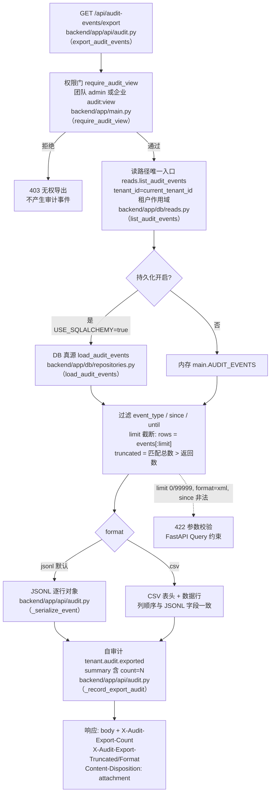
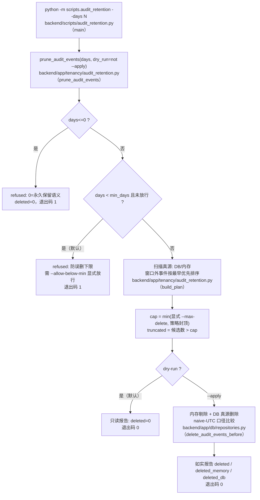

# OPT-14 企业身份、审计与租户隔离增强

> 一句话：把审计从「能看」补齐到「可导出、可保留、动作留痕」；把身份从「隐式本地」升级为「显式声明 + fail-closed」；把租户隔离从「已实现」固化为「冻结回归」。
>
> 状态：Done（2026-10-16）。验证 harness 17/17；专项门禁 26 passed；全量回归见 §5.2。
> 证据：`backend/.data/opt14-exp/`（运行产物）；文档资产副本 `docs/project-development/assets/opt14/`。

## 1. 目标、范围与设计契约

### 1.1 问题（侦察结论）

OPT-14 立项前对本仓库做了三项核对，确认存在三个缺口：

1. **审计只有「查看」**：仅有 `GET /api/audit-events` 列表接口，无导出、无保留（retention）/清理策略——商业试点（E7 交付包）与 E6 运维场景缺导出与生命周期两侧能力；
2. **身份边界含混**：OIDC/MFA 在 E1 蓝图中有名无实（仓库中 OAuth 仅用于 Gitee/GitHub 托管授权，不是登录身份），且没有任何配置门——存在「以为配了 SSO、实际仍是本地口令」的静默降级风险；
3. **租户隔离缺护栏**：E1 起已实现「共享 schema + tenant_id + 应用层强制」，但缺少一份表级分类/权限矩阵/跨租户与伪造头场景的冻结回归，后续演进可能悄悄引入无隔离表。

### 1.2 范围（本次交付）

- **审计导出**：`GET /api/audit-events/export`——JSONL（默认）/ CSV、`event_type`/`resource_type`/`resource_id`/`since`/`until` 过滤、`limit` 截断诚实标注（响应头）、导出动作自审计（`tenant.audit.exported`）、`audit:view` 权限门、租户作用域；
- **审计保留**：`backend/app/tenancy/audit_retention.py`（策略 / 只读计划 / 受控清理）+ `backend/scripts/audit_retention.py`（运维 CLI，默认 dry-run）；
- **身份边界**：`AUTH_MODE` 配置项 + fail-closed 校验（默认 `local`；非 local 拒绝启动，绝不静默降级）；
- **隔离回归冻结**：ORM 30 表租户分类、企业角色权限矩阵（7 角色）、跨租户审计不可见（列表 + 导出）、伪造身份请求头无效；
- **路由冻结受控演进**：有效路由 117 → 118 条（OPT-11 锚点同步更新，见 §8）。

### 1.3 明确不做（边界声明）

- **不实现** OIDC 登录链路（授权码流/会话映射）与 MFA（TOTP/WebAuthn）——本任务只做「边界声明 + fail-closed」，实现留待后续立项；
- **不做** MySQL RLS（Row Level Security）：维持与 E1-01 一致的「共享 schema + tenant_id + 应用层强制」路线，本任务把分类冻结为回归；DB 直连越权不在应用防护范围内（部署边界，见 §7）；
- **不做** 前端导出入口/下载按钮（接口先行）；
- **不做** 审计归档到对象存储、冷热分层、导出签名（未采集项见 §7）。

### 1.4 设计契约（安全默认）

| 配置/参数 | 默认 | 语义 | 钳制 |
| --- | --- | --- | --- |
| `AUDIT_RETENTION_DAYS` | `0` | 0 = 永久保留（策略语义）；清理必须显式给天数 | `max(0, ·)` |
| `AUDIT_RETENTION_MIN_DAYS` | `30` | 防误删下限：窗口低于它默认拒绝 | `max(1, ·)` |
| `AUDIT_RETENTION_MAX_DELETE` | `10000` | 单次删除封顶（`truncated=true` 如实标注） | `max(1, ·)`；CLI `--max-delete` 只能收紧不能放宽 |
| `AUTH_MODE` | `local` | 当前唯一支持值；非 local → 启动即 `RuntimeError`（fail-closed） | — |
| 导出 `limit` | `1000` | 每次导出行数 | `1..5000`（越界 422） |
| 导出 `format` | `jsonl` | 输出格式 | `jsonl` / `csv`（其他值 422） |

## 2. 业务流程（Mermaid，含源码位置）

### 2.1 审计导出主链路（HTTP）



### 2.2 审计保留主链路（CLI）



## 3. 关键机制与实现要点

### 3.1 导出：租户作用域在哪里收口

导出的读路径**不新增通道**，复用 `backend/app/db/reads.py（list_audit_events）`——与列表接口同一入口、同一 `tenant_id=current_tenant_id()` 作用域、同一排序（`created_at` 倒序）。这意味着：跨租户泄漏只可能存在一处，而该处已被 E1 的 `_scoped` 集中过滤覆盖，本任务用真实 HTTP 回归验证（§6.2）。

截断不撒谎：`truncated = 匹配总数 > 返回数`，只放在响应头 `X-Audit-Export-Truncated`，调用方必须显式处理。

### 3.2 保留：三道防误删闸

1. **0 闸**：`days<=0` 直接 refused——「0 = 永久保留」是策略语义，绝不能被解释成「全部删除」（历史数据 `created_at < now` 恒真，若不过闸就是灾难）；
2. **下限闸**：窗口低于 `min_days`（默认 30 天）默认拒绝，`--allow-below-min` 才能放行（供演练/测试）；
3. **封顶闸**：单次删除受 `max_delete` 封顶并如实报告 `truncated`，`--apply` 执行两次才能删完的极端场景也不会「一把梭」。

且默认 dry-run：不加 `--apply` 永远只读。删除同时作用于内存缓存与 DB 真源（写透缓存一致性，见 §4.3）。

**范围说明**：保留是**系统级运维动作（全租户口径）**——这是与读接口（租户作用域）刻意不同的设计：清理必须由部署方在维护窗口统一执行，不能让某个租户的「保留策略」跨越全库删除或漏掉数据。该差异已在模块 docstring 显式声明。

### 3.3 AUTH_MODE：未实现能力的 fail-closed

`AUTH_MODE` 目前只接受 `local`。任何非 local 值（如 `oidc`）都会在配置加载时抛出 `RuntimeError`——API、Worker、CLI 所有进程**启动即失败**，错误信息同时含 `AUTH_MODE` 与 `fail-closed` 字样。这样做的理由：与其「配置了 SSO 但静默回退本地口令」（安全上最坏的一种失败），不如拒绝提供服务，把问题暴露在部署阶段。

### 3.4 隔离回归冻结面

| 冻结对象 | 位置 | 回归方式 |
| --- | --- | --- |
| ORM 30 表租户分类（15 直挂 / 13 间接 / 2 全局） | `backend/app/models/orm.py（Base）` | 集合精确对拍 + 直挂表必须有 `tenant_id` 列 + 间接表不得假装有 |
| 企业权限矩阵 7 角色 | `backend/app/tenancy/permissions.py（ENT_ROLE_PERMISSIONS）` | 逐角色逐权限集合对拍 + `audit:view` 四角色一致性 |
| 跨租户审计不可见 | 导出 + 列表接口 | 建租户 B → 越权 403 留 B 侧审计 → 回默认租户列表/导出均无 B 事件 |
| 伪造身份头 | `backend/app/main.py（get_current_user）` | `X-Auth-Request-Email`/`Remote-User` 等 5 种头 匿名 401、登录后身份仍来自会话 |

### 3.5 TDD 过程中的两处红灯修正（如实记录）

实现首次跑绿前的红灯暴露了两处**测试自身的缺陷**（非实现缺陷），修正如下：

1. **自审计污染断言**：`test_export_filters_event_type_and_time_window` 中第二次导出（`since` 查询）会读到第一次导出写下的 `tenant.audit.exported` 自审计事件——这是产品的**正确行为**（导出留痕），原断言未考虑。修正：精确断言并入「此前已产生的自审计事件集合」，不放松对过滤语义的强度；
2. **保留拒绝用例的种子窗口自相矛盾**：`test_retention_refuses_unsafe_windows` 原种子取「3 天前」的事件配「7 天窗口」，而删除条件是「早于窗口」——3 天前的事件在 7 天窗口内，本就不该被删，与同文件其余 3 个用例（100 天事件配 30 天窗口等）的语义相斥。修正：种子改为 10 天前（窗口外），保持「窗口外才可删」的主流语义。

两处修正均保留原用例意图，且与冻结契约（§1.4）一致；未发生「改断言迁就实现」的情况。

## 4. 关键代码说明

### 4.1 导出 API —— `backend/app/api/audit.py`

- `export_audit_events`：查询参数 `format`（`Literal["jsonl","csv"]`）/四个过滤参数/`limit`（`Query(ge=1, le=5000)`，越界与非法枚举由 FastAPI 直接 422）；`require_audit_view` 先于一切读操作；返回原生 `Response`（非 `ApiResponse` 包装）；
- `_serialize_event`：单一字段清单 `_EXPORT_FIELDS` 同时驱动 JSONL 键与 CSV 列，`datetime` 统一 `isoformat()`——防两种格式字段漂移；
- `_record_export_audit`：写 `tenant.audit.exported`（`resource_type="audit_export"`，summary 含 `count=N truncated=·`），失败不阻断导出（与全仓审计写入口径一致）。

### 4.2 保留模块 —— `backend/app/tenancy/audit_retention.py`

- `retention_policy`：策略集中出参（days/min_days/max_delete），API/CLI/测试同源；
- `build_plan`：只读统计（total/candidates/oldest/newest/cutoff），不修改数据；
- `prune_audit_events`：先过「0 闸 + 下限闸」，再按 `cap` 截断候选（最早优先），dry-run 时到此为止；`--apply` 时先剔内存、再删 DB，返回 `deleted/deleted_memory/deleted_db/truncated/refused/reason` 全量字段；
- `_as_utc`：naive 视为 UTC 挂钟——SQLite/MySQL `DATETIME` 列不存时区，读回比较必须统一口径（与 E4 持久化恢复同一套处理）。

### 4.3 DB 真源删除 —— `backend/app/db/repositories.py`

`delete_audit_events_before(cutoff, limit)`：`persistence_enabled()=false` 时为空操作（返回 0）；`cutoff` aware→naive UTC 转换后与列值比较；`order_by(created_at.asc()).limit(limit)` 选最早至多 N 条后按 id 集合删除——与内存侧候选排序完全一致，两侧不会删出分歧。

### 4.4 配置层 —— `backend/app/core/runtime_config.py`

新增 4 个字段：`audit_retention_days` / `audit_retention_min_days` / `audit_retention_max_delete` / `auth_mode`；`_auth_mode()` 承载 fail-closed 校验（§3.3）。字段位于 frozen dataclass 末尾、构造 kwargs 末尾，既有字段顺序与语义零改动。

### 4.5 运维 CLI —— `backend/scripts/audit_retention.py`

- `--days` **必填**（缺省即 argparse 参数错误，退出码 2）——杜绝「默认全删」式调用；
- `--apply` 才真删；`--json` 输出机器可读结果（最后一行）；`--allow-below-min` / `--max-delete` 显式放行/收紧；
- 退出码约定：0 = 正常（含 dry-run）；1 = 策略拒绝（refused）；2 = 参数错误。

### 4.6 验证 harness —— `backend/scripts/opt14_verify.py`

真实 uvicorn 子进程（隔离环境变量、内存态）+ 真实 HTTP 会话（cookie 会话、真实 403/200/422）+ 真实 SQLite 落库 + 真实 CLI 子进程退出码，17 项检查全部来自实际返回值；报告落盘 `backend/.data/opt14-exp/opt14_evidence.json`。

## 5. 测试

### 5.1 专项门禁（26 passed）

```bash
cd backend && .venv/Scripts/python.exe -m pytest \
  tests/test_opt14_audit_export_retention.py \
  tests/test_opt14_tenant_isolation_regression.py \
  tests/test_opt11_main_split.py -q
# 26 passed in 41.41s
```

- `backend/tests/test_opt14_audit_export_retention.py`（17）：导出 8（JSONL/CSV/过滤/截断/参数/权限/自审计/DB 读取）+ 保留 7（策略/计划/dry-run/apply/拒绝窗/封顶/SQLite 往返/CLI）+ 身份 2（默认 local / fail-closed）；
- `backend/tests/test_opt14_tenant_isolation_regression.py`（5）：ORM 分类冻结 / 权限矩阵冻结 / audit:view 门一致性 / 跨租户列表+导出隔离 / 伪造头防护；
- `backend/tests/test_opt11_main_split.py`（4）：路由冻结 118 条（含 OPT-14 受控新增）逐条一致。

### 5.2 全量回归（backend 全套）

```bash
cd backend && .venv/Scripts/python.exe -m pytest -q
# 1029 passed, 17 skipped, 4 warnings in 1472.18s (0:24:32)
# PYTEST_EXIT=0（= OPT-13 基线 1007 + 本轮新增 22）
```

## 6. 真实运行证据（2026-10-16）

### 6.1 harness 命令与结果（17/17）

```bash
cd backend && .venv/Scripts/python.exe -m scripts.opt14_verify
# [opt14-verify] 17/17 checks passed
# 报告: backend/.data/opt14-exp/opt14_evidence.json
```

检查面：A1-A7（真实 HTTP：跨租户 403/租户作用域/自审计/CSV/权限门/422）、B0-B4（真实 SQLite + CLI：种子/dry-run/下限拒绝/apply 真删/参数错误）、C1-C2（AUTH_MODE 默认与 fail-closed）、D1-D2（ORM 分类/权限矩阵快照）、E1（专项 pytest 门禁）。

### 6.2 导出关键证据（真实 HTTP）

```text
# A3（默认租户导出 JSONL）
status=200  rows=2
content-type: application/x-ndjson
content-disposition: attachment; filename="audit-events.jsonl"
x-audit-export-count: 2
x-audit-export-truncated: false
x-audit-export-format: jsonl
b_ids_leak: []            # 租户 B 的事件 id 与导出零交集

# A4（自审计可见性）
first_export_count=2 -> second_export_count=3   # 第二次导出多出一行 = 第一次导出的自审计事件
export_audit_events: tenant.audit.exported "审计导出 format=jsonl count=2 truncated=false"
                     tenant.audit.exported "审计导出 format=jsonl count=3 truncated=false"
```

### 6.3 保留 CLI 证据（真实 SQLite）

```jsonc
// B1 dry-run 默认（rc=0）
{"days": 90, "total": 2, "candidates": 1, "deleted": 0, "dry_run": true, "refused": false}

// B2 低于 min_days 默认拒绝（rc=1）
{"days": 7, "deleted": 0, "refused": true,
 "reason": "days=7 低于 min_days=30 防误删下限，需显式 allow_below_min 放行"}

// B3 --apply 真删（rc=0），DB 仅剩新事件
{"days": 90, "candidates": 1, "deleted": 1, "deleted_db": 1, "dry_run": false}
db_ids_after: ["opt14_new"]
```

### 6.4 AUTH_MODE fail-closed 证据

```text
$ AUTH_MODE=oidc python -c "from app.core.runtime_config import load_runtime_settings as L; L()"
RuntimeError: AUTH_MODE=oidc 未实现（OIDC/MFA 规划中）：fail-closed 拒绝启动，绝不静默降级到 local 认证。见 docs/project-development/126。
退出码: 1
```

补充实测（本次会话）：DB 未初始化时（`audit_events` 表不存在）保留 CLI 直接抛 `OperationalError` 并以非零退出——**fail loudly，不会把「读不到」静默当成「没有可删」**。

### 6.5 证据文件清单

- `docs/project-development/assets/opt14/opt14_evidence.json`：harness 全量报告（17 项检查的完整 evidence 字段）；
- `docs/project-development/assets/opt14/opt14_pytest.txt`：专项 pytest 原始输出（26 passed）；
- `docs/project-development/assets/opt14/opt14_uvicorn.log`：真实服务进程日志（log-level=warning，无告警输出）；
- `docs/project-development/assets/opt14/opt14_full_pytest.txt`：全量 pytest 原始输出（1029 passed / 17 skipped / EXIT=0，见 §6.6）；
- `docs/project-development/assets/opt14/opt14_doc_consistency.json`：文档检查器 JSON 输出（74 份文档 0 违规）。

### 6.6 全量回归与文档检查

- 全量 pytest（命令见 §5.2）：`1029 passed, 17 skipped, 4 warnings in 1472.18s (0:24:32)`，`PYTEST_EXIT=0`（= OPT-13 基线 1007 + 本轮新增 22）；原始输出留档 `assets/opt14/opt14_full_pytest.txt`；
- 文档一致性检查（OPT-12 门禁）：全量套件内 `test_opt12_doc_consistency.py` 通过（5 passed）；直接运行 `backend/scripts/opt12_doc_consistency.py --json` → 扫描 74 份文档、0 违规（退出码 0），JSON 留档 `assets/opt14/opt14_doc_consistency.json`。

**关于截图**：本任务为纯后端接口 + CLI 交付，无前端 UI 变更，故无界面截图；上列证据均为真实运行的命令输出与机器可读报告（真实 uvicorn HTTP 会话 / 真实 SQLite / 真实子进程退出码），不含任何示意图。

## 7. 生产边界与未采集项（忠实报告）

| 项 | 状态 |
| --- | --- |
| OIDC/OIDC Provider/MFA 实现 | **未实现**（边界声明 + fail-closed 已验证）；OAuth 仅用于 Git 托管授权，不是登录身份 |
| MySQL RLS | **未实现**：共享 schema + tenant_id + 应用层强制（E1-01 既定路线）；DB 直连绕过应用不在防护范围 |
| 大数据量导出性能 | `limit` 封顶 5000；百万级导出性能 **not_collected** |
| 真实 MySQL 保留删除回归 | **not_collected**（SQLite 已真实验证；MySQL 依赖 E6 部署环境人工演练） |
| 前端导出入口/下载按钮 | 未做（接口先行） |
| 浏览器路径验证 | 未采集（无 UI 变更，本任务无浏览器行为可验） |

## 8. 相关源码文件位置

| 文件 | 角色 |
| --- | --- |
| `backend/app/api/audit.py` | 导出接口 + 自审计 + 序列化（新增 `export_audit_events` 等） |
| `backend/app/tenancy/audit_retention.py` | 保留策略 / 计划 / 受控清理（新文件） |
| `backend/scripts/audit_retention.py` | 保留运维 CLI（新文件，默认 dry-run） |
| `backend/app/db/repositories.py` | `delete_audit_events_before`（新增）+ 既有 audit 读写 |
| `backend/app/db/reads.py` | 读路径租户作用域（复用，未改） |
| `backend/app/core/runtime_config.py` | 4 个新配置字段 + `_auth_mode` fail-closed |
| `backend/app/models/orm.py` | ORM 30 表（分类冻结对象） |
| `backend/app/tenancy/permissions.py` | 企业权限矩阵（冻结对象） |
| `backend/tests/test_opt14_audit_export_retention.py` | 导出/保留/身份专项测试（17） |
| `backend/tests/test_opt14_tenant_isolation_regression.py` | 租户隔离回归（5） |
| `backend/tests/test_opt11_main_split.py` | 路由冻结锚点（117→118 受控更新） |
| `backend/scripts/opt14_verify.py` | 验证 harness（17 项真实运行检查） |

## 9. 联调注意点

1. **导出不是 JSON 包装**：`/api/audit-events/export` 返回原生报文（JSONL/CSV）+ 自定义头，前端若做下载不要按 `{code, data}` 解析；文件名与计数以 `Content-Disposition` / `X-Audit-Export-*` 为准；
2. **时间参数口径**：`since`/`until` 接受 ISO 8601；带时区按绝对值比较，naive 一律按 UTC 挂钟解释（与落库口径一致）；
3. **422 而非静默**：`limit` 越界（0/99999）、`format` 非法枚举、`since` 非法日期均由 FastAPI 直接 422——调用方应把它们当契约错误处理；
4. **保留 CLI 的部署前提**：需在已初始化数据库的环境执行（E6 bootstrap 之后）；`USE_SQLALCHEMY=false` 时只作用于进程内存（无持久数据，天然无风险）；DB 未初始化会报错退出（fail loudly）；
5. **AUTH_MODE 一旦非 local，全进程拒绝启动**：部署脚本请显式 `export AUTH_MODE=local`（或移除该变量），CI/运维脚本改动前先跑一次 `python -c "from app.core.runtime_config import load_runtime_settings as L; print(L().auth_mode)"` 自检；
6. **路由表锚点**：本任务后有效路由 118 条；任何新增/删除路由必须同步 `backend/tests/test_opt11_main_split.py（FROZEN_EFFECTIVE_OPERATIONS）` 的冻结清单，否则该类测试会按设计失败。

## 10. FIX-04 / FIX-05 整改衔接（2026-10-18）

- **FIX-04 时间源**：审计导出、RAG 查询、在线评测触发/完成/失败、租户拒绝等新增审计
  不再复用 `main.DEFAULT_NOW`，统一走 `backend/app/core/clock.py` 的 `utcnow()`；
  测试可冻结/推进时钟。SQLite/MySQL 的 naive UTC 往返、`since`/`until` 与 retention cutoff
  由 `backend/tests/test_fix04_audit_timestamps.py` 覆盖。
- **FIX-05 保留参数**：`backend/app/tenancy/audit_retention.py` 的 `prune_audit_events`
  明确拒绝 `max_delete<=0`（`error_code=invalid_max_delete`），CLI
  `backend/scripts/audit_retention.py` 返回退出码 2，且在任何内存/DB 变更前返回；
  正数仍按 `min(请求值, 策略封顶)` 执行并报告 `effective_max_delete` / `capped_by_policy`。
  回归见 `backend/tests/test_fix05_audit_retention_max_delete.py`。
- 详见 `docs/project-development/129-fix-runtime-shared-state-closure.md`。
