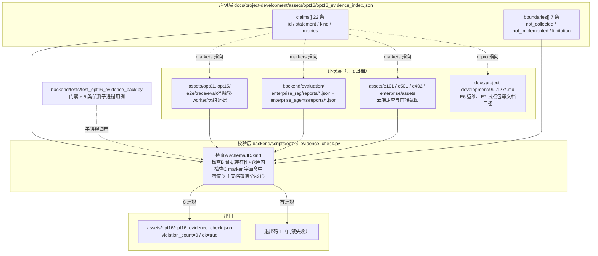

# OPT-16 简历成果证据包（声明 → 归档证据的机械可核对索引）

> 一句话：把简历/面试中要说的每一条「成果声明」收敛为机器可校验的索引条目——`docs/project-development/assets/opt16/opt16_evidence_index.json` 里的每条声明必须指向仓库内真实存在的证据文件并命中文件中的字面 marker（指标/哈希/ID），并由 `backend/scripts/opt16_evidence_check.py` 以退出码门禁 + JSON 报告机械核对，杜绝叙述漂移。
>
> 状态：Done（2026-10-16）。校验器对真实索引零违规；专项门禁测试 7 passed；全量回归见 §8。
> 证据：`docs/project-development/assets/opt16/`（证据索引 JSON + 校验报告 JSON）。

## 1. 目标与范围

### 1.1 问题

项目已完成 E1–E7 验收与 16 项 OPT 工程优化，证据散落在 19 个 `assets/` 目录、`backend/evaluation/` 报告目录与开发文档中。简历/面试场景的三个风险：

1. **叙述漂移**：口头/书面描述与归档证据脱钩（数字记错、环境等级混说、边界被略过）；
2. **不可核验**：说「precision@K 0.34」时对方无法快速定位到哪个文件、哪一行；
3. **过度宣称**：把本地隔离/mock/合成语料的口径说成生产事实。

### 1.2 交付物

| 文件 | 作用 |
| --- | --- |
| `docs/project-development/assets/opt16/opt16_evidence_index.json` | 22 条声明（`C01`–`C22`）+ 7 条边界（`B01`–`B07`），每条含：陈述、环境等级 kind、关键指标、证据文件、字面 marker、复现指引 |
| `backend/scripts/opt16_evidence_check.py` | 校验器：索引 schema / 证据存在性 / marker 字面命中 / 主文档覆盖，退出码门禁 + JSON 报告 |
| `backend/tests/test_opt16_evidence_pack.py` | 门禁测试（TDD 红 → 绿）：真实索引零违规 + 五类侦测能力 |
| `docs/project-development/assets/opt16/opt16_evidence_check.json` | 校验器对真实索引的运行结果（归档） |

### 1.3 环境等级（kind）口径

每条声明的 kind 表示证据的验证环境等级，宁可保守、不可拔高：

| kind | 含义 |
| --- | --- |
| `production_cloud` | 生产云端实测（公网入口/真实部署/真实证书） |
| `local_real_ext` | 本地执行 + 真实外部依赖（真实模型 API/真实 Milvus/真实 Embedding/真实远端写入/真实 DB） |
| `local_offline` | 本地离线/隔离（确定性 provider、内存态、无 DB/无外部服务） |
| `synthetic` | 脱敏合成语料/模拟后端（报告内 `validation_status=local_only` 如实标注） |

## 2. 使用方式（简历与面试）

### 2.1 简历描述样例（可直接用，均可在本包核对）

- 从零构建企业级 AI Agent 研发协作平台（FastAPI + Vue3 + MySQL/Redis/Milvus）：Multi-Agent Runtime 完成真实端到端交付闭环（6 Agent、E2 审批门、真实 Docker 测试、真实 Gitee PR 创建）——见 `C03`。
- 企业级 RAG 全链路（BM25+向量+RRF 混合检索、Query 扩展、Cross-Encoder 精排、强租户过滤）：真实 Milvus + 真实 embedding-3 上 hybrid precision@K 0.3396 达门（门限 0.3），Cross-Encoder 全档最优——见 `C01` `C02`。
- 质量与安全工程：RAG 在线评测 API（RBAC + 生产确认门）、Embedding 索引生命周期 fail-closed、Agent 工具安全六维度回归、审计导出与租户隔离增强——见 `C06` `C07` `C14` `C10`。
- 工程化治理：main.py 9177→7651 行渐进拆分（路由冻结锚点）、文档引用防腐检查器（77→0 违规）、Celery 双 Worker 崩溃恢复验证（36/36 checks）、全量回归 1055 passed 基线——见 `C11` `C15` `C09` `C21`。
- 私有化交付：公网生产部署（域名/证书/监控告警）、备份恢复与失败注入演练、商业试点交付包（SLA/手册/验收脚本）——见 `C17` `C19`。

### 2.2 面试追问的标准回答路径

被追问任一数字时，路径固定为三步：**声明 ID → 索引条目（kind + metrics）→ 证据文件字面 marker**。例如被问「precision@K 0.3396 怎么来的」：`C01` → kind=`local_real_ext`（如实说明是本地企业独立 Milvus + 真实 embedding，非生产）→ 打开 `e3_07_health_middle_quality_tuned_hybrid_gate.json` 命中 `"precision_at_k": 0.3396` 与 `"needs_improvement": false`，同目录 `e3_07_health_middle_quality_tuned.json` 命中 `"validation_status": "verified"`。

被问到「什么没做/做不到」时，直接引用 §5 边界清单（`B01`–`B07`），这是本包与普通「成果汇总」的本质区别。

## 3. 证据链总览（Mermaid）



关键点：声明与证据之间不是「目录引用」而是**字面 marker 命中**——证据文件后续被改写/搬走时校验器立即报红（防止「归档后漂移」）。

## 4. 声明索引（22 条）

| ID | 声明摘要 | kind | 关键指标 | 主要证据文件 |
| --- | --- | --- | --- | --- |
| `C01` | 企业级 RAG 全链路质量达门（真实 Milvus + embedding-3 + 真实仓库） | local_real_ext | recall 0.8955 / MRR 0.8172 / NDCG 0.7981 / prec@K 0.3396 | `backend/evaluation/enterprise_rag/reports/e3_07_health_middle_quality_tuned_hybrid_gate.json` |
| `C02` | Cross-Encoder 精排四档对比（ms-marco-MiniLM-L-6-v2） | local_real_ext | CE MRR 0.8507 / NDCG 0.8090 全档最优 | `backend/evaluation/enterprise_rag/reports/e3_09_health_middle_rerank_comparison.json` |
| `C03` | 6-Agent Runtime 真实闭环 + 真实 Gitee PR #3 | local_real_ext | 6/6 AgentRun、VERIFIED、content_hash 050b6f79… | `docs/project-development/assets/e402/rt_e4a_113934.release-evidence.json` |
| `C04` | 多 Agent 端到端可复现演示（含修复分支） | local_offline | 14/14 checks、无远端写模块 | `docs/project-development/assets/opt03/opt03_e2e_evidence.json` |
| `C05` | 全链路可观测（单 trace 29 spans 六类） | local_offline | 29 spans / 6 类 / 13/13 checks | `docs/project-development/assets/opt07/opt07_trace_evidence.json` |
| `C06` | RAG 在线评测 API（RBAC + 生产确认门） | local_offline | 403 拒触发、生产门 blocked | `docs/project-development/assets/opt08/opt08_eval_evidence.json` |
| `C07` | Embedding/索引生命周期 fail-closed（409 + 审计） | local_offline | 12 passed、incompatible_rejected | `docs/project-development/assets/opt09/opt09_focused_suite.txt` |
| `C08` | RAG 检索参数消融（12 配置 + 5 切片探针） | synthetic | 确定性 identical=true、dataset sha256 e306b418… | `docs/project-development/assets/opt10/opt10_ablation_report.json` |
| `C09` | Celery 双 Worker 崩溃恢复与有界长稳 | local_offline | 36/36 checks、收敛 111.28s / 104.7s | `docs/project-development/assets/opt13/opt13_multiworker_report_final.json` |
| `C10` | 身份/审计导出/保留策略/AUTH_MODE fail-closed | local_offline | 17/17 checks | `docs/project-development/assets/opt14/opt14_evidence.json` |
| `C11` | main.py 渐进拆分（路由冻结锚点） | local_offline | 9177→7651 行、12 模块 | `docs/project-development/assets/opt11/opt11_split_metrics.txt` |
| `C12` | 托管平台 Provider 契约（fail-closed 双重门） | local_offline | 26 passed、harness 16/16、零真实远端写入 | `docs/project-development/assets/opt15/opt15_evidence.json` |
| `C13` | 测试环境与 CI 稳定性（Redis 隐性依赖修复） | local_offline | 890 passed, 17 skipped（全环境门控） | `docs/project-development/assets/opt05/opt05_backend_pytest_full.txt` |
| `C14` | Agent 工具安全六维度回归 | local_offline | 25 passed in 0.64s | `docs/project-development/assets/opt06/opt06_security_suite.txt` |
| `C15` | 文档引用防腐检查器 | local_offline | 77 违规 → 0（72 份文档） | `docs/project-development/assets/opt12/after-current.json` |
| `C16` | 企业前端完整化（7 页面 + 5 角色走查） | local_offline | 264 frontend tests、30 张真实截图 | `docs/project-development/assets/e501/audit-note.md` |
| `C17` | 私有化生产交付强化（E6） | production_cloud | 证书 86d、回滚点 e6-rollback-compat-61a6752 | `docs/project-development/112-enterprise-e6-prod-ops.md` |
| `C18` | Agent 级 Eval 与版本回归 | local_offline | 2/2、success_rate 1.0、real_model=false | `backend/evaluation/enterprise_agents/reports/agent_eval_local_v1_verified.json` |
| `C19` | 商业试点交付包（E7，6 文件 + 索引） | production_cloud | 基于 E6 云端基线、脱敏 | `docs/enterprise/10-pilot/README.md` |
| `C20` | 企业 RBAC 云端走查（auditor 200 / 越权 403） | production_cloud | audit:view 200、成员创建 403 | `docs/project-development/assets/e101/e101_03_audit_body.txt` |
| `C21` | 全量回归终稿基线 | local_offline | 1055 passed / 17 skipped / 1338.55s | `docs/project-development/assets/opt15/opt15_full_pytest.txt` |
| `C22` | 企业审批与治理门禁（E2） | local_offline | 31 passed + 加固 17 passed | `docs/project-development/100-enterprise-e2-01-approval-governance.md` |

> 每条声明的完整字段（statement / metrics / markers / repro）以 `opt16_evidence_index.json` 为准；上表仅为导航。

## 5. 边界与不可宣称清单（7 条）

这些条目**必须**在面试/材料中如实保留，防止过度宣称：

| ID | 类型 | 边界 |
| --- | --- | --- |
| `B01` | not_collected | OPT-15 真实 Gitee/GitHub/GitLab 远端写入未执行（本轮零写入；Provider 由本地真实 socket stub + 真实 git 二进制验证） |
| `B02` | not_implemented | OIDC/真实身份提供方未接入（仅 fail-closed 边界与配置门验证） |
| `B03` | not_implemented | 生产 MySQL 行级安全（RLS）未启用（共享 schema + 应用层租户作用域） |
| `B04` | not_collected | Agent 模型真实 token 用量未采集（如实记 not_collected） |
| `B05` | not_collected | 真实单机 Redis 服务与多机故障演练未执行（OPT-13 为 fakeredis 单机进程级） |
| `B06` | limitation | E6 legacy 镜像不支持跨 schema 回滚（fail-closed）；ALLOW_UNKNOWN_MIGRATION_REVISION 禁止生产开启 |
| `B07` | not_collected | Agent Eval 真实模型评测与成本未采集（--allow-real-model 为显式 opt-in，未执行） |

## 6. 关键代码说明

### 6.1 校验器 `backend/scripts/opt16_evidence_check.py`

- **仓库根解析**：`REPO_ROOT = Path(__file__).resolve().parents[2]`，任意 cwd 可运行（与 `opt12_doc_consistency.py` 同风格）；默认索引与主文档路径为常量，`--index` / `--doc` / `--json-out` 可覆写。
- **检查 A（结构）**：schema 版本 `opt16-evidence-index-v1`；声明 ID 匹配 `C\d{2,3}` 且唯一；kind 枚举四个等级；statement/metrics 非空（metrics 值不得为 null）；边界 ID 匹配 `B\d{2,3}` 且 kind 枚举 `not_collected/not_implemented/limitation`、statement/note 非空。
- **检查 B（存在性）**：`evidence_files` 必须为仓库内**真实文件**——`_inside_repo()` 拒绝绝对路径与 `..` 逃逸（防索引写出仓库外或指向失效路径）。
- **检查 C（marker 字面命中）**：`markers[].file` 读取为 UTF-8（BOM 容忍），`must_contain` 必须字面出现，miss 即违规 `marker_missing`；目标不可读记 `marker_file_unreadable`，不存在记 `marker_file_missing`。
- **检查 D（文档覆盖）**：主文档必须收录全部声明与边界 ID（` ``C01`` ` 反引号或空格包裹形态），防「索引更新、叙述未更新」的单边漂移。
- **退出码门禁**：0 = 零违规；1 = 有违规。stdout 输出 JSON 报告（`schema=opt16-evidence-check-v1`），`--json-out` 另存归档。

### 6.2 构造性细节（踩过的坑）

- **marker 与 JSON 格式化耦合**：markers 用 `"key": value` 带空格的形态（Python `json.dump` 默认分隔），不用「压缩 JSON」形态；一旦证据文件被重写为不同缩进，校验器会报红——这正是设计意图（归档文件不应再被改写）。
- **UTF-8 BOM**：Windows 工具链可能给文本文件加 BOM，`utf-8-sig` 读取保证 marker 命中不受影响。
- **二进制证据不做 marker**：截图 `.png` 只做存在性检查（`evidence_files`），不设 marker。

## 7. 源码与资产位置

| 类型 | 路径 |
| --- | --- |
| 声明索引（数据） | `docs/project-development/assets/opt16/opt16_evidence_index.json` |
| 校验器 | `backend/scripts/opt16_evidence_check.py` |
| 门禁测试 | `backend/tests/test_opt16_evidence_pack.py` |
| 校验报告（归档） | `docs/project-development/assets/opt16/opt16_evidence_check.json` |
| 本模板文档 | `docs/project-development/128-opt16-resume-evidence-pack.md` |
| 上游证据根 | `docs/project-development/assets/`、`backend/evaluation/`、`docs/enterprise/10-pilot/` |

## 8. 真实运行证据与验证

### 8.1 校验器对真实索引的运行（零违规）

```bash
cd backend && .venv/Scripts/python.exe scripts/opt16_evidence_check.py --json-out ../docs/project-development/assets/opt16/opt16_evidence_check.json
```

产出报告关键字段（归档于 `opt16_evidence_check.json`）：`ok=true`、`violation_count=0`、`total_claims=22`、`total_markers=61`。（以 §8.4 实测输出为准。）

### 8.2 门禁测试（TDD 红 → 绿）

```bash
cd backend && .venv/Scripts/python.exe -m pytest tests/test_opt16_evidence_pack.py -q
```

首轮红灯：7 failed（脚本/索引/文档缺失）；实现后绿灯（数字见 §8.4）。侦测能力覆盖：marker 篡改、证据文件缺失、kind 非法、主文档缺 ID、仓库外路径。

### 8.3 文档一致性检查器（OPT-12 门禁对本文档生效）

```bash
cd backend && .venv/Scripts/python.exe scripts/opt12_doc_consistency.py --json
```

本包新增 `128-*.md` 后语料须保持 0 违规（结果见 §8.4）。

### 8.4 实测输出

校验器（EXIT=0，报告归档 `opt16_evidence_check.json`）：

```json
{
  "schema": "opt16-evidence-check-v1",
  "index": "docs/project-development/assets/opt16/opt16_evidence_index.json",
  "doc": "docs/project-development/128-opt16-resume-evidence-pack.md",
  "total_claims": 22,
  "total_boundaries": 7,
  "total_markers": 61,
  "violation_count": 0,
  "violations": [],
  "ok": true
}
```

门禁测试（TDD）：首轮红 `7 failed in 2.28s`（脚本/索引/文档未创建）→ 实现后绿 `7 passed in 1.08s`；与 OPT-12 检查器测试合并相关回归 `12 passed in 2.37s`。

文档一致性检查器（OPT-12）：语料 `docs_scanned=76`、`violation_count=0`（新增本文档后保持零违规）。

全量后端回归终稿（首轮即绿，日志归档 `opt16_full_pytest.txt`）：

```text
1062 passed, 17 skipped, 4 warnings in 1439.00s (0:23:58)
PYTEST_EXIT=0
```

（= OPT-15 基线 1055 + 本轮新增专项/门禁 7，零失败零回归）

## 9. 维护注意点（联调/演进）

1. **新增成果声明**：先落证据文件（归档目录只增不改），再在 `opt16_evidence_index.json` 增条目，最后在本文档 §4 表与 §2 样例同步；运行校验器绿后方可对外引用。
2. **证据文件只读原则**：`assets/` 下的证据文件一经归档不再改写（历史证据文件不得改写，与 OPT-12 检查器同一约定）；确需修正时新增 `_repro`/修订版文件并更新索引指针。
3. **数字不复制两份**：本文档 §4 展示指标为导航用途，唯一事实源是索引 JSON 的 `metrics` + 证据文件 marker；两者不一致时以校验器为准并修订文档。
4. **环境等级不得抬升**：`kind` 只允许按证据实际环境标注；把 `local_offline`/`synthetic` 说成 `production_cloud` 属违规（评审时按边界清单 `B01`–`B07` 对照检查）。
5. **无 UI 变更声明**：本功能为文档+脚本交付，不涉及前端页面，故无界面截图；真实运行证据为校验器 JSON 报告、pytest 输出与文档检查器输出（§8）。
