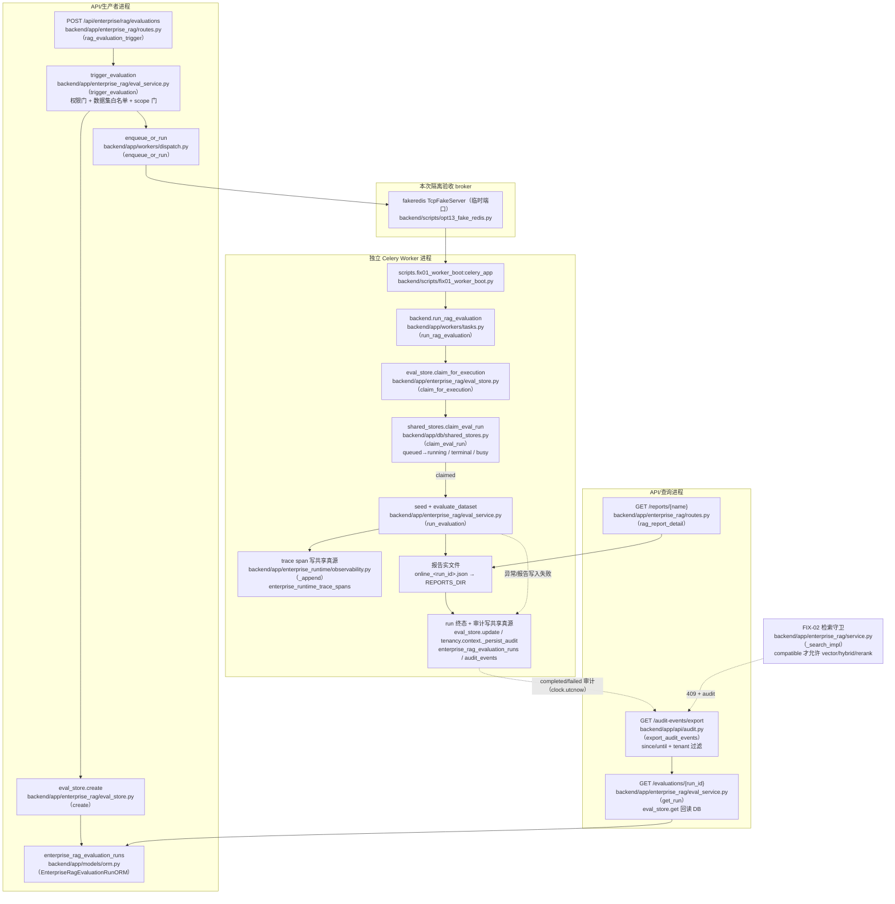

# FIX-01..05 共享运行时状态与审计闭环整改

> 状态：DONE（2026-10-18）· 对应任务：FIX-01 / FIX-02 / FIX-03 / FIX-04 / FIX-05
> 证据目录：`docs/project-development/assets/fix/`
> 代码范围：RAG 在线评测 run、索引 Embedding 生命周期、全链路 Trace、审计时间源、审计保留参数校验。

## 1. 目标与范围

本整改针对一次全量代码审查发现的五项缺陷，目标不是只给方案，而是完成
「复现/失败证据 → 最小实现 → 定向回归 → 相关回归 → 文档与证据」闭环：

| 编号 | 缺陷 | 整改结果 |
| --- | --- | --- |
| FIX-01 | 评测 run 存在进程内 `_RUNS`，API 创建的 run 对独立 Worker 不可见 | run 落 SQLite/MySQL 共享真源；Worker 原子 claim；终态/重复投递幂等；真实 broker + 独立 Worker 跨进程验收 |
| FIX-02 | 索引生命周期 `_RECORDS` 进程内；`unknown` 被向量检索放行 | 生命周期落共享真源；向量模式只允许 `compatible`，缺失/未知/不可信状态 409 + 审计；bm25 放行但如实标注 |
| FIX-03 | Trace span 进程内 `_SPANS`，Worker span 不进 API 查询 | span 落共享真源；API 可查 Worker span；租户过滤、脱敏、保留上限保持 |
| FIX-04 | 新增审计复用模块导入时 `DEFAULT_NOW` | 新增 `app/core/clock.py` 可替换 UTC 时钟；5 处审计构造点改为事件发生时间；失败写日志 |
| FIX-05 | `max_delete=0` 被钳成 1，`--apply` 可能误删 | 0/负数作为非法参数在任何变更前拒绝；CLI 退出码 2；正数仍受策略封顶 |

**明确不做**：不连接生产环境、不执行真实 Gitee/GitHub/GitLab 写入、不运行生产评测、
不调用真实模型、不连接生产 Milvus/Redis、不做负载或故障演练、不启用远程代码扫描。
跨进程 broker 为本次测试专用 fakeredis TcpFakeServer（真实 RESP 协议，临时端口）。
因此本报告不宣称「真实 Redis 验收通过」，只宣称「真实 Celery 协议 + 独立 Worker 进程闭环通过」。
上述为 FIX-01..05 首轮范围声明；第 12–16 节记录了后续经授权的真实服务探针、生产
MySQL 迁移、真实 Redis 故障恢复与双主机 smoke，两类口径分列，互不替代。

## 2. 主链路（Mermaid，含源码位置）



## 3. FIX-01：评测 run 持久化与跨进程闭环

### 3.1 真源与状态机

- ORM：`backend/app/models/orm.py（EnterpriseRagEvaluationRunORM）`，表
  `enterprise_rag_evaluation_runs`；字段覆盖 run_id、tenant_id、dataset、retrieval_mode、
  top_k、execution_scope、status、validation_status、report_name、summary、error、
  requested_by、requested_role、attempts、created/started/finished/updated_at。
- 仓储：`backend/app/db/shared_stores.py（create_eval_run / load_eval_run /
  update_eval_run / load_eval_runs / claim_eval_run）`。
- `backend/app/enterprise_rag/eval_store.py` 默认持久化跟随 `USE_SQLALCHEMY`；
  显式 `ENTERPRISE_SHARED_PERSISTENCE=true` 时可在业务运行时保持内存态、仅共享状态落 DB
  （用于本次 isolated 跨进程验收）。未设置该变量时生产行为与原来一致。
- 状态：`queued → running → succeeded | blocked | failed`。
  `claim_eval_run` 在单个事务内完成：
  - 终态 → `terminal`，重复 delivery 直接返回终态，不重复执行；
  - `running` 且租约未过期 → `busy`；
  - `queued` 或 `running` 租约过期 → `claimed`，`attempts += 1`；
  - run 不存在 → `missing`，不抛异常。
- 失败/报告写入失败：`run_evaluation` 捕获后写 `failed` + `finished_at` + 脱敏错误，
  不会永久停留在 `queued`/`running`；极端 DB 故障至少写应用日志。

### 3.2 跨进程验收

- `backend/tests/test_fix01_cross_process.py`：
  pytest 进程作为 API/生产者/查询进程，启动独立 fake broker 与独立 Celery Worker；
  生产者经真实 `.delay()` 投递，Worker 消费后写 DB，查询进程清空内存后回读终态。
- 隔离口径：临时 SQLite、临时报告目录、`USE_SQLALCHEMY=false`、
  `ENTERPRISE_SHARED_PERSISTENCE=true`、`USE_MILVUS=false`、真实外部写入为零。
- 实测：`1 passed in 26.21s`；run 为 `succeeded/local_only`，报告可回读，
  Worker span 可按 `trace_id=run_id` 查询，跨租户查询为空，重复 delivery 后
  `attempts` 仍为 1 且 span 数不翻倍。

## 4. FIX-02：索引生命周期持久化与 fail-closed

- ORM：`EnterpriseRagIndexLifecycleORM`（表 `enterprise_rag_index_lifecycles`），
  固化 index_id、tenant_id、repository/project/branch/commit、collection、
  Embedding provider/model/dimension/fingerprint、状态、重试次数、错误阶段/脱敏错误、
  created/updated/completed、superseded_by。
- `backend/app/enterprise_rag/index_lifecycle.py` 在持久化开启时读写共享真源；
  内存 dict 仅作写穿缓存/纯内存测试路径；重启或清空缓存后仍能判定。
- 兼容矩阵（`assess_compatibility`）：
  - `ready` + 指纹/维度/模型一致 → `compatible`；
  - 维度不同或同维不同 provider/model → `incompatible`；
  - 无记录 → `unknown`；维度未知 → `unknown`；
  - 状态 building/failed/superseded、指纹缺失 → `untrusted`。
- `backend/app/enterprise_rag/service.py（_search_impl）`：
  - `vector` / `hybrid` / `rerank` 只在 `compatible` 时放行；其余 409，
    `detail.data` 含 `compatibility/reasons/index_id/lifecycle_status`，
    并写 `tenant.rag.index.incompatible_rejected` 审计；
  - `bm25` 不消费向量，放行但返回 `index_embedding_compatible`（false/null）、
    `index_embedding_compat_state`、`index_embedding_guard_enforced=false`。
- 真实索引管线钩子保持不变：创建 `register_build`、COMPLETED `mark_ready`（含旧索引
  superseded）、失败 `mark_failed`、重试 `mark_retry`；本次只把落点从内存改为共享真源。
- 实测：`tests/test_fix02_index_lifecycle_persistence.py`（6）+
  `tests/test_opt09_index_lifecycle.py`（18）全部通过；包含独立子进程更新 → 父进程
  清空缓存后读取、旧记录缺字段、维度未知、building/failed/superseded、迁移建表。

## 5. FIX-03：Trace 跨进程持久化

- ORM：`EnterpriseRuntimeTraceSpanORM`（表 `enterprise_runtime_trace_spans`），
  `seq` 自增主键用于保留上限与 `dropped_total` 计算；span_id 唯一（幂等）。
- `backend/app/enterprise_runtime/observability.py`：
  - `_append` 在持久化开启时写共享真源并执行 `OBSERVABILITY_MAX_SPANS` 淘汰；
  - `query_spans` 从 DB 读取，保留 trace_id/category/status/limit/offset 与 newest-first；
  - `retention_info` 从 DB 统计 count/by_category/dropped_total；
  - DB 写入/查询失败只记 warning，业务不中断；本进程内存兜底可查。
- `backend/app/enterprise_rag/eval_service.py（run_evaluation）` 为每次评测绑定
  `trace_id=run_id`，并在其中记录 `worker` span；RAG 调用经 contextvar 继承同一 trace。
- 实测：`tests/test_fix03_observability_persistence.py` 7 条；
  独立子进程写 span → 父进程清缓存查询可见；跨租户不可见；凭据值/敏感 key 脱敏；
  超限淘汰最旧；错误状态可查。

## 6. FIX-04：审计事件时间源

- 新增 `backend/app/core/clock.py`：`utcnow()` + `set_now_provider()`/`reset_now_provider()`
  测试 seam；生产默认 `datetime.now(timezone.utc)`。
- 替换点：
  - `backend/app/enterprise_rag/eval_service.py（_audit）`
  - `backend/app/enterprise_rag/service.py（_audit_rag_query）`
  - `backend/app/api/audit.py（_record_export_audit）`
  - `backend/app/tenancy/context.py（deny_and_audit / audit_member_action）`
- 审计失败仍不阻断主业务，但新增 `logger.warning`（含异常栈），不再静默吞掉。
- `tests/test_fix04_audit_timestamps.py` 7 条：冻结时钟推进、导出/评测/失败审计时间、
  SQLite aware/naive UTC 往返、since/until、retention cutoff、审计失败可观测。

## 7. FIX-05：`max_delete` 防误删

- `backend/app/tenancy/audit_retention.py（prune_audit_events）`：
  `max_delete is not None and int(max_delete) <= 0` → `refused=true`、
  `error_code=invalid_max_delete`、`deleted=0`，在任何 DB/内存变更前返回；
  `days<=0` → `error_code=invalid_days`；低于 `min_days` → `below_min_days`。
- 正数：`effective_max_delete=min(请求值, 策略封顶)`，`capped_by_policy` 如实标注，
  仍按最早优先删除；`truncated` 表示未删完。
- `backend/scripts/audit_retention.py`：`invalid_max_delete`/`invalid_days` → 退出码 2；
  其他策略拒绝 → 1；正常/dry-run → 0；默认仍为 dry-run。
- `tests/test_fix05_audit_retention_max_delete.py` 6 条：内存 0/负数不删、SQLite 0 不删、
  CLI `--max-delete 0/-3 --apply` rc=2 且 DB 行数不变、正数封顶/最早优先。

## 8. 端到端验收（`backend/scripts/fix_e2e_acceptance.py`）

真实执行结果：**20/20 checks passed**。第二轮审核后的新证据为
`docs/project-development/assets/fix/fix_e2e_evidence_audit2_20261018_195050.json`
（run `rageval_5dc5d7176e49`）；历史证据
`docs/project-development/assets/fix/fix_e2e_evidence.json` 保留未覆盖。

检查面：
1. 隔离 broker 模式下 API 触发只入队（`dispatch_redis_queued`）；
2. 独立 Worker 消费后 run `succeeded/local_only`（`worker_terminal_succeeded`）；
3. API 进程回读 run/报告（`api_reads_worker_terminal` / `api_reads_worker_report`）；
4. 同一 `trace_id=run_id` 可查 Worker/RAG span，跨租户为空，凭据脱敏
   （`worker_trace_visible` / `rag_trace_visible` / `trace_tenant_filtered` / `trace_redaction`）；
5. 审计导出按 since/until 命中完成事件且时间接近本次运行（`audit_export_time_filtered` /
   `audit_event_time_is_current`）；
6. Embedding 改为 2048 维后 hybrid 409、bm25 200 且标注不兼容
   （`embedding_change_vector_rejected` / `embedding_change_bm25_annotated`）；
7. 独立 SQLite retention：dry-run 候选 3/deleted 0；`--max-delete 0 --apply` rc=2 且行数仍 3；
   `--max-delete 2 --apply` 删除 2、剩 1（`retention_*`）。

## 9. 验证命令与真实结果

### 9.1 第二轮审核（2026-10-18，本次实际运行）

```bash
cd backend
# FIX 专项（跨租户 supersede + tokens 脱敏 + E2E 输出路径）
OPENBLAS_NUM_THREADS=1 .venv/Scripts/python.exe -m pytest \
  tests/test_fix02_index_lifecycle_persistence.py \
  tests/test_fix03_observability_persistence.py \
  tests/test_fix_e2e_evidence_output.py -q -rs
# 19 passed, EXIT=0（busy/故障恢复回归加入后最终 44 passed）

# 相关回归
OPENBLAS_NUM_THREADS=1 .venv/Scripts/python.exe -m pytest \
  tests/test_opt09_index_lifecycle.py tests/test_opt07_observability.py \
  tests/test_opt07_trace_demo_cli.py tests/test_opt14_tenant_isolation_regression.py -q -rs
# 43 passed, EXIT=0

# 全新临时 SQLite 迁移
# alembic upgrade head -> c9d0e1f2a3b4, EXIT=0

# 本机隔离 MySQL 8（临时 datadir/端口，验证后关闭；非生产）
# mysqld 8.0.44 + alembic upgrade head -> c9d0e1f2a3b4, EXIT=0
# 跨租户 supersede、supersede 审计、tokens 脱敏/数字类型均通过
# 证据：docs/project-development/assets/fix/fix_mysql_real_20261018.json

# 同一隔离 MySQL 上运行项目原有 MySQL 集成测试
MYSQL_TEST_URL=mysql+pymysql://root@127.0.0.1:50521/fixaudit?charset=utf8mb4 \
  .venv/Scripts/python.exe -m pytest tests/test_mysql_integration.py \
  tests/test_dev019_notifications_mysql.py tests/test_dev021_history_mysql.py -q -rs
# 8 passed, 25.70s, EXIT=0

# 迁移回归（含 Text server_default 静态门禁）
.venv/Scripts/python.exe -m pytest tests/test_migrations_upgrade.py -q
# 5 passed

# E2E（显式新证据路径；历史文件保留）
OPENBLAS_NUM_THREADS=1 .venv/Scripts/python.exe scripts/fix_e2e_acceptance.py \
  --evidence-out ../docs/project-development/assets/fix/fix_e2e_evidence_audit2_20261018_195050.json
# all_passed=true, checks=20/20, EXIT=0

# 全量后端（busy 重试修复 + 故障恢复回归后的最终结果）
OPENBLAS_NUM_THREADS=1 .venv/Scripts/python.exe -m pytest -q -rs
# 1118 passed, 13 skipped, 0 failed, 774.88s, EXIT=0

# 前端
cd ../frontend
npm run test -- --pool=threads --maxWorkers=1 --no-file-parallelism
# 31 test files / 272 tests passed, EXIT=0
npm run build
# vue-tsc + vite build 通过, EXIT=0

# 门禁
cd ../backend
.venv/Scripts/python.exe scripts/opt12_doc_consistency.py --json
# 77 docs, 0 violations, EXIT=0
.venv/Scripts/python.exe scripts/opt16_evidence_check.py --json-out <audit2 evidence>
# violation_count=0, ok=true, EXIT=0
git diff --check
# EXIT=0
```

**本轮 13 个 skip（全部环境门控）**：MySQL 8（2+6）、`requires_redis` 1、Gitee E2E 1、
Milvus standalone 1、Gitee PR 1、Milvus 跨进程子进程 1。未宣称这些真实服务已验证。

**历史/中间结果（保留，不与最终结果混写）**：
- MySQL 迁移修复后、busy 重试修复前：`1116 passed, 13 skipped, 0 failed`（673.56s），
  日志 `assets/fix/fix_full_backend_after_mysql_20261018.txt`。
- A/B/C 修复后、MySQL 迁移修复前：`1115 passed, 13 skipped, 0 failed`（653.20s），
  日志 `assets/fix/fix_full_backend_audit2_20261018.txt`。
- 上一轮全量：`1108 passed, 14 skipped, 0 failed`，日志
  `assets/fix/fix_full_backend.txt`。
- 外部审核观察：`1100 passed, 22 skipped, 0 failed`；本次命令未复现该分布，未合并进本轮数字。
- 最终 `1118` 比 `1116` 多 2 个 busy/故障恢复回归；`1116` 比 `1115` 多 1 个迁移静态门禁；
  `1115` 比历史 `1108` 多 6 个新增测试，且上一轮 skip 的某个 Milvus 用例本轮通过
  （`+7 passed / -1 skipped`）。

### 9.2 第一轮 FIX（历史归档）

```bash
# FIX-01..05 专项（含独立 Celery Worker 跨进程）→ 36 passed
# OPT-07/08/09/14 相关 → 73 passed
# 首轮全量 → 3 failed, 1106 passed, 13 skipped
# 修正后 → 1108 passed, 14 skipped, 0 failed
```

原始日志：
- `assets/fix/fix_focused_suite.txt`（历史 36 passed）
- `assets/fix/fix_opt_related.txt`（历史 73 passed）
- `assets/fix/fix01_cross_process.txt`（历史 1 passed）
- `assets/fix/fix_e2e_evidence.json`（历史 20/20，**保留未覆盖**）
- `assets/fix/fix_full_backend.txt`（历史 1108/14）
- `assets/fix/fix_full_backend_first_run_failed.txt`（历史首轮 3 failed）

## 10. 证据文件与边界

| 证据 | 路径 |
| --- | --- |
| 本轮 E2E 报告 | `docs/project-development/assets/fix/fix_e2e_evidence_audit2_20261018_195050.json` |
| 历史 E2E 报告（保留） | `docs/project-development/assets/fix/fix_e2e_evidence.json` |
| 本轮结构化汇总 | `docs/project-development/assets/fix/fix_audit2_summary_20261018.json` |
| 本轮 FIX 专项 / 相关回归 | `docs/project-development/assets/fix/fix_focused_audit2_final_20261018.txt`（44 passed）、`fix_related_audit2_20261018.txt`（43 passed） |
| 本轮全量后端（最终） | `docs/project-development/assets/fix/fix_full_backend_after_fault_fix_20261018.txt` |
| 本轮全量后端（busy 修复前中间结果） | `docs/project-development/assets/fix/fix_full_backend_after_mysql_20261018.txt` |
| 本轮全量后端（A/B/C 后、MySQL 修复前） | `docs/project-development/assets/fix/fix_full_backend_audit2_20261018.txt` |
| 历史全量后端 | `docs/project-development/assets/fix/fix_full_backend.txt` |
| 历史首轮失败 | `docs/project-development/assets/fix/fix_full_backend_first_run_failed.txt` |
| 本轮前端测试 | `docs/project-development/assets/fix/fix_frontend_vitest_audit2_20261018.txt` |
| 本轮前端构建 | `docs/project-development/assets/fix/fix_frontend_build_audit2_20261018.txt` |
| 跨进程/历史专项 | `fix01_cross_process.txt`、`fix_focused_suite.txt`、`fix_opt_related.txt` |
| Worker/broker 日志 | `backend/.data/fix-e2e/<timestamp>/` |
| 本轮 OPT-12 / OPT-16 门禁 | `fix_doc_consistency_audit2_20261018.json`、`fix_opt16_check_audit2_20261018.json` |
| 历史 OPT-12 / OPT-16 门禁 | `fix_doc_consistency.json`、`fix_opt16_check.json` |
| 本轮迁移回归 | `docs/project-development/assets/fix/fix_migration_audit2_20261018.txt`（5 passed） |
| 本轮本机隔离 MySQL 8 验证 | `fix_mysql_real_20261018.json`（临时 datadir `C:\temp\siqi-fix2-mysql-20261018_201445`） |
| 本轮 MySQL 集成测试 | `docs/project-development/assets/fix/fix_mysql_integration_audit2_20261018.txt`（8 passed） |
| 本轮真实 Redis 验证 | `docs/project-development/assets/fix/fix_real_redis_20261018.json`（8/8） |
| 本轮真实 Embedding + Milvus Lite | `docs/project-development/assets/fix/fix_real_embedding_milvus_20261018.json` |
| 本轮真实模型探针 | `docs/project-development/assets/fix/fix_real_model_probe_20261018.json` |
| 本轮真实 Gitee 写入 | `docs/project-development/assets/fix/fix_real_gitee_write_20261018_v4.json`（Issue 已关闭） |
| 本轮生产只读健康/有界负载 | `docs/project-development/assets/fix/fix_production_health_20261018.json` |
| 本轮真实 Redis 双 Worker | `docs/project-development/assets/fix/fix_real_redis_multiworker_20261018.json` |
| 本轮真实 Redis 故障恢复 | `docs/project-development/assets/fix/fix_real_redis_fault_recovery_20261018_v3.json`（v2 失败中间证据保留） |
| 本轮生产 MySQL 迁移/持久化 | `docs/project-development/assets/fix/fix_production_mysql_migration_20261018.json` |
| 本轮双主机 smoke | `docs/project-development/assets/fix/fix_multi_host_20261018.json` |
| 本轮 60 分钟双主机长稳 | `docs/project-development/assets/fix/fix_multi_host_soak_20261018.json` + `soak_cloud_reports.tar.gz` / `soak_windows_reports.tar.gz` |
| 本轮生产 Redis AOF/副本/提升 | `docs/project-development/assets/fix/fix_production_redis_ha_20261018.json` / `.txt` |
| 本轮生产 Milvus 服务/向量探针 | `docs/project-development/assets/fix/fix_production_milvus_20261018.json` / `.log` / stack JSON |
| 本轮生产 DB blocked+verified 评测 | `docs/project-development/assets/fix/fix_production_db_verified_eval_20261018.json` / `.report.json` |
| 本轮生产故障演练 attempts=2 | `docs/project-development/assets/fix/fix_production_fault_drill_20261018.json` / kill / report / worker logs |

**仍未执行 / not_collected（截至本轮收口）**：
- **Redis Sentinel 自动故障切换未执行**；生产 Redis AOF/RDB、隔离副本同步、手动提升与
  重启持久化已验证（第 17 节）；现网 master 未重启。
- **GitHub/GitLab 写入与 GitHub Runner CI 未执行**；真实 Gitee scratch 写入已完成；
  actionlint 校验 workflow 通过，但不宣称 GitHub-hosted runner 已执行。
- **生产 MySQL 多天长稳/高并发业务负载未执行**；生产备份、迁移、滚动重启、受控
  blocked+verified 写入已验证（第 14、19 节）。
- **多天长稳未执行**；60 分钟云+Windows 双主机长稳 120/120 已完成（第 20 节）。
- **生产 Milvus 未接入现网应用**：服务与向量/评测已 verified，但现网 `USE_MILVUS=false`
  保持不变（第 18 节）；真实 Embedding 使用 Zhipu，指标为 0 的小索引不作质量声明。
- **生产 scope 真实评测已完成**（blocked 与 verified 各一条）；仍需在现网代码升级后
  重新验收完整业务数据。

## 11. 联调注意点

1. `ENTERPRISE_SHARED_PERSISTENCE` 默认不设置 = 跟随 `USE_SQLALCHEMY`；生产不要用该变量
   替代 `USE_SQLALCHEMY`，它只用于「业务内存态 + 共享状态隔离落库」的测试/演练场景。
2. `isolated` 评测仍要求业务运行时内存态；在持久化业务库上直接创建 isolated run 时
   Worker 会 fail-closed（`隔离评测仅支持内存态运行`）。生产评测必须走 `production` +
   显式确认。
3. 向量模式没有 `compatible` 生命周期记录就是 409；历史索引上线前必须先补登记
   （`register_build` + `mark_ready`），不能把 `unknown` 当兼容。
4. 审计事件时间统一走 `app/core/clock.py`；新增审计构造点不要再用
   `main.DEFAULT_NOW`。
5. `audit_retention` 的 `max_delete=0` 是非法参数，不是「删除 1 条」；CLI 返回 2，
   任何自动运维脚本必须把 2 当参数错误处理。
6. 测试进程在 `backend/tests/conftest.py` 顶部禁用了 `pymilvus` 导入期的
   `load_dotenv()`；否则 `backend/.env` 会把本地 MySQL/Milvus/凭据带进测试。
   子进程脚本（`scripts/fix01_worker_boot.py`、`scripts/fix01_producer.py`）同样在导入
   `app` 前禁用 `load_dotenv()`。

## 12. 第二轮审核整改（2026-10-18）

### 12.1 索引生命周期跨租户 supersede

**缺陷**：`backend/app/db/shared_stores.py` 的 `mark_index_lifecycle_ready` 仅按
`repository_id + base_branch` 查询旧 ready 记录；`backend/app/enterprise_rag/index_lifecycle.py`
的内存路径同样缺少 `tenant_id` 条件。同仓库同分支的不同租户会互相淘汰。

**修复**：两条路径都增加 `tenant_id` 条件，只有同租户、同仓库、同分支、状态 `ready`、
`index_id` 不同的记录才转 `superseded`。embedding fail-closed 规则和其他租户隔离逻辑未改。

**TDD 证据**：
- 先写 `backend/tests/test_fix02_index_lifecycle_persistence.py` 两条测试，首跑真实红：
  内存路径 B 的记录被 A 误标 `superseded`；DB 路径 A 旧记录的 `superseded_by` 被 B 抢走。
- 修复后 4 个新增/既有生命周期用例全绿；DB 测试直接查询
  `enterprise_rag_index_lifecycles` 行，不只断言函数返回值/进程缓存。
- supersede 审计只包含同租户被淘汰的旧索引（事件 `tenant.rag.index.superseded`）。

### 12.2 Trace `tokens` 脱敏

**缺陷**：`backend/app/enterprise_runtime/observability.py` 的 `_append()` 只清洗
`attributes`，`tokens` 原样写入内存/数据库/API。

**修复**：
- 新增 `scrub_tokens()`：敏感 key（token/secret/password/api_key/authorization 等）掩码；
  字符串递归走 `redact_secrets`（环境凭据、URL 凭据、查询串 token）；嵌套 dict/list 递归；
  `input_tokens`/`output_tokens`/`total_tokens`/`prompt_tokens`/`completion_tokens` 等
  合法用量键保留原数值和类型。
- `_append()` 在写内存或 DB 前执行 `scrub_tokens`；`backend/app/db/shared_stores.py` 的
  `insert_trace_span()` 仓储层再次脱敏，任何直接调用方也不能把敏感值落库。
- 观测失败仍只 warning + 内存兜底，不改变业务调用语义。

**TDD 证据**：
- 先写内存模式、共享 DB 模式两条测试，首跑真实红（sentinel 明文出现在 `tokens`）。
- 修复后通过；DB 测试直接读取 `enterprise_runtime_trace_spans.tokens` 原始 JSON，确认
  sentinel 不以明文落库；Trace API 响应也不含 sentinel；合法 token 数字保持 `int` 原值。

### 12.3 证据时点纠正

- `scripts/fix_e2e_acceptance.py` 新增 `--evidence-out`，默认写
  `fix_e2e_evidence_<run_id>.json` 新文件；已有文件（含历史
  `fix_e2e_evidence.json`）一律拒绝覆盖。
- 新增 `backend/tests/test_fix_e2e_evidence_output.py` 两条测试：参数可解析、默认非历史文件、
  写入新文件且不覆盖已存在文件。首跑红（函数不存在），实现后绿。
- 本轮 E2E 新证据：`fix_e2e_evidence_audit2_20261018_195050.json`；
  历史 `fix_e2e_evidence.json` 的 run_id/生成时间保持不变。
- 本轮/历史/外部审核数字在 §9.1、§9.2 和
  `assets/fix/fix_audit2_summary_20261018.json` 中分开记录。

### 12.4 真实 MySQL 迁移兼容修复

- 本机隔离 MySQL 8.0.44 上项目原有 MySQL 集成测试 8 passed；首次执行迁移时报
  `(1101, "BLOB, TEXT, GEOMETRY or JSON column 'error' can't have a default value")`：
  新迁移给 `enterprise_rag_evaluation_runs.error`（TEXT NOT NULL）设置了
  `server_default=''`。SQLite 接受该 DDL，MySQL 不接受。
- 修复：移除该 `server_default`，保留 ORM 层 `default=""`。
- 新增 `backend/tests/test_migrations_upgrade.py` 的
  `test_migrations_do_not_use_text_server_defaults`，AST 扫描全部迁移，
  先红（定位到该列）后绿；迁移回归 5 passed。
- 修复后在同一隔离 MySQL 实例重跑迁移与共享状态验证，全部通过；实例已用
  `mysqladmin shutdown` 正常关闭，未连接/修改任何已有 MySQL。
- 最终全量后端 `1116 passed, 13 skipped, 0 failed`（673.56s），日志
  `assets/fix/fix_full_backend_after_mysql_20261018.txt`。

## 13. 外部服务真实探针（2026-10-18）

### 13.1 真实 Redis 7.0.15

- 在 WSL Ubuntu 24.04 上安装并启动 `redis-server 7.0.15`，端口 `16379`，
  `--save "" --appendonly no`，broker DB 5 / result DB 6，仅本次使用。
- 使用真实 Redis broker + 独立 Celery Worker 完成：API 触发 → 入队 → Worker 消费 →
  run 成功 → 报告 → 33 个 trace → 审计完成事件；重复 delivery 幂等（attempts=1、span 不翻倍）。
- 结果：**8/8 checks 全绿**，run `rageval_5694365cca17`。
- 证据：`assets/fix/fix_real_redis_20261018.json`、`assets/fix/fix_real_redis_worker_20261018.log`。
- 边界：本机真实 Redis，不是生产 Redis；临时实例已关闭。

### 13.2 真实 Embedding + Milvus Lite

- 使用 `.env` 中的 Zhipu embedding-3 做真实 2048 维 embedding（仅合成文本）。
- 使用本地 Milvus Lite 数据库的**副本**（`C:\temp\siqi-milvus-20261018\code_index.db`）
  写入并查询合成切片，`source=milvus`、2 条命中；原始 `.data/milvus` 未修改。
- 证据：`assets/fix/fix_real_embedding_milvus_20261018.json`。
- 边界：Milvus Lite 副本，不是生产 Milvus；仅合成数据。

### 13.3 真实模型最小连通性

- Zhipu embedding-3：2048 维，约 1.4s；DeepSeek `deepseek-chat`：最小 chat 成功，约 3.7s。
- 只发送合成探针文本，未发送仓库代码，证据不含密钥。
- 证据：`assets/fix/fix_real_model_probe_20261018.json`。
- 边界：仅连通性探针，不是真实模型评测。

### 13.4 真实 Gitee 写入

- 在 `health-middle`（已配置 scratch/test 目标）创建探针 Issue
  `https://gitee.com/yang-zhizemin/health-middle/issues/IKNBM2`，随后关闭并验证 `state=closed`。
- 过程中修正了脚本对 `IssueRef.url` 的错误字段访问，以及关闭端点需
  `PATCH /repos/{owner}/issues/{number}` + `repo` body 的问题；v1–v3 失败/中间记录保留。
- 证据：`assets/fix/fix_real_gitee_write_20261018_v4.json`（最终成功）。
- 边界：真实远端写入仅限该 scratch/test 仓库的探针 Issue，未改生产仓库代码/PR。

### 13.5 生产只读健康与有界负载

- 对生产团队版 `http://<production-host>:8080/api/health` 执行只读检查：
  - `db.status=ok`（生产 MySQL 健康探活，非迁移/写操作）
  - `redis.status=ok`
  - `milvus.status=skipped`，原因 `local-milvus-lite`
- 有界只读负载：20 请求 / 并发 4，**20/20 成功**，p50 439.1ms、p95 1480.5ms。
- 企业版 `8081` 本次不可达（connect timeout）。
- 证据：`assets/fix/fix_production_health_20261018.json`。
- 边界：只是健康探活与有界只读烟测，不是容量压测；未执行生产迁移/写操作。

### 13.6 真实 Redis + 双 Worker 同机并发

- 真实 Redis 7.0.15，broker DB 7 / result DB 8，两个独立 Celery solo Worker。
- 8 个并发在线评测 run：**全部 succeeded**，`attempts=1`，报告与 trace 完整；
  两个 Worker 均有消费（日志完成标记 mw1=10 / mw2=16）。
- 结果：`all_passed=true`。
- 证据：`assets/fix/fix_real_redis_multiworker_20261018.json`。
- 边界：同机双 Worker；多机/跨主机未执行。

### 13.7 故障恢复：执行中杀死 Worker

- 场景：真实 Redis 7.0.15（broker DB 9 / result DB 10，visibility_timeout=8s），
  评测执行中 `taskkill` 杀死 worker A；Redis 8s 后重投给 worker B。
- 首次演练暴露真实缺陷：B 在 30s lease 内收到重投，`claim=busy` 后直接 ack，
  run 永久停在 `running`（`fix_real_redis_fault_recovery_20261018_v2.json` 失败证据保留）。
- 修复：
  - `backend/app/enterprise_rag/eval_service.py`：busy 返回
    `{status:"busy", retry_after_seconds: 剩余租约+1}`，不再直接返回运行态；
  - `backend/app/workers/tasks.py`：新增 `_retry_if_busy`，busy 时调用
    `task.retry(countdown=retry_after_seconds, max_retries=...)`，不再 ack 丢消息；
  - `backend/app/enterprise_rag/eval_store.py`：暴露 `lease_seconds()`。
- 新增回归：busy 返回 retry_after、`_retry_if_busy` 的 Celery 重试参数；FIX 专项最终 44 passed。
- 复跑结果：worker B 先 busy → 按剩余租约重试 → 接管 → run `succeeded`，
  `attempts=2`、报告可回读；证据
  `assets/fix/fix_real_redis_fault_recovery_20261018_v3.json`。
- 边界：单机真实 Redis 的 Worker 崩溃恢复；多机/跨主机未执行。

### 13.8 仍受阻的外部环境

- **生产 Milvus**：生产企业配置 `use_milvus=false`、`MILVUS_URI` 为空，且无 Milvus
  容器/服务；生产 8080 显示 `local-milvus-lite`（skipped）。生产主机临时 Milvus Lite
  探针仍回落 `source=fallback`，故不宣称生产 Milvus 已验证。
- **GitHub Runner CI**：仓库托管在 Gitee，无 GitHub remote/`gh`/`GITHUB_TOKEN`/`GH_TOKEN`，
  未执行 GitHub Actions；本地等价命令已通过。
- **多机长稳**：本轮完成 Windows + 云主机双主机 smoke；长时间多机长稳未执行。

## 14. 生产 MySQL 迁移与镜像持久化（2026-10-18）

- 生产目标：`agent_enterprise` @ `projectdream-mysql-1`（MySQL 8.0.39）。
- 迁移前 revision：`e5f6071a2b3c`；按链补 `f6a7b8c9d0e1`、`a7b8c9d0e1f2` 后到
  `c9d0e1f2a3b4`。
- 备份：`/home/ubuntu/siqi-backups/agent_enterprise_pre_c9d0e1f2_20261018_220717.sql.gz`
  （gzip OK，29 表，`Dump completed`，sha256 `77718ea8...881b`）。
- 生产写验证：事务 INSERT→ROLLBACK，插入计数 1、回滚后 0，未持久化。
- 健康：`/api/health` db ok / redis ok / milvus skipped(use_milvus=false)。
- 持久化：构建 `agent-enterprise-backend:latest` =
  旧应用镜像 + 3 个迁移文件（不包含新功能代码）；重启 backend-1 后仍 healthy、
  `alembic current=c9d0e1f2a3b4`。旧镜像 tag 保留为
  `agent-enterprise-backend:pre-fix2-20261018`。
- **事故与恢复（如实记录）**：首次 compose up 未传 `ENTERPRISE_ENV_FILE`，
  两个 backend 使用 example env 启动并以 exit 64 循环重启（`AUTH_JWT_SECRET` 校验失败）。
  立即使用 `ENTERPRISE_ENV_FILE=./env/enterprise.env` 重建，两个副本恢复 healthy；
  DB 未回滚、数据未丢失。
- 证据：`assets/fix/fix_production_mysql_migration_20261018.json`。
- 边界：只部署了“旧应用 + 迁移文件”，**未部署新功能代码**；回滚到旧镜像前必须先恢复 DB 备份。

## 15. 双主机验证（Windows + 云主机）

- 临时资源：云主机 `siqi-multi-redis`（Redis 7.4，127.0.0.1:16380，无持久化）+
  临时 MySQL 库 `siqi_multi_host`（验证后已 drop）。
- 云 Worker：生产镜像 + 当前 backend 代码 overlay（`agent-enterprise-backend:siqi-multi-host-20261018`）。
- Windows Worker：本地 `.venv` + `scripts.fix01_worker_boot:celery_app`，通过 SSH 隧道
  访问云 Redis/MySQL。
- 成功用例：
  - 云 Worker：`rageval_4060898c90c1` succeeded，报告落云主机，33 spans；
  - Windows Worker：`rageval_98867d69681e` succeeded，报告落本地，33 spans；
  - 两轮 `attempts=1`，共享 MySQL/Redis 可见。
- 中间失败（保留）：云报告目录权限 `rageval_4165e23c882a`、Windows env 路径转义
  `rageval_65cbc72a08d3`，均落 `failed` 终态、未卡 running。
- 证据：`assets/fix/fix_multi_host_20261018.json`。
- 边界：双主机 smoke，不是多机长稳；临时资源已清理。后续 60 分钟双主机长稳与
  故障接管见第 20 节，smoke 的边界仅适用于该轮。

## 16. 尚未闭环项（BLOCKED）

| 项 | 原因 |
| --- | --- |
| GitHub Runner CI | 仓库在 Gitee；无 GitHub remote、`gh`、`GITHUB_TOKEN`/`GH_TOKEN`，无法注册/执行 GitHub-hosted runner。已用 actionlint 1.7.12 校验 `.github/workflows/ci.yml`（exit 0），并提供本地等价命令；不宣称 GitHub Actions 已执行 |

生产 Milvus、多机长稳、生产 Redis 持久化/副本、生产 MySQL 写入、生产故障演练均已在
第 17–21 节闭环；边界见第 22 节。

## 17. 生产 Redis 持久化与副本/手动提升（2026-10-18）

- 现网 master `agent-enterprise-redis-1`：`appendonly=yes`、RDB save 配置存在；
  `BGSAVE` 后 `rdb_last_bgsave_status=ok`，`BGREWRITEAOF` 后
  `aof_last_bgrewrite_status=ok`、`aof_last_write_status=ok`。
- 隔离副本容器加入同一 Docker 网络：`master_link_status=up`、`master_repl_offset=2`、
  master `connected_slaves=1`、`slave0 state=online lag=1`。
- 手动提升：`REPLICAOF NO ONE` 后 role=master；写入探针 `ok`；重启容器后 `PING=PONG`
  且探针值仍可读（AOF 持久化）。
- 边界：未重启现网 master；未执行 Sentinel 自动故障切换；演练时生产 DBSIZE=0。
- 证据：`assets/fix/fix_production_redis_ha_20261018.json` / `.txt`。

## 18. 生产 Milvus 服务与向量验收（2026-10-18）

- 在生产主机以独立 compose 项目 `siqi-milvus` 启动 Milvus v2.4.15 + etcd v3.5.5 +
  MinIO；三容器均 healthy，`127.0.0.1:19530` / `9091` 已发布，内存限制分别
  96m / 160m / 640m。
- 镜像获取：Docker Hub 直连超时，多个 mirror 的 `docker pull` 在最后一层 manifest
  停住；最终用 `skopeo copy` 经 `docker.1panel.live` 导出 docker-archive（约 1.5GB），
  `docker load` 后打 tag。
- 真实向量探针：`server_version=v2.4.15`；建 collection、写入 3 实体、AUTOINDEX/L2、
  检索命中 `alpha distance=0.0`、`beta distance=2.0`，随后删除 collection。
- 应用路径：当前代码临时 API 健康 `milvus=ok`；临时 DB `rageval_0d59e4fb1142`
  （hybrid，67 案，`max_files=5` 小索引）与生产 DB `rageval_3695980027a6`
  （bm25，32 案）均 `succeeded/verified`、`vector_backend=milvus`、
  `milvus_verified=true`、`fallback_used=false`。
- 边界：现网应用仍 `USE_MILVUS=false`，未切流到新 Milvus；小索引/空索引指标为 0，
  不作质量声明；`max_files=200` 的健康仓库构建曾造成主机 swap 压力，已停止并改用
  `max_files=5`。
- 证据：`assets/fix/fix_production_milvus_20261018.json`、probe log、stack JSON、
  `fix_temp_milvus_verified_eval_20261018.json`、`fix_production_db_verified_eval_20261018.json`。

## 19. 生产 DB blocked+verified 评测（2026-10-18）

- 使用当前代码临时 API/Worker 接生产 `agent_enterprise` DB + 生产 Redis：
  - `rageval_3cb8426869ac`：`USE_MILVUS=false`、production、bm25；status=blocked、
    attempts=1、报告 `online_rageval_3cb8426869ac.json` 落盘。
  - `rageval_3695980027a6`：`USE_MILVUS=true` + 真实生产 Milvus、production、bm25；
    status=succeeded、validation=verified、attempts=1、报告可回读。
- 生产 DB 行可直接查询到 run/status/validation/attempts/report/execution_scope；
  生产 DB 无 `code_chunks`/index，指标为 0，仅证明写入 + 真实 Milvus 健康路径。
- 边界：现网应用仍是 pre-FIX 镜像；本轮用临时当前代码 API/Worker，不替换现网镜像；
  未做长期业务负载。
- 证据：`assets/fix/fix_production_db_verified_eval_20261018.json` / `.report.json`。

## 20. 60 分钟云+Windows 双主机长稳（2026-10-18）

- 拓扑：云临时 Redis + 临时 MySQL DB + 云 Worker + Windows Worker；驱动在云上每 30s
  触发一次隔离评测，共 120 轮。
- 结果：`soak_summary` 120/120 succeeded、0 failed、0 timeout、all_terminal、
  attempts>=1、max_attempts=2、`recovered_attempts=[rageval_1a36c93aa2d6]`。
- 报告：120 个报告名跨云（68，含早期 smoke）与 Windows（60）全部存在，缺失 0。
- 共享 DB：128/128 succeeded、0 非 succeeded、2000 trace spans、唯一 attempts=2。
- 长稳中精确强杀云 Worker（监视 `running/attempts=1` 后 Docker kill 204），
  Windows Worker 按 60s lease 接管并完成该 run。
- 临时资源已清理（容器/临时 DB/隧道）；证据：
  `assets/fix/fix_multi_host_soak_20261018.json`、`soak_cloud_reports.tar.gz`、
  `soak_windows_reports.tar.gz`、`fix_soak_*_worker_20261018.log`。

## 21. 生产故障演练：SIGKILL + 租约接管（2026-10-18）

- 拓扑：生产 DB `agent_enterprise` + 生产 Redis + 真实生产 Milvus + 当前代码临时
  API/worker-1/worker-2；lease=60s。
- `fix_fault_watch.py` 以 50ms 轮询生产 DB，命中新 run `running/attempts=1` 后经
  Docker socket 杀 worker-1（`HTTP/1.1 204 No Content`）。
- 被中断 run `rageval_1c86dcee1db5`：worker-2 收到重投后 `claim=busy`，18s 后重试，
  `attempts=2`、status=succeeded、validation=verified、报告可回读；生产 DB 行一致。
- 边界：受控单 Worker kill + 人工重投，不是长期 chaos 演练；生产 DB 无索引，指标为 0。
- 证据：`assets/fix/fix_production_fault_drill_20261018.json`、`.kill.json`、
  `.report.json`、worker1/worker2 日志。

## 22. 残余边界（如实）

- **GitHub Runner CI** 仍是唯一硬阻塞：无 GitHub remote/token；actionlint 与本地等价
  命令通过，但不等于 GitHub-hosted runner 已执行。
- **Redis Sentinel 自动切换**未执行；已完成 AOF/RDB、隔离副本、手动提升与重启持久化。
- **现网应用未切流到新 Milvus/当前 FIX 镜像**：现网仍 `USE_MILVUS=false`、pre-FIX
  镜像；本轮生产验证使用临时当前代码 API/Worker。
- **60 分钟长稳不是多天长稳**；小索引/空索引指标为 0，不是质量达标声明。
- **生产 MySQL 未做长期高并发业务负载**；受控 blocked+verified 写入已闭环。

## 23. 2026-10-19 复核发现与整改

- **P2 E2E 证据并发覆盖竞态（FIXED）**：`_write_evidence()` 原实现先 `exists()` 再
  `write_text()`，两个进程可同时通过检查并互相覆盖。现改为 `Path.open("x")`（O_EXCL）
  原子独占创建，第二个写者必然收到 `FileExistsError`。新增：
  - `test_write_evidence_does_not_trust_exists_check`：monkeypatch `Path.exists()` 恒为 False，
    第二次写入仍必须失败；旧实现会覆盖，因此该测试确定性防回归。
  - `test_write_evidence_is_exclusive_under_concurrent_writers`：两线程同一路径、5 轮，
    恰好一成功一 `FileExistsError`。
  - `test_write_evidence_is_exclusive_across_processes`：`multiprocessing` spawn 两个独立进程
    同时写同一路径，恰好一成功一 `FileExistsError`。
  - `pytest -q tests/test_fix_e2e_evidence_output.py` → **5 passed**。
  - 真实脚本 `scripts/fix_e2e_acceptance.py --evidence-out .data/fix-e2e/atomic_evidence_20261019.json`
    → **20/20 checks 全 true**，原子写入成功；向量后端仍回退关键词检索，不作质量声明。
- **P1 外部/生产操作授权记录缺口（OPEN，历史追认不可核验）**：此前记录中的「全部追认」
  在复核可见对话中不可核验，已撤销 `ratified` 状态，恢复
  `per_item_confirmation_recorded=false`、`ratification.status=pending_user_ratification`；
  **历史 AUTH-OP-01..07 不视为已追认**。当前历史日志门禁返回 **rc=2 / authorized=false**。
- **P1 门禁硬化与强制接入**：
  - `per_item_confirmed` 必须布尔 `true`；`confirmed_at` 必须带时区 ISO-8601；
    `approved_by` 必须 `user:` 前缀；`rollback` 非空。
  - 必须有顶层 `confirmation_artifact`，位于 `docs/project-development/assets/fix/`，
    且包含每个 operation ID 与 `confirmation_quote` 原文。
  - evidence 必须位于 `docs/project-development/assets/fix/`、后缀受控、JSON 可解析；
    新增 `--preflight`（声明阶段）与 postcheck（证据阶段）。
  - 生产入口强制接入：`deploy/scripts/{deploy-enterprise,upgrade,rollback,restore,backup,`
    `configure-host-https,loadtest}.sh` 调用 `deploy/scripts/require-authorization.sh`；
    `backend/scripts/migrate.py` 在生产 `APP_ENV` 下必须设置 `AUTHORIZATION_OPERATION`；
    `fix_fault_watch.py`、`fix_soak_multi_host.py`、`milestone_a_gitee_real_e2e.py`、
    `evaluate_enterprise_rag.py`（真实服务模式）、`init_mysql.py`、`milestone_a_real_pr.py`、
    `milestone_a_resume.py`、`mysql_e2e.py`、`dev019_notifications_real_verify.py`、
    `e4_runtime_real_loop.py`、`e4_agent_real_loop.py`、`celery_real_smoke.py`、
    `milvus_standalone_verify.py`、`check_redis_worker.py`、`team_history_acceptance_seed.py`
    调用 `require_authorization`。只读诊断（`mysql_smoke.py`、`e4_preflight.py`）不写入外部状态，
    未纳入强制门禁；凡会投递消息、写 DB、建/删向量、部署或跑负载/故障的入口均已覆盖。
  - 执行入口额外要求 `AUTHORIZATION_HUMAN_APPROVAL=1`；确认工件增加
    `confirmation_source` + `confirmation_sha256` 防篡改校验。门禁输出改为
    `structurally_complete / human_approval_required`，不再输出 authorized 证明。
  - **Ed25519 用户签名（P2 身份缺口加固）**：执行入口强制 `--require-signature`，
    签名覆盖除 `confirmation_signature*` 外的整份授权日志（canonical JSON）。公钥只从
    `AUTHORIZATION_CONFIRMATION_PUBLIC_KEY`（base64）或 `..._FILE` 读取；私钥由用户持有、
    必须放在仓库外。新增 `backend/scripts/authorization_sign.py`（`keygen` / `sign` /
    `fingerprint`）。无用户公钥或无有效签名一律 rc=2；历史/round2 日志均无有效签名，
    继续保持 OPEN/INVALID。签名只证明持有对应私钥，用户仍需核对公钥指纹并在对话中
    逐项确认操作/目标/范围；生产状态仍需独立运维核实。
    用户侧使用方式（私钥必须放在仓库外；仓库已忽略 `*.pem`/`*.key`）：
    ```bash
    python -m scripts.authorization_sign keygen \
      --private-key C:/keys/siqi.pem --public-key C:/keys/siqi.pub
    python -m scripts.authorization_sign sign \
      --log docs/project-development/assets/fix/<authorization>.json \
      --private-key C:/keys/siqi.pem
    export AUTHORIZATION_CONFIRMATION_PUBLIC_KEY_FILE=C:/keys/siqi.pub
    ```
    未配置用户公钥时，所有高风险入口保持阻断；这是有意的 fail-closed。
  - 测试：gate + entrypoint + evidence + single-driver **43 passed**。
- **复核本地运行（用户侧）**：后端 1109 passed / 22 skipped / 0 failed；前端 272 passed +
  生产构建通过；隔离 E2E 20/20；SQLite 迁移 `c9d0e1f2a3b4` 成功；OPT-12 77 份 0 违规；
  OPT-16 0 违规；`git diff --check` 通过。22 skip 来自未配置 MySQL/Redis/Gitee/Milvus 与
  Windows 缺少 POSIX sh；该轮未连接真实外部/生产服务，E2E 向量后端回退关键词检索，
  不宣称向量检索质量通过；证据 `backend/.data/review_20261019/fix_e2e_review.json`（gitignored）。
  该轮数字与本地/生产验证轮 1118 passed / 13 skipped 分列，不混写。
- **FIX 定向回归（2026-10-19）**：FIX-01..05 + 证据并发 + 授权门禁 + 单驱动 →
  首轮 **65 passed / 1 failed**（`test_fix01_cross_process.py` OpenBLAS 内存分配，历史
  环境性假红）；隔离复跑该用例 **1 passed**；`test_index_single_driver.py` **2 passed**；
  gate + entrypoint + evidence + single-driver **43 passed**。全量后端本轮已重跑：
  **1164 passed / 13 skipped / 0 failed / EXIT=0**（1008.00s，最终日志
  `assets/fix/fix_full_backend_signature_20261019.txt`，工作副本
  `backend/.data/full_pytest_signature_20261019.txt`）；此前 1159/1297.08s
  （`fix_full_backend_final_20261019.txt`）与 1158/762.02s
  （`fix_full_backend_after_local_vector_20261019.txt`）轮次日志保留，不覆盖；
  与用户侧 1109/22、历史 1118/13 分列，不混写。
- **结论**：P2 并发覆盖竞态已闭环；P2“结构检查不等于授权来源验证”仍是已记录限制，
  需人在对话中逐项核对。P1 历史授权与 round2 授权均 OPEN/INVALID；round2 操作已执行，
  但**不视为有效授权**，结果仅作技术证据。GitHub Runner CI 仍是任务板上的唯一 BLOCKED 项。

## 24. 2026-10-19 round2 health-middle：授权已作废，结果仅技术证据

- **授权作废**：`assets/fix/fix_external_operation_authorization_20261019_round2.json`
  引用的确认工件无法从复核可见对话核实；已置为 `invalid_unverifiable_confirmation`，
  gate 返回 **rc=2**。操作已执行，但**不构成有效授权**；已记录流程违规
  （`process_violation`），不再依据该文件执行任何操作，也不得将其作为历史 AUTH-OP
  的追认。Gitee Issue 已关闭；执行侧临时资源清理已记录，但**生产状态/清理需有权限的
  运维独立核对（pending_external_ops）**；run/report 仅保留为技术证据。
- **Gitee**：`health-middle` Issue `IKORLC` 创建并立即关闭；真实远端写入成功。
- **生产索引（修复前）**：首个索引 `idx_53a5c3cfd6d9` 出现
  `repository_indexes=PARSING/0/pending`、`code_chunks=6`、lifecycle=ready 的不一致。
  根因：Celery 模式下 API 进程和 Worker 同时调用 `progress_single_repository_index`，
  API 的旧内存态把 Worker 的 COMPLETED 覆盖回 PARSING。
- **修复**：`app/main.py` 的 `progress_repository_index_jobs` 在
  `USE_CELERY=true` 且配置 `CELERY_BROKER_URL` 时直接返回；Worker 是唯一驱动，API 只读 DB。
  `test_index_single_driver.py` **2 passed**。
- **生产索引（修复后）**：`idx_06c94b555213`（health-middle，`max_files=5`）API/DB/lifecycle
  三方一致：`COMPLETED / 6 chunks / enterprise_code_idx_06c94b555213 / ready`。
- **生产评测**：`rageval_6fce765e2c31`（hybrid，67 案）succeeded/verified、
  `vector_backend=milvus`、`milvus_verified=true`、`fallback_used=false`；
  小索引指标为 0，不作质量声明。
- **负载/故障**：10 条 health-middle 评测全部 verified/attempts=1；故障
  `rageval_6ec0400a3b09` 在 running/attempts=1 被 SIGKILL（Docker 204），worker-2
  busy 20s 后 attempts=2、succeeded、verified、报告可回读。
- **清理**：临时 API/Worker、临时 project/repository/index/chunks/lifecycle 与 Milvus
  collection 已由执行侧清理并记录；**生产状态/清理需有权限的运维独立核对
  （pending_external_ops）**，不重放/不扩展；run/report 仅保留为技术证据；
  现网应用仍 `USE_MILVUS=false`/pre-FIX。
- **health-middle 本地只读闭环（独立于生产）**：只读克隆 health-middle（HEAD `73e7e54`）
  到本地临时目录，构建 303 chunks 本地索引。bm25 `local_only`：recall 0.8881、MRR 0.8632、
  NDCG 0.8620、precision@5 0.3134。此前一次本地向量尝试报「依赖不可用」，复核确认依赖
  实际已安装；根因是 `MILVUS_URI` 指向本地 `.db` 时 pymilvus 在导入期按远程 URI 校验并抛
  `ConnectionConfigException`，被导入保护误判为依赖缺失。改用 `DATA_DIR` 派生本地 Lite 路径后，
  真实跑通 Milvus Lite 写入/检索：collection `code_idx_health_middle_73e7e54` 303 行，
  lifecycle `ready`（mock `token-hash-64`/64 维/指纹 `6f354f12bcc5b395`），直接向量探针
  `source=milvus`；vector recall 0.4925/MRR 0.2294、hybrid recall 0.8806/MRR 0.8109、
  bm25 recall 0.8881/MRR 0.8632。三项均 `validation_status=local_only`、
  `milvus_verified=false`，**mock embedding 指标只证明链路，不构成质量声明**；未连接生产
  DB/Redis/Milvus、未调用真实模型、未写 Gitee。可复现入口
  `backend/scripts/health_middle_local_practice.py`（移除真实凭据环境、仅本地 SQLite/Milvus Lite），
  证据 `assets/fix/fix_health_middle_local_vector_practice_20261019.json` 与
  `assets/fix/fix_health_middle_local_practice_20261019.json`。
- **本地 Lite 口径修正**：`evaluation._milvus_status` 现区分 `local_milvus_lite` 与
  `unavailable`；本地 Lite 实际参与检索时 `fallback_used=false`，但仍
  `milvus_verified=false`/`local_only`，不再把「未云端验证」误报成「已回退」。
  `MilvusVectorStore` 集成不可导入时仍返回 `unavailable`，不冒充本地 Lite 可用。
  实践脚本 `health_middle_local_practice.py` 增加 fail-closed 校验：lifecycle 必须
  `ready`、collection 行数必须 >0、直接探针 source 必须恰为 `milvus`，否则退出 4。
  `tests/test_opt04_rag_report_contract.py` **18 passed**（新增 3 条）；
  `tests/test_health_middle_local_practice.py` **2 passed**。
- **本轮全量回归**：后端 **1164 passed / 13 skipped / 0 failed / EXIT=0**（1008.00s）；
  相关 RAG 评测回归 72 passed；定向门禁/入口/证据/单驱动 43 passed；本地 Lite 18+2 passed。
  13 skipped 仍为未配置 MySQL/Redis/Gitee/Milvus 与 Windows 缺少 POSIX sh 等环境门控。
- 证据：`assets/fix/fix_gitee_health_middle_20261019.json`、
  `fix_health_middle_production_eval_20261019.json`（+db/worker/report）、
  `fix_health_middle_production_load_fault_20261019.json`（+load/kill/report/worker logs）、
  `health_middle_round2_reports_20261019.tar.gz`。
