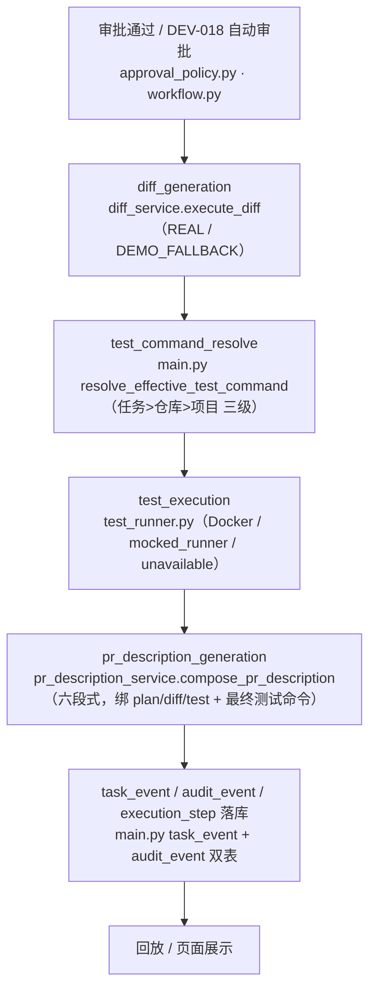

# Diff、测试和 PR 描述自动生成 —— PR 描述生成

> 与 `11-diff-generation-and-display.md`、`12-test-execution.md` 统一口径。本卷聚焦 PR 描述。

## 功能目标

本模块在测试完成后，基于最新落库产物生成可复制的结构化合入说明。系统现在以规则组装六段式描述，绑定计划版本、Diff 产物与测试记录；MVP 只生成文本，不自动创建 Gitee PR。

核心目标：

- 输入来源固定：Issue、AI 分析、修改计划、Diff 结果、测试记录。
- 输出固定六段式、按版本保留历史，不覆盖旧版。
- 计划/Diff/测试变化后标记过期、重新生成新版本。
- 页面支持复制全文，任务详情 / Diff 页 / 回放都能看到生成信息。
- 每次生成写 `task_event` + `audit_event`，改状态是记录级、不改任务终态。
- **记录最终实际使用的测试命令与来源**：PR 描述绑定 `test_run_id → TestRunRecord.command`（任务创建时经 `resolve_effective_test_command` 任务>仓库>项目收敛的最终命令），并把执行命令、`runner_mode` 与回退告警写入测试结果段；命令来源（task/repository/project）由任务时间线 `TEST_COMMAND_SOURCE` + 全局 `TEST_COMMAND_FALLBACK_OR_REJECT` 审计承载，不单独作为 PR 字段。
- **测试命令或测试结果变化后可重新生成**：Diff/测试/计划任一变化即标记过期并追加新版本，不覆盖旧版。

## 主流程



本卷负责 `D → E → F` 一段：基于最新 Diff 与测试记录组装六段式，版本化落库并写事件。

## 执行门禁

- **未生成 Diff/测试不能生成**：无最新成功 Diff、无带结论的测试记录、或计划失效，返回 `409`。
- **只对最新产物生成**：当前版本若已基于最新 Diff 与测试结果生成，拒绝重复生成。
- **过期重算**：Diff、测试或计划变化后，重新生成追加新版本，不覆盖旧版。
- **绑定不可脱离**：`PrDescriptionRecord` 必须携带 `plan_version`、`diff_id`、`test_run_id`。

## 核心能力

### 六段式模板（PRD 口径 → 落地字段）

| 段（验收口径） | 落地字段 | 内容与来源 |
| --- | --- | --- |
| 背景与问题 | `background` | Issue 标题/诉求 + AI 分析概述（来源：`Issue #<id>`、分析 vN） |
| 修改摘要 | `change_summary` | 计划目标、实施步骤、变更产物（来源：审批通过的修改计划 vN、Diff `<id>`） |
| 关键 Diff / 影响范围 | `impact_scope` | 计划 file_scope、Diff 产物文件、影响模块（来源：AI 分析 vN） |
| 测试结果 | `test_result` | 结果、exit code、尝试次数、耗时、输出尾行、执行命令、`runner_mode`、计划建议补充 |
| 风险与回滚 | `risk_notes` + `rollback_notes` | 计划风险等级、审批调整与原因、风险依据、注入识别提示；回滚步骤与工作分支 |
| 审批与审计信息 | `risk_notes`（审批调整行）+ `task_event/audit_event` | 审批通过、风险调整由真实 `user.id`/系统记录；审计信息由事件双表承载 |

> 口径说明：六段式文案由 `compose_pr_description` 组装；「审批与审计信息」在当前实现中以正文风险段的「审批调整」+ 事件双表承载，不在 PR 描述正文单列一段。

### 组装规则

- 每段标注来源，不编造产物中不存在的结论；空数据写「暂无记录」。
- `is_demo_fallback` 的 Diff 会在文案中如实注明「演示兜底，未真实执行代码改动，合入前需真实生成」。
- 测试未通过时文案追加「合入前需修复并重新生成」提示。
- 生成状态是**记录级**：任务仍停在 `TESTED/TEST_FAILED`，PR 描述只在产物层追加版本。

### 版本化与重算

- 复制按钮只复制当前版本全文，不改后端记录。
- 基于旧 Diff/旧测试的版本在页面标记过期，提示重新生成。

### 团队版主链（自动生成）

LangGraph 主链内 `generate_pr_description` 图节点 → worker 复用 `compose_pr_description`：绑定 plan/diff/test、`generated_by=agent-system`、写 `PR_DESC_GENERATED`/`PR_DESC_FAILED`；已有非过期 `GENERATED` 时静默 skip（不重复）。HTTP 手动 `POST /pr-description/generate` 保留。

## 数据与审计

| 产物 | 关联字段 |
| --- | --- |
| `PrDescriptionRecord` | `task_id`、`plan_id`、`plan_version`、`diff_id`、`test_run_id`、`generated_by`、正文六段、版本号 |
| 事件 | `PR_DESC_GENERATED` / `PR_DESC_FAILED`（记录级，不改任务终态） |
| 落库 | 版本历史只追加不覆盖；`task_event` + `audit_event` 双表 |

## 降级边界

- MVP 只生成可审阅文本，不自动创建/更新 Gitee PR；自动建 PR 属后续链路。
- Diff 为演示兜底时，文案如实标注，不起草为已合入。
- 组装异常走 `FAILED` 记录并留痕，不向调用方抛错、不留半成品当成功。

## 关键源码

| 文件 | 职责 |
| --- | --- |
| `backend/app/services/pr_description_service.py` | `compose_pr_description` 六段式组装（来源标注、`暂无记录` 兜底、demo 标记） |
| `backend/app/agent/workflow.py` | `generate_pr_description` 图节点，LangGraph 主链内自动生成 |
| `backend/app/main.py` | `POST /pr-description/generate`、门禁、`PrDescriptionRecord`、过期重算、审计事件 |
| `frontend/src/views/DiffView.vue` | 生成按钮、复制全文、历史版本切换、过期提示 |

## 测试与验收

关键覆盖：无 Diff/无测试门禁、权限矩阵、六段字段、版本历史、过期重算、失败留痕、回放事件。

```text
python -m pytest backend/tests -q
406 passed, 14 skipped, 0 failed
```

## 当前结论

功能链路已通过源码与测试验收；六段式模板、版本化、过期重算、审计落库均已验证；页面真实截图待补。