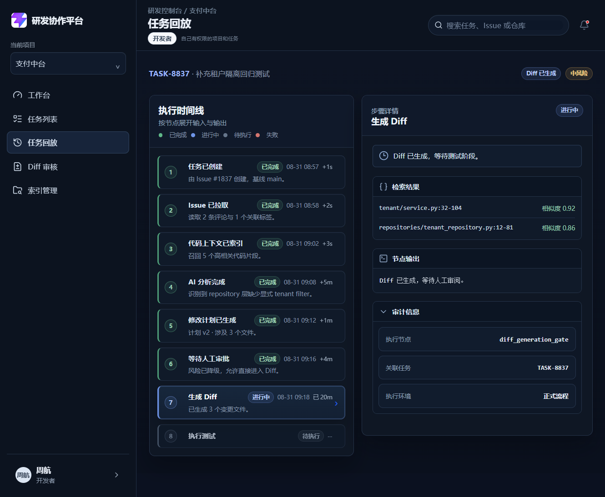
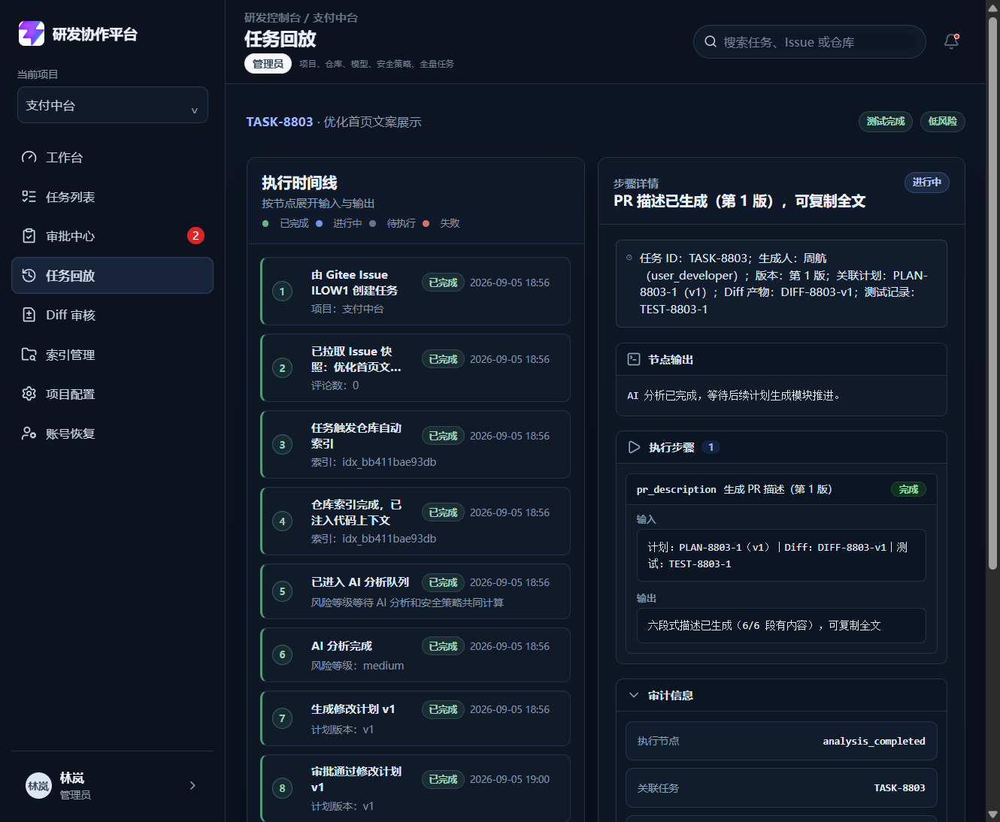

# DEV-014 任务回放与审计模块

## 1. 基本信息

| 项目 | 内容 |
| --- | --- |
| 模块名称 | 任务回放与审计模块 |
| 开发阶段 | MVP |
| 开始日期 | 2026-09-05 |
| 完成日期 | 2026-09-05 |
| 负责人 | Codex 架构复核，Qoder 实现，Claude/豆包验收 |
| 关联文档 | `docs/02-prd.md`、`docs/03-mvp-workflow.md`、`docs/04-technical-architecture.md`、`docs/08-api-design.md`、`docs/09-database-design.md`、`docs/23-mvp-功能细化拆解文档.md` |
| 关联接口 | `GET /api/tasks/{task_id}/timeline`、`GET /api/tasks/{task_id}/events/{event_id}`、`GET /api/audit-events` |
| 关联数据 | `AuditEventRecord`、`ExecutionStepRecord`、`TaskRecord.events`、`TaskRecord.execution_steps` |

## 2. 功能目标与范围

任务回放与审计模块负责把 Agent 执行全过程按时间线还原出来。系统已支持：

- 记录任务创建、Issue 拉取、索引完成、分析、计划、审批、Diff、测试、PR 描述等关键事件；
- 用 `task_events` 记录状态变化和审计事件；
- 用 `execution_steps` 记录 Agent 节点级输入输出、耗时和失败原因；
- 一个事件可挂多个步骤，但事件和步骤职责严格分离；
- 回放页可按事件查看步骤详情，并关联跳转到任务详情、Diff、测试和 PR 描述；
- 审计日志对普通用户只读，不能被修改。

本模块不负责业务流转本身，重点是可追溯、可回看、可关联。

## 3. 业务流程

```mermaid
flowchart TD
    A[业务动作发生<br/>任务创建 / 审批 / Diff / 测试 / PR 描述] --> B[create_audit_event<br/>backend/app/main.py（create_audit_event）]
    B --> C[task_event<br/>写入 task_events + 全局 AUDIT_EVENTS<br/>backend/app/main.py（task_event）]
    A --> D[record_execution_step<br/>写入 execution_steps<br/>backend/app/main.py（record_execution_step）]
    D --> E[关联 event_id / task_id]
    C --> F[GET /api/tasks/{task_id}/timeline<br/>backend/app/main.py（get_task_timeline）]
    F --> G[按 created_at 升序组装回放时间线]
    G --> H[ReplayView.vue 展示事件与步骤<br/>frontend/src/views/ReplayView.vue]
    H --> I[点击跳转任务详情 / Diff / 测试 / PR 描述]
    F --> J[GET /api/tasks/{task_id}/events/{event_id}]
    J --> K[查看单条事件及其 execution_steps]
    L[GET /api/audit-events<br/>后台审计查询] --> M[仅 project:manage 可见]
```

## 4. 实现说明

### 4.1 后端审计模型

- `AuditEventRecord` 记录 `event_type`、`resource_type`、`resource_id`、`actor`、`summary`、`diff_summary`、`created_at`，并额外挂载 `execution_step_ids`。
- `ExecutionStepRecord` 记录 `task_id`、`event_id`、`node`、`title`、`status`、`input`、`output`、`duration_ms`、`failure_reason`、`blocked_reason`。
- `task_event()` 负责把事件写入任务内 `task.events` 和全局 `AUDIT_EVENTS`，用于时间线查询与按 ID 快速定位。
- `record_execution_step()` 负责把步骤写入 `task.execution_steps`，并反向写回关联事件的 `execution_step_ids`。

### 4.2 回放聚合接口

- `GET /api/tasks/{task_id}/timeline` 按时间升序返回事件列表，每条事件内嵌其关联步骤。
- `GET /api/tasks/{task_id}/events/{event_id}` 返回单条事件及其步骤，跨任务事件按不存在处理。
- `GET /api/audit-events` 作为全局审计查询入口，仅管理员可查。

### 4.3 前端展示

- `ReplayView.vue` 读取任务时间线，左侧按事件展示，右侧展开节点输入、输出、失败原因和审计信息。
- `TaskDetailView.vue` 的“最近事件”区域直接引用任务时间线的末尾事件，方便从详情页进入回放。
- 回放页里审批、计划、Diff、测试、PR 描述都能通过事件类型跳转到对应页面。

### 4.4 职责边界

- `task_events` 只记录“发生了什么”。
- `execution_steps` 只记录“Agent 怎么做的”。
- 人工审批、普通审计事件不挂步骤。
- 事件可以挂多个步骤，但步骤不能脱离任务存在。

## 5. 相关源码文件位置

- `backend/app/main.py`
- `backend/tests/test_dev014_replay_audit_module.py`
- `frontend/src/views/ReplayView.vue`
- `frontend/src/views/TaskDetailView.vue`
- `frontend/src/services/taskMapper.ts`
- `frontend/src/types/domain.ts`
- `frontend/src/views/__tests__/ReplayView.spec.ts`
- `frontend/src/views/__tests__/TaskDetailView.spec.ts`
- `docs/02-prd.md`
- `docs/03-mvp-workflow.md`
- `docs/04-technical-architecture.md`
- `docs/08-api-design.md`
- `docs/09-database-design.md`
- `docs/23-mvp-功能细化拆解文档.md`

## 6. 真实内容截图

当前模块已完成代码、验收和真实截图。

| 截图 | 说明 |
| --- | --- |
| `docs/assets/dev014-replay-task-8837-real.png` | 任务回放页真实时间线、步骤详情、关联跳转 |
| `docs/assets/dev014-replay-task-8803-real.png` | 任务回放页真实时间线（`localhost:5176` 实测），可滚动查看完整 12 条事件与右侧关联产物 |





## 7. 测试与验收

| 验收项 | 结果 |
| --- | --- |
| 关键事件写入 task_events | 通过 |
| execution_steps 与事件分离且可关联 | 通过 |
| 失败步骤可展开查看失败原因 | 通过 |
| 审批、计划、Diff、测试在回放中可关联 | 通过 |
| 普通用户不能修改审计日志 | 通过 |
| 回放页与任务详情可读真实时间线 | 通过 |

## 8. 复盘

- 做得好的地方：把事件和步骤拆开后，回放语义更清楚了。
- 需要加强的地方：回放页的节点文案还可以更精确，避免固定 fallback 文本误导。
- 下次注意：新增业务节点时先决定写 event 还是 step，再补前端展示。
- 联调时统一用 `http://localhost:5176` 访问真实前端；本机 `127.0.0.1:5176` 可能直接拒绝连接，容易把环境访问问题误判成回放或 Diff 渲染问题。

## 9. 异常与边界

| 场景 | 当前实现 | 备注 |
| --- | --- | --- |
| 人工审批 / 普通审计事件 | 只写 `task_event`，不写 `execution_step` | 职责分离，避免把人工动作伪装成 Agent 节点 |
| 低风险一键通过 | real 模式下前端逐项调用审批接口并写审计；mock 模式仅更新前端状态，不落审计 | mock 为演示兜底，需在 UI 中显式标记 |
| 回放节点无输出 | 根据事件类型展示摘要或 fallback 文案 | 后续可继续细化为事件专属摘要 |
| 审计双写 | `task.events` 与全局 `AUDIT_EVENTS` 同步写入 | 回放以任务内事件为准，全局表用于 ID 查询与后台审计 |
| 审批 / 计划 / Diff / 测试 / PR 描述关联 | 通过 event summary、diff_summary 和 step 输出串联 | 回放页应优先展示关联对象，再展示步骤明细 |
