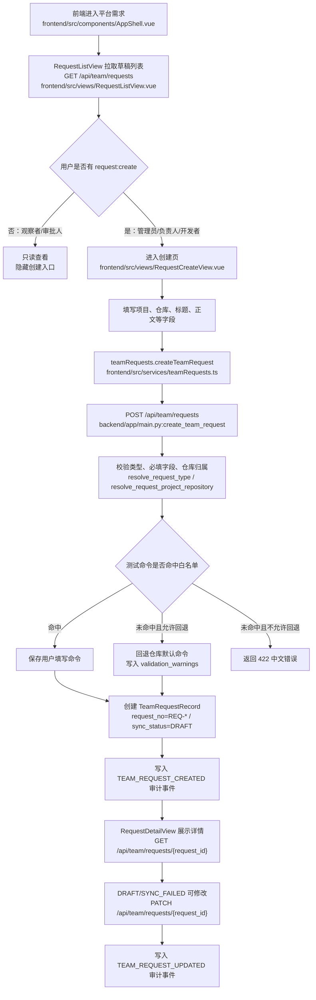
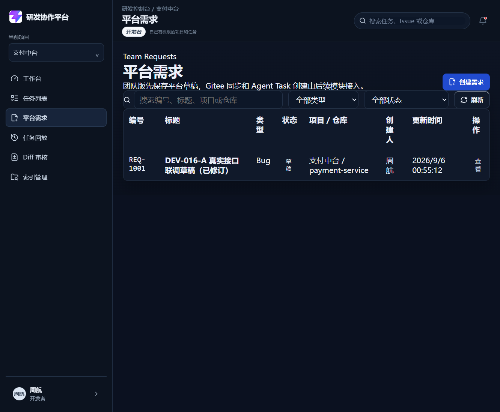
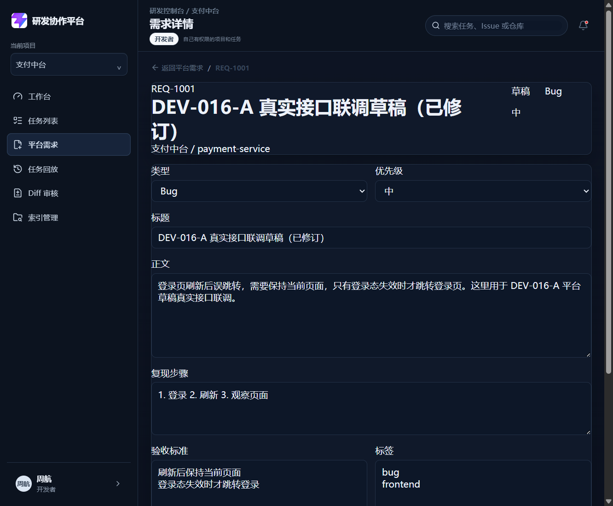

# DEV-016-A 平台需求/缺陷草稿创建

## 1. 基本信息

| 项目 | 内容 |
| --- | --- |
| 模块名称 | 平台需求/缺陷草稿创建 |
| 开发阶段 | 团队版 |
| 开始日期 | 2026-09-06 |
| 完成日期 | 2026-09-06 |
| 负责人 | Codex 架构复核，Qoder 实现，Claude/豆包验收 |
| 关联文档 | `docs/team/01-team-prd.md`、`docs/team/03-team-api-design.md`、`docs/team/04-team-data-permission.md` |
| 关联接口 | `POST /api/team/requests`、`GET /api/team/requests`、`GET /api/team/requests/{request_id}`、`PATCH /api/team/requests/{request_id}` |
| 关联数据 | `TeamRequestRecord`、`TEAM_REQUESTS`、`TEAM_REQUEST_CREATED`、`TEAM_REQUEST_UPDATED` |

## 2. 功能目标与范围

DEV-016-A 解决团队版第一步：用户可以先在平台内创建需求或缺陷草稿，不再必须先去 Gitee 创建 Issue。

本模块已支持：

- 创建、查看、修改平台需求/缺陷草稿；
- 类型复用 MVP 任务类型：`demand`、`bug`、`refactor`、`test`、`doc`；
- 禁止 `feature`、`task` 等非约定类型；
- 必填项目、仓库、标题、正文；
- 可选复现步骤、验收标准、优先级、标签、期望分支、测试命令；
- 生成内部 `REQ-*` 编号，初始状态为 `DRAFT`；
- 正文过短允许保存草稿，但写入 `content_sufficient=false` 和中文补充提示；
- 测试命令必须命中仓库命令白名单，允许按仓库配置回退默认测试命令；
- 草稿创建和修改写入审计事件；
- 观察者只读，不能创建或修改草稿。

本模块不做 Gitee Issue 同步、不创建 Agent Task、不处理 `REQ-*` 与 Gitee Issue 的映射。这些属于 DEV-016-B / DEV-016-C。

## 3. 业务流程

## 4. 实现说明

### 4.1 后端接口与校验

- `backend/app/main.py（ALL_PERMISSIONS）` 增加 `request:view`、`request:create` 权限。
- `backend/app/main.py（ROLE_PERMISSIONS）` 定义团队版角色权限：管理员、研发负责人、开发者可创建；观察者只读；审批人暂不放开创建。
- `backend/app/main.py（TeamRequestRecord）` 定义平台草稿模型，保存平台草稿、创建人、项目仓库、同步状态、正文充足性和预留 Gitee 映射字段。
- `backend/app/main.py（resolve_request_type）` 校验需求类型，只允许 `demand/bug/refactor/test/doc`。
- `backend/app/main.py（evaluate_request_content）` 评估正文是否充足；正文过短不阻断保存，但同步 Gitee 或创建 Agent Task 前需要补充。
- `backend/app/main.py（resolve_request_test_command）` 校验测试命令白名单，支持按仓库配置回退默认测试命令。
- `backend/app/api/team_requests.py（create_team_request）` 创建草稿，生成 `REQ-*` 编号和 `DRAFT` 状态，并写 `TEAM_REQUEST_CREATED` 审计事件。
- `backend/app/api/team_requests.py（list_team_requests）` 返回当前用户可见的草稿列表。
- `backend/app/api/team_requests.py（get_team_request）` 查询草稿详情，支持按内部 id 或 `REQ-*` 编号定位。
- `backend/app/api/team_requests.py（update_team_request）` 修改草稿，仅允许 `DRAFT` 和 `SYNC_FAILED` 状态，开发者只能修改本人创建的草稿。

### 4.2 前端页面

- `frontend/src/router/index.ts:36` 增加 `/requests`、`/requests/new`、`/requests/:id` 三个路由。
- `frontend/src/components/AppShell.vue:83` 增加侧边栏“平台需求”入口。
- `frontend/src/services/teamRequests.ts` 封装平台需求列表、详情、创建、修改接口。
- `frontend/src/views/RequestListView.vue` 展示草稿列表，支持类型、状态和关键字筛选。
- `frontend/src/views/RequestCreateView.vue` 提供草稿创建表单，观察者无创建权限时显示只读提示。
- `frontend/src/views/RequestDetailView.vue` 展示草稿详情并支持保存修改。

### 4.3 权限和状态边界

- 草稿初始状态固定为 `DRAFT`。
- `DRAFT`、`SYNC_FAILED` 可编辑；其他状态不允许修改。
- 观察者不能创建或修改草稿。
- 开发者只能查看和修改本人创建的草稿。
- 管理员、研发负责人、观察者可查看当前 MVP 单项目范围内的草稿。
- Gitee 同步状态已预留 `SYNCING`、`SYNCED`、`SYNC_FAILED`、`TASK_CREATED`、`CLOSED`，但本模块不推进这些状态。

## 5. 相关源码文件位置

- `backend/app/main.py`
- `backend/tests/test_dev016_team_requests.py`
- `frontend/src/types/auth.ts`
- `frontend/src/types/domain.ts`
- `frontend/src/router/index.ts`
- `frontend/src/components/AppShell.vue`
- `frontend/src/components/ModificationPlanPanel.vue`
- `frontend/src/services/teamRequests.ts`
- `frontend/src/views/RequestListView.vue`
- `frontend/src/views/RequestCreateView.vue`
- `frontend/src/views/RequestDetailView.vue`
- `frontend/src/views/__tests__/RequestViews.spec.ts`
- `frontend/vite.config.ts`

## 6. 真实内容截图

| 截图 | 说明 |
| --- | --- |
| `docs/assets/dev016-team-request-list-real.png` | 平台需求列表真实页面，显示真实接口返回的 `REQ-1001` 草稿 |
| `docs/assets/dev016-team-request-detail-real.png` | 平台需求详情真实页面，显示草稿状态、类型、优先级、正文、复现步骤、验收标准和 Gitee 未同步状态 |

## 7. 联调注意点

| 注意点 | 说明 |
| --- | --- |
| 后端端口 | 本次真实联调用 `http://127.0.0.1:8002`，避免旧 `8000` 进程未加载 DEV-016-A 接口 |
| 前端端口 | 本次真实联调用 `http://127.0.0.1:5177` |
| 代理配置 | `frontend/vite.config.ts` 支持 `VITE_API_PROXY_TARGET`，本次指向 `http://127.0.0.1:8002` |
| 登录账号 | 使用开发者账号周航验证创建、列表、详情和修改流程 |
| 模块边界 | DEV-016-A 只保存平台草稿，不同步 Gitee，不创建 Agent Task |
| 编号生成 | 当前 MVP/团队版内存实现按 `TEAM_REQUESTS` 数量生成 `REQ-*`；DEV-016-B/持久化阶段需要改为数据库序列或唯一约束 |
| 测试命令 | 用户填写命令必须命中仓库白名单；允许回退时保存默认测试命令并记录中文 warning |

## 8. 测试与验收

| 验收项 | 结果 |
| --- | --- |
| 创建、查看、修改平台草稿 | 通过 |
| 草稿包含创建人、创建时间、所属项目和所属仓库 | 通过 |
| 类型枚举只允许 `demand/bug/refactor/test/doc` | 通过 |
| 字段校验失败返回 422 且为中文原因 | 通过 |
| 正文过短可保存草稿，但写入补充提示 | 通过 |
| 测试命令白名单和回退逻辑 | 通过 |
| 观察者不能创建或修改草稿 | 通过 |
| 审计事件写入创建和修改动作 | 通过 |
| 后端 DEV-016-A 专项测试 | 42 passed |
| 后端全量测试 | 208 passed |
| 前端全量测试 | 139 passed |
| 前端构建 | 通过 |
| 真实 API 联调 | 通过，`REQ-1001` 可列表查看和详情保存 |

## 9. 复盘

- 做得好的地方：DEV-016-A 把团队版入口先收敛成平台草稿，边界清楚，不急着混入 Gitee 同步和 Agent Task 创建。
- 需要加强的地方：`REQ-*` 编号现在还是内存生成，下一步接 Gitee 同步和持久化时要换成数据库唯一编号。
- 后续 DEV-016-B 已验证同步失败状态、`manual_reason`、幂等查重和 Gitee 映射关系，避免草稿和外部 Issue 断链。
