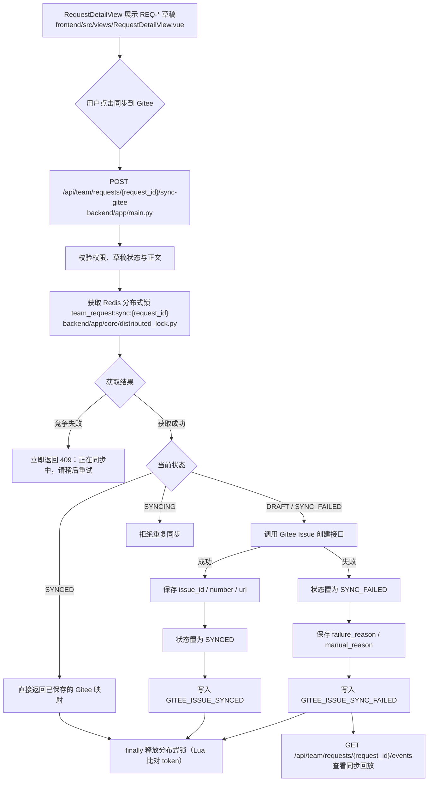
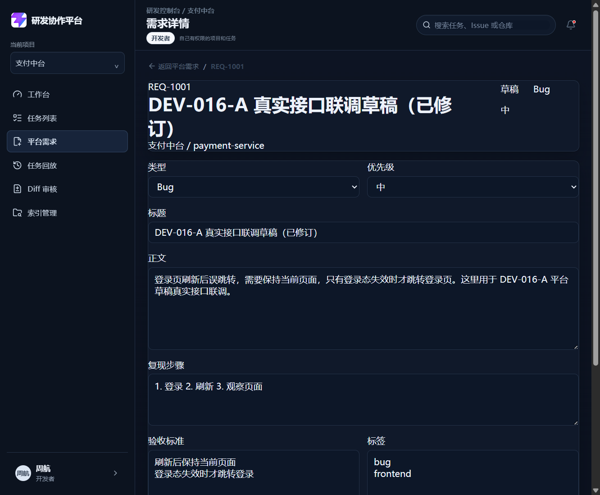
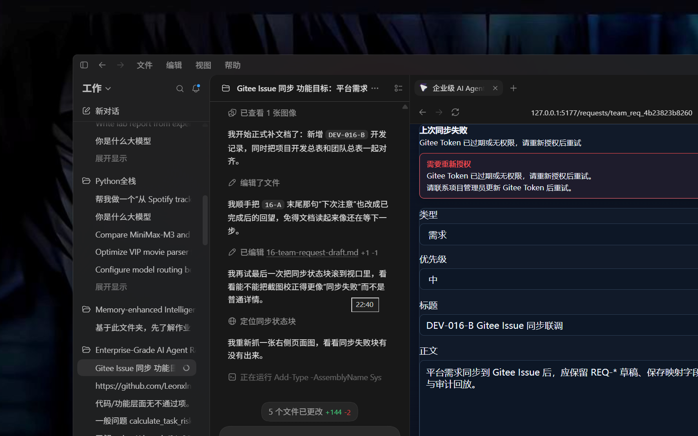

# DEV-016-B 平台需求同步 Gitee Issue

## 1. 基本信息

| 项目 | 内容 |
| --- | --- |
| 模块名称 | 平台需求同步 Gitee Issue |
| 开发阶段 | 团队版 |
| 开始日期 | 2026-09-06 |
| 完成日期 | 2026-09-06 |
| 负责人 | Codex 架构复核，Qoder 实现，Claude/豆包验收 |
| 关联文档 | `docs/team/01-team-prd.md`、`docs/team/03-team-api-design.md`、`docs/team/04-team-data-permission.md`、`docs/project-development/16-team-request-draft.md` |
| 关联接口 | `POST /api/team/requests/{request_id}/sync-gitee`、`GET /api/team/requests/{request_id}/events` |
| 关联数据 | `TeamRequestRecord`、`AUDIT_EVENTS`、`gitee_issue_id`、`gitee_issue_number`、`gitee_issue_url` |

## 2. 功能目标与范围

DEV-016-B 解决团队版第二步：平台需求草稿可以同步创建 Gitee Issue，并保留平台与外部 Issue 的映射关系。

本模块已支持：

- 从 `REQ-*` 草稿同步创建 Gitee Issue；
- 同步成功后保存 `gitee_issue_id`、`gitee_issue_number`、`gitee_issue_url`；
- 同步成功后草稿状态变为 `SYNCED`；
- 同步失败后草稿状态变为 `SYNC_FAILED`，保留失败原因；
- 失败后可在修复授权或字段后重试；
- 重复点击同步不会创建多个 Gitee Issue；
- 同步事件进入审计与回放；
- 同步成功后可从平台跳转到 Gitee Issue；
- 同步失败不会创建 Agent Task。

本模块不做 DEV-016-C 的 Agent Task 创建。

## 3. 业务流程

## 4. 实现说明

### 4.1 后端接口与幂等

- `backend/app/main.py（gitee_api_post / create_gitee_issue）` 增加 Gitee POST 适配，统一处理创建 Issue 请求。
- `backend/app/core/distributed_lock.py` 提供按 `request_id` 粒度的 Redis 分布式锁（`SET NX PX` + Lua CAS 释放，TTL 默认 30s），未配置 `REDIS_URL` 时降级进程内锁。
- `backend/app/api/team_requests.py（sync_team_request_to_gitee）` sync-gitee 端点非阻塞获取 `team_request:sync:{request_id}` 锁，竞争失败返回 409，`finally` 中释放。
- `backend/app/api/team_requests.py（sync_team_request_to_gitee）` 定义 `sync-gitee` 接口入口。
- 同一入口在锁内重读后早退已同步（SYNCED）草稿，避免重复创建。
- 失败分流 `auth_expired`、`field_error`、`network_timeout`：error_type 由 `backend/app/main.py（gitee_api_post）` 标注，入口按类型落 `SYNC_FAILED` 与 `manual_reason`。
- 同步成功后写入 `GITEE_ISSUE_SYNCED` 审计事件（Worker 异步路径由 `backend/app/main.py（sync_request_to_gitee_worker）` 同写）。
- `backend/app/api/team_requests.py（list_team_request_events）` 提供需求同步回放接口，返回该草稿的同步事件。
- 失败后写入 `GITEE_ISSUE_SYNC_FAILED`（Worker 路径同写失败审计与 `failure_reason`）。

### 4.2 前端页面

- `frontend/src/services/teamRequests.ts` 增加同步与回放接口封装。
- `frontend/src/types/domain.ts` 增加同步状态、映射字段和回放事件类型。
- `frontend/src/views/RequestDetailView.vue` 增加同步按钮、失败重试、授权入口和 Gitee 外链。
- `frontend/src/views/RequestDetailView.vue` 对 `SYNCING`、`SYNCED`、`SYNC_FAILED` 分别渲染不同状态。

### 4.3 权限和状态边界

- 只有 `request:create` 角色可同步。
- `DRAFT`、`SYNC_FAILED` 可同步。
- `SYNCING` 期间禁止重复点击。
- `SYNCED` 草稿不允许再次创建 Gitee Issue。
- 开发者只能同步本人创建的草稿。
- 同步失败后保留草稿，不创建 Agent Task。

## 5. 相关源码文件位置

- `backend/app/main.py`
- `backend/app/core/distributed_lock.py`
- `backend/tests/test_dev016b_sync_gitee.py`
- `backend/tests/test_distributed_lock.py`
- `frontend/src/services/teamRequests.ts`
- `frontend/src/types/domain.ts`
- `frontend/src/views/RequestDetailView.vue`
- `frontend/src/views/__tests__/RequestDetailSync.spec.ts`
- `docs/team/03-team-api-design.md`
- `docs/team/00-team-development-plan.md`

## 6. 真实内容截图

| 截图 | 说明 |
| --- | --- |
| `docs/assets/dev016-team-request-detail-real.png` | 平台需求草稿详情真实页面，作为同步前基线 |
| `docs/assets/dev016-team-request-sync-failed-real.png` | 平台需求同步失败真实页面，显示失败原因、重新授权入口和重试能力 |

## 7. 联调注意点

| 注意点 | 说明 |
| --- | --- |
| 后端端口 | 本次真实联调用 `http://127.0.0.1:8000` |
| 前端端口 | 本次真实联调用 `http://127.0.0.1:5177` |
| 代理配置 | `frontend/vite.config.ts` 支持 `VITE_API_PROXY_TARGET` |
| 登录账号 | 使用开发者账号周航验证同步、重试和授权入口 |
| 模块边界 | DEV-016-B 只做 Gitee Issue 同步，不创建 Agent Task |
| 幂等边界 | 同步锁已升级为 Redis 分布式锁（`team_request:sync:{request_id}`）；多 Worker/多容器部署必须配置 `REDIS_URL`，未配置时仅进程内锁、只保证单实例幂等 |
| 锁超时 | TTL 由 `TEAM_REQUEST_LOCK_TTL_SECONDS` 控制，默认 30 秒；持有者崩溃自动释放，锁竞争立即 409 可重试 |
| 查重边界 | 查重是兜底保护，不替代持久化唯一约束 |

## 8. 测试与验收

| 验收项 | 结果 |
| --- | --- |
| DRAFT 同步成功并保存映射字段 | 通过 |
| SYNCED 重复请求不再次创建 | 通过 |
| SYNCING 并发请求不重复创建 | 通过 |
| Token 过期进入 `SYNC_FAILED` + `auth_expired` | 通过 |
| 字段错误进入 `SYNC_FAILED` | 通过 |
| 失败后可重试 | 通过 |
| 同步失败/成功都不创建 Agent Task | 通过 |
| 成功/失败/重试写入审计事件 | 通过 |
| Token 不出现在响应和审计 | 通过 |
| 网络超时查重复用已存在 Issue | 通过 |
| 回放接口返回同步事件 | 通过 |
| Redis 分布式锁下并发同步只成功一次，竞争方 409 后重试复用映射 | 通过 |
| 锁 TTL 过期恢复、释放异常不外抛、Redis 故障降级进程锁 | 通过 |
| 后端专项测试 | DEV-016-B 30 passed；分布式锁 14 passed |
| 后端全量回归 | 257 passed |
| 前端类型检查与构建 | 通过 |

## 9. 复盘

- 做得好的地方：同步、失败、重试、审计和回放的边界收得很紧，没有把 Agent Task 误拉进来。
- 需要加强的地方：同步锁已从进程内锁升级为 Redis 分布式锁（生产前修复）；来源标识查重仍是网络兜底，持久化唯一约束需要在数据库落地阶段补齐。
- 下次注意：DEV-016-C 接 Agent Task 时，要继续沿用 `SYNCED` 草稿的映射字段，不要把同步逻辑和任务创建逻辑搅在一起。
