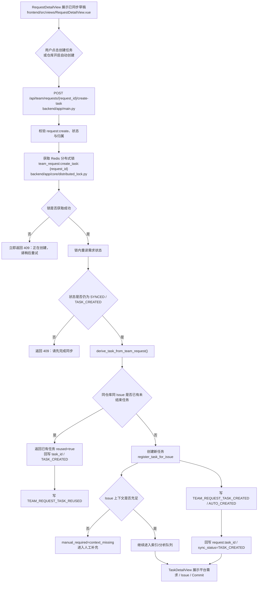
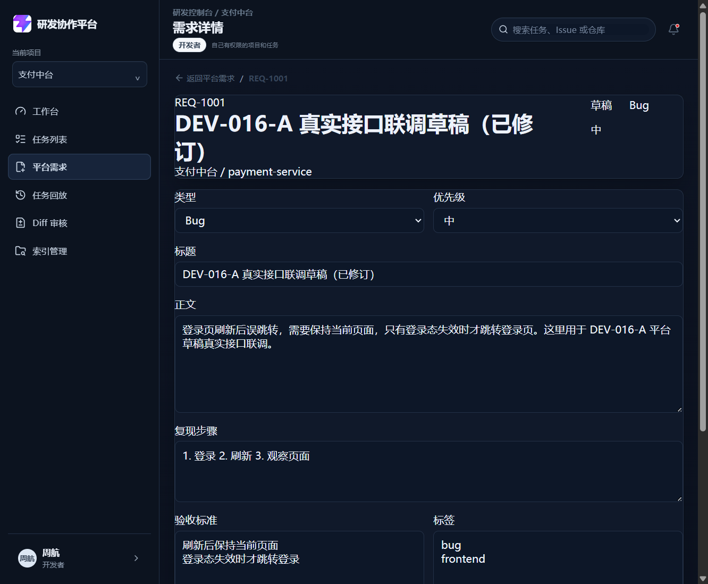
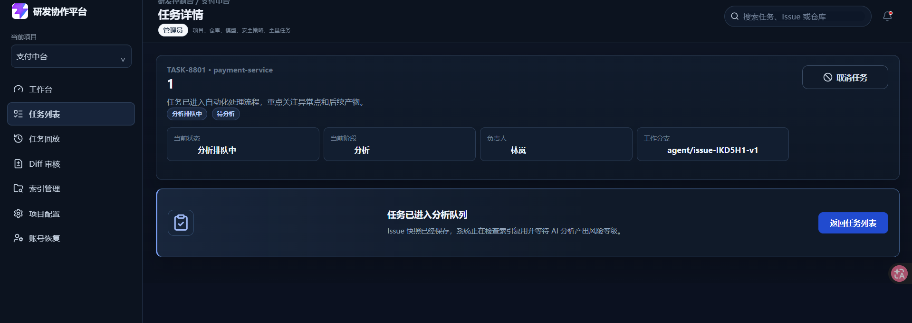
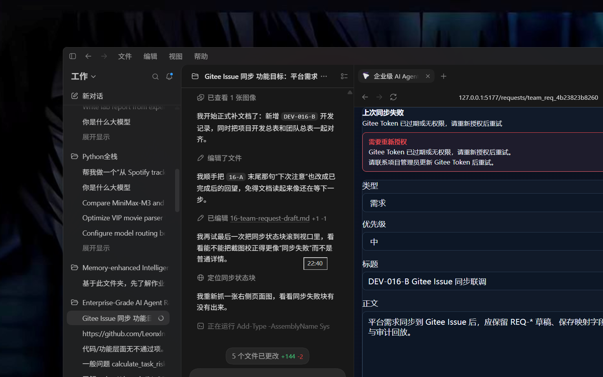

# DEV-016-C Agent 任务自动创建

## 1. 基本信息

| 项目 | 内容 |
| --- | --- |
| 模块名称 | Agent 任务自动创建 |
| 开发阶段 | 团队版 |
| 开始日期 | 2026-09-06 |
| 完成日期 | 2026-09-07 |
| 负责人 | Codex 架构复核，Qoder 实现，Claude/豆包验收 |
| 关联文档 | `docs/team/01-team-prd.md`、`docs/team/03-team-api-design.md`、`docs/team/04-team-data-permission.md`、`docs/project-development/17-team-request-sync-gitee.md` |
| 关联接口 | `POST /api/team/requests/{request_id}/create-task`、`POST /api/repositories/{repository_id}`、`PUT /api/repositories/{repository_id}` |
| 关联数据 | `TeamRequestRecord`、`TaskRecord`、`RepositoryConfigRecord`、`AUDIT_EVENTS`、`team_request:sync:{request_id}`、`team_request:create_task:{request_id}` |

## 2. 功能目标与范围

DEV-016-C 解决团队版第三步：Gitee Issue 同步完成后，可以一键创建 Agent 任务，也可以按仓库开关同步后自动创建任务。

本模块已支持：

- 已同步 Gitee Issue 的平台需求可一键创建 Agent 任务；
- 可配置为同步成功后自动创建 Agent 任务；
- 创建任务时自动绑定项目、仓库、Issue、Commit、创建人；
- 同一仓库同一 Issue 存在未结束任务时，返回已有任务；
- 已结束任务允许新建任务版本；
- 空 Issue 或上下文不足时不直接失败，进入人工补充；
- 并发创建同一需求时不产生重复未结束任务；
- 任务详情可看到平台需求、Gitee Issue 和当前 Commit；
- 创建、复用、自动创建失败都进入审计和回放；
- 自动创建失败不回滚 Gitee 同步结果。

本模块不改 DEV-016-B 的同步语义，不重写 MVP 任务状态机。

## 3. 业务流程

## 4. 实现说明

### 4.1 后端创建内核

- `backend/app/main.py（derive_task_from_team_request）` 定义任务创建内核，统一承载手动创建与自动创建。
- 内核命中未结束任务时返回 `TEAM_REQUEST_TASK_REUSED`，不重复创建。
- 内核新建任务时区分 `TEAM_REQUEST_TASK_CREATED` 与 `TEAM_REQUEST_TASK_AUTO_CREATED`。
- `backend/app/main.py（maybe_auto_create_task_after_sync）` 同步成功后按仓库开关自动触发。
- 自动创建失败只写 `TEAM_REQUEST_TASK_AUTO_CREATE_FAILED`，不回滚同步结果。
- `backend/app/api/team_requests.py（create_task_from_team_request）` 提供一键创建接口 `/api/team/requests/{request_id}/create-task`。
- 一键创建在锁内重读状态，避免等待期间状态变化导致重复创建。
- `backend/app/core/distributed_lock.py` 提供 `team_request:sync:{request_id}` / `team_request:create_task:{request_id}` 两条锁链路。

### 4.2 前端页面

- `frontend/src/views/RequestDetailView.vue:56` 起的 `canCreateTask` 负责权限、状态、归属三重门禁。
- `frontend/src/views/RequestDetailView.vue:162` 起的一键创建调用 `createTaskFromTeamRequest`。
- `frontend/src/views/RequestDetailView.vue:270` 起渲染创建任务、查看任务、新建版本入口。
- `frontend/src/views/SettingsView.vue:61` 和 `:413` 提供仓库级 `auto_create_task_after_sync` 开关。
- `frontend/src/views/TaskDetailView.vue:116` 起展示当前 Commit。
- `frontend/src/views/TaskDetailView.vue:122` 起展示平台需求与 Gitee Issue 来源闭环。

### 4.3 权限与状态边界

- 只有 `request:create` 可以创建 Agent 任务。
- 开发者只能为本人创建的平台需求建任务。
- `SYNCED` / `TASK_CREATED` 可触发创建。
- `DRAFT` / `SYNCING` / `SYNC_FAILED` 不允许直接建任务。
- 同一仓库同一 Issue 存在未结束任务时返回已有任务，不再重复创建。
- 已结束任务再次创建时版本号递增。
- 空 Issue 或上下文不足时进入 `manual_required=context_missing`。

## 5. 相关源码文件位置

- `backend/app/main.py`
- `backend/app/core/distributed_lock.py`
- `backend/tests/test_dev016c_create_task.py`
- `backend/tests/test_dev016b_sync_gitee.py`
- `backend/tests/test_distributed_lock.py`
- `frontend/src/services/teamRequests.ts`
- `frontend/src/types/domain.ts`
- `frontend/src/views/RequestDetailView.vue`
- `frontend/src/views/SettingsView.vue`
- `frontend/src/views/TaskDetailView.vue`
- `frontend/src/views/__tests__/RequestDetailCreateTask.spec.ts`
- `frontend/src/views/__tests__/SettingsAutoCreate.spec.ts`
- `frontend/src/views/__tests__/TaskDetailView.spec.ts`

## 6. 真实内容截图

| 截图 | 说明 |
| --- | --- |
| `docs/assets/dev016-team-request-detail-real.png` | 平台需求详情真实页面，显示已同步后的创建入口与任务按钮 |
| `docs/assets/gitee-issue-task-detail-success-real.png` | 任务详情真实页面，展示任务来源闭环和当前 Commit |
| `docs/assets/dev016-team-request-sync-failed-real.png` | 同步失败真实页面，作为创建前失败兜底状态参考 |

## 7. 联调注意点

| 注意点 | 说明 |
| --- | --- |
| 后端端口 | 本次真实联调用 `http://127.0.0.1:8000` |
| 前端端口 | 本次真实联调用 `http://127.0.0.1:5177` |
| 代理配置 | `frontend/vite.config.ts` 支持 `VITE_API_PROXY_TARGET` |
| 登录账号 | 使用开发者账号周航验证创建、复用和自动创建 |
| 模块边界 | DEV-016-C 只做从已同步需求创建任务，不改 DEV-016-B 的同步语义 |
| 幂等边界 | Redis 分布式锁 + 锁内重读 + 未结束任务查重；未配置 `REDIS_URL` 时仅适用于单实例 |
| 自动创建 | 默认关闭，需在仓库配置里显式开启 `auto_create_task_after_sync` |

## 8. 测试与验收

| 验收项 | 结果 |
| --- | --- |
| 已同步需求一键创建任务 | 通过 |
| 同步成功后自动创建 | 通过 |
| 任务绑定项目/仓库/Issue/Commit/创建人 | 通过 |
| 同一 Issue 未结束任务不重复 | 通过 |
| 已结束任务允许新版本 | 通过 |
| 空 Issue 进入人工补充 | 通过 |
| 并发创建不重复 | 通过 |
| 任务详情显示来源 | 通过 |
| 审计回放完整 | 通过 |
| 权限控制正确 | 通过 |
| 不破坏 DEV-016-B | 通过 |
| 后端专项测试 | 19 passed |
| DEV-016-B 回归测试 | 30 passed |
| 前端类型检查与构建 | 通过 |

## 9. 复盘

- 做得好的地方：把“同步”和“建任务”拆成两条链路后，幂等、权限和审计都更清晰了。
- 需要加强的地方：生产环境必须保证 Redis 常驻可用，降级进程锁只适合单实例演示或本地开发。
- 下次注意：后续如果要继续扩展团队版，优先接 DEV-017 自动上下文补齐，不要再把任务来源和上下文补齐混成一层。
