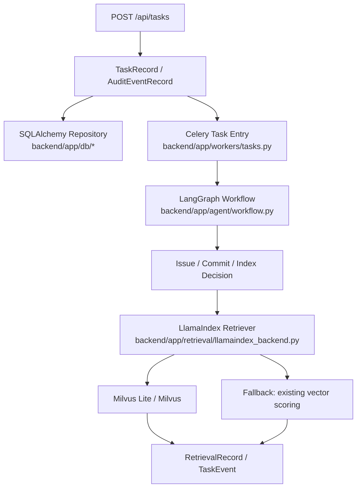

# DEV-017 框架对齐落地记录

## 功能目标与范围

把 PRD 中声明的技术框架真正落到代码里，覆盖：
- SQLAlchemy + MySQL/SQLite 持久化入口
- Celery 异步任务入口
- LangGraph 任务工作流
- DeepAgents 任务代理入口
- LlamaIndex + Milvus 检索与索引编排

当前实现保持原有 API 和测试行为不变，同时补上真实框架适配层。

## 业务流程图



## 关键代码说明

- `backend/app/core/runtime_config.py`
  - 收拢 `DATABASE_URL`、`CELERY_BROKER_URL`、`MILVUS_URI` 等运行时配置。
- `backend/app/retrieval/llamaindex_backend.py`
  - 用 `TextNode` + `VectorStoreIndex` 接管检索编排。
  - `MilvusVectorStore` 作为主存储；Milvus 不可用时自动回退。
- `backend/app/agent/workflow.py`
  - 用 LangGraph 编译任务工作流。
  - `build_task_deep_agent()` 预留 DeepAgents 入口。
- `backend/app/models/orm.py`
  - 增加 `repository_indexes`、`code_chunks`、`retrieval_records`、`task_events`、`execution_steps`、`agent_checkpoints` 的 ORM 定义。
- `backend/app/db/repositories.py`
  - 为索引、切片、检索记录、事件和执行步骤提供持久化辅助。
- `backend/app/main.py`
  - 在启动时初始化 schema 和工作流。
  - 索引构建、检索、事件和执行步骤同步写入 DB。
- `backend/app/core/distributed_lock.py`
  - DEV-016-B/C 使用 `SET NX PX` + Lua CAS 释放 Redis 锁。
  - Redis 瞬时不可用时允许单实例进程锁兜底；兜底 token 带 `process:` 标记，Redis 恢复后释放不会误走 Redis 路径。

## 联调注意点

- `DATABASE_URL` 未配置时默认走本地 SQLite。
- `MILVUS_URI` 未配置时默认使用本地 Milvus Lite 文件。
- `CELERY_BROKER_URL` 为空时，Celery 保持 eager 模式，方便本地跑通。
- LlamaIndex / Milvus 检索失败时会回退到现有确定性向量评分，避免打断主流程。
- `REDIS_URL` 未配置或 Redis 瞬时不可用时，只能保证单进程幂等；多 Worker / 多容器生产环境必须配置高可用 Redis。
- Redis 故障降级次数保存在锁后端的 `degraded_count`，生产环境应接入指标或日志告警，避免长期静默运行在单实例兜底模式。

## 真实运行验证

后端总回归：

```bash
pytest backend/tests -q
```

结果：`284 passed`

前端构建采用路由级动态导入，登录页不再预加载全部业务页面；构建时如仍出现大 chunk 提示，应继续对详情页的重型组件做分块，而不改变业务接口。
