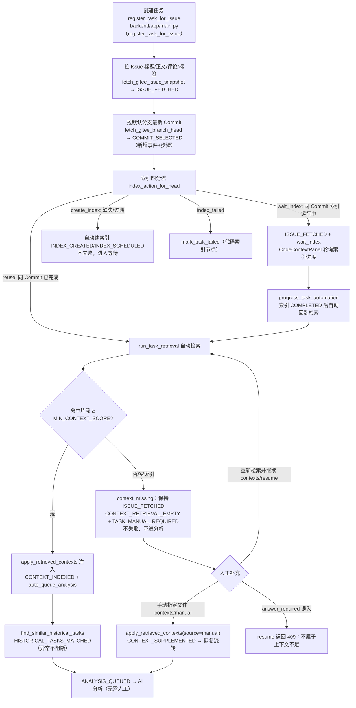

# DEV-017 自动上下文补齐

## 1. 基本信息

| 项目 | 内容 |
| --- | --- |
| 模块名称 | 自动上下文补齐（Issue / Commit / 索引 / 检索 / 历史任务 / 人工补充） |
| 开发阶段 | 团队版 |
| 开始日期 | 2026-09-07 |
| 完成日期 | 2026-09-07 |
| 负责人 | 豆包实现与自测，小泽验收 |
| 关联文档 | `docs/team/01-team-prd.md`（§7.4 自动上下文补齐、§6.5 历史任务复用、§7.10 复用索引边界）、`docs/team/02-team-workflow.md`、`docs/team/03-team-api-design.md`、`docs/project-development/08-code-rag-index.md`、`docs/project-development/18-team-request-create-task.md` |
| 关联接口 | `POST /api/tasks/{task_id}/contexts/resume`、`GET /api/tasks/{task_id}/similar`、既有 `GET /api/tasks/{task_id}/contexts`、`POST /api/tasks/{task_id}/contexts/manual` |
| 关联数据 | `TaskRecord.similar_task_refs`、`SimilarTaskRef`、`RetrievalRecord`、任务事件 `COMMIT_SELECTED` / `CONTEXT_RETRIEVAL_EMPTY` / `CONTEXT_SUPPLEMENTED` / `HISTORICAL_TASKS_MATCHED` |

## 2. 功能目标与范围

DEV-017 承接 DEV-016-C：Agent 任务创建后，系统自动抓齐分析所需上下文，尽量不需要人工操作。

本模块已支持：

- 任务创建时自动拉取 Issue 标题、正文、评论、标签（沿用 `ISSUE_FETCHED`，空 Issue 走 `context_missing` 兜底，DEV-016-C 已具备）；
- 拉取仓库默认分支最新 Commit 后，新增独立的 `COMMIT_SELECTED` 事件与执行步骤，回放可区分「Issue 拉取 / Commit 选择 / 索引决策」三个节点；
- 自动判断代码索引是否 fresh：同 Commit 已完成则复用，缺失/过期自动创建索引并进入等待，索引完成后由 `progress_task_automation` 自动检索注入；
- 自动检索代码片段：命中达到 `MIN_CONTEXT_SCORE=0.3` 的片段才注入并进入分析队列；
- **检索为空或全部低于阈值时，任务不判失败、不进分析队列**，置 `manual_required=true`、`manual_reason=context_missing`、`next_action=supplement_context`，状态保持 `ISSUE_FETCHED`，写 `CONTEXT_RETRIEVAL_EMPTY` 事件；
- 自动检索同仓库历史相似任务（轻量关键词/向量同源打分，Top 3、阈值 0.2），只返回引用用于参考展示，**不自动套用旧 Diff**；检索异常不阻断主链路；
- 上下文不足后提供两条恢复路径：`POST /contexts/resume` 重新自动检索、`POST /contexts/manual` 手动指定文件；补齐后写 `CONTEXT_SUPPLEMENTED` 并自动恢复流转到分析队列；
- 严格区分 `context_missing`（上下文聚合阶段）与 `answer_required`（AI 分析阻塞问题阶段）：`resume` 接口拒绝非 `context_missing` 的人工态。

范围边界：

- 不重写任务状态机，不新增任务状态，复用 `ISSUE_FETCHED / CONTEXT_INDEXED / ANALYSIS_QUEUED` 与 `manual_required` 标志；
- 不实现 DEV-021 的复用摘要向量索引与 `POST /api/reuse-index/rebuild`，本模块的历史相似任务是同仓库已完成任务的轻量实时打分，DEV-021 落地后替换 `find_similar_historical_tasks` 内部实现即可；
- 不做 `03-team-api-design.md` 中提到的 Gitee 反向拉 Issue（sync-from-gitee），该能力另行排期；
- 不改动 DEV-016-B 同步、DEV-016-C 任务创建与 Redis 分布式锁主流程。

## 3. 业务流程

## 4. 实现说明

### 4.1 后端（`backend/app/main.py`）

- `backend/app/main.py（SimilarTaskRef）`：历史相似任务轻量引用模型，只含 `task_id/version/title/issue_id/status/risk_level/score/summary`，不含 Diff、计划和代码上下文；`TaskRecord` 新增 `similar_task_refs` 字段。
- `backend/app/main.py（find_similar_historical_tasks）`：筛选同仓库、`COMPLETED`、排除自己的历史任务，复用 `retrieval_score`（真实向量模式下与代码检索同一套 embedding 相似度）对标题+正文+评论+标签打分，取 `SIMILAR_TASK_LIMIT=3`、`SIMILAR_TASK_MIN_SCORE=0.2`。
- `backend/app/main.py（attach_similar_historical_tasks）`：上下文注入后挂载引用并写 `HISTORICAL_TASKS_MATCHED`（0 命中也写一条，异常时写「已跳过且不阻断」）。
- `backend/app/main.py（apply_retrieved_contexts）`：DEV-017 统一上下文分流 helper，被三处复用——创建时复用索引（`source=reuse`）、等待索引完成（`source=index_ready`，`progress_task_automation` 内）、人工补充恢复（`source=resume/manual`）。命中则注入、置 `CONTEXT_INDEXED` 并检索历史任务；为空则置 `context_missing`、保持 `ISSUE_FETCHED`，写 `CONTEXT_RETRIEVAL_EMPTY`。
- `backend/app/main.py（register_task_for_issue）` 与 `retry_task`：拉到分支 head 后补 `COMMIT_SELECTED` 事件和 `commit_select` 执行步骤。
- `POST /api/tasks/{task_id}/contexts/resume`（`backend/app/main.py（resume_task_contexts）`，权限 `task:operate`）：重新自动检索；索引运行中返回 200 + `resumed=false` + 中文等待提示；索引失败/不存在返回 409；命中则解除 `context_missing`、写 `CONTEXT_SUPPLEMENTED`、调 `progress_task_automation` 恢复；仍为空返回 200 + `empty_reason`；`answer_required` 等其他人工态一律 409。
- `POST /contexts/manual`：手动指定文件成功后，若任务处于 `context_missing`，走同一恢复 helper，响应新增 `resumed` 字段。
- `GET /api/tasks/{task_id}/similar`（`backend/app/main.py（list_similar_tasks）`，权限 `task:view`）：实时计算历史相似任务引用。
- `contexts/resume` 额外拦截 `status=FAILED`：索引失败或其他终态任务必须走 `/retry`，避免把失败任务误当作上下文不足恢复。

### 4.2 前端

- `frontend/src/types/domain.ts`：新增 `SimilarTaskRef`、`ContextResumeResult`、`TaskSimilarResult`；`Task` 增加 `similarTaskRefs`、`AgentTask` 增加 `similar_task_refs`、`ManualContextResult` 增加 `resumed`。
- `frontend/src/services/taskMapper.ts`：映射 `similar_task_refs`。
- `frontend/src/components/CodeContextPanel.vue`：
  - `context_missing` 空态显示「自动分析已暂停：上下文不足」，主按钮为「重新检索并继续」（走 resume），保留手动指定文件、重建索引入口；
  - resume 中禁用按钮、成功后 `emit('refresh')` 由详情页重新拉任务；
  - 新增「历史相似任务参考」区，直接渲染任务详情携带的 `similarTaskRefs`，提供手动刷新（调 `/similar`），标注「仅参考，不会自动套用旧 Diff」；
  - 等待索引轮询、索引失败重试等既有能力不变。
- `frontend/src/views/TaskDetailView.vue`：人工横幅为 `context_missing / supplement_context` 增加「去补充上下文」按钮，平滑滚动到代码上下文面板；按钮顺序保证 `FAILED` 任务优先显示「重试任务」。
- `frontend/src/views/IndexView.vue`：不改流程，索引等待状态继续在索引管理可见。

### 4.3 context_missing 与 answer_required 的边界

| 维度 | context_missing | answer_required |
| --- | --- | --- |
| 触发阶段 | 上下文聚合（Issue/代码检索） | AI 分析产出阻塞问题后 |
| 任务状态 | 保持 ISSUE_FETCHED，不进分析队列 | ANALYZED，分析已生成 |
| next_action | supplement_context | answer_analysis_question |
| 恢复入口 | contexts/resume、contexts/manual | 分析问题回答接口 |
| resume 接口 | 允许并恢复（但 `status=FAILED` 仍拒绝） | 409 拒绝，提示到对应节点处理 |

## 5. 相关源码文件位置

- `backend/app/main.py`
- `backend/tests/test_dev017_context_fill.py`（新增，13 个用例）
- `backend/tests/test_dev008_rag_index.py`、`test_dev009_modification_plan.py`、`test_dev014_replay_audit_module.py`、`test_dev015_rewrite_limit.py`（随事件序列/检索语义更新断言）
- `frontend/src/types/domain.ts`
- `frontend/src/services/taskMapper.ts`
- `frontend/src/components/CodeContextPanel.vue`
- `frontend/src/views/TaskDetailView.vue`
- `frontend/src/components/__tests__/CodeContextPanel.spec.ts`、`frontend/src/views/__tests__/TaskDetailView.spec.ts`
- `docs/team/03-team-api-design.md`

## 6. 联调注意点

| 注意点 | 说明 |
| --- | --- |
| 自动推进时机 | 自动流转是 lazy 的：`GET /api/tasks`、`GET /api/tasks/{id}`、`GET /contexts` 等接口被调用时由 `progress_task_automation` 逐任务推进；前端 3s 轮询索引状态即可驱动，无需额外定时任务 |
| 空检索不等于失败 | 索引 COMPLETED 但无匹配片段时是 `context_missing`（ISSUE_FETCHED + blocked），只有索引本身 FAILED 才是任务失败，注意前端两类提示不要混淆 |
| 8 秒分析闸门 | CONTEXT_INDEXED → ANALYSIS_QUEUED 无延迟；ANALYSIS_QUEUED → ANALYZED 保留既有 8s 最小聚合时间闸门，与本模块无关 |
| 历史相似任务口径 | 只统计同仓库 COMPLETED 任务；跨仓库相似、复用摘要向量索引属于 DEV-021 |
| 恢复后幂等 | resume/manual 恢复都会重新注入并推进，重复调用以最新检索结果为准，不会产生重复任务或重复索引 |
| 真实联调 | 自动建索引/分支 head 依赖可用 Gitee Token；当前种子 Token 不可访问真实仓库，端到端截图待联调环境补齐 |

## 7. 测试与验收

| 验收项 | 结果 |
| --- | --- |
| 常规 Issue 创建后自动拉 Issue/选 Commit/复用索引/检索/历史任务并进入分析队列 | 通过 |
| COMMIT_SELECTED 事件携带分支与 Commit，回放五节点（issue_fetch/commit_select/index_decision/context_fetch）齐全 | 通过 |
| 索引缺失自动创建并等待，完成后自动检索注入、进入分析队列 | 通过 |
| 检索为空/低于阈值转 context_missing，不失败、不进分析队列，自动推进也不越界 | 通过 |
| resume 命中后恢复并写 CONTEXT_SUPPLEMENTED；仍空保持人工态；索引运行中返回等待提示 | 通过 |
| 手动指定文件恢复 context_missing 并 emit 恢复 | 通过 |
| answer_required 调 resume 返回 409，两类人工态不混用 | 通过 |
| 历史相似任务只返回引用、不含旧 Diff、不含自己；检索异常不阻断主链路 | 通过 |
| 权限：resume 需 task:operate（observer 403），similar 需 task:view | 通过 |
| 后端专项测试 | 13 passed |
| 后端全量回归 | 270 passed（基线 257 + 新增 13） |
| 前端专项 | CodeContextPanel 11 passed、TaskDetailView 20 passed |
| 前端全量 / tsc / build | 167 passed；tsc 通过；vite build 通过 |

## 8. 真实内容截图

> 已补：自动上下文补齐依赖真实 Gitee 仓库与 Token 才能端到端联调。本次已在 real 模式真实跑通并补上页面截图，不再保留示意图位。

| 截图 | 说明 |
| --- | --- |
| `docs/assets/dev017-context-missing-real.png` | 顶部真实空态：`context_missing` 提示、主信息、补充入口 |
| `docs/assets/dev017-context-followup-real.png` | 下方真实联调：代码上下文补充入口、重检/手动指定/重建索引、最近事件 |

> 说明：当前种子任务尚未推进到独立回放页的可展开节点，因此主证据图先放在任务详情页最近事件区；后续如果补到可展开回放节点，再追加回放页截图。

## 9. 复盘

- 做得好的地方：没有新造状态机，用一个 `apply_retrieved_contexts` 统一了「创建复用、等索引完成、人工恢复」三处检索分流，`context_missing` 与 `answer_required` 的边界用接口 409 固化下来。
- 需要加强的地方：历史相似任务目前是实时关键词/同源向量打分，数据量增大后需要 DEV-021 的持久化复用索引；端到端真实截图已补齐，后续可继续补独立回放页。
- 下次注意：DEV-018 审批分级接自动推进时，只允许从 `CONTEXT_INDEXED/ANALYZED` 之后的链路接管，不能绕过上下文补齐门禁。
