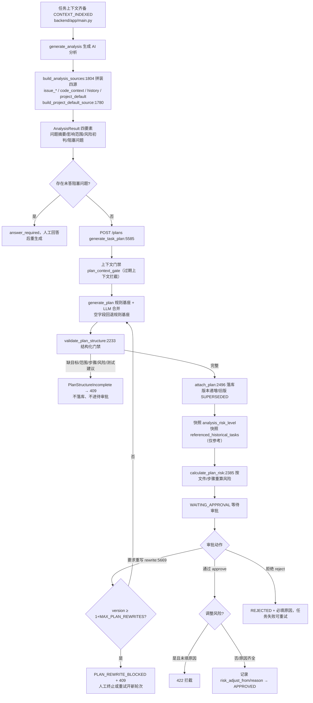
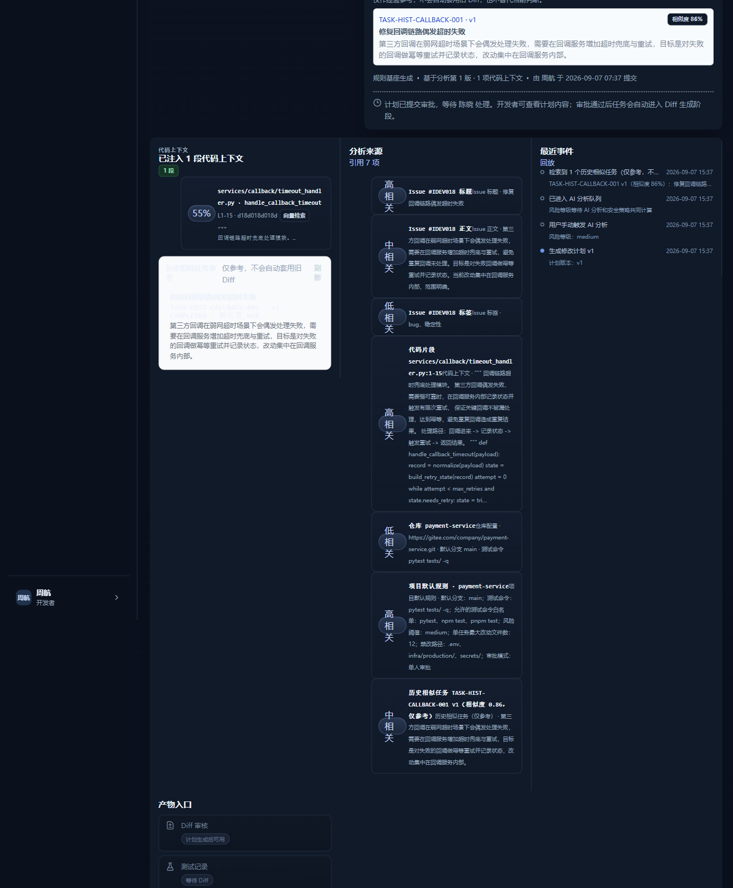
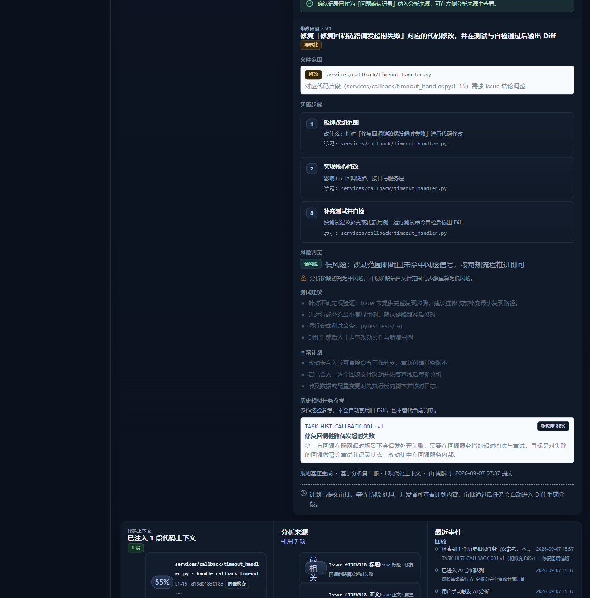

# DEV-018（团队版 7.5）AI 分析与修改计划增强

> 说明：本节对应团队 PRD `docs/team/01-team-prd.md` §7.5，是在 MVP DEV-007（AI 分析）、DEV-009（修改计划）、DEV-015（重写上限）之上的团队版增量，不新增独立任务状态机。开发文档编号顺延为 20。

## 1. 基本信息

| 项目 | 内容 |
| --- | --- |
| 模块名称 | AI 分析与修改计划（团队版 7.5 增强） |
| 开发阶段 | 团队版 |
| 开始日期 | 2026-09-07 |
| 完成日期 | 2026-09-07 |
| 负责人 | 豆包实现与自测，小泽验收 |
| 关联文档 | `docs/team/01-team-prd.md` §7.5、`docs/team/03-team-api-design.md`、`docs/project-development/07-ai-issue-analysis.md`、`docs/project-development/09-modification-plan.md`、`docs/project-development/19-team-context-fill.md` |
| 关联接口 | `POST /api/tasks/{task_id}/analysis`、`POST /api/tasks/{task_id}/plans`、`POST /api/tasks/{task_id}/plans/{plan_id}/rewrite`、`/approve`、`/reject`、`GET /api/tasks/{task_id}/plans` |
| 关联数据 | `AnalysisSource`、`AnalysisResult`、`ModificationPlan.analysis_risk_level`、`ModificationPlan.referenced_historical_tasks`、`SimilarTaskRef` |

## 2. 功能目标与范围

沿用 MVP 已完成的分析与计划能力，补齐团队版要求的四类输入、结构化门禁与可见性：

- **分析输入四源齐备**：Issue（标题/正文/评论/标签）、代码上下文（DEV-017 检索片段）、历史相似任务（DEV-017 `similar_task_refs`，仅参考）、项目默认规则（仓库默认分支/测试命令/命令白名单/风险阈值/最大文件数/禁改路径/审批模式）。
- **分析输出四要素**：问题摘要 `decision_summary`、影响范围 `affected_areas`、风险初判 `suggested_risk_level + risk_reason`、阻塞问题 `questions`（字段沿用 MVP，本次补输入来源）。
- **计划五要素**：目标 `goal`、文件范围 `file_scope`、步骤 `steps`、风险 `risk_level + risk_reason`、测试建议 `test_suggestions`。
- **版本化与重写**：计划继续按 `version` 递增，旧待审批版本置 `SUPERSEDED`；要求重写生成新版本；单轮次重写上限 `MAX_PLAN_REWRITES=2`，超限写 `PLAN_REWRITE_BLOCKED` 并返回 409，引导「审批当前版本 / 拒绝终止 / 重试任务开新轮次」。
- **历史参考可见但不替代判断**：分析来源中以 `history` 类型展示历史相似任务摘要；计划生成时把引用快照到 `referenced_historical_tasks`，前端明确标注「仅参考，不自动套用旧 Diff」。引用模型 `SimilarTaskRef` 结构上不含 diff/plans/code_contexts。
- **风险重算可见**：计划生成时快照分析初判风险 `analysis_risk_level`，结合文件范围/步骤由 `calculate_plan_risk` 重算；审批人调整风险必须填原因，`risk_adjust_from / risk_adjust_reason` 全链路可见。
- **结构化完整性门禁**：`validate_plan_structure` 在计划落库（`attach_plan`）前强制校验五要素，残缺计划抛 `PlanStructureIncomplete`，端点转 409，不进入 `WAITING_APPROVAL`、不写入 `task.plans`。

范围边界：

- 不新增任务/计划状态，不改动 DEV-016-B/C、DEV-017 主链路；
- 低风险自动推进（`AUTO_APPROVED`）属于 §7.6 / DEV-018 审批分级（见 `docs/project-development/30-approval-grading-auto-advance.md`），本模块为其提供「进入审批或自动推进前计划结构完整」的前置门禁；自动推进本身由 DEV-018 `approval_policy.evaluate_plan_gate` 实现，并复用本模块的 `validate_plan_structure` 作为自动推进「结构完整」前提，与 PRD §7.6 对齐；
- 历史相似任务仍是 DEV-017 的轻量实时引用，完整复用摘要向量索引属于 DEV-021。

## 3. 业务流程

## 4. 实现说明

### 4.1 后端（`backend/app/main.py`）

- `AnalysisSource.source_type` 枚举新增 `project_default`、`answered_question`；原「问题确认」误用的 `history` 语义归还给「历史相似任务」。
- `backend/app/main.py（build_project_default_source）`：把仓库默认规则拼成高相关来源。
- `backend/app/main.py（build_analysis_sources）`：按 Issue → 代码上下文（fresh 优先、最多 `MAX_CONTEXT_CHUNKS`）→ 仓库 → 项目默认规则 → 历史相似任务（仅参考）→ 问题确认 的顺序拼装四源。
- `_analysis_prompt` / `build_plan_prompt`：补历史相似任务与项目默认规则文本，并显式要求模型「禁止直接照搬旧结论 / 旧 Diff」。
- `backend/app/main.py（PlanStructureIncomplete）` + `backend/app/main.py（validate_plan_structure）`：五要素完整性校验，返回缺失项。
- `_merge_llm_plan`：LLM 返回空 goal / 空范围 / 空步骤时回退规则基座，尽量不触发门禁；真残缺由门禁拦截。
- `backend/app/main.py（attach_plan）`：落库前先过结构门禁；快照 `analysis_risk_level` 与 `referenced_historical_tasks`；审计 diff_summary 增加「风险重算 初判→计划」「参考历史相似任务 N 项（仅参考）」。
- `backend/app/main.py（generate_task_plan / rewrite_task_plan）`：捕获 `PlanStructureIncomplete` 转 409 中文提示。
- `ModificationPlan` 新增 `analysis_risk_level`、`referenced_historical_tasks`；因前向引用 `SimilarTaskRef`，在其定义后调用 `ModificationPlan.model_rebuild()`。

### 4.2 前端

- `types/domain.ts`：`AnalysisSourceType` 增 `project_default`/`answered_question`；`ModificationPlan` 增 `analysis_risk_level`、`referenced_historical_tasks`。
- `views/TaskDetailView.vue`：分析来源标签 `history` 改为「历史相似任务（仅参考）」，新增项目默认规则、问题确认记录标签。
- `components/ModificationPlanPanel.vue`：风险判定区在「分析初判 ≠ 计划重算」时展示变化行；新增「历史相似任务参考」区块（含跳转、相似度、参考免责说明）。

### 4.3 关键边界

| 边界 | 处理 |
| --- | --- |
| 历史任务与当前结论 | 只传摘要引用，`SimilarTaskRef` 无 diff/plans/code_contexts 字段，prompt 明确禁止照搬 |
| 计划结构残缺 | 不落库、不进待审批，端点 409，任务保持 ANALYZED 可重新生成 |
| 重写上限 | 单轮次最多重写 2 次，超限 409 + `PLAN_REWRITE_BLOCKED`；retry 清空 plans 后随新轮次重置 |
| 风险调整 | 调整必须填原因（后端 422、前端禁用提交双保险），原等级→新等级与原因全程可见 |
| context_missing / answer_required | 仍由 DEV-017 与分析阻塞问题各自分流，本模块不混用 |

## 5. 相关源码文件位置

- `backend/app/main.py`
- `backend/tests/test_team_analysis_plan.py`（新增，12 用例）
- `backend/tests/test_dev007_analysis.py`（问题确认来源枚举随语义更新为 answered_question）
- `frontend/src/types/domain.ts`
- `frontend/src/views/TaskDetailView.vue`
- `frontend/src/components/ModificationPlanPanel.vue`
- `frontend/src/components/__tests__/ModificationPlanPanel.spec.ts`（新增 2 用例）
- `frontend/src/stores/__tests__/workspace.spec.ts`（来源枚举同步）
- `backend/dev_demo_dev018.py`（本地演示种子：无 Key 环境下种出四源分析 + 历史参考 + 风险变化行的真实任务，供截图复现）

## 6. 联调注意点

| 注意点 | 说明 |
| --- | --- |
| 四源可见位置 | 任务详情「分析来源」区可看到项目默认规则、代码上下文、历史相似任务（仅参考）等条目 |
| 历史参考来源 | 依赖 DEV-017 在 CONTEXT_INDEXED 时挂载的 `similar_task_refs`；若该任务无历史相似任务，计划中不出现参考区，属正常 |
| 结构门禁触发 | 正常规则基座始终完整；门禁主要拦截 LLM 异常输出且回退仍残缺的极端情况，前端会收到 409 中文提示 |
| 风险初判对比 | 仅当分析初判与计划重算等级不同时展示变化行，相同时不展示以免噪声 |
| 真实联调 | LLM 叙述字段需要真实模型 Key；规则基座与全部门禁逻辑在无 Key 环境同样可验证 |

## 7. 测试与验收

| 验收项 | 结果 |
| --- | --- |
| 分析输入包含 Issue / 代码上下文 / 历史任务 / 项目默认规则 | 通过 |
| 模型 prompt 含历史参考与默认规则、且声明禁止照搬 | 通过 |
| 分析输出四要素字段完整 | 通过 |
| 修改计划五要素完整 | 通过 |
| 重写生成新版本、旧版 SUPERSEDED、PLAN_REWRITTEN 事件 | 通过 |
| 重写达上限 409 + PLAN_REWRITE_BLOCKED | 通过 |
| 风险重算快照 + 审批调整记录可见；调整缺原因 422 | 通过 |
| 结构化门禁：validate/attach/端点三层拦截残缺计划 | 通过 |
| 历史引用只含摘要、结构上无旧 Diff/计划 | 通过 |
| 后端专项 | 12 passed |
| 后端全量回归 | 284 passed |
| 前端计划面板/工作台/详情专项 | 51 passed（面板新增 2 例） |

## 8. 真实内容截图

> 截图来自本地演示实例（`backend/dev_demo_dev018.py` 种子，mock 兜底无真实 LLM Key）真实跑通后的页面：
> 任务 TASK-8802（修复回调链路偶发超时失败）经 创建 → 分析 → 计划 全链路后处于「等待审批」，
> 分析初判 medium、计划重算 low，命中一条历史相似任务。

### 截图一：任务详情「分析来源」区 — 四源齐备

`docs/assets/dev75-analysis-sources-real.png`

「分析来源」面板（引用 7 项）逐一列出四类输入：

- **Issue 信息（标题/正文/标签，高/中/低相关）**：#IDEV018 标题、正文、标签（bug、稳定性）。
- **代码上下文（高相关）**：命中 `services/callback/timeout_handler.py:1-15` 代码片段（检索结果）。
- **项目默认规则（高相关）**：默认分支 main、测试命令 `pytest tests/ -q`、命令白名单、风险词 medium、单任务最大改文件数 12、禁改路径（env、infra/production/、secrets/）、审批模式单人审批。
- **历史相似任务（中相关，仅参考）**：`TASK-HIST-CALLBACK-001 v1（相似度 0.86，仅参考）`，只展示标题与正文摘要，不含旧 Diff/计划。

右侧「最近事件」列可看到 `HISTORICAL_TASKS_MATCHED`（检索到 1 个历史相似任务）、`ANALYSIS_QUEUED`、`ANALYSIS_GENERATED`（风险 medium）、`PLAN_GENERATED`（计划 v1）等回放事件。

### 截图二：修改计划 — 「分析初判→计划重算」风险变化行 + 历史参考区

`docs/assets/dev75-plan-history-risk-real.png`

「修改计划 · V1」中：

- **风险判定**：计划重算为「低风险」（改动范围明确且未命中风险信号）；下方明确展示 **「分析阶段初判为中风险，计划阶段结合文件范围与步骤重算为低风险」** 的变化说明——仅在分析初判 ≠ 计划重算时出现。
- **历史相似任务参考**：标题与内容标注 **「仅作经验参考，不会自动套用旧 Diff，也不替代当前判断」**，下方为 `TASK-HIST-CALLBACK-001 · v1`（相似度 86%）引用卡片——由计划生成时快照 `referenced_historical_tasks` 所得。

## 9. 复盘

- 做得好的地方：没有新造状态机，沿用 MVP 分析/计划/重写链路，只补输入来源、结构门禁和可见性三类缺口；历史参考用「无 Diff 字段的引用模型 + prompt 禁止照搬 + 前端免责标注」三重方式保证不替代当前判断。
- 需要加强的地方：项目默认规则目前取自仓库配置，后续若引入项目级规则模板需要扩展来源；本模块演示用 mock 兜底（无真实 LLM Key），叙述字段为规则生成，真实模型 Key 联调时需复核叙述润色效果。

  > DEV-018b 联动（2026-09-09）：项目级 `default_test_command` 已在**测试命令解析层**（`resolve_effective_test_command`，任务>仓库>项目）作为最末级生效，并已写入 `ProjectPayload`/`ProjectRecord` 可落库恢复；但本模块的分析输入 `backend/app/main.py（build_project_default_source）` 仍只读**仓库**配置（`repository.test_command`/`command_whitelist`），尚未把项目级 `default_test_command` 并入「项目默认规则」四源，二者属不同层（命令回退 vs 分析提示）。若需要分析侧也体现项目级命令，需在此处扩展读取 `project.default_test_command`。
- 下次注意：DEV-018 审批分级做低风险自动推进时，必须复用 `validate_plan_structure` 作为自动推进前置条件，与 PRD §7.6「模型输出结构完整」对齐。

## 附：DEV-018 审批分级联动（自动推进的安全门禁 + 落地）
> 完整 DEV-018 功能目标 / 主流程图 / 权限 / 源码 / 测试见 `docs/project-development/30-approval-grading-auto-advance.md`。本节只摘与本模块联动部分。

自动推进（`approval_policy.evaluate_plan_gate`）在原有「风险/结构/上下文 fresh/无未答阻塞问题/测试命令白名单」基础上新增两道独立门禁，不依赖索引过滤或测试执行期拦截：
- **敏感文件**：计划 file_scope 命中仓库 `blocked_paths` / 敏感扩展 / `.env`、`secrets`、`.pem/.key` 等路径 → `sensitive_file_matched:<path>`，不得自动审批。
- **危险命令**：计划 test_suggestions / 测试命令含 `rm -rf`、`curl|sh`、`Invoke-WebRequest|iex` 等 → `dangerous_command_matched:<cmd>`，不得自动审批。
命中即 `WAITING_APPROVAL` 人工审批中心，reasons 可读。

- **主链落地**：LangGraph 在 `workflow.py:227 node_generate_plan` 计划生成后调用 `evaluate_and_apply`（:233 import / :238 call），低风险安全 → `AUTO_APPROVED` 越过 `WAITING_APPROVAL` 自动进入 Diff/测试；否则留待人工审批，`node_wait_approval` 落 checkpoint 暂停、审批后恢复。
- **测试**：`test_workflow_graph.py:86 test_graph_advances_analysis_past_waiting_approval_via_auto` 验证图上自动越过审批；全量 `python -m pytest backend/tests -q` → 406 passed, 14 skipped, 0 failed。
