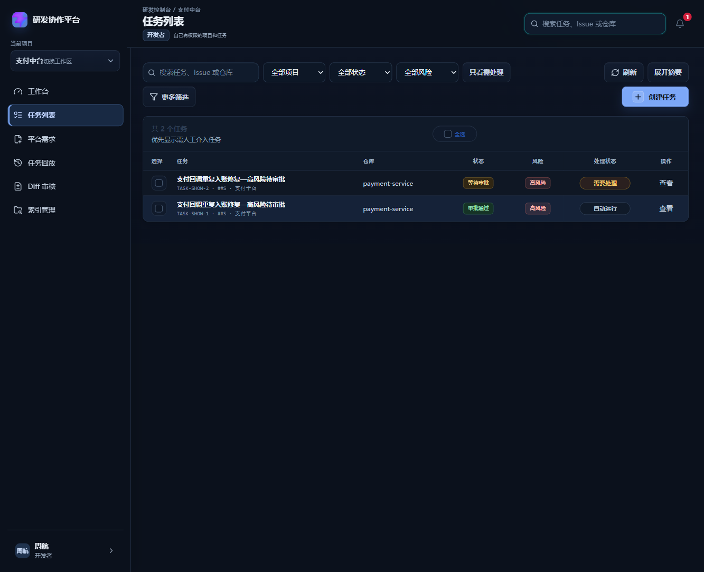
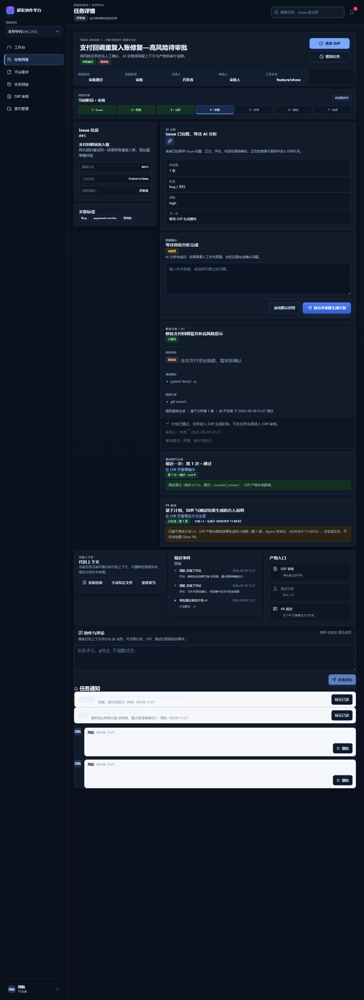
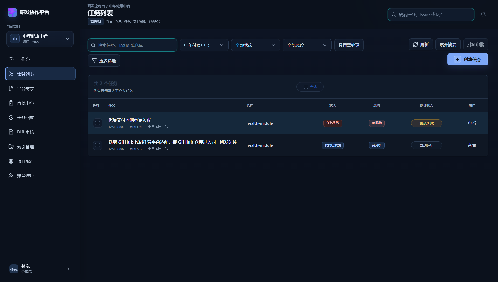

# 评论、通知与催办（DEV-019）

> 关联：`10-approval-module.md`（审批）、`14-task-replay-audit.md`（回放/审计）、`22-celery-async.md`、`23-langgraph-workflow.md`（主链）。

## 功能目标

让团队成员围绕任务上下文协作。评论、@成员、审批通知、风险提醒、超时催办与审批结果通知都**绑定任务**，并可追溯到计划、Diff、测试记录或回放事件。

设计约束：

- **不新增旧状态机**，不改变已通过的 LangGraph/Celery/审批主链——通知只作为主链上的**副作用**挂载。
- 评论与通知**写透 MySQL**（`COMMENTS`/`NOTIFICATIONS` 只是启动缓存），读取走 `reads` 层/`task_for_mutation`，不新增 `TASKS.get` 主读。
- 评论删除为**软删除**（`deleted_at` 置位），历史回放保留记录与审计痕迹。
- 通知以 MySQL 为事实源；团队版通过 Redis Pub/Sub + SSE 推送资源变化信号，前端收到后重新请求受权限保护的 API。原有打开时拉取和轮询保留作为断线兜底，不把 Redis 消息当作业务数据。

## 主流程

```mermaid
flowchart TD
    A[任务详情页] --> B[读取任务权限 task_for_mutation]
    B --> C[评论列表/任务通知列表]
    C --> D[发表评论]
    D --> E[校验任务与关联对象 resolve_comment_reference]
    E --> F[解析 @成员 resolve_mentioned_user_ids]
    F --> G[保存评论/提及 COMMENT_ADDED]
    G --> H[给被@成员生成 MENTION 通知]
    H --> I[写 task_event + audit_event]

    J[任务进入 WAITING_APPROVAL] --> K[emit_approval_required_notification 通知审批人]
    K --> L[高风险 RISK_HIGH 强提醒 priority=high]

    N[待审批 >24h] --> O[POST /nudge 催办入口]
    O --> P[emit NUDGE 通知给审批人 priority=high]
    P --> Q[写 NUDGE_SENT 审计 + task_event]

    R[审批完成 通过/拒绝/自动] --> S[emit_approval_result_notification 通知任务发起人]
    C --> T[AppShell /api/notifications 拉取未读]
    T --> U[POST /read 标记已读]
    V[业务写入 MySQL] --> W[Redis Pub/Sub 发布资源变化]
    W --> X[GET /api/events/stream SSE]
    X --> Y[前端 EventSource 收到 team-update]
    Y --> Z[重新请求真实 API并刷新页面]
```

## 后端落点

### 模型与持久化

- `CommentRecord`：`task_id/project_id/repository_id`、`author`、`body`、`mentioned_user_ids`、`reference_type/reference_id`、`created_at`、`deleted_at`（软删除）。
- `NotificationRecord`：`recipient_id`、`task_id`、`type ∈ {MENTION, APPROVAL_REQUIRED, RISK_HIGH, APPROVAL_RESULT, NUDGE}`、`title/body`、`actor`、`priority ∈ {normal, high}`、`read_at`、`created_at`。
- ORM：`CommentORM`/`NotificationORM`（`app/models/orm.py`），`create_schema` 自动建表；Alembic 迁移 `8f3d21c7a0b1_add_comments_and_notifications`。
- 仓储：`upsert_comment`/`upsert_notification` + `load_comments`/`load_notifications`；bootstrap `restore_from_db` 重启恢复。
- 读层：`list_task_comments`、`list_user_notifications`、`list_task_notifications`、`get_notification`、`unread_notification_count`（DB 真源）。

### 能力

- **评论**：`GET/POST /api/tasks/{id}/comments`、`PUT/DELETE /api/tasks/{id}/comments/{cid}`；`resolve_comment_reference` 校验关联对象归属任务；`resolve_mentioned_user_ids` 按姓名 `@名` 解析、作者自提及不通知；软删除保留记录 + `COMMENT_DELETED` 审计。
- **通知**：`GET /api/notifications`（`unread_only` 过滤）、`GET /api/notifications/unread-count`、`GET /api/tasks/{id}/notifications`、`POST /api/notifications/{nid}/read`（收件人本人或 admin）。
- **审批联动（主链副作用，不改状态机）**：
  - 进入人工审批：`generate_task_plan`/`rewrite_task_plan` HTTP 路径 + `approval_policy.evaluate_and_apply` 的 `require_manual` 分支 → `emit_approval_required_notification`（高风险 → `RISK_HIGH`/high）。
  - 审批完成：`approve_task_plan`/`reject_task_plan` → `emit_approval_result_notification`（任务发起人）；`apply_auto_approval` → 通知发起人自动通过。
- **催办**：`POST /api/tasks/{id}/nudge` 门禁（WAITING_APPROVAL 且最新待审批计划 >24h、未指派审批人 409）；成功写 `NUDGE` 通知（high）+ `NUDGE_SENT` 审计 + task_event。**幂等**：同一任务近 `_NUDGE_HOURS`(24h) 内已对审批人推送过 NUDGE（`reads.list_user_notifications` 真源）则直接返回 `nudged=False`，不再重复生成通知/审计/事件。

### 关键源码

| 文件 | 职责 |
| --- | --- |
| `backend/app/main.py` | 模型、`create_notification`/`resolve_*`/`emit_*`、评论/通知/催办端点 |
| `backend/app/services/approval_policy.py` | `require_manual`/`apply_auto_approval` 挂通知钩子 |
| `backend/app/models/orm.py` | `CommentORM`/`NotificationORM` |
| `backend/app/db/repositories.py` | `upsert_*`/`load_*` |
| `backend/app/db/reads.py` | 评论/通知读层（DB 真源） |
| `backend/app/db/bootstrap.py` | 重启恢复 COMMENTS/NOTIFICATIONS |
| `frontend/src/components/TaskCommentsPanel.vue` | 任务详情评论/通知/催办面板 |
| `frontend/src/components/AppShell.vue` | 顶部通知铃铛、未读角标与实时刷新 |
| `backend/app/services/realtime_service.py` | Redis Pub/Sub 频道、SSE 心跳、不可用事件与帧编码 |
| `frontend/src/services/realtime.ts` | 全局 EventSource 连接、事件分发与订阅取消 |

## 测试与验收

后端子集 `tests/test_dev019_comments_notifications.py`（19 条）：发表/@提及生成 MENTION、自提及不通知、评论关联校验、软删除保留记录与审计、越权删除 403、收件箱与标记已读、任务级通知、**通知读权限严格自限定（非 admin 只见自己、admin 不默认读他人）**、低/高风险进入审批分别生成 `APPROVAL_REQUIRED`/`RISK_HIGH`、审批结果通知发起人、催办 <24h 409、催办成功 NUDGE+审计、**催办幂等（重复 nudge 不重复生成，`nudged=False`）**、非待审批催办 409、未知任务 404、评论/通知 DB roundtrip、统一通知服务三入口。
`tests/test_migrations_upgrade.py`（4 条）：create_all 无版本旧库 + 无版本缺 pr_* 旧库 upgrade 成功、幂等、数据保留、Worker 落后报错、单一 head。
`tests/test_dev019_notifications_mysql.py`（MYSQL_TEST_URL 门控）：评审 MySQL 环境真实验证 RISK_HIGH/APPROVAL_REQUIRED/APPROVAL_RESULT/NUDGE 四类通知落库 + 清内存重启恢复（DB 真源）。

前端 `TaskCommentsPanel.spec`（6 条）+ `TaskDetailView.spec` 全绿；vue-tsc 无类型错误。

后端全量：`backend\.venv\Scripts\python.exe -m pytest backend/tests -q` → **496 passed, 12 skipped, 0 failed**。
前端全量：`vitest run` → **196 passed**，其中 `frontend/src/services/__tests__/realtime.spec.ts` 覆盖 SSE 连接复用、事件分发、取消订阅与 mock 隔离。

## 收口（有条件通过 → 通过）

**1. 既有 MySQL Alembic 迁移闭环**
- 迁移链单一 head：`ad6faa347bb8(baseline) → 4486135ff281(index_snapshots) → b7c3d51a9e02(tasks pr_*) → c9a4e71f2b50(projects.default_test_command) → 8f3d21c7a0b1(comments+notifications)`；`target_head()` 从脚本目录动态计算并断言唯一 head。
- 升级入口：`scripts/migrate.py` 改为执行 `alembic upgrade head`（幂等），`scripts/init_mysql.py` 建库后也走 alembic 而非 `create_all()`；不再依赖 create_all 演进既有表。
- 启动检查：`app/db/migrate.py#ensure_schema_current`——应用进程 `RUN_ALEMBIC_UPGRADE=true`（默认）落后则升级，失败抛错拒绝启动；Worker 只检查不迁移（`upgrade=False` 落后即明确报错），避免多 Worker 抢 Alembic 锁。
- 测试 `tests/test_migrations_upgrade.py`（2 条）：构造 legacy schema（缺 new 表/列）→ upgrade head → 新表/列出现、`load_tasks/comments/notifications` 可执行、原业务数据保留、重复 upgrade 幂等、Worker 落后报错。

**2. 统一通知服务 + 真实现场流量**
- 抽取 `app/services/notification_service.py`：`notify_approval_required / notify_approval_completed / send_approval_reminder` 为唯一逻辑源，main.py `emit_*` 与 nudge 端点全部委托，复用不复制。
- `scripts/dev019_notifications_real_verify.py`：真实 MySQL 现场流量验证器（非 MySQL/prod 报错退出）。
- 真实现场跑通（持久化 DB）：RISK_HIGH / APPROVAL_REQUIRED / APPROVAL_RESULT / NUDGE 四种通知写透 → 清空内存 → `restore_from_db` 恢复 `notifications=4` → PASS（DB 真源）。MySQL host 现场跑法见脚本内的部署命令。

**3. 前端通知中心真实化**
- AppShell 通知铃铛**只**读 `/api/notifications` + `/api/notifications/unread-count`；移除 `dashboardSummary.events` 示例数据作为通知源，失败保持空态（绝不用示例冒充）。

**4. 通知读权限严格化**
- `/api/notifications` 与 unread-count 恒按 `recipient_id == 当前用户` 过滤（DB/内存一致）：非管理员只见自己；管理员列表也只含自己的个人通知，不默认读他人。
- 测试 `test_notification_read_is_strictly_self_scoped`：开发者/管理员均只返回自己 recipient 的通知，且看不到他人的 MENTION。

## 当前结论

通知链收口为「通过」：迁移闭环 + 统一通知服务 + 真实流量验证 + 前端真实化 + 严格读权限，全部有测试/运行证据。

## 真实页面截图（2026-09-09 浏览器实录）

- 环境：真实 MySQL `agent_showcase`（应用启动 Alembic `upgrade head` 自动建表）+ 后端 uvicorn:8010 + 前端 Vite(real 数据源) + CDP 浏览器登录（developer@company.com）。
- 数据：高风险待审批任务 `TASK-SHOW-1/2`（支付回调重复入账）、2 条任务评论（含 @提及）、3 类通知（MENTION @审批人 / APPROVAL_RESULT / NUDGE 催办）。

| 截图 | 说明 |
| --- | --- |
|  | 任务列表：高风险待审批任务真实展示 |
|  | 任务详情评论面板：@提及 + 时间 + 作者，高风险标签 |
|  | 顶部通知中心（仅有 `/api/notifications`）：MENTION/审批/催办通知 |
|  | 团队版任务列表真实页面；通过 Redis 广播 `task.updated` 后，在线页面重新请求任务列表、任务详情和审批队列 |

### 实时联调记录（2026-09-10）

- 后端 `GET /api/events/stream` 返回 `200`，真实浏览器保持 SSE 连接。
- 向 `team:realtime:broadcast` 发布 `task.updated` 后，后端日志出现任务详情、任务列表和审批队列的重新请求。
- 向 `team:realtime:user:user_admin` 发布 `notification.created` 后，后端日志出现 `/api/notifications` 与 `/api/notifications/unread-count` 的重新请求。
- Redis 连接失败时，SSE 返回 `realtime.unavailable`；前端保留原有轮询和手动刷新兜底。
