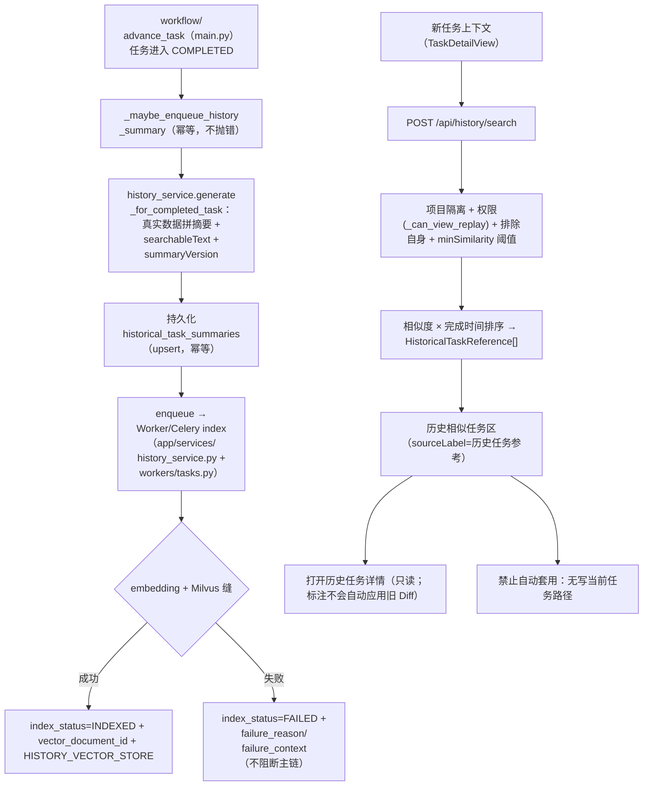

# 历史任务复用索引（DEV-021）

## 功能目标与范围

把**已完成任务**沉淀为团队知识资产：任务到达 `COMPLETED` 后，自动生成「历史任务复用摘要」（真实数据来源、缺失字段标「暂无记录」），摘要进入向量索引（复用现有 Milvus 缝），新任务在其上下文中检索并展示**历史相似任务**，用户可打开历史任务详情查看。**历史仅供参考，绝不自动套用旧 Diff / 旧代码 / 旧执行计划。**

核心约束：
- 只读参考 + 用户主动确认才能复用；不提供任何「套用旧 Diff / 改写当前任务」的接口。
- 向量索引失败 **不得阻断** 任务完成主链（记录 `failure_reason/failure_context` + 工单/时间，可重试）。
- 检索默认**项目隔离** + **权限过滤** + **排除自身** + **相似度阈值** + 数量限制。
- 异步、幂等（同 taskId+summaryVersion 不重复生成；同 summary_id 不重复入向量索引）。
- 不新建重复架构：复用 `embedding_service`、`app/retrieval/llamaindex_backend`（Milvus 缝）、`task_for_mutation`/`reads`（DB 真源）、`create_audit_event`、`enqueue_or_run`（Celery）。

## 主流程



## 关键代码与文件

| 文件 | 职责 |
| --- | --- |
| `backend/app/services/history_service.py` | `generate_for_completed_task/get_by_task_id/enqueue/index/retry/get_status/search_similar`；向量复用 `llamaindex_backend` 缝（Milvus，不可用→memory(local) 显式标 provider） |
| `backend/app/retrieval/llamaindex_backend.py` | 复用：`build_vector_store` / `LlamaIndexEmbeddingAdapter` / `embedding_dim`（Milvus 缝） |
| `backend/app/main.py` | 完成态挂 `_maybe_enqueue_history_summary`（`advance_task`）；API：`POST/GET /api/tasks/{id}/completed-summary`、`GET /.../completed-summary/index`、`POST /.../reindex`、`POST /api/history/search`；新字段/读层；`_can_view_replay` 复用做权限过滤 |
| `backend/app/models/orm.py` + `repositories.py` + `reads.py` + `bootstrap.py` + `migrations/versions/3a9e71d2b0c4` | 两表 `historical_task_summaries` / `historical_task_indexes`（DB 真源、重启恢复） |
| `backend/app/workers/tasks.py` | `backend.index_historical_summary` Celery 任务 |
| `frontend/src/components/HistoricalTasksPanel.vue` | 任务详情/创建任务「历史相似任务」区（compact、现有 token、Loading/空/失败/正常、只读详情、不自动套用；空查询回退展示项目内最近完成） |
| `frontend/src/services/historyTasks.ts` + `types/domain.ts` | 检索封装 + 类型 |

## 数据结构

- `HistoricalTaskSummary`：`id/task_id/project_id/source_task_title/issue_summary/context_summary/analysis_summary/plan_summary/diff_summary/test_summary/pr_summary/replay_summary/searchable_text/summary_version/completed_at/...`
- `HistoricalTaskIndexRecord`：`summary_id/task_id/project_id/embedding_provider/embedding_model/vector_document_id/index_status(PENDING|EMBEDDING|INDEXED|FAILED)/failure_reason/failure_context/indexed_at/retry_count/...`
  历史向量集合按 embedding 维度隔离（如 `historical_task_summaries_v2048`），避免切换模型维度后复用旧集合导致写入失败。
- 检索结果 `HistoricalTaskReference`：`taskId/summaryId/title/project/similarity/completedAt/matchedSections/sourceLabel(历史任务参考)/summaryPreview/canOpenDetail`

## 接口（遵循 ApiResponse 风格，均带类型/错误/测试）

```text
POST /api/tasks/{id}/completed-summary        # 生成/重生成（完成任务 409 若非 COMPLETED）
GET  /api/tasks/{id}/completed-summary        # 读摘要
GET  /api/tasks/{id}/completed-summary/index  # 读索引状态 + failure_reason
POST /api/tasks/{id}/completed-summary/reindex# 重生成 + 入向量
POST /api/history/search                      # 相似检索 {projectId?, query, taskId?, limit?, minSimilarity?}
```

## 权限与隔离

- 摘要/索引/检索均 `require_permission(replay:view)` + `_can_view_replay`（admin 全量、lead 本项目、其余创建者/审批人）。
- 检索默认 `projectId` 过滤；未给 projectId 时由 `taskId` 推导当前项目；排除自身；`minSimilarity` 阈值过滤；`limit ≤ 20`。
- 只读：无任何写当前任务/审计的接口；不信任伪造 `user_id/project_id`（身份来自 Cookie）。

## 摘要生成规则

- 只用真实任务数据（issue/context/analysis/plan/diff/test/pr/replay）；缺失字段写「暂无记录」，不凭空造。
- `searchable_text` 由结构化字段稳定拼接（保留业务/技术关键词、错误信息、修改范围、测试命令、文件路径）。
- 带 `summary_version`；同 taskId 已生成则复用（幂等），`force/regenerate` 才重算。

## 向量索引与降级

- 复用现有 Milvus 缝（`llamaindex_backend.build_vector_store`）；生产写 Milvus，只有显式允许 `RAG_MOCK_FALLBACK=true` 时才可降级为 `memory(local)`（`embedding_provider` 诚实标注）。
- 幂等：同 `summary_id` 已 `PENDING/EMBEDDING/INDEXED` 不重复建。
- 失败：`index()` 捕获异常 → `index_status=FAILED` + `failure_reason` + `failure_context` + `retry_count`，**不抛错**（不阻断任务完成）；`retry()` 重置并重入。

## 联调注意点

- 完成链挂载在 `advance_task`（graph.invoke 后）→ 首次 `COMPLETED` 触发摘要+异步索引；Celery 模式由 Worker `index_historical_summary` 消费，eager/测试内联执行。
- 向量后端需 Milvus（`MILVUS_URI`）或依赖 `llama_index`（不可用时降级 memory）；检索对 DB 内摘要直接用 embedding 余弦（`HISTORY_VECTOR_STORE` 缓存），不依赖 live Milvus 也能测。
- 迁移 `3a9e71d2b0c4` 走 Alembic（`python -m scripts.migrate` / 应用启动自动 upgrade head）。
- **MySQL 兼容（P1 修复，评审）：** 历史表 `TEXT` 列在 MySQL 8 严格模式不允许 `DEFAULT`（1101），故迁移里 `TEXT` 列一律**只 `NOT NULL`、不带 `server_default`**（默认由代码层/ORM 提供）；VARCHAR/INT 仍可带安全默认。SQLite 无此限制但已统一口径。违约样 `test_dev021_history_mysql.py`（MYSQL_TEST_URL 门控）为评审在真实 MySQL 复验建表 + 端到端。

## 测试

- 后端 `tests/test_dev021_history.py`（10）：生成完整摘要、缺失字段「暂无记录」、重复触发幂等、索引成功状态、索引失败不抛错且记 failure_reason、重试入队、检索排除自身+阈值、项目隔离+权限、只读不改当前任务、不自动套用旧 Diff（摘要无 auto-apply 字段）、端点完成态 409。
- 前端 `HistoricalTasksPanel.spec`（5）：请求 `/api/history/search`、渲染、空态、失败、只读详情标注「不会自动应用旧 Diff」、打开跳转历史任务（不复制到当前）。

## 真实运行证据（浏览器实录 2026-09-09）

- 环境：venv 起后端 `:8015`（`USE_SQLALCHEMY=true`、`DATABASE_URL=sqlite:///…`，真实持久化 SQLite 库）+ 前端 vite `:5175`（`VITE_DATA_SOURCE=real`、`VITE_API_PROXY_TARGET=:8015`）+ 真 Chrome/CDP。
- 数据：造 3 条完成任务 + 历史摘要 + 向量索引（`INDEXED`）；developer 登录；打开 `/tasks/TASK-HIST2`。
- 结果：任务详情「历史相似任务」区真实从 `/api/history/search`（`:8015`）拉取并渲染 **2 张卡**：`支付回调重复入账幂等修复 · 66% · 历史任务参考`、`退款单复核定时任务 · 39% · 历史任务参考`；API 真实 200 返回 `similarity=0.7846 / matchedSections=["plan"] / sourceLabel="历史任务参考"`。
- 截图：`docs/assets/dev021-history-history-panel-real.png`（历史相似任务区）、`docs/assets/dev021-history-references-real.png`。
- MySQL：同链路由 `tests/test_dev021_history_mysql.py`（MYSQL_TEST_URL 门控）在真实 MySQL 复验建表/落库/检索。
