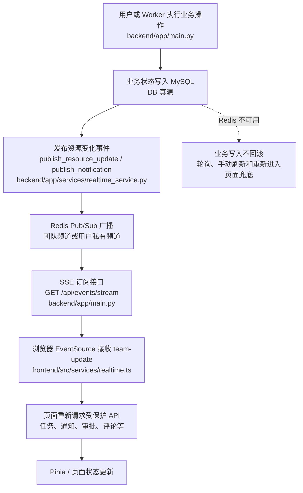
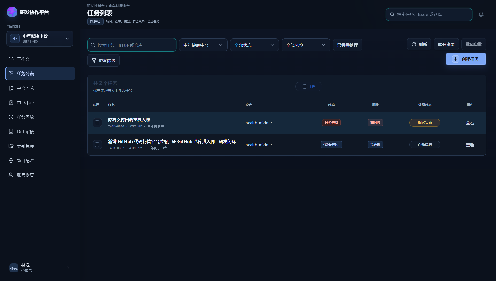

# DEV-019-R 团队版实时同步：Redis Pub/Sub、SSE 与 WebSocket

> 文档类型：团队版实时协作开发记录与面试复盘  
> 核实日期：2026-09-10  
> 关联功能：评论、通知、审批、任务状态、索引进度和平台需求同步

## 1. 基本信息

| 项目 | 内容 |
| --- | --- |
| 模块名称 | 团队版多人实时同步 |
| 开发阶段 | 团队版 |
| 开始日期 | 2026-09-10 |
| 完成日期 | 2026-09-10 |
| 关联文档 | `31-comments-notifications-nudge.md`、`05-team-deployment-acceptance.md` |
| 后端入口 | `GET /api/events/stream` |
| Redis 频道 | `team:realtime:broadcast`、`team:realtime:user:{user_id}` |
| 真实截图 | `docs/assets/dev019-realtime-task-list-real.png` |

## 2. 功能目标

多人同时使用团队版时，一个角色完成任务、评论、审批或索引操作后，其他在线页面能够尽快感知变化并刷新数据。

本模块解决的是“变化如何通知到在线页面”，不是把 Redis 当成业务数据库。业务数据仍然以 MySQL 为事实源，Redis 只传递资源变化信号。

## 3. 实际实现流程



## 4. Redis Pub/Sub、SSE、WebSocket 分别是什么

这三个概念不在同一层，面试时不能混在一起讲。

| 技术 | 所在层 | 通信方向 | 在本项目中的作用 |
| --- | --- | --- | --- |
| Redis Pub/Sub | 后端服务间的消息广播层 | 发布者到订阅者 | 让多个 API/Worker 实例知道“某个资源发生变化” |
| SSE | 浏览器与后端之间的传输协议 | 服务端到浏览器单向推送 | 把 Redis 订阅到的变化通知在线页面 |
| WebSocket | 浏览器与后端之间的双向长连接协议 | 浏览器与服务端双向 | 当前没有采用；适合聊天、协同编辑、实时控制等双向场景 |

关键理解：

- Redis Pub/Sub 不是浏览器通信协议，浏览器不直接连接 Redis。
- SSE 不是消息队列，它只负责把服务端事件流传给浏览器。
- WebSocket 可以替代 SSE 作为浏览器通道，但不能替代 Redis 在多实例之间的广播职责。
- MySQL 负责保存最终业务状态；Redis Pub/Sub 和 SSE 都不承担历史数据恢复。

## 5. SSE 与 WebSocket 对比

| 对比项 | SSE | WebSocket |
| --- | --- | --- |
| 底层形态 | 基于 HTTP 的长连接 | HTTP Upgrade 后的独立双向连接 |
| 通信方向 | 服务端到客户端 | 客户端与服务端双向 |
| 浏览器 API | `EventSource` | `WebSocket` |
| 数据格式 | 默认文本事件流 | 文本或二进制帧 |
| 自动重连 | 浏览器原生支持 | 通常需要自己实现重连、心跳和状态恢复 |
| 服务端实现复杂度 | 较低，普通 HTTP 鉴权和代理更容易复用 | 较高，需要连接管理、心跳、重连、广播和背压策略 |
| 适合场景 | 通知、任务进度、状态变化、日志摘要 | 在线聊天、协同编辑、实时指令、双向控制 |
| 当前项目适配度 | 高：主要是服务端通知页面刷新 | 暂不需要：页面没有持续向服务端发送实时指令 |

## 6. 为什么当前选择 Redis Pub/Sub + SSE

当前团队版的核心实时需求是：

- 审批完成后，开发者页面看到任务状态变化。
- 评论和 @ 提及后，相关成员看到通知。
- 索引、任务和平台需求状态变化后，其他页面及时刷新。
- 页面主要接收服务端变化，不需要持续向服务端发送输入流。

因此选择：

1. Redis Pub/Sub 负责跨进程、跨 Worker 广播。
2. SSE 负责服务端到浏览器的轻量推送。
3. 前端收到事件后重新请求真实 API，避免信任消息里的业务正文。
4. MySQL 保证离线用户重新打开页面时仍然能读到最新状态。

如果直接使用 WebSocket，当前阶段需要额外维护双向消息协议、连接状态、重连恢复、心跳和更多连接生命周期代码，但暂时没有对应的双向业务收益。

## 7. 事件设计

### 7.1 频道

| 频道 | 用途 |
| --- | --- |
| `team:realtime:broadcast` | 任务、评论、索引、项目、仓库和平台需求等团队资源变化 |
| `team:realtime:user:{user_id}` | 只发送给指定用户的站内通知，避免个人通知广播给其他成员 |

### 7.2 事件类型

当前已发布：

```text
task.updated
comment.updated
repository_index.updated
team_request.updated
project.updated
repository.updated
notification.created
```

连接状态事件：

```text
realtime.heartbeat
realtime.unavailable
```

事件只携带资源类型、资源 ID、任务 ID、时间和变化原因等元数据。前端收到 `team-update` 后重新请求：

```text
/api/tasks/{task_id}
/api/tasks
/api/notifications
/api/notifications/unread-count
/api/approvals/pending
```

这样做可以继续复用后端权限校验，也可以避免 Redis 消息丢失或过期正文造成页面显示错误。

## 8. 关键源码位置

| 文件 | 职责 |
| --- | --- |
| `backend/app/services/realtime_service.py` | Redis 地址选择、发布、订阅、心跳、SSE 帧和不可用事件 |
| `backend/app/main.py` | `GET /api/events/stream` 以及业务写入后的事件发布调用 |
| `frontend/src/services/realtime.ts` | 全局 `EventSource`、事件解析、监听器订阅与取消 |
| `frontend/src/components/AppShell.vue` | 通知、任务列表、工作台和审批队列的实时刷新 |
| `frontend/src/views/TaskDetailView.vue` | 任务详情实时刷新 |
| `frontend/src/components/TaskCommentsPanel.vue` | 评论和任务通知实时刷新 |
| `backend/tests/test_realtime_service.py` | Redis 频道、心跳、发布和失败降级测试 |
| `frontend/src/services/__tests__/realtime.spec.ts` | SSE 连接复用、事件分发、取消订阅和 Mock 隔离测试 |

## 9. 遇到的问题与解决方案

| 问题 | 原因 | 解决方式 |
| --- | --- | --- |
| 多个页面各自创建连接 | 页面组件重复挂载，容易产生多个 SSE 连接 | `realtime.ts` 使用模块级连接复用，全局只建立一条 `EventSource` |
| Redis 消息不能直接作为页面数据 | 消息可能延迟、丢失或缺少完整业务字段 | 消息只做变化信号，页面收到后重新读取 MySQL 真源 API |
| 个人通知被其他成员收到 | 所有人订阅同一广播频道 | 团队资源使用广播频道，个人通知使用 `user:{user_id}` 私有频道 |
| Redis 故障时页面无法判断状态 | 连接失败可能只表现为断线 | 返回 `realtime.unavailable`，同时保留轮询、手动刷新和重新进入页面兜底 |
| 浏览器断线后连接恢复 | 网络波动或服务重启会中断 SSE | 使用浏览器 `EventSource` 原生自动重连，业务数据仍通过 API 重新读取 |

## 10. 一致性与可靠性边界

当前方案是“最终一致的在线刷新”，不是可靠消息队列，也不是事件回放系统。

- MySQL 写入成功后，Redis 发布失败不会回滚业务写入。
- Redis Pub/Sub 是瞬时广播，不保存待消费历史消息。
- SSE 断线期间可能错过某条事件，但页面通过轮询、手动刷新或重新进入页面重新读取 MySQL。
- 任务回放和审计仍然使用数据库中的 `task_events`、`audit_events` 等持久化记录，不依赖 Redis 消息。
- 事件处理需要幂等；页面重复收到同一事件时，重新请求 API 不会重复写业务数据。

## 11. 测试与真实验收

### 自动化测试

```text
backend\.venv\Scripts\python.exe -m pytest backend/tests/test_realtime_service.py backend/tests/test_migrations_upgrade.py -q
10 passed

frontend
npm run test -- src/services/__tests__/realtime.spec.ts
5 passed

后端全量：496 passed, 12 skipped
前端全量：202 passed
前端生产构建：通过
```

### 真实环境

- Redis Docker 容器：`redis-celery`
- Redis 连通性：`PONG`
- 后端：`http://127.0.0.1:8002`
- 前端：`http://127.0.0.1:5177`
- `GET /api/events/stream`：`200`
- 发布团队频道 `task.updated` 后，任务详情、任务列表和审批队列重新请求。
- 发布管理员私有频道 `notification.created` 后，通知列表和未读数重新请求。

真实页面截图：



## 12. 面试回答模板

### 12.1 30 秒回答

> 我们团队版采用的是 Redis Pub/Sub 加 SSE。业务先写 MySQL，写成功后发布一个只包含资源类型和 ID 的变化事件。Redis Pub/Sub 负责在 API 和 Worker 之间广播，FastAPI 通过 SSE 把事件推给在线浏览器，前端收到后重新请求真实 API 刷新页面。这样 MySQL 是事实源，Redis 只负责通知，离线用户重新进入页面仍然能读到最新数据。当前没有用 WebSocket，因为需求主要是服务端到页面的任务状态、审批和通知推送，还没有聊天或协同编辑这类双向实时交互。

### 12.2 面试官问“为什么不是 WebSocket”

> WebSocket 更适合双向实时通信，比如聊天、协同编辑和实时控制。我们当前主要是服务端向浏览器推送变化信号，SSE 基于 HTTP，浏览器原生支持 `EventSource` 和自动重连，接入现有 Cookie 鉴权和反向代理也更简单，所以选择 SSE。未来如果增加双向协作输入，再评估 WebSocket。

### 12.3 面试官问“Redis Pub/Sub 和 SSE 是不是一回事”

> 不是。Redis Pub/Sub 是后端实例之间的消息分发机制，解决多进程、多 Worker 如何收到同一变化；SSE 是后端到浏览器的传输方式，解决浏览器如何收到服务端事件。它们分别位于后端内部通信层和前后端通信层。

### 12.4 面试官问“消息丢了怎么办”

> 这套 Pub/Sub 不是持久化消息队列，所以不能保证每条通知都能回放。我们把消息设计成刷新信号，不把它当作业务正文；页面收到事件后从 MySQL 重新读取，断线期间还有轮询和手动刷新兜底。真正需要审计的内容会写入数据库事件表。若未来要求严格不丢消息，可以引入 Redis Streams、Kafka 或基于数据库 Outbox 的可靠投递。

### 12.5 面试官问“多实例部署还能工作吗”

> 可以。每个 API 实例的 SSE 连接订阅 Redis 频道，任意实例完成业务写入后发布事件，其他实例都能收到并向自己连接的浏览器推送。生产环境还需要继续补充连接数、Redis 高可用、反向代理超时、限流和观测指标。

## 13. 复盘

- 做得好的地方：把业务事实源、后端广播层和浏览器传输层拆开，职责清晰。
- 做得好的地方：个人通知使用用户私有频道，避免越权广播。
- 需要加强的地方：当前没有事件持久化重放，断线期间依赖重新拉取和轮询兜底。
- 下一步重点：如果实时协作扩展到聊天、多人编辑或服务端接收连续输入，再评估 WebSocket；如果需要可靠事件投递，再引入 Outbox + Redis Streams/Kafka。
