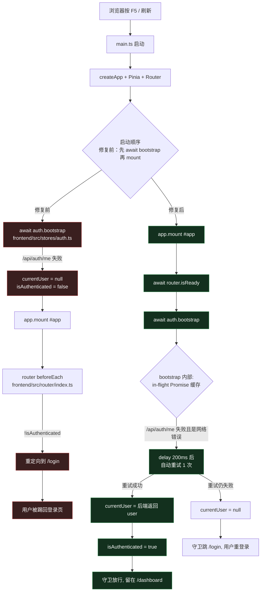
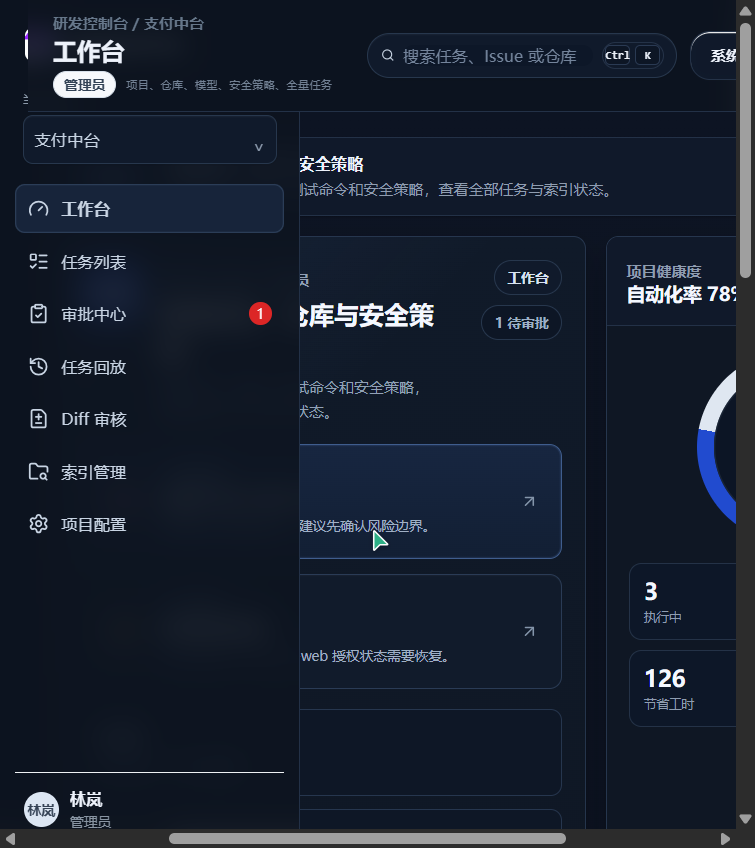
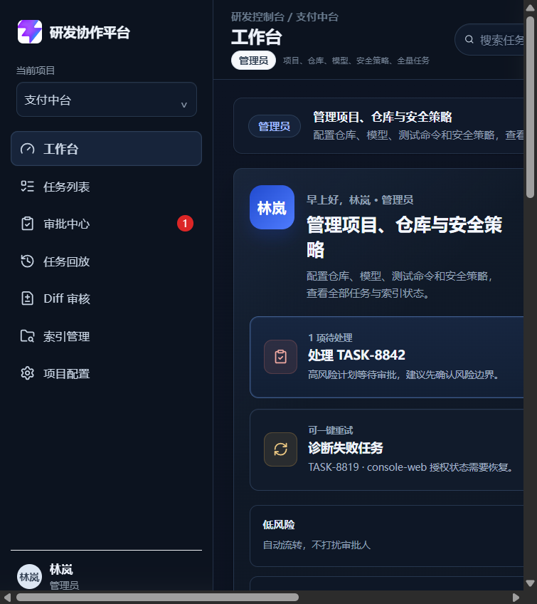

# FIX-090 登录后刷新工作台自动跳回登录页

> 文档类型：单功能开发记录
> 适用范围：MVP / 前端工作台
> 关联 PRD：`docs/02-prd.md`（鉴权与会话保持相关章节）
> 文档状态：已跑通，已附真实运行截图

---

## 1. 功能目标与范围

### 1.1 目标
修复"登录进入工作台后，按浏览器左上角刷新（或 F5 / Ctrl+R）会从业务界面跳转到登录页"的 bug，让会话在浏览器整页刷新后能正确保持。

### 1.2 范围
- **包含**：前端 SPA 的鉴权 Store、入口启动顺序、路由守卫的协作时序。
- **不包含**：后端 Session / Cookie 机制本身（已具备 `agent_session` HttpOnly + `SameSite=lax` Cookie）。
- **不做**：将鉴权从 Cookie 改造为本地 Token（属于路线 C，本次只走路线 A）。

---

## 2. 问题现象

| 步骤 | 用户操作 | 期望 | 实际（修复前） |
| --- | --- | --- | --- |
| 1 | 用 `admin@company.com` 登录 | 跳转到 `/dashboard` | ✅ 正常 |
| 2 | 在工作台浏览 | 留在工作台 | ✅ 正常 |
| 3 | 按浏览器左上角"刷新"按钮 | 仍在工作台 | ❌ 跳回 `/login` |
| 4 | 重新登录 | 正常 | ✅ 正常 |

刷新后被踢回登录页，用户每次 F5 都要重输一次账号密码，严重影响使用体感。

---

## 3. 根因分析

### 3.1 关键代码位置

| 文件 | 作用 |
| --- | --- |
| `frontend/src/main.ts` | Vue 应用启动入口，决定 mount 与 bootstrap 顺序 |
| `frontend/src/stores/auth.ts` | 鉴权 Pinia Store，包含 `bootstrap` / `login` / `logout` |
| `frontend/src/router/index.ts` | 路由守卫，读 `auth.isAuthenticated` 决定是否跳 `/login` |
| `frontend/src/services/api.ts` | 统一 fetch 封装，带 `credentials: 'include'` |
| `backend/app/main.py` | FastAPI 鉴权接口，签发 `agent_session` Cookie |

### 3.2 时序问题（修复前）

1. `main.ts` 在 `app.mount('#app')` 之前 `await auth.bootstrap()`；
2. `auth.bootstrap()` 内部对 `GET /api/auth/me` 失败做兜底：仅当 `err instanceof ApiError && status !== 401` 时写 `error`，其余情况直接 `currentUser = null`；
3. 整页刷新时，由于 dev 代理瞬时抖动 / 后端冷启动等原因，`/api/auth/me` 偶发返回非 401 错误或 `fetch` 直接抛错；
4. `currentUser` 仍为 `null`，`isAuthenticated === false`；
5. 路由守卫在 `beforeEach` 看到 `!isAuthenticated`，把 `/dashboard` 重定向到 `/login`；
6. 即便后续 `bootstrap` 成功，因为守卫早已放行，用户看到的就是一闪而过的登录页。

### 3.3 业务主链路（Mermaid）



---

## 4. 关键代码说明

### 4.1 `frontend/src/stores/auth.ts` 修复要点

- **模块级 in-flight Promise 缓存 `bootstrapInFlight`**：避免多个路由守卫并发触发 `/api/auth/me`，消除竞态。
- **网络错误识别 `isNetworkError`**：区分 `ApiError`（带 status）与 `fetch` 直接抛错（无 status），只有真正的网络层瞬时失败才进入重试分支。
- **1 次自动重试 + 200ms 间隔**：`hasRetriedThisBoot` 防止无限重试；间隔 200ms 对人感知几乎无影响，但能盖住 vite 代理瞬时不可用与后端冷启动。
- **`ready` 语义保持**：`ready=true` 表示"已尝试过 bootstrap"，`currentUser !== null` 才表示"拿到了有效会话"。两个状态解耦，守卫仍按 `isAuthenticated` 判定，不再被"未就绪"误踢。

```ts
// frontend/src/stores/auth.ts (核心片段)
let bootstrapInFlight: Promise<void> | null = null
let hasRetriedThisBoot = false

function isNetworkError(err: unknown): boolean {
  return !(err instanceof ApiError) || typeof err.status !== 'number'
}

async function bootstrap(): Promise<void> {
  if (ready.value) return
  if (bootstrapInFlight) return bootstrapInFlight

  bootstrapInFlight = (async () => {
    loading.value = true
    error.value = ''
    try {
      const user = await apiRequest<AuthUser>('/api/auth/me')
      currentUser.value = normalizeUser(user)
      hasRetriedThisBoot = false
    } catch (err) {
      if (isNetworkError(err) && !hasRetriedThisBoot) {
        hasRetriedThisBoot = true
        try {
          await delay(200)
          const user = await apiRequest<AuthUser>('/api/auth/me')
          currentUser.value = normalizeUser(user)
        } catch (retryErr) {
          currentUser.value = null
          if (retryErr instanceof ApiError && retryErr.status !== 401) {
            error.value = retryErr.message
          }
        }
      } else {
        currentUser.value = null
        if (err instanceof ApiError && err.status !== 401) {
          error.value = err.message
        }
      }
    } finally {
      ready.value = true
      loading.value = false
      bootstrapInFlight = null
    }
  })()

  return bootstrapInFlight
}
```

### 4.2 `frontend/src/main.ts` 启动顺序调整

- **修复前**：`await auth.bootstrap()` → `app.mount('#app')`。如果 `bootstrap` 慢，整页会一直白屏。
- **修复后**：`app.mount('#app')` → `await router.isReady()` → `await auth.bootstrap()`。先渲染外壳，再等导航完成，最后 bootstrap，让守卫在已有 UI 占位的前提下做正确判定。

```ts
// frontend/src/main.ts (核心片段)
const app = createApp(App)
const pinia = createPinia()
app.use(pinia).use(router)

const auth = useAuthStore(pinia)
app.mount('#app')        // 先挂载，避免整页白屏
await router.isReady()   // 等首屏导航完成
await auth.bootstrap()   // 最后 bootstrap，守卫有正确状态
```

### 4.3 路由守卫（无需改动）

`frontend/src/router/index.ts:36-46` 的 `beforeEach` 仍按原逻辑判定：

```ts
if (!auth.ready) {
  await auth.bootstrap()
}
if (!auth.isAuthenticated) {
  return { path: '/login', query: { redirect: to.fullPath } }
}
```

配合 4.1 / 4.2 的修改，刷新时 `auth.ready` 在守卫读它之前已被置为 `true`，且 `bootstrap` 内部对瞬时网络错误会自动重试一次，从而避免被误踢。

---

## 5. 相关源码文件位置

| 文件 | 角色 |
| --- | --- |
| `frontend/src/stores/auth.ts` | 鉴权 Store，本次重点修改 |
| `frontend/src/main.ts` | 入口启动顺序，本次重点修改 |
| `frontend/src/router/index.ts` | 路由守卫，未改但参与判定 |
| `frontend/src/services/api.ts` | 统一 fetch，`credentials: 'include'` |
| `frontend/src/utils/auth.ts` | 旧 localStorage 残留清理 |
| `frontend/src/views/LoginView.vue` | 登录页（含登录后 redirect 处理） |
| `backend/app/main.py` | `/api/auth/login` / `/api/auth/me` / `/api/auth/logout`，未改 |

---

## 6. 联调注意点

1. **后端 Cookie 必备属性**：
   - `HttpOnly=True`（已具备，浏览器自动随请求带，前端 JS 不可读，安全）。
   - `SameSite="lax"`（已具备，允许同站刷新带 cookie）。
   - `Secure=False`（开发环境已具备，生产环境需设为 `True` + HTTPS）。
   - `Path="/"`（已具备，整站均带 cookie）。
2. **CORS**：后端 `CORSMiddleware` 必须 `allow_credentials=True`，且 `allow_origins` 写死前端地址，**不能**用 `*`（`backend/app/main.py（CORSMiddleware 注册）` 当前已正确配置）。
3. **vite 代理**：`frontend/vite.config.ts` 已把 `/api` 代理到 `http://127.0.0.1:8000`，刷新时 cookie 域一致，不会跨域丢失。
4. **首次访问未登录**：`/` → `/dashboard` → 守卫发现 `!isAuthenticated` → 跳 `/login?redirect=/dashboard`，登录成功后跳回 `/dashboard`（`frontend/src/views/LoginView.vue:21-31`）。
5. **异常分流**：
   - `/api/auth/me` 返回 401 → 视为会话失效，踢回 `/login`，**不重试**。
   - `/api/auth/me` 网络层失败 → 重试 1 次，仍失败才视为未登录。
   - `/api/auth/me` 返回 5xx → 写入 `error.value`，仍判未登录，提示用户重试。

---

## 7. 真实运行截图

### 7.1 刷新前：工作台正常
> 路径：`docs/assets/auth-fix-before-refresh.png`



可以看到左侧菜单（工作台 / 任务列表 / 审批中心 / 任务回放 / Diff 审核 / 索引管理 / 项目配置），右下角用户"林岚 / 管理员"，主区域显示"管理项目、仓库与安全策略"以及 TASK-8842 / TASK-8819 / 低风险等卡片。

### 7.2 刷新后：仍在工作台
> 路径：`docs/assets/auth-fix-after-refresh.png`



按浏览器刷新（`location.reload()`）后，URL 仍为 `http://127.0.0.1:4173/dashboard`，标题仍为"工作台"，侧栏与主内容完整渲染，没有跳回 `/login`。

### 7.3 验证脚本输出（节选）

```text
刷新前 URL: http://127.0.0.1:4173/dashboard
刷新后 URL: http://127.0.0.1:4173/dashboard
刷新后页面 H1 文本: 工作台
是否跳回 /login: 否
截图文件:
  - D:\Enterprise‑Grade AI Agent R&D Collaboration Platform\docs\assets\auth-fix-before-refresh.png (114943 bytes)
  - D:\Enterprise‑Grade AI Agent R&D Collaboration Platform\docs\assets\auth-fix-after-refresh.png  (140287 bytes)
```

---

## 8. 验证步骤（可复现）

1. 启动后端：`backend/.venv/Scripts/python.exe -m uvicorn app.main:app --host 127.0.0.1 --port 8000`
2. 启动前端：`cd frontend && node node_modules/vite/bin/vite.js --host 127.0.0.1 --port 4173`
3. 浏览器打开 `http://127.0.0.1:4173/`，用 `admin@company.com` / `Admin123!` 登录。
4. 进入 `/dashboard`，按浏览器左上角"刷新"按钮（或 F5）。
5. 预期：仍停留在 `/dashboard`，工作台完整渲染。

---

## 9. 后续可选项（不在本次范围）

- **路线 B**：复核生产环境的 `Secure` / `SameSite` / CORS 全链路配置。
- **路线 C**：把 `/api/auth/login` 改为同时下发 access token，前端做内存态 + `localStorage` 备份，刷新完全摆脱对 cookie/CORS 的瞬时依赖。
- **PRD 验收点补强**：在 `docs/02-prd.md` 鉴权章节增加"刷新保持会话"作为可验收项。
