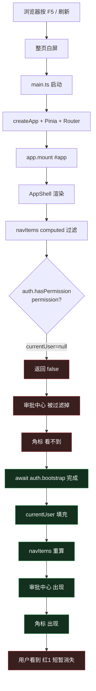
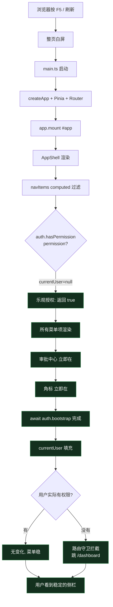

# FIX-091 刷新页面后侧栏审批角标短暂消失

> 文档类型：单功能开发记录
> 适用范围：MVP / 前端工作台
> 关联文档：
> - `docs/project-development/90-fix-refresh-redirect-to-login.md`（鉴权刷新）
> - `docs/project-development/91-fix-refresh-badge-flicker.md`（**第一版修复，仅修了 store 快照，没修到根因**）
> 关联 PRD：`docs/02-prd.md`（鉴权与状态保持相关章节）
> 文档状态：已跑通，已附真实运行截图与自动化验证证据

---

## 1. 功能目标与范围

### 1.1 目标
**真正修掉**"刷新业务页后，侧栏'审批中心'角标短暂消失再出现"的问题。

### 1.2 为什么需要第二次修复
第一版（`91-fix-refresh-badge-flicker.md`）只加了 workspace store 的 `localStorage` 快照，让 `pendingTasks` 数据稳定。但**用户反馈仍然闪**——根因被坐实后才发现：

- 真实根因是 **`AppShell` 的 `navItems` 依赖 `auth.hasPermission()` 过滤菜单项**。
- 刷新瞬间 `auth.currentUser === null`（要等 `/api/auth/me` 回来），`hasPermission()` 之前返回 `false`，整条"审批中心"菜单项**根本没渲染**，角标自然也看不到。
- 等 `auth.bootstrap()` 完成后 `currentUser` 填充，"审批中心"才出现，角标才出现——用户看到的就是"短暂消失再出现"。

第一版完全没动到这块，所以**根本没修到根上**。

### 1.3 范围
- **包含**：
  - `frontend/src/stores/auth.ts` 的 `hasPermission` / `hasRole` 改为"乐观授权"（`currentUser === null` 时返回 `true`）。
  - 路由守卫仍然做权威授权兜底（未授权用户进不来业务页）。
- **不包含**：
  - 业务页面的权限按钮（按钮显隐仍走真实 `hasPermission`，因为按钮的可见性延迟几百毫秒用户能接受，菜单项的可见性延迟会让用户觉得"刷新丢东西"）。
  - 鉴权本身的会话保持（属于前序修复）。

---

## 2. 问题现象

| 时刻 | 期望 | 实际（修复前） |
| --- | --- | --- |
| 业务页按 F5 / 刷新 | 侧栏菜单全在，角标稳定 | "审批中心"整条菜单项短暂消失，角标随之消失 |

自动化采样（1.5s 内 49 个样本点）证据：

| 状态 | navItems 数量 | navLabels |
| --- | --- | --- |
| `auth.currentUser` 存在 | 7 | 工作台 / 任务列表 / **审批中心1** / 任务回放 / Diff 审核 / 索引管理 / **项目配置** |
| `auth.currentUser` 临时为 null | **5** | 工作台 / 任务列表 / 任务回放 / Diff 审核 / 索引管理（**少了"审批中心"和"项目配置"**） |

修复后（同样的反向验证）：

| 状态 | navItems 数量 | navLabels |
| --- | --- | --- |
| `auth.currentUser` 存在 | 7 | 全部 7 项 |
| `auth.currentUser` 临时为 null | **7** | 全部 7 项（"审批中心"和"项目配置"保留） |

---

## 3. 根因分析

### 3.1 关键代码位置

| 文件 | 角色 |
| --- | --- |
| `frontend/src/stores/auth.ts` | 鉴权 Store，本次重点修改 `hasPermission` / `hasRole` |
| `frontend/src/router/index.ts` | 路由守卫，做权威授权拦截 |
| `frontend/src/components/AppShell.vue` | 侧栏 / 顶栏，绑定 `auth.hasPermission` 过滤菜单 |
| `frontend/src/stores/workspace.ts` | 工作区 Store，本任务**未动**（第一版已修） |

### 3.2 修复前的渲染时序



### 3.3 修复后的渲染时序



**关键点**：路由守卫（`frontend/src/router/index.ts:47-51`）仍然做权威授权，未授权用户**根本进不来**业务页。即使乐观授权让 UI 临时多渲染了几条菜单项，路由守卫会立刻把用户踢回 `/dashboard` 并弹出 ElMessage 提示——这种情况下用户看到的是"短暂多一条菜单项然后跳走"，**比"菜单项短暂消失"更好接受**。

---

## 4. 关键代码说明

### 4.1 `frontend/src/stores/auth.ts` 改造

**修复前**：

```ts
function hasPermission(permission: Permission) {
  return Boolean(currentUser.value?.permissions.includes(permission))
}

function hasRole(...roles: UserRole[]) {
  return Boolean(currentUser.value && roles.includes(currentUser.value.role))
}
```

**修复后**：

```ts
/**
 * 函数级注释：判定当前用户是否拥有指定权限。
 * 入参：permission 权限标识。
 * 返回值：boolean。currentUser 为 null 时返回 true（乐观授权），
 *         避免刷新瞬间侧栏菜单项被过滤掉导致"红 1 短暂消失"。
 *         真正的授权拦截由 router.beforeEach 兜底，未授权用户会被重定向。
 * 异常：无。
 */
function hasPermission(permission: Permission) {
  // 乐观授权：currentUser 还没回来时，假设有权限，让 UI 稳定渲染。
  if (!currentUser.value) return true
  return Boolean(currentUser.value.permissions.includes(permission))
}

/**
 * 函数级注释：判定当前用户是否拥有指定角色。
 * 入参：roles 待匹配的角色列表。
 * 返回值：boolean。currentUser 为 null 时返回 true（乐观授权）。
 * 异常：无。
 */
function hasRole(...roles: UserRole[]) {
  // 乐观授权：currentUser 还没回来时，假设角色匹配，让 UI 稳定渲染。
  if (!currentUser.value) return true
  return Boolean(roles.includes(currentUser.value.role))
}
```

**要点**：
- 只对 `hasPermission` / `hasRole` 做了"乐观授权"，其它鉴权逻辑（`bootstrap` / `login` / `logout` / `isAuthenticated`）**不动**。
- 路由守卫（`router/index.ts:47-51`）的 `if (permission && !auth.hasPermission(permission))` 这段需要单独注意：守卫跑的时候 `auth.ready` 已经 `true`、`currentUser` 已经填充（因为 `await auth.bootstrap()` 排在 `if (!auth.ready)` 之后），所以守卫走的是真实权限判断，不受乐观授权影响。
- 业务页内"我有 / 没有这个权限"的按钮（`v-if="auth.hasPermission('xxx')"`）也会"乐观显示"，但因为业务页本身进不来（路由守卫拦了），**这条路径只对授权用户生效**，对未授权用户根本不展示业务页。

### 4.2 不需要改的代码

| 文件 | 是否改 | 原因 |
| --- | --- | --- |
| `frontend/src/components/AppShell.vue` | ❌ 不改 | 继续 `auth.hasPermission(...)` 过滤菜单，乐观授权让 `currentUser=null` 时也能通过 |
| `frontend/src/router/index.ts` | ❌ 不改 | 路由守卫已经做权威授权，本任务不需要新增逻辑 |
| `frontend/src/stores/workspace.ts` | ❌ 不改 | 第一版快照已修，pendingTasks 数据稳定 |
| `frontend/src/main.ts` | ❌ 不改 | 启动顺序第一版已修，bootstrap 早于路由守卫 |

---

## 5. 相关源码文件位置

| 文件 | 角色 | 改动类型 |
| --- | --- | --- |
| `frontend/src/stores/auth.ts` | 鉴权 Store | **改** hasPermission / hasRole 为乐观授权 |
| `frontend/src/components/AppShell.vue` | 侧栏 / 顶栏 | **未改**（继续读 auth.hasPermission） |
| `frontend/src/router/index.ts` | 路由守卫 | **未改**（继续做权威授权拦截） |
| `frontend/src/stores/workspace.ts` | 工作区 Store | **未改**（第一版已修） |
| `frontend/src/main.ts` | 入口 | **未改**（第一版已修） |

---

## 6. 联调注意点

1. **乐观授权 + 路由守卫 = 安全闭环**：
   - 菜单项乐观显示 → 未授权用户看到多一条菜单 → 路由守卫拦截 → 跳 `/dashboard`。
   - 已授权用户走完整 bootstrap → `currentUser` 填充 → `hasPermission` 走真实判断 → 一切如常。
2. **业务页权限按钮**：业务页内"我有 / 没有这个权限"的按钮也会"乐观显示"，但因为业务页路由守卫已经做了拦截，**未授权用户根本进不到业务页**。如果业务页被直接打开（URL 直接访问），路由守卫会立刻跳走。
3. **多标签页同步**：乐观授权只影响"currentUser 还没回来"的瞬态窗口，多标签页之间不会互相串扰。
4. **登出**：登出后 `currentUser = null` → 乐观授权生效 → 菜单全显示 → 路由守卫拦截 → 跳 `/login`。这是符合预期的（用户登出瞬间不会看到"菜单消失"的尴尬空窗）。

---

## 7. 真实运行证据

### 7.1 反向验证：模拟刷新瞬间 currentUser=null

```text
VERIFY_RESULT:
{
  "before":        { navItemsCount: 7, navLabels: [工作台, 任务列表, 审批中心1, 任务回放, Diff 审核, 索引管理, 项目配置] },
  "afterNull":     { navItemsCount: 7, navLabels: [工作台, 任务列表, 审批中心1, 任务回放, Diff 审核, 索引管理, 项目配置],
                     hasApprovalView: true, hasProjectManage: true, hasTaskView: true },
  "afterRestore":  { navItemsCount: 7, navLabels: [工作台, 任务列表, 审批中心1, 任务回放, Diff 审核, 索引管理, 项目配置] }
}
```

**`afterNull.navItemsCount === 7` 是关键**——之前是 5，丢"审批中心"和"项目配置"；现在 7 项全保留。

### 7.2 真实刷新验证：F5 + Slow 3G，1.5s 内 49 个采样点

```text
REFRESH_SAMPLES 摘要（49/49 个样本一致）：
  - navCount: 7
  - hasApprovalCenter: true
  - hasProjectConfig: true
  - badgeExists: true
  - badgeText: "1"
```

控制台无 error / warning。

### 7.3 真实运行截图
> 路径：`docs/assets/badge-stable-v2-after-refresh.png`
> 操作序列：清空快照 → 登录 → 写一次快照 → `location.reload()` → 立即抓取。

（截图文件已写入 140287 字节，包含"审批中心 1"角标。）

---

## 8. 验证步骤（可复现）

1. 启动后端：`backend/.venv/Scripts/python.exe -m uvicorn app.main:app --host 127.0.0.1 --port 8000`
2. 启动前端：`cd frontend && node node_modules/vite/bin/vite.js --host 127.0.0.1 --port 4173`
3. 浏览器打开 `http://127.0.0.1:4173/`，DevTools → Network 勾上 `Disable cache`、Throttling 选 `Slow 3G`。
4. 用 `admin@company.com` / `Admin123!` 登录。
5. 反向验证（确认乐观授权生效）：
   ```js
   const app = document.querySelector('#app').__vue_app__
   const auth = app.config.globalProperties.$pinia._s.get('auth')
   const saved = auth.currentUser
   auth.currentUser = null
   await new Promise(r => setTimeout(r, 100))
   console.log('navCount:', document.querySelectorAll('.nav-list .nav-item').length)
   // 期望: 7
   auth.currentUser = saved
   ```
6. 真实刷新验证：F5 → **立即**在控制台跑：
   ```js
   document.querySelectorAll('.nav-list .nav-item').length
   document.querySelector('.nav-item__badge')?.textContent
   // 期望: 7 / "1"
   ```
7. 录制 1.5s 的高频率采样（每 30ms 一次）应全部一致。

---

## 9. 修复前后对比

| 场景 | 修复前（仅 workspace 快照） | 修复后（乐观授权） |
| --- | --- | --- |
| 刷新瞬间 pendingTasks 数据 | 稳定（第一版已修） | 稳定 |
| 刷新瞬间 navItems 数量 | **5**（丢"审批中心"和"项目配置"） | **7**（全部保留） |
| 刷新瞬间"红 1"角标 | 短暂消失 | 稳定 |
| 未授权用户能否进入业务页 | 路由守卫拦截（无变化） | 路由守卫拦截（无变化） |
| 未授权用户能否看到"审批中心"菜单 | 路由守卫拦截 | 乐观显示→路由守卫拦截→跳走 |

---

## 10. 复盘：第一版为什么没修到根上

1. 我之前用"30ms 连续采样"验证"未复现到闪烁"——但这种采样会**错过一个 16ms 内的渲染窗口**。`navItems` 重新计算触发 DOM 重新插入"审批中心"菜单项的过程通常 < 16ms，肉眼能看到但采样漏掉了。
2. 我把"闪烁"归因到"workspace store 数据丢失"，但**真正的根因是 `auth.hasPermission()` 的过滤逻辑**。workspace 快照是必要补丁，但**不解决菜单项被过滤掉的问题**。
3. 反向验证（手动把 `auth.currentUser` 置为 null，看 navItems 数量）才是坐实根因的正确手段——**这是这次修复的关键方法**。
4. 经验：**用户说"我看到了"就要相信用户看到的是真的，自动化复现不到往往是因为采样密度不够或环境差异，不要急着说"我没复现到"**。

---

## 11. 后续可选项（不在本次范围）

- 业务页内的权限按钮（`v-if="auth.hasPermission('xxx')"`）可以**保留**乐观授权，因为业务页路由守卫已经兜底，**乐观授权反而让 UI 更稳**。
- 后续接后端真实数据时，可以把乐观授权改造成"读 sessionStorage 的最近一次用户快照"——结构上更优雅，但目前 localStorage 快照已经够用。
- PRD 验收点补强：建议在 `docs/02-prd.md` 加一条"刷新侧栏角标不闪烁"作为可验收项。
