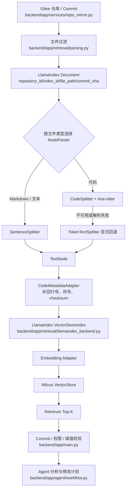
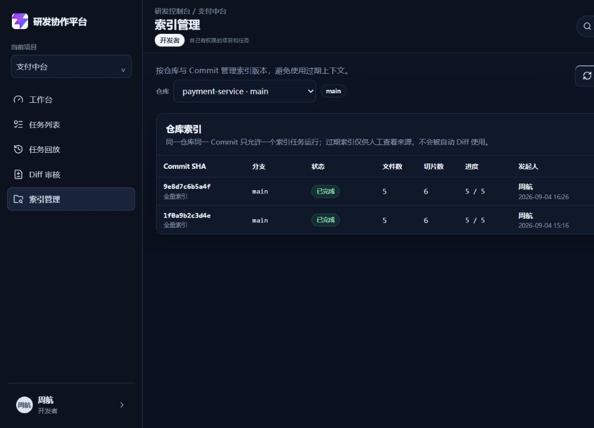
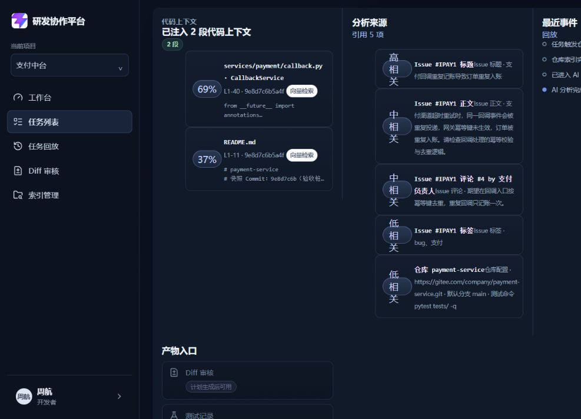

# RAG / LlamaIndex 面试专题复盘

> 文档类型：项目面试准备与技术复盘  
> 适用范围：MVP、团队版、企业版  
> 核实日期：2026-09-09  
> 说明：本文只整理当前源码、测试和真实运行记录能够证明的内容；“已解决问题”和“当前边界风险”分开描述。

> ⚠️ **时点声明（2026-09-24 追加）**：本文核实日期为 **2026-09-09**，**§4.2 / §4.3 的结论已被后续 E3-01~E3-09 推翻**。
> 引用本文时必须带时点，否则会低估当前能力。最新口径请看：
>
> | 本文旧结论 | 当前事实 | 权威来源 |
> | --- | --- | --- |
> | §4.2「还没有完整的离线评测集」 | 已有 `enterprise_rag/evaluation.py`（Recall/Precision/MRR/NDCG/Freshness/Empty/Unauthorized）+ 67 条真实仓库评测集 | `docs/project-development/104`、`105`、`106` |
> | §4.3「不是完整的混合检索」 | 已实现 BM25 + 向量 Hybrid、RRF 融合、Cross-Encoder 重排、Metadata 多阶段过滤 | `docs/project-development/101`~`103`、`109` |
> | §4.3「生产主路径是向量检索」 | 团队版与企业版模板 `RAG_RETRIEVAL_MODE=hybrid` | `docs/06-rag-design.md` §8.2 |
>
> 本文 **§1~§3（主链路、切片、Milvus 跨进程、降级诚实性）仍然有效**，可继续引用。

## 1. 项目中的 RAG 主链路



## 2. LlamaIndex 的职责边界

| 模块 | LlamaIndex 负责 | 项目自定义逻辑负责 |
| --- | --- | --- |
| 解析 | `Document` 和 NodeParser | 仓库文件过滤、大小限制、敏感文件过滤 |
| 切片 | `CodeSplitter`、`SentenceSplitter`、`TokenTextSplitter` | 代码文件与文档文件的选择策略 |
| 节点化 | `TextNode` | 业务字段映射 |
| 向量索引 | `VectorStoreIndex` | Milvus 配置与降级策略 |
| 检索 | Retriever 和相似度结果 | 项目、仓库、Commit、权限和 freshness 门禁 |
| 任务流程 | 不负责 | LangGraph、审批、审计和任务状态机 |

面试时可以这样回答：

> LlamaIndex 在项目中是 RAG 基础设施，不是业务状态机。它负责 Document、节点化、Embedding 接入、VectorStore 和 Retriever 编排；任务状态、审批、权限、审计和 Commit freshness 由平台业务层负责。这样做可以避免把第三方框架和业务流程强耦合。

## 3. 真实遇到的问题与解决方案

### 3.1 代码切片不能只依赖普通文本窗口

**问题：**

如果直接按固定字符或行数切片，函数、类和业务逻辑容易被截断，检索结果缺少代码语义。

**解决：**

- Python、TypeScript、Java 等代码优先使用 LlamaIndex `CodeSplitter`。
- Markdown、JSON、YAML 等内容使用 `SentenceSplitter`。
- 未识别语言使用 `TokenTextSplitter`。
- 当前默认代码窗口为 40 行，重叠 10 行，单个 chunk 最大 4000 字符。

**面试追问：为什么还保留 TokenTextSplitter？**

> 因为未知语言、语法包不可用或解析失败时，固定窗口仍然能够保证索引主链可运行。但它是可观测的降级路径，不应该伪装成语义切片。

### 3.2 tree-sitter 运行时不可用

**现象：**

`CodeSplitter` 依赖 tree-sitter 语言语法包。Windows、本地网络受限或语法包缺失时，构造或切片可能失败。

**解决：**

- 捕获 `CodeSplitter` 构造异常。
- 切片过程异常时再次回退到 `TokenTextSplitter`。
- 写入 warning 日志。
- 继续保留文件路径、Commit、chunk checksum 等业务元数据。

**关键代码：**

- `backend/app/retrieval/parsing.py::_pick_splitter`
- `backend/app/retrieval/parsing.py::_split_to_texts`

**测试证据：**

- `backend/tests/test_rag_parse_chain.py::test_parse_fallback_is_honest_nodeparser`

### 3.3 LlamaIndex 节点没有直接满足业务行号需求

**问题：**

通用 NodeParser 能返回文本节点，但任务详情页和 Diff 审核需要显示精确的文件路径、起止行号、函数名和 Commit SHA。切片过程中空行或分隔符可能被忽略，不能简单依赖节点文本直接计算行号。

**解决：**

项目增加 `CodeMetadataAdapter`：

1. 先由 LlamaIndex 生成 chunk 文本。
2. 回到原文件行序中顺序查找 chunk 首行。
3. 根据 chunk 行数推导起止行号。
4. 补充 `symbol_name`、`chunk_index`、`checksum`、`commit_sha`。

**当前边界：**

这种方式能满足当前展示和审计，但属于近似行号映射。更高精度的方案是让 AST parser 输出 byte offset 或直接保存 AST 节点起止位置。

### 3.4 Milvus 跨进程查询出现 `released`

**现象：**

进程 A 写入 Collection 后退出，进程 B 查询同一个 Collection 时出现：

```text
MilvusException: collection is in state 'released'
```

**根因：**

新进程重新构造了 VectorStore，但没有主动把已有 Collection 加载到查询节点。

**解决：**

在 `VectorStoreIndex.from_vector_store` 之前调用：

```text
ensure_milvus_collection_loaded(vector_store, collection_name)
```

该函数按以下顺序尝试加载：

- VectorStore 持有的 `client`
- 兼容旧实现的 `_milvus_client`
- `pymilvus.utility`

并且设计为幂等调用。

**测试证据：**

- `backend/tests/test_rag_milvus_realtime.py::test_cross_process_query_existing_collection`
- 真实 Milvus Standalone 写入、退出、重新查询通过

### 3.5 降级路径不能伪装成真实向量检索

**问题：**

如果 Milvus 不可用却仍返回 `source=milvus`，页面和审计会误导使用者，面试时也无法证明真实链路。

**解决：**

- 本地或测试环境允许 `RAG_MOCK_FALLBACK=true`。
- 降级结果标记为 `fallback`，上层可以映射为 `manual`。
- 日志明确记录降级原因。
- 生产环境设置 `RAG_MOCK_FALLBACK=false`，Milvus 失败直接抛错。

**面试回答：**

> 我们把可用性和真实性分开处理。本地可以降级保证开发效率，但降级必须显式标记；生产不能把关键词检索伪装成 Milvus 向量检索。

### 3.6 代码版本变化导致索引过期

**问题：**

仓库已经产生新 Commit，但旧索引仍然可以召回。若 Agent 使用旧代码生成 Diff，可能修改错误版本。

**解决：**

- 索引绑定 `repository_id + commit_sha`。
- 检索结果携带 `commit_sha` 和 `fresh`。
- 过期索引允许人工查看来源。
- 自动分析或 Diff 前调用 `assert_fresh_index_for_auto`，版本不一致返回 409。

**面试回答：**

> RAG 结果不只是相似度问题，还必须有版本一致性。项目把 Commit SHA 作为检索上下文的一部分，过期代码可以审阅，但不能直接驱动自动修改。

### 3.7 同一个仓库重复构建索引

**问题：**

多个任务可能同时针对同一个仓库和 Commit 创建索引，造成重复同步、重复 Embedding 和重复写入。

**解决：**

索引决策分为四种情况：

1. 同 Commit 已完成：复用索引。
2. 同 Commit 正在运行：任务等待。
3. 同 Commit 已失败：显示失败并允许重试。
4. 没有可用索引或 Commit 已变化：创建新索引。

索引完成后自动恢复等待中的 Agent 任务，并用 `(index_id, task_id)` 做幂等保护。

**测试证据：**

- `backend/tests/test_wait_index_resume.py`
- `backend/tests/test_dev008_rag_index.py`

### 3.8 敏感文件进入 RAG

**风险：**

`.env`、证书、Token、依赖目录和构建产物不应进入向量库，否则可能在检索或回放中泄露。

**解决：**

`path_blocked` 在 LlamaIndex 解析前执行过滤，覆盖：

- `.env` 和 `.env.*`
- `.git`
- `node_modules`
- `dist`、`build`
- 二进制文件
- 仓库自定义 `blocked_paths`

这体现了一个重要原则：**安全过滤必须发生在向量化之前，而不是只在前端展示阶段隐藏。**

## 4. 当前需要诚实说明的边界风险

### 4.1 Embedding 维度切换风险

当前项目支持：

- 真实 Embedding：通常由配置决定，例如 2048 维。
- 本地 token-hash 兜底：64 维。

如果 Collection 按真实模型维度创建后，Embedding 调用失败又切换到 64 维，可能产生向量维度不一致。当前代码已经支持显式降级，但还应继续补充：

- Collection 记录实际 embedding provider、model 和 dimension。
- 写入前校验向量维度。
- 模型或维度变化时强制重建索引。
- 禁止不同维度混写同一个 Collection。

面试时应说：

> 项目已经解决了降级可观测性，但 Embedding 维度与 Collection schema 的生命周期管理还需要继续加固，这是当前 RAG 的已知边界。

### 4.2 RAG 质量评测还不完整

> **⚠️ 本节已过时（2026-09-09 时点）**：离线评测集与指标已于 E3-04~E3-06 落地，见 `104`/`105`/`106` 文档与 `backend/app/enterprise_rag/evaluation.py`。
> 以下保留原文以记录当时的真实边界。

当前有 Top-K、阈值、来源、Commit 和空结果处理，但还没有完整的离线评测集。后续应补：

- Recall@K
- MRR
- 无关召回率
- 来源完整率
- 上下文有效率
- 不同切片策略的对比实验

不能只用“接口返回了结果”证明 RAG 质量好。

> **2026-09-24 更正**：上面六项已全部落地（`enterprise_rag/evaluation.py` 实现 Recall/Precision/MRR/NDCG/Freshness/Empty/Unauthorized，报告含 `metrics_by_tag` 与 `failed_cases`）。

### 4.3 当前不是完整的混合检索

> **⚠️ 本节已过时（2026-09-09 时点）**：Hybrid / RRF / Cross-Encoder / 多阶段 MetadataFilters 已于 E3-01~E3-09 落地。
> 当前准确说法是：**已实现完整 Hybrid RAG，且经过真实仓库 + 真实 Milvus 的四档 rerank 对比验证**（见 `107`/`109` 文档）。
> 仍然成立的边界：`--all-modes` 的 bm25 主报告 `precision@K=0.2034` 未过质量门；CE 默认关闭。

生产主路径是向量检索；Milvus 不可用时才使用关键词兜底。项目还没有完整实现：

- BM25 + 向量的 Hybrid Search
- Cross-Encoder 重排序
- 按文件路径、语言、符号的多阶段过滤
- 面向不同任务类型的动态 Top-K

~~面试时不要说已经实现了完整 Hybrid RAG。~~

> **2026-09-24 更正**：上面这段「还没有实现」的清单**已全部落地**（E3-01~E3-09）。当前正确说法是：
> 「**已实现完整 Hybrid RAG（BM25 + 向量 + RRF + Rerank/Cross-Encoder + Metadata 多阶段过滤），并在真实仓库 + 真实 Milvus 上做过四档 rerank 对比验证**」。
> 仍然存在的边界（这部分要说）：`--all-modes` 的 bm25 主报告 `precision@K=0.2034` 未过质量门；Cross-Encoder 默认关闭。
> 权威来源：`101`~`103`、`107`、`109` 文档。

## 5. 高频面试问答

### Q1：LlamaIndex 和 Milvus 分别解决什么问题？

> LlamaIndex 负责 Document、NodeParser、TextNode、Embedding 接入、VectorStoreIndex 和 Retriever 编排；Milvus 负责向量持久化和相似度检索。前者是 RAG 编排层，后者是向量存储层。

### Q2：为什么不直接把代码全文交给大模型？

> 全量代码会超过上下文窗口，成本高且噪声大。先按 Issue 检索相关代码，可以控制上下文规模，同时保留文件路径、行号和 Commit，使分析结果可追溯。

### Q3：为什么代码不能全部用 SentenceSplitter？

> SentenceSplitter 适合自然语言。代码需要尽量保持函数、类和语法结构，所以优先使用 CodeSplitter；只有语法解析不可用时才回退 TokenTextSplitter。

### Q4：如何保证召回代码是最新版本？

> 每个索引绑定 Commit SHA。检索时比较任务基线 Commit 和索引 Commit；过期索引只能人工查看，自动 Diff 前必须通过 freshness 门禁。

### Q5：Milvus 挂了怎么办？

> 本地测试允许显式降级到关键词检索并标记来源；生产关闭降级开关，直接暴露错误并让任务进入可重试状态，避免产生虚假的成功结果。

### Q6：如何定位 RAG 召回错误？

> 先检查 Commit 和索引状态，再看 query 文本、Top-K、相似度阈值、文件路径、行号和 source。项目保存 RetrievalRecord，并在页面展示来源，不只返回一段无法解释的文本。

### Q7：如何防止 README 中的恶意提示词影响 Agent？

> 检索内容只能作为不可信上下文，不能覆盖系统安全规则。权限、审批、命令白名单和 Diff 门禁仍由平台业务层执行。后续还需要进一步补充提示词注入检测和上下文隔离策略。

### Q8：你认为当前 RAG 还可以怎么改进？

> 第一是补离线评测集，量化 Recall@K 和 MRR；第二是补 Hybrid Search 和重排序；第三是完善 Embedding 维度与 Collection schema 的版本管理；第四是用 AST byte offset 替代近似行号映射。

## 6. 关键源码与证据

| 内容 | 文件 |
| --- | --- |
| LlamaIndex Document、切片和回退 | `backend/app/retrieval/parsing.py` |
| TextNode、VectorStoreIndex、Retriever、Milvus | `backend/app/retrieval/llamaindex_backend.py` |
| Embedding 真实调用与 token-hash 兜底 | `backend/app/services/embedding_service.py` |
| 切片参数 | `backend/app/retrieval/parsing_config.py` |
| 索引分流、fresh 门禁、任务注入 | `backend/app/main.py` |
| RAG 单元与链路测试 | `backend/tests/test_rag_parse_chain.py` |
| Milvus 真实与降级测试 | `backend/tests/test_rag_milvus_realtime.py` |
| RAG 持久化测试 | `backend/tests/test_rag_persistence.py` |
| 跨进程索引恢复测试 | `backend/tests/test_wait_index_resume.py` |
| RAG 设计说明 | `docs/06-rag-design.md` |
| RAG / Milvus 真实化记录 | `docs/project-development/24-rag-milvus-reality.md` |

## 7. 真实运行截图

以下截图来自当前仓库真实运行记录：





## 8. 复盘

- 做得好的地方：把 LlamaIndex、Milvus、业务元数据和任务状态机拆开，且对降级、过期索引和跨进程恢复做了显式处理。
- 需要加强的地方：Embedding 维度生命周期、RAG 离线评测、混合检索和精确行号定位。
- 面试重点：不要只讲“用了 LlamaIndex 和 Milvus”，要讲清楚真实故障、定位依据、解决方案和仍然存在的边界。
