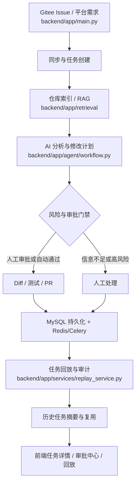

# 项目问题与面试问答总复盘

> 文档类型：项目问题复盘与面试准备  
> 核实日期：2026-09-09  
> 适用范围：MVP、团队版、企业版  
> 说明：本文基于当前源码、测试和真实运行记录整理。面试时应区分“真实修复过的问题”“工程化验证问题”和“当前边界风险”。

## 1. 项目主链路



## 2. 问题总览

| 优先级 | 问题 | 类型 | 当前结论 |
| --- | --- | --- | --- |
| P0 | Worker 写库后 API 仍读取旧内存状态 | 真实联调故障 | 已修复 |
| P0 | Gitee 创建 Issue 返回 404 | 真实接口故障 | 已修复 |
| P0 | 过期索引驱动自动修改 | 数据正确性风险 | 已增加 freshness 门禁 |
| P0 | 敏感文件进入 RAG | 安全风险 | 已增加索引前过滤 |
| P0 | 并发审批产生多个有效结果 | 并发一致性风险 | 已增加锁和幂等 |
| P1 | Celery Worker 重启后任务 404 | 异步运行时故障 | 已修复 |
| P1 | Worker 重试时状态空转或直接终态失败 | 异步可靠性故障 | 已修复 |
| P1 | 旧 MySQL 缺字段或迁移重复执行 | 数据库演进故障 | 已改为 Alembic 迁移 |
| P1 | 写库异常被静默吞掉 | 可观测性问题 | 已增加错误码、日志和指标 |
| P1 | Milvus 跨进程查询 `released` | RAG 运行时故障 | 已修复 |
| P1 | 前端刷新后跳登录或角标闪烁 | 前端时序故障 | 已修复 |
| P1 | 通知重复发送或越权读取 | 协作治理问题 | 已修复 |
| P2 | 回放事件重复、乱序或越权 | 审计展示问题 | 已修复 |
| P2 | 历史摘要索引失败影响主任务 | 知识复用可靠性问题 | 已设计为不阻断主链 |
| P2 | 文档、配置和实际运行方式不一致 | 工程协作问题 | 已同步主要口径 |

## 3. 真实修复问题

### 3.1 Worker 写库后 API 读到旧状态

**现象**

Worker 把任务推进到 `TESTED` 或 `COMPLETED` 并写入数据库，但 FastAPI 进程里的 `TASKS` 字典仍是旧状态。API 继续处理审批、PR 描述等操作时，可能返回 409 或 404。之前只能重启 API 才能绕过。

**根因**

系统早期采用“内存注册表 + 数据库镜像”的兼容结构。Worker 和 API 是不同进程，Worker 修改数据库不会自动刷新 API 内存字典。

**解决方案**

- 增加 `task_for_mutation(task_id)`。
- 持久化开启时，修改型接口先经 `reads.get_task()` 读取数据库真源。
- 读取成功后刷新 `TASKS[task_id]` 缓存。
- 数据库尚未落库的短窗口才回退到内存视图。
- 统一替换任务端点中的直接 `TASKS.get(task_id)`。

**面试回答**

> 我们在真实异步联调中发现了典型的缓存与数据库不一致问题。Worker 和 API 是两个进程，Worker 写库后 API 内存缓存不会自动更新，导致 API 根据旧状态做出错误判断。后来把修改型接口统一收敛到 `task_for_mutation`，持久化开启时以 DB 为准并刷新缓存，同时保留本地测试的内存模式。这个问题的关键不是简单加一次 reload，而是明确数据库真源和缓存边界。

**证据**

- `backend/app/main.py::task_for_mutation`
- `backend/app/db/reads.py`
- `docs/project-development/29-gitee-pr-real-e2e.md`
- MySQL 直接修改任务后不重启 API 仍能读到新值

### 3.2 Gitee 创建 Issue 返回 404

**现象**

调用 Gitee 创建 Issue 接口时返回：

```text
404 {"message":"project or enterprise"}
```

**根因**

最初把仓库名写进了路径：

```text
POST /repos/{owner}/{repo}/issues
```

实际接口需要使用 owner 级路径，并把仓库名放到请求体：

```text
POST /repos/{owner}/issues
{ "repo": "...", "title": "...", "body": "..." }
```

**解决方案**

- 修正 `create_gitee_issue` 的 endpoint。
- 将 `repo` 写入 payload。
- 增加请求参数回归测试。
- 用真实 Gitee 仓库复验，正确请求返回 201。

**面试回答**

> 这个问题最初看起来像 Token 权限或 Gitee 平台限制，但我通过对照请求路径和返回信息，发现是接口端点理解错误。修复后没有只改代码，而是增加了请求路径和 payload 的回归断言，并用真实仓库验证 201，避免测试桩掩盖问题。

**证据**

- `backend/app/main.py::create_gitee_issue`
- `backend/tests/test_dev016b_sync_gitee.py`
- `docs/project-development/22-celery-async.md`

### 3.3 Git Clone 使用相对路径导致索引异常

**现象**

真实仓库索引时没有成功使用 git clone，工作区目录为空，系统回退到 Gitee API 逐文件读取，最终触发 403 或限流。

**根因**

传给 git 的工作目录使用了相对路径。由于执行进程的当前目录与预期不同，仓库被 clone 到嵌套错误目录，后续 mirror 查找不到代码。

**解决方案**

- 在 `repo_mirror` 中统一调用 `.resolve()` 获取绝对路径。
- clone/fetch 后固定 checkout 目标 Commit。
- 日志对 token remote 做脱敏。
- 只有 git clone 失败时才显式回退 Gitee API。

**面试回答**

> 我们通过日志发现不是 Gitee API 本身不稳定，而是本地 git 工作目录解析错误。相对路径在多进程和不同启动目录下不可靠，所以改为绝对路径，并把 git clone 作为索引主链，Gitee API 只作为明确标记的 fallback。

**证据**

- `backend/app/services/repo_mirror.py`
- `backend/tests/test_repo_mirror.py`
- `docs/project-development/29-gitee-pr-real-e2e.md`

### 3.4 Worker 启动后找不到任务

**现象**

Celery Worker 能收到任务，但执行时任务、项目或仓库在 Worker 进程内不存在，表现为 missing、404 或无法继续推进。

**根因**

Worker 不会执行 FastAPI 的 `lifespan`，因此不能依赖 API 进程启动时的内存恢复逻辑。早期 Worker 只启动了 Celery，没有独立恢复业务运行时。

**解决方案**

- 增加 `init_worker_runtime()`。
- Worker 启动时执行 schema 检查和 `restore_from_db()`。
- 每个任务开始前执行幂等的 `ensure_worker_runtime_ready()`。
- 恢复失败时转换为可序列化的 Worker 错误，而不是直接让进程崩溃。

**面试回答**

> Worker 是独立进程，不能复用 Web 进程的生命周期。我们把 Worker 初始化设计成独立运行时恢复，并在任务入口再做一次幂等兜底，这样 Worker 重启后仍能从数据库恢复任务上下文。

**证据**

- `backend/app/workers/runtime.py`
- `backend/tests/test_celery_worker_runtime.py`
- `docs/project-development/22-celery-async.md`

### 3.5 Celery 重试空转与异常不可序列化

**现象**

Agent 失败后可能在第一次重试就被标记为最终失败，或者失败异常无法被 Celery 序列化，导致 Worker 进程异常退出。

**根因**

- 没有区分“本次失败”和“达到最大重试次数”。
- 直接把 `HTTPException` 或任意异常穿过 Worker 边界，异常对象不一定可 pickle。
- `_AGENT_ENQUEUED` 没有在恢复、审批或终态时清理，后续任务无法再次投递。

**解决方案**

- 增加可序列化的 `WorkerTaskError`，只传递状态码、错误码和资源 ID。
- 非最后一次失败只保存 `retry_count`、`failure_reason`、`next_action=worker_retry`。
- 最后一次失败才进入任务失败终态并写审计。
- 在审批通过、恢复、重试和终态阶段清理投递去重标记。

**面试回答**

> 重试不是简单把异常再抛一次。我们把业务状态和队列重试分开：中间失败保持可恢复态，达到上限才进入终态；同时在 Worker 边界把异常转换成可序列化结构，避免一个业务异常导致 Worker 崩溃。

**证据**

- `backend/app/workers/tasks.py`
- `backend/app/workers/runtime.py`
- `backend/tests/test_celery_retry_and_config.py`
- `docs/project-development/22-celery-async.md`

### 3.6 过期索引驱动错误版本代码修改

**问题**

仓库已经产生新 Commit，但旧索引仍然可以召回。如果旧索引直接进入自动 Diff，Agent 可能基于过时代码生成修改。

**解决方案**

- 每个索引绑定 `repository_id` 和 `commit_sha`。
- 任务保存 `base_commit_sha` 和 `related_index_id`。
- 检索结果带 `commit_sha` 和 `fresh`。
- 旧索引可以人工查看，但 `require_fresh` 和 `assert_fresh_index_for_auto` 阻止自动 Diff。

**面试回答**

> RAG 的正确性不只有相似度，还包括版本一致性。我们把 Commit SHA 纳入索引和任务上下文，允许人工查看历史来源，但自动修改前必须通过 freshness 门禁。

**证据**

- `backend/app/main.py::run_task_retrieval`
- `backend/app/main.py::assert_fresh_index_for_auto`
- `backend/tests/test_dev008_rag_index.py`

### 3.7 并发审批产生多个结果

**问题**

两个审批请求几乎同时到达时，如果都先读取到 `WAITING_APPROVAL`，可能重复写入审批结果、事件和审计。

**解决方案**

- 复用 `_APPROVAL_LOCK` 保护审批动作。
- 重新读取并确认计划仍处于待审批状态。
- 只接受第一条有效动作，后续请求返回状态冲突。
- 自动审批通过 `evaluate_and_apply` 做幂等判断。
- 所有动作写入 task event 和 audit event。

**面试回答**

> 并发控制不能只靠前端按钮禁用，因为请求可能重试、重复提交或来自多个客户端。后端以计划状态为条件加锁，第一条有效动作改变状态，后续请求重新校验后返回冲突，同时把动作完整写入审计。

**证据**

- `backend/app/services/approval_policy.py`
- `backend/tests/test_approval_policy.py`
- `docs/project-development/30-approval-grading-auto-advance.md`

### 3.8 写库异常被静默吞掉

**问题**

早期部分 `_persist_*` 使用 `except: pass`。数据库写失败时 API 可能仍然返回成功，但实际数据没有落库，形成隐性数据丢失。

**解决方案**

- 增加 `persistence_status.measure()` 统一包装写透操作。
- 记录 `ok/fail/skip` 计数。
- 记录最后错误、日志和错误码。
- `PERSIST_STRICT=true` 时把写库异常继续抛给上层。
- 索引中间态快照也落库，重启后可以继续解析。

**面试回答**

> 对持久化失败最危险的处理不是报错，而是假装成功。我们把写透操作统一封装为可观测操作，开发环境保留兼容性，生产可以开启 strict 模式，让写库失败真正影响请求。

**证据**

- `backend/app/core/persistence_status.py`
- `backend/tests/test_persistence_observability.py`
- `docs/project-development/26-persistence-hardening.md`

### 3.9 MySQL 旧库迁移和 TEXT 默认值问题

**问题**

- 既有数据库缺少新字段时，单纯使用 `create_all()` 不会自动补列。
- MySQL 8 严格模式不允许某些 `TEXT` 列设置默认值，历史任务表迁移可能报 1101。
- 应用和多个 Worker 同时执行迁移存在锁竞争风险。

**解决方案**

- 统一使用 Alembic `upgrade head` 演进既有数据库。
- 对早期无版本库先识别并 stamp baseline，再执行增量迁移。
- 迁移脚本对新增表和字段做幂等检查。
- 应用进程负责升级，Worker 只检查版本，不执行迁移。
- MySQL `TEXT` 列只保留 `NOT NULL`，默认值由代码层提供。

**面试回答**

> `create_all()` 适合初始化，不适合作为生产数据库演进方案。我们后来把初始化和升级分开，用 Alembic 管理版本，应用负责升级，Worker 只做版本检查，并针对 MySQL 的 TEXT 默认值限制修正迁移脚本。

**证据**

- `backend/app/db/migrate.py`
- `backend/migrations/versions/`
- `backend/tests/test_migrations_upgrade.py`
- `docs/project-development/28-mysql-production.md`

### 3.10 Milvus 跨进程查询 `released`

**问题**

进程 A 写入 Collection 并退出，进程 B 查询同一 Collection 时出现：

```text
MilvusException: collection is in state 'released'
```

**解决方案**

在 `VectorStoreIndex.from_vector_store()` 之前调用 `ensure_milvus_collection_loaded()`，对已存在的 Collection 做幂等 load，并兼容不同客户端字段和 `pymilvus.utility`。

**面试回答**

> 同进程立即查询不能证明服务可恢复。我们专门构造了 A 进程写入、退出，B 进程重新连接并查询的场景，定位到 Collection 生命周期问题，最终在查询前主动 load，并用跨进程测试验证。

**证据**

- `backend/app/retrieval/llamaindex_backend.py::ensure_milvus_collection_loaded`
- `backend/tests/test_rag_milvus_realtime.py::test_cross_process_query_existing_collection`
- `docs/project-development/24-rag-milvus-reality.md`

### 3.11 前端刷新后跳回登录页

**现象**

登录后进入工作台，浏览器刷新页面会短暂或直接跳到登录页。

**根因**

应用启动时先等待 `auth.bootstrap()`，路由守卫和页面渲染的时序互相影响。网络稍慢时，前端在 Cookie 会话尚未确认前就把状态当成未登录。

**解决方案**

- 调整启动顺序为先挂载应用，再等待路由就绪，最后 bootstrap 鉴权。
- `/api/auth/me` 返回 401 时视为会话失效。
- 网络错误允许重试一次，不把瞬时网络问题直接等同于未登录。
- 使用 HttpOnly Cookie、`credentials: include` 和正确的 CORS 配置。

**证据**

- `frontend/src/main.ts`
- `frontend/src/stores/auth.ts`
- `frontend/src/router/index.ts`
- `docs/project-development/90-fix-refresh-redirect-to-login.md`

### 3.12 前端刷新后审批角标闪烁

**现象**

刷新业务页面时，审批中心和角标短暂消失，鉴权完成后又出现。

**根因**

`AppShell` 根据 `auth.hasPermission()` 过滤菜单。刷新瞬间 `currentUser` 为空，权限判断返回 false，审批中心整项菜单被过滤掉，而不是只有角标数据暂时为空。

**解决方案**

- 从“全局乐观授权”演进为更安全的 `cachedUser` 回退。
- 只有 `auth.ready=false` 时使用最近一次用户快照。
- bootstrap 完成且确认未登录后，严格返回无权限。
- 路由守卫继续做权威权限拦截。

**面试回答**

> 第一次只缓存了工作区数据，用户反馈仍然闪烁。后来做反向验证，手动把 `currentUser` 置空，发现是菜单权限过滤导致整个菜单项被卸载。最终采用“未完成鉴权时使用 cachedUser，完成后严格按真实用户判断”的方案，既解决 UI 闪烁，也避免长期乐观授权带来的安全问题。

**证据**

- `frontend/src/stores/auth.ts`
- `frontend/src/components/AppShell.vue`
- `docs/project-development/91-fix-refresh-badge-flicker.md`

### 3.13 通知重复发送和越权读取

**问题**

- 同一个审批人在 24 小时内重复点击催办，可能收到多条相同通知。
- 通知列表如果不按 `recipient_id` 限制，用户可能读到他人的通知。

**解决方案**

- 催办前从 DB 真源检查近 24 小时是否已有相同 NUDGE。
- 重复催办返回 `nudged=false`，不重复生成通知、事件和审计。
- 通知读取恒按当前用户 `recipient_id` 过滤。
- 管理员也默认只读取自己的通知，不因为角色高就读取所有人的收件箱。
- 评论删除采用软删除并保留审计记录。

**证据**

- `backend/app/services/notification_service.py`
- `backend/app/db/reads.py`
- `backend/tests/test_dev019_comments_notifications.py`
- `docs/project-development/31-comments-notifications-nudge.md`

### 3.14 回放事件重复、乱序和越权

**问题**

任务回放数据来自多个事件、步骤和产物来源，同一动作可能同时出现在事件和产物关联中。如果直接拼接，页面会出现重复或乱序；如果只做角色权限，不做任务参与范围校验，用户可能查看不属于自己的任务。

**解决方案**

- `replay_service` 统一聚合事件、步骤、产物和评论。
- 按 `occurred_at`、原始顺序和 ID 稳定排序。
- 对重复事件做稳定去重。
- 回放只读，不推进任务状态，不写审计。
- 使用 `replay:view` 加项目级 `_can_view_replay`：管理员全量，负责人按项目，普通用户限创建者或审批人。

**面试回答**

> 回放不是简单返回一张日志表，而是多个业务来源的只读聚合。我们重点处理了来源关联、稳定排序、重复去除和权限边界，并验证回放请求不会改变业务状态或审计记录。

**证据**

- `backend/app/services/replay_service.py`
- `backend/tests/test_dev020_replay.py`
- `docs/project-development/32-replay-summary-audit.md`

### 3.15 历史任务索引失败不能阻断主任务

**问题**

任务完成后生成历史复用摘要并写入向量索引。如果向量服务失败，不能把已经完成的业务任务重新判为失败。

**解决方案**

- 完成主链只负责生成和持久化摘要。
- 向量索引作为异步副作用执行。
- 索引失败记录 `failure_reason`、`failure_context`、`retry_count`。
- 失败状态可重试，不影响原任务 `COMPLETED`。
- 检索默认项目隔离、权限过滤、排除自身并限制数量。

**证据**

- `backend/app/services/history_service.py`
- `backend/tests/test_dev021_history.py`
- `docs/project-development/33-history-task-reuse.md`

## 4. 工程协作与文档问题

### 4.1 文档曾经夸大真实落地状态

**问题**

早期架构文档把 SQLite、内存模拟、Milvus、Celery 和生产形态写在同一层，容易让读者误以为所有环境都使用真实外部服务。

**解决方案**

- 明确区分 local/test、team 和 production。
- 文档标注真实服务、显式 fallback 和未完成能力。
- 配置模板与 `runtime_config` 对齐。
- 增加启动脚本和 Worker 启动说明。

**面试回答**

> 我们做过一次文档和运行状态对齐，重点是不把“接口存在”写成“生产已验证”。后来所有外部依赖都区分真实主路径和显式降级路径，并在文档中标注验证证据。

**证据**

- `docs/project-development/25-docs-config-sync.md`
- `deploy/env/*.env.example`
- `backend/app/core/runtime_config.py`

## 5. 当前边界风险

以下内容面试时应主动说明，不要包装成已完全解决：

| 风险 | 当前状态 | 后续方案 |
| --- | --- | --- |
| Embedding 维度切换 | 真实模型和本地兜底可能是不同维度 | 记录 provider/model/dimension，写入前校验并按维度重建 Collection |
| RAG 质量评估 | 有 Top-K、阈值和来源，但缺完整评测集 | 增加 Recall@K、MRR、无关召回率和人工标注集 |
| 混合检索 | 当前是向量主路径，失败时关键词兜底 | 增加 BM25 + 向量召回和重排序 |
| 行号映射精度 | 当前根据原文顺序近似回填 | 使用 AST byte offset 或 parser 节点起止位置 |
| 多租户隔离 | 已有项目级权限，完整组织/租户模型仍需增强 | 在数据表和查询层引入 tenant_id / organization_id |
| 生产安全沙箱 | 已有 Docker、白名单和审批门禁 | 增加网络隔离、资源配额、密钥代理和更强运行时沙箱 |

## 6. 面试通用回答模板

> 项目中遇到过一个问题是 **[现象]**。  
> 我先通过 **[日志 / 数据库 / Network / 测试]** 定位，发现根因是 **[根因]**。  
> 后来在 **[模块 / 接口 / 数据结构]** 中采用了 **[解决方案]**。  
> 选择这个方案主要是因为 **[技术取舍]**。  
> 修复后通过 **[单测 / 集成测试 / 真实环境]** 验证。  
> 目前仍然存在 **[边界]**，后续会用 **[改进方案]** 补强。

## 7. 推荐重点准备的 9 个问题

1. Worker 和 API 的内存、数据库状态不一致是怎么发现和解决的？
2. Celery 如何保证失败重试不会把任务错误地置为终态？
3. 为什么选择 LangGraph、LlamaIndex、Milvus，各自负责什么？
4. Gitee API 404 是如何定位到 endpoint 错误的？
5. 如何保证 RAG 不使用过期 Commit 的代码？
6. Milvus 跨进程 `released` 是什么原因，如何验证修复？
7. 如何防止高风险任务绕过审批和命令白名单？
8. 当前项目还有哪些不足，下一步如何改进？
9. 为什么选择 Redis Pub/Sub + SSE，而不是 WebSocket？消息丢失怎么办？

## 8. 真实截图与关联文档

以下截图均来自项目已有真实运行记录：

| 场景 | 截图 |
| --- | --- |
| 登录后刷新仍保持工作台 | `docs/assets/auth-fix-after-refresh.png` |
| 审批角标刷新稳定 | `docs/assets/badge-stable-v2-after-refresh.png` |
| 通知和评论 | `docs/assets/dev019-notifications-real.png`、`docs/assets/dev019-task-detail-comments-real.png` |
| 回放与权限拦截 | `docs/assets/dev020-replay-summary-real.png`、`docs/assets/dev020-replay-permission-403-real.png` |
| 历史任务复用 | `docs/assets/dev021-history-history-panel-real.png`、`docs/assets/dev021-history-references-real.png` |
| RAG 索引和代码上下文 | `docs/assets/dev008-index-list-real.png`、`docs/assets/dev008-code-context-real.png` |

关联专题：

- `docs/project-development/22-celery-async.md`
- `docs/project-development/24-rag-milvus-reality.md`
- `docs/project-development/28-mysql-production.md`
- `docs/project-development/29-gitee-pr-real-e2e.md`
- `docs/project-development/34-realtime-sync-sse-pubsub-websocket.md`
- `docs/project-development/92-rag-llamaindex-interview-review.md`

## 9. 复盘

- 做得好的地方：大多数问题都有真实现象、定位依据、代码修复和测试证据。
- 需要加强的地方：早期提交信息过于笼统，很多提交都叫“优化”，不利于按时间还原问题。
- 下次重点：每次修复同时记录“现象、根因、验证命令、结果和剩余风险”，并让提交信息体现具体问题。
