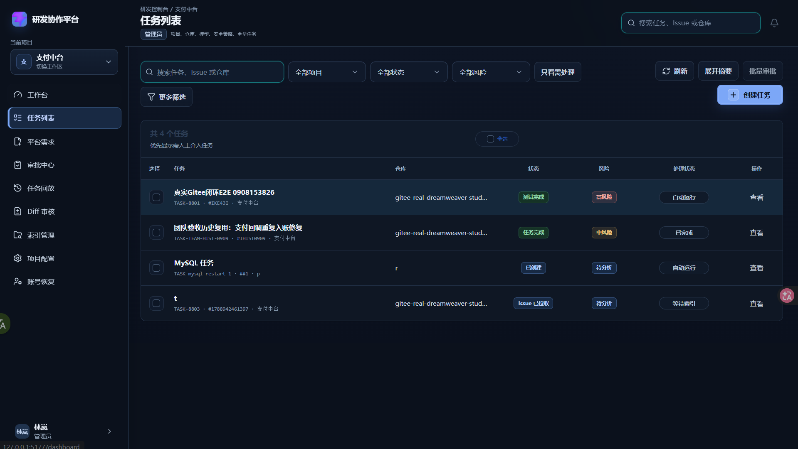
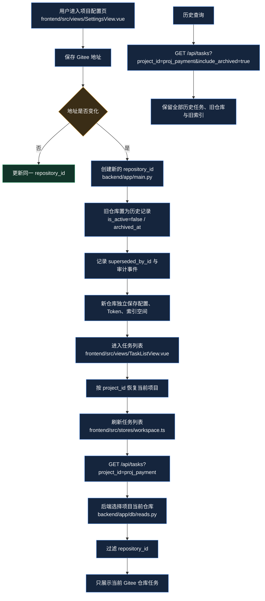
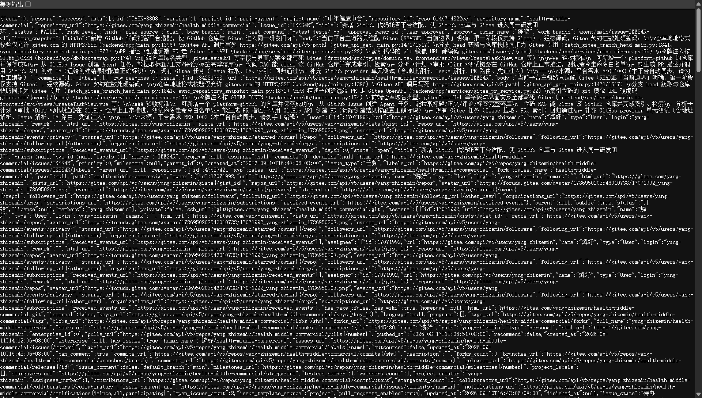
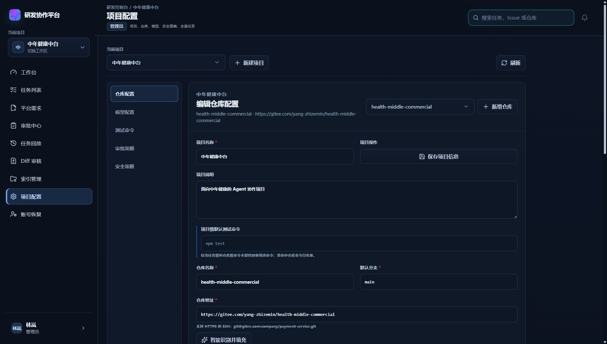
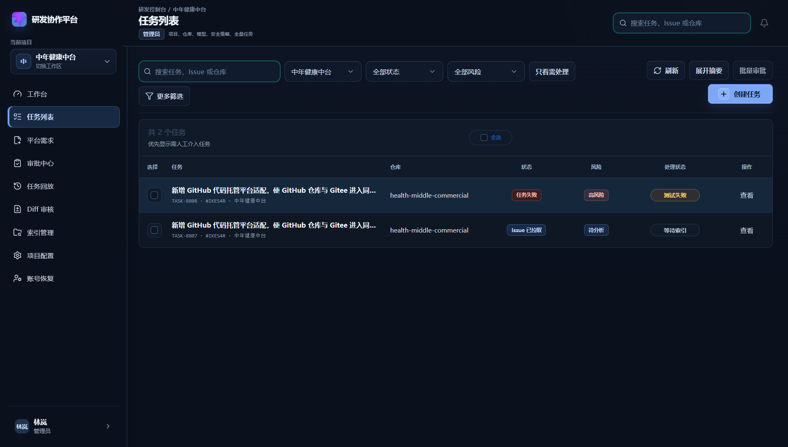

# FIX-094 仓库地址切换后的任务、索引与历史数据隔离

> 文档类型：单功能开发记录  
> 适用范围：团队版项目配置、任务列表、仓库生命周期  
> 关联模块：项目配置、Gitee 仓库、Agent 任务、仓库索引、历史任务  
> 文档状态：已跑通，已附用户现场截图、真实运行截图、API 验收结果

---

## 1. 功能目标与范围

### 1.1 目标

解决团队版项目中修改 Gitee 仓库地址后，任务列表仍显示原仓库任务的问题。

本次最终行为：

- 保存新地址时创建新的 `repository_id`，新仓库拥有独立的数据空间。
- 旧仓库配置、旧任务、旧索引和旧镜像不删除，保留历史追溯能力。
- 普通任务列表默认只展示项目当前仓库的数据。
- 历史接口通过 `include_archived=true` 保留全量查询能力。
- 前端项目切换使用稳定的 `project_id`，不再使用展示名称作为业务主键。
- 刷新任务页时默认带上当前项目 ID，避免请求全量任务。

### 1.2 不包含

- 不删除任何仓库、任务、索引或镜像。
- 不修改 Gitee 远端仓库中的 Issue、Commit 或 PR。
- 不把历史任务迁移到新仓库；历史任务仍绑定原来的 `repository_id`。
- 不改变任务详情、任务回放和历史相似任务的追溯入口。

---

## 2. 原始问题现象

用户在团队版项目配置中把仓库地址修改为：

```text
https://gitee.com/yang-zhizemin/health-middle-commercial
```

保存后，任务列表仍出现第一次仓库的数据，例如：

- `gitee-real-dreamweaver-studio-pro` 的任务；
- `MySQL 任务`；
- 旧仓库任务和新仓库任务混在同一列表；
- 页面项目筛选显示为“全部项目”。

### 2.1 用户现场截图

以下截图来自用户本次复测，不是示意图。截图中可以看到旧仓库任务仍显示在任务列表中，且项目筛选为“全部项目”。



文件：`docs/assets/repository-lifecycle-before-real.png`

---

## 3. 第一次优化为什么没有彻底解决

第一轮改造已经完成了仓库生命周期字段和地址切换逻辑，但现场复测仍暴露出两个遗漏。

### 3.1 只处理了“本次地址变化”，没有处理旧库中的多个有效仓库

第一轮迁移增加了：

- `is_active`
- `archived_at`
- `superseded_by_id`

新代码可以保证“通过当前编辑记录修改地址”时，旧记录被归档、新记录获得新的 ID。

但是，迁移无法自动判断历史数据库中已有的多个仓库哪个才是用户真正想保留的当前仓库。现场曾同时存在：

```text
repo_5f9ca2d1cb61       dreamweaver-studio-pro
repo_payment_service    payment-service
repo_5b5b9a2dd10d        health-middle
repo_b5b8dd165d3a        health-middle-commercial
```

其中部分旧记录在生命周期字段加入前已经存在，因此仍然是 `is_active=true`。如果任务列表只判断 `is_active`，这些仓库的任务仍会一起返回。

### 3.2 前后端项目名称不一致，导致前端项目筛选失效

后端真实项目记录是：

```text
project_id: proj_payment
project_name: 中年健康中台
```

前端工作区早期硬编码的是：

```text
支付中台
```

原任务页通过名称查找项目：

```ts
projects.value.find((item) => item.name === store.activeProject)
```

由于 `中年健康中台 !== 支付中台`，查找失败，`project` 保持为 `all`，最终发出的请求是：

```text
GET /api/tasks
```

这也是用户截图里“全部项目”一直存在的直接原因。

---

## 4. 最终业务流程



---

## 5. 实现方案

### 5.1 后端仓库生命周期

地址变化时，`PUT /api/repositories/{repository_id}` 执行以下操作：

1. 创建新的仓库记录和新的 `repository_id`；
2. 原记录设置 `is_active=false`；
3. 原记录写入 `archived_at`；
4. 原记录写入 `superseded_by_id=new_repository_id`；
5. 新记录作为当前候选仓库；
6. 写入 `REPOSITORY_REPLACED` 审计事件；
7. 不删除旧任务、旧索引和旧镜像。

关键位置：

- `backend/app/api/repositories.py（update_repository）`：仓库更新入口；
- 同一入口内：地址变化判断（`repository.url != url`）；
- 同一入口内：归档旧仓库（`is_active=False` + `superseded_by_id`）；
- 同一入口内：记录仓库替换审计事件（`REPOSITORY_REPLACED`）；
- `backend/app/models/orm.py（RepositoryORM）`：仓库 ORM 生命周期字段；
- `backend/migrations/versions/d1b7c8e9f012_repository_lifecycle_and_index_dedupe.py`：数据库迁移。

### 5.2 兼容旧库中的多个有效仓库

为兼容生命周期字段加入前已经存在的旧数据，新增：

```python
current_repository(project_id)
current_repository_ids(project_id)
```

规则：

- 先读取项目下仍为 `is_active=true` 的仓库；
- 按 `updated_at` 和 `id` 选择最新记录作为当前仓库；
- 普通任务列表只按当前仓库 ID 过滤；
- 旧仓库数据不删除；
- `include_archived=true` 仍返回历史全量。

关键位置：

- `backend/app/db/reads.py（current_repository）`：当前仓库选择；
- `backend/app/db/reads.py（current_repository_ids）`：当前仓库 ID 集合；
- `backend/app/main.py（list_tasks）`：任务列表归档参数（`include_archived`）；
- 同一入口内：普通列表按当前仓库过滤。

### 5.3 前端项目身份改为稳定 ID

前端工作区新增 `activeProjectId`：

- localStorage：`frontend-active-project-id`；
- 工作区快照保存 `activeProjectId`；
- 旧快照没有该字段时回退到 `proj_payment`；
- 展示名称仍用于界面显示，但不作为筛选主键。

任务映射同时保存：

```ts
projectId: task.project_id
projectName: task.project_name
repositoryId: task.repository_id
```

关键位置：

- `frontend/src/types/domain.ts:68`：`Task.projectId`；
- `frontend/src/services/taskMapper.ts:97`：映射后端项目 ID；
- `frontend/src/stores/workspace.ts:17`：项目 ID 存储键；
- `frontend/src/stores/workspace.ts:274`：项目切换；
- `frontend/src/stores/workspace.ts:373`：任务刷新默认带项目 ID；
- `frontend/src/views/TaskListView.vue:35`：项目筛选选项使用项目 ID；
- `frontend/src/views/TaskListView.vue:120`：按项目 ID匹配任务；
- `frontend/src/views/TaskListView.vue:302`：查询参数使用项目 ID；
- `frontend/src/components/AppShell.vue:239`：项目切换传递 ID 和名称。

---

## 6. 数据库迁移

新增迁移：

```text
backend/migrations/versions/d1b7c8e9f012_repository_lifecycle_and_index_dedupe.py
```

迁移内容：

- `repositories.is_active`
- `repositories.archived_at`
- `repositories.superseded_by_id`
- 运行中仓库索引的 `active_key` 唯一约束

团队版现场已执行到：

```text
d1b7c8e9f012
```

本次不执行数据删除或历史任务迁移。

---

## 7. 现场最终数据与 API 验收

### 7.1 当前仓库

本次最终复测时，当前仓库为：

```text
repository_id: repo_6f46704322ec
url: https://gitee.com/yang-zhizemin/health-middle-commercial
is_active: true
```

旧的 `health-middle`、早期重复创建的 `health-middle-commercial` 已进入历史链路。旧 `dreamweaver-studio-pro` 和 `payment-service` 的历史数据仍保留。

### 7.2 普通任务接口

请求：

```text
GET /api/tasks?project_id=proj_payment
```

真实返回摘要：

```text
ScopedCount: 2
TASK-8808 -> health-middle-commercial [repo_6f46704322ec]
TASK-8807 -> health-middle-commercial [repo_6f46704322ec]
```

结论：普通任务列表不再返回 `dreamweaver-studio-pro` 或 `payment-service` 的任务。

### 7.3 历史任务接口

请求：

```text
GET /api/tasks?project_id=proj_payment&include_archived=true
```

真实返回摘要：

```text
HistoryCount: 7
repo_5b5b9a2dd10d: 1
repo_5f9ca2d1cb61: 3
repo_6f46704322ec: 2
repo_scratch_git-repo-test: 1
```

结论：历史任务仍可查询，没有被删除。

### 7.4 真实 API 截图



文件：`docs/assets/repository-lifecycle-api-real.png`

---

## 8. 真实运行截图

### 8.1 项目配置页

真实页面显示：

- 当前项目：中年健康中台；
- 当前仓库：`health-middle-commercial`；
- 地址：`https://gitee.com/yang-zhizemin/health-middle-commercial`；
- Token 状态：已配置；
- 审计区能看到旧仓库切换为新仓库的记录。



文件：`docs/assets/repository-lifecycle-settings-real.png`

### 8.2 任务列表页

真实页面显示：

- 当前项目筛选不再是“全部项目”，而是“中年健康中台”；
- 共 2 个任务；
- 两条任务的仓库均为 `health-middle-commercial`；
- 旧 `dreamweaver` 任务没有出现在默认列表。



文件：`docs/assets/repository-lifecycle-task-list-real.png`

### 8.3 前后结果对比

| 场景 | 修复前 | 修复后 |
| --- | --- | --- |
| 项目筛选 | 全部项目 | 中年健康中台 |
| 默认请求 | `/api/tasks` | `/api/tasks?project_id=proj_payment` |
| 默认任务 | 旧仓库任务混入 | 只显示当前仓库任务 |
| 历史任务 | 与当前任务混在一起 | 通过 `include_archived=true` 查询 |
| 旧任务数据 | 容易误以为被覆盖 | 保留原 `repository_id` 可追溯 |
| 新仓库空间 | 与旧仓库共享 | 新 `repository_id` 独立 |

---

## 9. 测试与验收结果

### 9.1 后端

执行：

```powershell
backend\.venv\Scripts\python.exe -m pytest backend/tests/test_repository_lifecycle.py backend/tests/test_reads_layer.py -q
```

结果：

```text
13 passed, 3 warnings
```

新增覆盖：

- 地址变化创建新仓库 ID；
- 旧仓库归档字段正确；
- 当前列表隐藏旧仓库任务；
- 历史列表仍能查到旧任务；
- 旧库存在多个有效仓库时选择最新当前仓库。

### 9.2 前端

执行：

```powershell
cd frontend
npm.cmd test -- --run src/views/__tests__/TaskListView.spec.ts src/services/__tests__/taskData.spec.ts src/stores/__tests__/workspace.spec.ts
```

结果：

```text
Test Files  3 passed
Tests       30 passed
```

新增覆盖：

- Store 刷新默认请求 `project_id=proj_payment`；
- 任务页项目筛选使用 ID；
- 后端返回项目名称与前端展示名称不一致时仍能正确筛选；
- real 模式刷新继续整体替换任务列表，不保留旧本地任务。

### 9.3 前端生产构建

执行：

```powershell
cd frontend
npm.cmd run build
```

结果：

```text
vite build completed successfully
```

### 9.4 团队版真实页面

团队服务：

```text
Frontend: http://127.0.0.1:5177/
Backend:  http://127.0.0.1:8002
```

真实验收：

```text
页面请求：/api/tasks?project_id=proj_payment
页面任务数：2
当前仓库：health-middle-commercial
旧 dreamweaver 任务：未出现在默认列表
历史接口：仍可查到 7 条全量任务
```

---

## 10. 联调注意点

1. 修改仓库地址后，前端必须使用保存接口返回的新仓库对象刷新仓库列表，不能继续使用旧的 `repository_id`。
2. 任务列表必须带 `project_id`，不能依赖项目展示名称推导项目身份。
3. 项目展示名称允许调整，但 `project_id` 必须保持稳定。
4. 普通任务列表默认走当前仓库范围；历史回放、历史任务检索等功能不得误用普通列表结果。
5. 旧库可能存在多个 `is_active=true` 仓库，兼容逻辑按最新更新时间选择当前仓库；后续如果要提供显式“当前仓库”字段，应迁移到项目级 `current_repository_id`。
6. `include_archived=true` 是历史查询参数，普通页面不能默认打开。
7. 归档是软状态变化，不得级联删除任务、索引、镜像或审计事件。
8. 新仓库的索引必须使用新 `repository_id`，不能复用旧仓库索引或 Milvus collection。
9. 真实联调时要同时检查浏览器 Network 请求、页面筛选文字和 API 返回的 `repository_id`，只看其中一个信号不足以确认隔离完成。

---

## 11. 复盘

### 本次练到的能力

- 从截图现象追到浏览器 Network 请求；
- 识别“展示名称”和“业务主键”混用带来的筛选 bug；
- 处理旧数据库多个有效记录的兼容窗口；
- 用普通接口和历史接口同时证明“隔离但不删除”；
- 用真实页面截图闭环开发文档，而不是只记录代码变更。

### 做得比较好的地方

- 没有删除旧任务、旧索引和旧仓库；
- 用新 `repository_id` 建立了新的仓库数据空间；
- 补充了后端和前端回归测试；
- 最终用真实页面和真实 API 复测，确认截图与代码一致。

### 还需要加强的地方

- 第一轮没有为历史库中的多个有效仓库定义明确的当前仓库选择规则；
- 前端早期把项目名称当作筛选主键，导致后端改名或名称不一致时筛选失效；
- 后续可以增加项目级 `current_repository_id`，避免依赖更新时间推断当前仓库。

