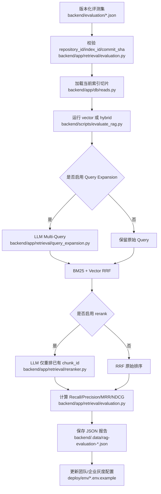
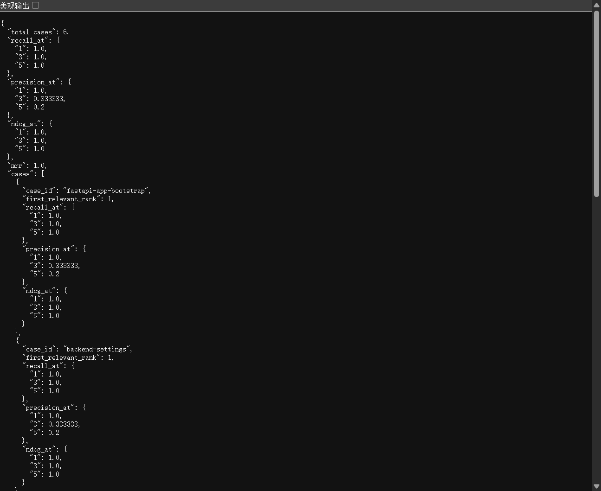

# DEV-095 RAG 检索质量评测与企业灰度策略

> 文档类型：单功能开发记录  
> 适用范围：代码 RAG 检索、离线评测、团队版和企业版运行配置  
> 文档状态：已跑通，已附真实评测报告截图

---

## 1. 功能目标与范围

为 RAG 增加可复现的离线质量评测，并根据真实结果确定团队/企业环境的检索灰度策略。

本次完成：

- 版本绑定评测集：标注可锁定 `repository_id + index_id + commit_sha`。
- 指标：`Recall@K`、`Precision@K`、`MRR`、`NDCG@K`。
- 同文件多 chunk 只计一次相关目标，避免重复片段虚高 `NDCG`。
- 评测 CLI 可分别开启或关闭 Query Expansion、rerank。
- 团队/企业模板采用 `hybrid + rerank`，保持 Query Expansion 关闭。

不包含：

- 不修改本地/MVP 的 `vector` 默认模式。
- 不把当前 6 条评测样本当作所有业务仓库的通用结论。
- 不删除旧索引、旧切片或历史检索记录。

---

## 2. 业务流程



---

## 3. 真实评测结果

评测对象：

```text
repository_id: repo_b5b8dd165d3a
index_id: idx_558411000439
commit_sha: d3177e3a4db81b7344a0ffed8fc0800cd3218e88
评测样本数: 6
```

| 配置 | Recall@1 | MRR | NDCG@5 | 结论 |
| --- | ---: | ---: | ---: | --- |
| vector | 0.833333 | 0.866667 | 0.897809 | Dockerfile 目标仅排第 5 |
| hybrid + Query Expansion | 0.833333 | 0.875000 | 0.905113 | 小幅改善排序，不提升 Top 3 召回 |
| hybrid + rerank | 1.000000 | 1.000000 | 1.000000 | 6 条样本全部进入 Top 1 |
| hybrid + Query Expansion + rerank | 1.000000 | 1.000000 | 1.000000 | 与仅 rerank 无额外收益，增加调用时延 |

真实运行截图：



截图来源：`backend/.data/rag-evaluation-hybrid-query-expansion-rerank.json`。

---

## 4. 关键实现说明

### 4.1 数据集必须绑定代码版本

`RetrievalEvalDataset` 支持在评测文件中声明仓库、索引和 Commit。CLI 在执行前校验三者，任一不匹配直接失败，避免用旧标注衡量新版本代码。

关键文件：

- `backend/app/retrieval/evaluation.py`
- `backend/scripts/evaluate_rag.py`
- `backend/evaluation/health-middle-commercial-d3177e3a4db8.json`

### 4.2 同文件多 chunk 去重计分

评测集按文件标注时，一个源文件可能拆成多个 chunk。首次命中才记为相关，后续同文件 chunk 不重复加分，保证 `NDCG@K` 不会超过 1。

### 4.3 灰度配置

**团队模板**（`deploy/env/team.env.example`）：

```env
RAG_RETRIEVAL_MODE=hybrid
RAG_QUERY_EXPANSION=false
RAG_RERANK_ENABLED=true
```

**企业模板**（`deploy/env/enterprise.env.example`，2026-09-24 核对）：

```env
RAG_RETRIEVAL_MODE=hybrid
RAG_QUERY_EXPANSION=false
RAG_RERANK_ENABLED=false   # 企业 rerank 安全默认关，见 103 文档 §6
RAG_CROSS_ENCODER_ENABLED=false
```

> ⚠️ 本节早期写的是「团队和企业模板中」共用同一份配置，**该口径有误**。
> 实际两者不同：团队版 `RAG_RERANK_ENABLED=true`，企业版 `RAG_RERANK_ENABLED=false`。
> 以 `deploy/env/*.env.example` 为准；统一口径表见 `docs/06-rag-design.md` §8.2。

生产发布前应使用目标仓库自己的版本绑定评测集复验。Query Expansion 可作为低置信度或多意图 Issue 的按需开关，不作为当前默认路径（6 条样本实测：`hybrid+QE+rerank` 与 `hybrid+rerank` 指标完全相同，见 §3）。

---

## 5. 联调与验收

执行命令：

```powershell
cd backend
python scripts/evaluate_rag.py `
  --dataset evaluation/health-middle-commercial-d3177e3a4db8.json `
  --repository-id repo_b5b8dd165d3a `
  --index-id idx_558411000439 `
  --mode hybrid `
  --no-query-expansion `
  --rerank `
  --output .data/rag-evaluation-hybrid-rerank.json
```

验收标准：

- 评测集版本绑定不匹配时，脚本拒绝执行。
- 指标范围合法：`Recall@K`、`Precision@K`、`MRR`、`NDCG@K` 均在 0 到 1。
- LLM 异常或输出非法 chunk ID 时，rerank 保留原 RRF 排序。
- 团队/企业环境模板启用 `hybrid + rerank`，Query Expansion 为 `false`。
