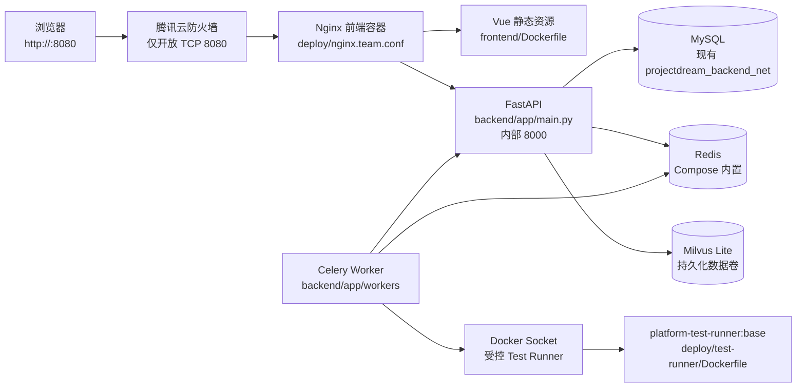
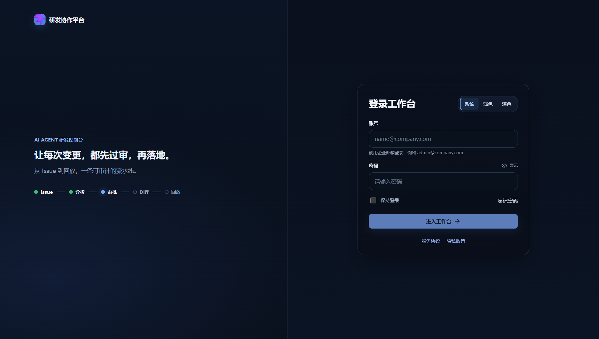

# DEV-096 团队版云部署源码与上线准备

> 文档类型：团队版云部署开发记录  
> 核实日期：2026-09-12  
> 当前状态：已完成腾讯云真实部署与基础上线验收

## 1. 功能目标与范围

本次把团队版从本地启动形态整理为可在单台 Ubuntu 云服务器上部署的 Docker Compose 形态，覆盖：

- 后端、前端生产镜像；
- Nginx 统一公网入口；
- 复用现有 MySQL 网络的独立业务库；
- Compose 内置轻量 Redis；
- 持久化 Milvus Lite 文件；
- Celery Worker 与 Docker Runner；
- 健康检查、启动失败保护和资源限制；
- 团队版环境变量、构建、启动、验收、备份和回滚说明。

本次不包含：

- 不停止或覆盖现有 `8002` 服务；
- 不删除任何本地数据卷或旧部署；
- 不代替用户修改腾讯云防火墙；
- 未伪造云端真实运行截图。

## 2. 部署拓扑



公网只暴露 `8080`。后端、Worker、MySQL、Redis、Milvus 不直接暴露公网端口。

## 3. 关键源码与配置

| 文件 | 职责 |
| --- | --- |
| `backend/Dockerfile` | Python 3.12 后端镜像、uv 依赖安装、非 root 运行 |
| `frontend/Dockerfile` | Vue 构建与 Nginx 运行时多阶段镜像 |
| `deploy/docker-compose.team.yml` | 团队版服务、Redis、网络、卷、资源和健康检查 |
| `deploy/nginx.team.conf` | SPA fallback、`/api/` 反向代理和上传限制 |
| `deploy/backend-entrypoint.sh` | 团队/生产密钥、MySQL、Redis、Milvus 配置启动校验 |
| `backend/app/db/bootstrap.py` | 启动时恢复部署级 Gitee Token，过滤演示占位 Token |
| `backend/app/db/reads.py` | 按当前运行时 Token 状态返回仓库 Token 配置状态 |
| `backend/app/main.py` | `/api/health` 依赖探活和生产启动恢复 |
| `backend/app/services/test_runner.py` | 测试容器隔离、资源限制、只读文件系统和网络策略 |
| `deploy/test-runner/Dockerfile` | 预装通用测试依赖的受控 Runner 镜像 |
| `deploy/env/team.env.example` | 团队版配置模板，不包含真实密钥 |

## 4. Runner 安全策略

团队版默认：

```env
TEST_RUNNER_MODE=docker
TEST_RUNNER_NETWORK=none
TEST_RUNNER_INSTALL_MODE=image
TEST_RUNNER_CPUS=0.50
TEST_RUNNER_MEMORY=384m
TEST_RUNNER_PIDS_LIMIT=128
```

Runner 使用 `--read-only`、`--cap-drop ALL`、`no-new-privileges`、PID/CPU/内存限制和临时文件系统。默认不允许测试容器联网，也不在线安装依赖；依赖应预装进 `platform-test-runner:base`。

临时需要安装被测仓库依赖时，必须显式设置：

```env
TEST_RUNNER_INSTALL_MODE=auto
TEST_RUNNER_NETWORK=bridge
```

依赖会安装到 `/tmp/runner-packages`，不会写入只读系统目录。该模式只适合受控联调，不建议作为公网生产默认值。

## 5. 云服务器约束

目标服务器：

| 项目 | 当前值 |
| --- | --- |
| 公网 IP | `<YOUR_SERVER_IP>` |
| 系统 | Ubuntu x86_64 |
| 内存 | 约 1.7 GiB |
| Swap | 约 1.9 GiB |
| 磁盘 | 50 GiB，可用约 36 GiB |
| Docker | 27.5.1 |
| Compose | v2.32.4 |

当前已知端口：

- `22`：已开放，用于 SSH；
- `8002`：已有旧应用占用，不停止、不覆盖；
- `8080`：团队版新入口，已在腾讯云防火墙开放；
- `80/443`：当前未开放，后续绑定域名和 HTTPS 时再启用。

## 6. 首次部署

在服务器执行：

```bash
cd /opt
git clone <repository-url> enterprise-ai-agent
cd enterprise-ai-agent

cp deploy/env/team.env.example deploy/env/team.env
chmod 600 deploy/env/team.env
```

编辑 `deploy/env/team.env`，至少替换：

- `DATABASE_URL`
- `CELERY_BROKER_URL`
- `CELERY_RESULT_BACKEND`
- `REDIS_URL`
- `REALTIME_REDIS_URL`
- `MILVUS_URI`（当前单机默认使用 `/var/lib/agent/data/milvus/code_index.db`）
- `AUTH_JWT_SECRET`
- `AUTH_RECOVERY_CODE`
- `FRONTEND_CORS_ORIGINS`
- `PUBLIC_BASE_URL`
- `GITEE_TOKEN`、LLM 和 Embedding Key

生成密钥示例：

```bash
openssl rand -hex 32
openssl rand -base64 32
```

确认 Docker Socket GID：

```bash
stat -c '%g' /var/run/docker.sock
```

把结果写入 `DOCKER_GID`，然后构建 Runner 镜像：

```bash
docker build -f deploy/test-runner/Dockerfile -t platform-test-runner:base .
docker compose --env-file deploy/env/team.env -f deploy/docker-compose.team.yml config --quiet
docker compose --env-file deploy/env/team.env -f deploy/docker-compose.team.yml up -d --build
```

## 7. 健康检查与验收

```bash
docker compose --env-file deploy/env/team.env -f deploy/docker-compose.team.yml ps
docker compose --env-file deploy/env/team.env -f deploy/docker-compose.team.yml logs --tail=200 backend worker frontend
curl -fsS http://127.0.0.1:8080/health
curl -fsS http://127.0.0.1:8080/api/health
```

通过标准：

- `frontend`、`backend`、`worker` 均为运行状态；
- `/health` 返回 `ok`；
- `/api/health` 中 `db`、`redis`、`milvus` 在团队环境为 `ok`；
- 浏览器可访问 `http://<YOUR_SERVER_IP>:8080`；
- 登录、项目配置、任务列表、索引、审批、测试和回放至少各走一条真实链路；
- Runner 能执行一条白名单测试命令，并记录真实 `exit_code/stdout/stderr/duration`。

## 8. 更新与回滚

更新：

```bash
git pull --ff-only
docker build -f deploy/test-runner/Dockerfile -t platform-test-runner:base .
docker compose --env-file deploy/env/team.env -f deploy/docker-compose.team.yml up -d --build
```

回滚前先保留当前镜像和数据库备份，再切换到已验证的 Git 提交：

```bash
git log -5 --oneline
git checkout <verified-commit>
docker compose --env-file deploy/env/team.env -f deploy/docker-compose.team.yml up -d --build
```

不执行 `down -v`，避免删除业务数据卷。

## 9. 备份与资源检查

```bash
df -h
free -h
docker system df
docker stats --no-stream
```

MySQL 备份示例：

```bash
mysqldump --single-transaction --routines --triggers \
  -h <mysql-host> -u <mysql-user> -p agent_team > agent_team-$(date +%F).sql
```

备份文件必须转存到服务器外部位置，不与应用磁盘共存。Milvus 按实际部署形态执行 Standalone 快照或集合备份。

## 10. 测试与当前验收结果

源码和配置验证：

| 项目 | 结果 |
| --- | --- |
| Runner 定向测试 | `18 passed` |
| RAG、DB、Runner 定向测试 | `43 passed` |
| 前端全量测试 | `219 passed` |
| 前端生产构建 | 通过 |
| Compose 静态解析 | 通过 |
| Python `compileall` | 通过 |
| 本机 Docker 镜像构建 | 未执行，Docker daemon 当前未启动 |
| 腾讯云后端镜像构建 | 通过 |
| 腾讯云前端镜像构建 | 通过（低内存 Node 堆配置） |
| 数据库迁移 | 通过，`agent_team` 独立数据库 |
| `/health` | 通过，返回 `ok` |
| `/api/health` | 通过，DB、Redis 正常；Milvus Lite 使用持久化文件 |
| Celery Worker | 通过，已连接 Redis 并完成运行时初始化 |
| 角色登录 | 通过，管理员、开发者、审批人、负责人、观察者均返回 200 |
| 已登录页面路由 | 通过，工作台、任务、需求、审批、索引页面可渲染 |
| 公网入口 | 通过，`http://<YOUR_SERVER_IP>:8080` |
| 腾讯云真实部署 | 已完成，四个 Compose 服务运行正常 |
| `health-middle` 真实 Gitee 索引 | 通过，`main` 分支、12 个文件、12 个代码切片写入索引 |
| `health-middle` 真实 RAG 检索 | 通过，任务上下文返回 5 条 `source=hybrid` 结果，`fresh=true` |
| 异步测试开始事件修复 | 已完成，Worker 先落 `running` 记录并写入 `TEST_RUN_STARTED`，随后原地更新同一条记录 |
| 云端异步测试回归 | 通过，`TASK-8806` 第 2 次尝试由 Redis Worker + Docker Runner 执行，`exit_code=0`，事件含 `TEST_RUN_STARTED`、`TEST_RUN_PASSED` |

本轮真实 RAG 验收记录：


| 项目 | 结果 |
| --- | --- |
| 仓库 | `yang-zhizemin/health-middle` |
| 分支 | `main` |
| 索引 ID | `idx_59b929b09a1b` |
| Commit | `73e7e5497addc74f67fe49a875d7afdd8d8c190b` |
| 索引状态 | `COMPLETED` |
| 文件/切片 | `12 / 12` |
| 检索任务 | `TASK-8806` |
| 检索结果 | `5` 条，`source=hybrid`，`fresh=true` |

本轮修复了三个真实问题：

1. API 检索不再依赖 Worker 无法同步的进程内 `CODE_CHUNKS` 缓存，改从 DB 真源读取；
2. 同 Commit 重建后，任务不再继续使用已被切片迁移为空的旧关联索引；
3. 团队版云端补齐 `hybrid + rerank` 运行配置，关闭默认 Query Expansion。

剩余上线前工作：

- 当前 RAG 评测集仍只有 6 条绑定样本，需要用云端目标版本扩充到 50～100 条；
- 仍需完成大仓库索引、并发任务和 Docker Runner 峰值压测；
- 仍需接入 HTTPS，并将 `AUTH_COOKIE_SECURE` 改为 `true`；
- 当前 Milvus 为本机持久化 Lite，扩容后再切换独立 Milvus 服务。

### 10.1 异步 Worker 测试执行回归

2026-09-12 修复了异步 Worker 与同步接口行为不一致的问题。修复前，Worker
直接在执行结束后新增终态记录，导致时间线缺少 `TEST_RUN_STARTED`；修复后：

1. Worker 开始执行前创建一条 `running` 测试记录；
2. 持久化 `TEST_RUN_STARTED`；
3. 测试完成后原地更新该记录的状态、退出码、输出、耗时和结束时间；
4. 追加 `TEST_RUN_PASSED`、`TEST_RUN_FAILED` 或 `TEST_RUN_UNAVAILABLE`。

真实云端回归记录：

| 项目 | 结果 |
| --- | --- |
| 任务 | `TASK-8806` |
| 第 2 次尝试 | `TEST-8806-2` |
| 队列 | Redis/Celery |
| Runner | Docker |
| 退出码 | `0` |
| 时间线 | `TEST_RUN_STARTED → TEST_RUN_PASSED` |
| 重复记录 | 无，本次仅新增 1 条 attempt 记录 |

对应源码和测试：

- `backend/app/main.py`：`execute_task_tests_worker`
- `backend/tests/test_auto_pr_description.py`：Worker 开始/通过事件与单记录回归测试

真实截图：



截图来自 `http://<YOUR_SERVER_IP>:8080` 的真实运行页面，采集日期为 2026-09-12。

## 11. 联调注意点

1. `team.env` 的 MySQL 地址使用 Compose 外部网络中的实际服务名；不能把容器内的 `127.0.0.1` 当作 MySQL 地址。
2. 当前 1.7 GiB 云主机使用 Compose 内置 Redis 和 Milvus Lite；扩容后可切换到独立私网服务。
3. `AUTH_COOKIE_SECURE=false` 只适用于当前 HTTP 验收；配置 HTTPS 后必须改为 `true`。
4. Worker 访问 Docker Socket 依赖 `DOCKER_GID`，GID 不匹配时测试执行会不可用。
5. `TEST_RUNNER_IMAGE` 必须存在于宿主 Docker daemon，Compose 不会自动构建该镜像。
6. Runner 工作区必须位于 `DATA_DIR/runner-workspaces`，并通过 `TEST_RUNNER_HOST_DATA_DIR` 映射到宿主机；否则 Docker daemon 会挂载空目录，测试会误报源码不存在。
7. 低内存服务器不建议同时执行多个大仓库索引；需要观察内存和 Swap。
8. 数据库迁移由单个应用进程执行，Worker 只检查 schema，不并发执行迁移；Worker 同时加入 `data` 和 MySQL 外部网络。
9. `down` 不带 `-v`；任何删除数据卷的操作都必须单独确认。
10. 仓库 Token 明文不落库；团队版必须通过 `GITEE_TOKEN` 或项目配置注入真实 Token，演示占位 Token 不会被发送到 Gitee。

## 12. 复盘

- 做得好的地方：把部署端口、依赖、Runner 安全边界和失败启动条件写成可验证配置。
- 需要加强的地方：当前服务器资源较小，仍需真实压测索引和 Runner 峰值。
- 下一步重点：扩充目标仓库评测集，再完成 Runner 压测和 HTTPS 域名接入。
