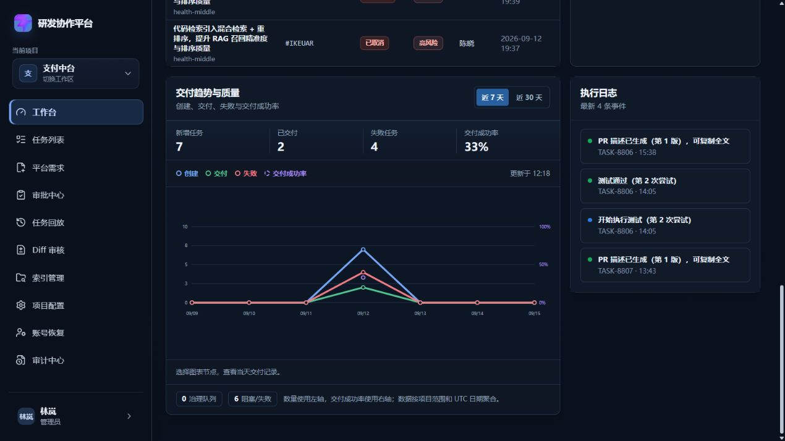
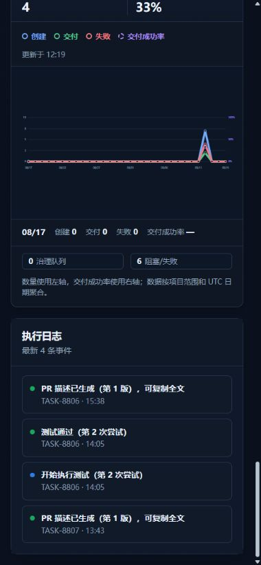
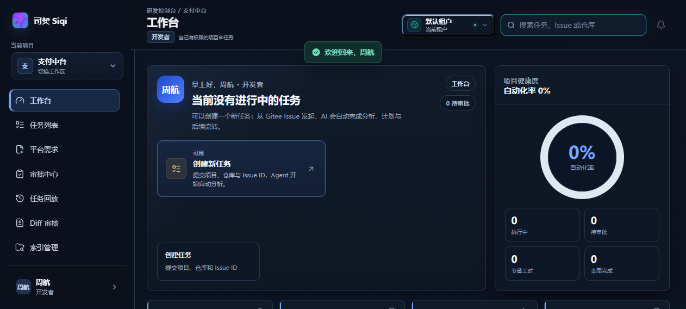
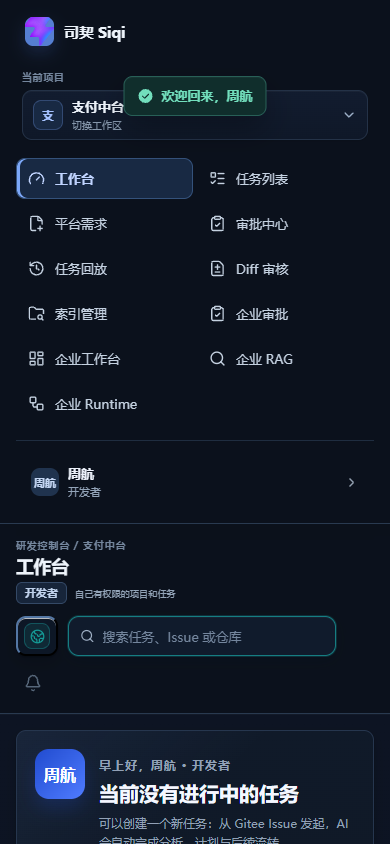

# DEV-097 工作台交付趋势与质量

> 文档类型：团队版研发交付趋势能力、真实云端发布与验收记录
> 核实日期：2026-09-15
> 当前状态：已完成本地回归、云端发布和公网交互验收

## 1. 功能目标与范围

将旧版“创建/完成柱状图”升级为研发负责人可直接判断交付质量的趋势面板：

- 支持 `近 7 天` 与 `近 30 天` 真实数据切换；
- 同时呈现新增任务、已交付任务、失败任务和交付成功率；
- 数量使用左轴，成功率使用右轴，避免把不同量纲混在一起；
- 图例可单独显隐，节点可鼠标悬浮或键盘聚焦查看当天数据；
- 明确“按项目范围、UTC 日期聚合”的数据口径；
- 具备加载、错误、空数据与移动端状态。

本次涉及 Dashboard 摘要 API 与前端展示，不修改任务状态流转、数据库结构、Redis、Milvus 或 Worker 执行路径。

## 2. 业务流程

```mermaid
flowchart LR
    A[时间范围切换<br/>DashboardView.vue] --> B[GET /api/dashboard/automation-summary?days=7|30]
    B --> C[main.py 按项目与 UTC 日期聚合<br/>created / done / failed / successRate]
    C --> D[workspace.ts 归一化并写入 Pinia]
    D --> E[DashboardView.vue 双轴 SVG 折线图]
    E --> F[图例显隐、节点键盘聚焦、当天详情]
    F --> G[style.css 深浅主题与 <= 920px 响应式布局]
```

## 3. 关键实现

### 3.1 API 与数据口径

`GET /api/dashboard/automation-summary` 新增 `days`，仅允许 `7` 或 `30`；`days=14` 返回 `422`。每个趋势点返回：

```text
date / created / done / failed / successRate
```

`successRate = done / (done + failed)`；当天没有已解决任务时返回 `null`，前端显示 `—`，不伪造 0%。

### 3.2 前端交互

- `DashboardView.vue` 根据左轴最大值和右轴 0-100% 分别计算 SVG 坐标；
- 图例按钮以 `aria-pressed` 表示显示状态，支持关闭任一指标；
- 趋势节点可 `hover`、`focus` 或按 Enter 查看当天详情；
- `workspace.ts` 为老数据和 mock 数据提供兼容归一化，真实模式请求带 `days` 参数；
- `style.css` 提供深浅主题、可见 focus、加载骨架、错误/空状态与移动端单列布局。

## 4. 源码位置

| 文件 | 职责 |
| --- | --- |
| `backend/app/main.py` | 聚合趋势数据、校验 `days`、返回 `trendDays` 与 `generatedAt` |
| `backend/tests/test_dashboard_summary.py` | 30 天、失败数、成功率和接口字段测试 |
| `frontend/src/types/domain.ts` | 趋势数据模型与 `DashboardTrendDays` 类型 |
| `frontend/src/stores/workspace.ts` | API 请求、趋势归一化和 Pinia 写入 |
| `frontend/src/views/DashboardView.vue` | 时间切换、SVG 双轴折线、图例与节点详情 |
| `frontend/src/style.css` | 图表、状态、深浅主题与移动端样式 |
| `frontend/src/views/__tests__/DashboardView.spec.ts` | 图表、右轴标签、图例交互测试 |
| `frontend/src/stores/__tests__/workspace.spec.ts` | `days=30` 请求契约测试 |

## 5. 联调注意点

1. 查询始终受当前项目范围约束；日期以 UTC 聚合，避免浏览器本地时区改变历史点归属。
2. 趋势图暂无“按日期下钻任务列表”，因为任务列表当前没有日期筛选 URL/API 契约；不能用不可用跳转伪装交互。
3. Worker 未重建：本次未触及 Worker 调用路径；后端与前端已重建，Redis 和数据卷保持不动。
4. 生产前端由 Nginx 提供，`/api/` 仍反向代理至后端；不要在前端写死服务器地址。

## 6. 验收结果

### 6.1 本地

| 项目 | 结果 |
| --- | --- |
| 后端摘要测试 | `2 passed` |
| 前端趋势定向测试 | `24 passed` |
| 前端全量测试 | `25 files / 224 passed` |
| 前端生产构建 | 通过 |
| `git diff --check` | 通过，无 whitespace error |

### 6.2 云端

部署目录：`/home/ubuntu/enterprise-ai-agent-20260914`

| 项目 | 结果 |
| --- | --- |
| Compose 配置校验 | 通过 |
| 后端镜像重建与健康检查 | `healthy` |
| 前端镜像重建与健康检查 | `healthy` |
| Redis 与 Worker | 保持运行，Redis `healthy` |
| `/health`、`/api/health` | HTTP `200` |
| 登录态 `days=7` | 7 个趋势点，字段完整 |
| 登录态 `days=30` | 30 个趋势点，字段完整 |
| 非法 `days=14` | HTTP `422` |
| 30 天切换、图例显隐、键盘节点详情 | 真实公网通过 |
| 390px 移动端 | 页面无横向溢出；图表 `346px = scrollWidth` |
| 浏览器控制台 | 0 个 error |

本次发布前备份：

```text
/home/ubuntu/enterprise-ai-agent-20260914/.deploy-backups/delivery-trend-20260915-121135/
```

### 6.3 真实运行截图

桌面端趋势图：



390px 移动端趋势图：



## 7. 回滚

如需回滚，先从本次备份恢复以下文件，再只重建受影响服务：

```text
backend/app/main.py
backend/tests/test_dashboard_summary.py
frontend/src/types/domain.ts
frontend/src/stores/workspace.ts
frontend/src/stores/__tests__/workspace.spec.ts
frontend/src/views/DashboardView.vue
frontend/src/views/__tests__/DashboardView.spec.ts
frontend/src/style.css
```

```bash
cd /home/ubuntu/enterprise-ai-agent-20260914
docker compose --env-file deploy/env/team.env -f deploy/docker-compose.team.yml up -d --build backend
docker compose --env-file deploy/env/team.env -f deploy/docker-compose.team.yml up -d --build frontend
```

未执行 `docker compose down -v`，不会删除业务数据卷。

## 8. 复盘

- 做得好：指标从单纯任务数量升级为可解释的交付质量口径，并完成 API、交互、移动端和云端全链路验收。
- 仍可增强：补齐任务列表的日期筛选契约后，可增加趋势节点到当天任务的可追溯下钻。

## 9. 2026-10-20 本地可访问性与空态复核

在隔离本地演示环境复核 `/dashboard` 后补齐最近任务表空态行；趋势摘要、趋势图例、角色操作摘要、趋势时间筛选均以具名 `group` 暴露给辅助技术。浏览器 axe-core 4.12.1 最终明确违规 0，剩余 1 组颜色对比 `incomplete` 是顶栏渐变背景导致工具无法自动计算，不等同于已验证通过；租户切换器“当前租户”文字经人工修正后复测无明确对比违规。390px 下 `scrollWidth=390`，无横向溢出。

测试证据：`frontend/src/views/__tests__/DashboardView.spec.ts` 5 passed；前端全量 272 passed；`npm run build` 通过；Impeccable detector 对 `DashboardView.vue` 0 项发现。截图来自本地隔离演示登录后的真实页面，不是云端/生产截图：




