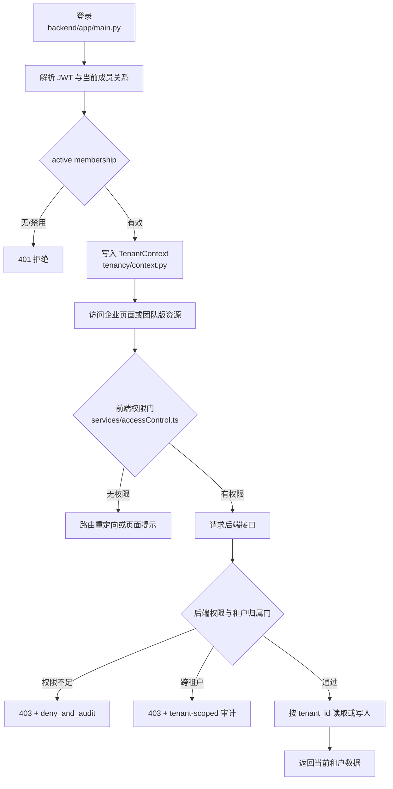

# E1-01 企业多租户与 RBAC 收口记录

> 文档类型：企业版功能开发与验收记录  
> 核实日期：2026-09-15  
> 当前状态：本地代码、测试和文档已完成；本轮增量云端发布与 auditor 浏览器走查待执行  
> 详细设计：[E1-01 多租户 / 组织成员 / RBAC / 项目隔离](../enterprise/10-e1-01-tenant-permission.md)

## 1. 功能目标与范围

E1-01 为团队版增加企业级租户边界和权限能力，同时保持默认租户下既有团队版链路可用。

本次收口覆盖：

- 服务端从会话解析激活租户，不信任前端传入的 `tenant_id` 或 `X-Tenant-Id`；
- 项目、仓库、任务、团队需求、索引、检索记录和审计事件按租户隔离；
- 企业角色 `tenant_owner`、`tenant_admin`、`security_admin`、`project_owner`、
  `developer`、`reviewer`、`auditor`；
- 审计列表由团队 `project:manage` 或企业 `audit:view` 任一权限放行；
- 前端路由、侧栏和审计页面与后端权限口径一致；
- 越权拒绝审计事件显式保留当前租户归属。

范围外：SSO/LDAP、MFA、ABAC、计费、部门树 UI、成员 removed 端点、RLS/物理分库和
worker 全链路租户上下文传递。

## 2. 业务主链路

## 3. H1 问题与修复

### 3.1 原问题

企业权限矩阵为 `auditor` 授予 `audit:view`，但审计列表接口原先只消费团队版
`project:manage`。因此企业 auditor 后端实际无法访问 `/api/audit-events`，形成“权限已配置、
接口未消费”的死权限。

### 3.2 修复结果

- `backend/app/main.py`
  - 新增 `require_audit_view(user)`；
  - 团队管理员沿用 `project:manage` 放行；
  - 企业 auditor、安全管理员、租户管理员和租户所有者通过 `audit:view` 放行；
  - developer/reviewer 无任一权限时返回 403；
  - 审计列表继续使用 `tenant_id=current_tenant_id()` 过滤。
- `backend/app/tenancy/context.py`
  - `deny_and_audit()` 显式写入 `tenant_id=ctx.tenant_id`；
  - 成员操作审计同样写入当前租户，避免落入 `tenant_default`。
- 前端
  - `/audit` 使用 `project:manage` 或 `audit:view`；
  - `/enterprise/members` 使用 `project:manage` 或 `member:view`；
  - 路由守卫、AppShell 导航和审计页加载统一复用 `hasAccessRequirement()`。

## 4. 关键源码位置

| 文件 | 作用 |
| --- | --- |
| `backend/app/main.py` | `require_audit_view`、审计列表接口、会话租户解析 |
| `backend/app/tenancy/context.py` | 租户上下文、跨租户拒绝、租户审计归属 |
| `backend/app/tenancy/permissions.py` | 企业角色权限矩阵 |
| `backend/app/tenancy/routes.py` | 租户、成员、组织接口 |
| `backend/app/db/reads.py` | `tenant_id` 读层过滤 |
| `frontend/src/services/accessControl.ts` | 团队/企业权限任一满足判断 |
| `frontend/src/router/index.ts` | 页面路由权限门 |
| `frontend/src/components/AppShell.vue` | 侧栏企业入口权限门 |
| `frontend/src/views/AuditCenterView.vue` | 审计页面加载权限和错误状态 |
| `backend/tests/test_enterprise_e1_tenancy.py` | E1-01 后端隔离、RBAC 和审计归属测试 |
| `frontend/src/views/__tests__/AuditCenterView.spec.ts` | 审计页企业权限回归 |
| `frontend/src/components/__tests__/AppShell.spec.ts` | 企业角色导航入口回归 |

## 5. 接口与权限验收矩阵

| 场景 | 团队权限 | 企业权限 | 预期 |
| --- | --- | --- | --- |
| admin 访问审计 | `project:manage` | 任意 | 200 |
| auditor 访问审计 | 无 | `audit:view` | 200 |
| developer 访问审计 | 无 | 无 | 403 |
| auditor 打开 `/audit` | 无 | `audit:view` | 前端路由通过并加载数据 |
| 普通成员打开 `/audit` | 无 | 无 | 隐藏入口/重定向，不发起审计请求 |
| auditor 打开成员页 | 无 | `member:view` | 只读成员列表 |
| 跨租户访问资源 | 任意 | 当前租户不匹配 | 403，并写当前租户审计 |

## 6. 测试与证据

### 6.1 本地测试

| 测试项 | 结果 |
| --- | --- |
| E1-01 后端专项 | `9 passed`（H1 原始验收为 `8 passed`，后续增加租户归属回归） |
| 迁移升级测试 | `4 passed` |
| 后端全量回归 | `539 passed, 16 skipped` |
| 审计页定向测试 | `6 passed` |
| 审计页 + AppShell 权限测试 | `17 passed` |
| 前端全量 Vitest | `232 passed` |
| `vue-tsc -b` | 通过 |
| `vite build` | 通过 |
| `git diff --check` | 通过 |

### 6.2 真实页面截图

E1-01 既有真实联调截图：

- [工作台租户 chip](../enterprise/assets/e1-01/e1-01-dashboard-tenant.png)
- [租户切换下拉](../enterprise/assets/e1-01/e1-01-tenant-switcher.png)
- [默认租户成员页](../enterprise/assets/e1-01/e1-01-members-default.png)
- [TenantB 成员隔离视图](../enterprise/assets/e1-01/e1-01-members-tenantB.png)

审计中心既有真实页面截图：

- [审计中心列表](assets/screenshots/audit-center-list.png)
- [任务审计详情](assets/screenshots/audit-center-task-detail.png)

这些截图证明既有页面真实运行过；本轮新增的企业 auditor 浏览器走查尚未完成，
因此不把本轮云端验收标记为完成。

## 7. 联调与发布注意点

1. 本地联调需要先登录，再请求 `/api/enterprise/tenant-context` 获取服务端上下文。
2. 前端切租户必须调用 `/api/enterprise/tenant-context/switch`，不能本地伪造当前租户。
3. 云端发布前需要备份当前前端构建和相关配置，不执行 `docker compose down -v`。
4. 发布后至少验证：
   - `/health` 和 `/api/health`；
   - admin 审计访问；
   - auditor 审计访问；
   - developer 审计 403；
   - 切换租户后审计列表和成员列表不串租户。

## 8. 残余风险

- 应用层隔离仍依赖后端读写门，尚未采用数据库 RLS/分区/物理分库。
- worker 无请求上下文时仍可能按默认租户写入，后续需要传递显式租户上下文。
- 多副本租户上下文同步和审计广播尚未补齐。
- 成员“移除”当前以禁用为主，没有独立 removed 端点。
- **云端 auditor 浏览器走查已完成（本轮）**：见 §10；按“真实浏览器 + 真实公网部署”取证，未用单测/静态审查冒充。剩余未覆盖：多副本并发压测与长期稳定性。

## 9. 复盘

- 这次修复的关键不是只改接口，而是让权限矩阵贯通后端接口、前端路由、导航和页面加载。
- 审计事件本身也必须带租户归属，否则拒绝记录会污染默认租户审计视图。
- `E1-01-CLOUD-01` 云端增量发布与真实 auditor 角色走查已在本轮完成，见 §10。

## 10. 云端 auditor 角色走查（E1-01-CLOUD-01 真实验收）

**部署环境**：腾讯云 `<YOUR_SERVER_IP>`（2 vCPU / 1.7 GB RAM，可用约 500 MB）。主机已跑 团队版 `agent-team`(8080)、`projectdream`、`healthguard-commercial` 等生产栈，容量吃紧。按 **应用-only** 方案新增 `deploy/docker-compose.enterprise.apponly.yml`（backend + redis + frontend，**不含 worker / Milvus/etcd/MinIO**），独立 project 名 `agent-enterprise`、网络、数据卷、`APP_ENV=enterprise`、公网 `8081`，与团队版完全隔离，不动现有 8080。

- 代码/配置同步到 `/home/ubuntu/enterprise-ai-agent-e101/`；DB 在项目自带 MySQL(`projectdream-mysql-1`)独立库 `agent_enterprise` 与最小权限用户；凭据（JWT/恢复码/DB 密码）在**服务端生成、留在服务端 `deploy/env/enterprise.env`（0600）**，不入库、不打印。
- 镜像在本地构建（`agent-enterprise-backend` / `agent-enterprise-frontend:latest`），`docker save | scp | docker load` 送达云端后 `docker compose up -d`。

### 10.1 阶段 I：联系发现并修复 MySQL 迁移缺陷（真实环境才暴露）
企业后端首次启动在 MySQL 迁移 `a1b2c3d4e5f6`（企业多租户表）失败并重启循环。日志无 traceback，借助一次性迁移容器拿到真实错误：
`OperationalError 1101 "BLOB, TEXT, GEOMETRY or JSON column 'description' can't have a default value"`。
根因：局部 SQLite 测试允许 `TEXT ... DEFAULT ''`，MySQL 不允许。修复 `a1b2`（tenants/organizations.description）与 `b3c4d5e6f708`（approval_applications.reason）去掉 TEXT 的 `server_default`（存储层创建时总是显式写入 description/reason，删除默认值安全）；`test_migrations_upgrade.py` 4 passed 回归通过；重建镜像并重发，迁移全部落到 HEAD、`alembic_version` 正常。**这正说明真实 MySQL 云端验证的必要性。**

### 10.2 阶段 II：云端栈状态与健康
| 项 | 结果 |
| --- | --- |
| 企业栈 `docker compose ps` | backend / redis / frontend 均 **healthy**；无 Milvus 容器（app-only 生效） |
| 公网 `/health`（8081） | **200** |
| 公网 `/api/health`（8081） | **200**，dependencies：db ok / redis ok / milvus=skipped(use_milvus=false) |
| 团队版 `/health`、`/api/health`（8080） | **均 200**，团队链路未受影响 |

### 10.3 阶段 III：auditor 角色 API 级 RBAC（对真实云端企业栈）
| 检查 | 结果 |
| --- | --- |
| 登录 `observer@company.com / Observer123!` | 成功，`role=observer`→企业 `auditor` |
| `GET /api/enterprise/tenant-context` | active_tenant=`tenant_default`，`role=auditor`／`审计人员`，`permissions=[approval:view, audit:view, member:view, org:view, tenant:context, tenant:switch]`（**无 approve/manage/governance**） |
| `GET /api/audit-events` | **200**（`audit:view` 生效） |
| `POST /api/enterprise/members`（加成员，越权） | **403 「无权执行该操作」**，且该拒绝被写入 `tenant.tenant.denied` 审计事件 |
| 未登录 `GET /api/audit-events` | **401** |

### 10.4 阶段 IV：真实浏览器（Edge/Chromium）auditor 走查
用真实浏览器驱动（Playwright，headless Edge 真实点击，非单测/静态审查）访问公网 `http://<YOUR_SERVER_IP>:8081`：
- 登录页 → 以 auditor 登录 → 落在 `/dashboard`；
- 进入 `/audit` 审计中心 → 标题「审计中心」、租户芯片「默认租户」、`2 条审计事件 / 1 条风险事件`，表格可见：
  - `PROJECT_CREATED`（林岚/user_admin，创建「Audit-Evidence-Demo」）+ 
  - `tenant.tenant.denied`（user_observer，`缺少租户权限 ... action=tenant.permission.member:manage`，**即 auditor 越权被拒并且被审计留痕**）。
- 截图存证：`docs/project-development/assets/e101/e101_01_login.png`、
  `e101_02_after_login.png`、`e101_03_audit_center.png`、`e101_04_api_health.png`（真实渲染结果）。

### 10.5 诚实边界（未被本轮覆盖，不写成完成）
- 本轮为 **应用-only** 云端栈，未含企业 Milvus/多副本 worker；企业 RAG 云端检索与多副本并发执行仍待另验。
- 未做多副本并发压测、HTTPS、备份恢复/回滚演练——（承担该生产主机资源有限，仅足以支撑 auditor 走查）。
- 浏览器截图来自真实 headless Chromium 对公网部署的渲染；模型无法内联显示 PNG，故正文文字摘录以佐证页面内容。
