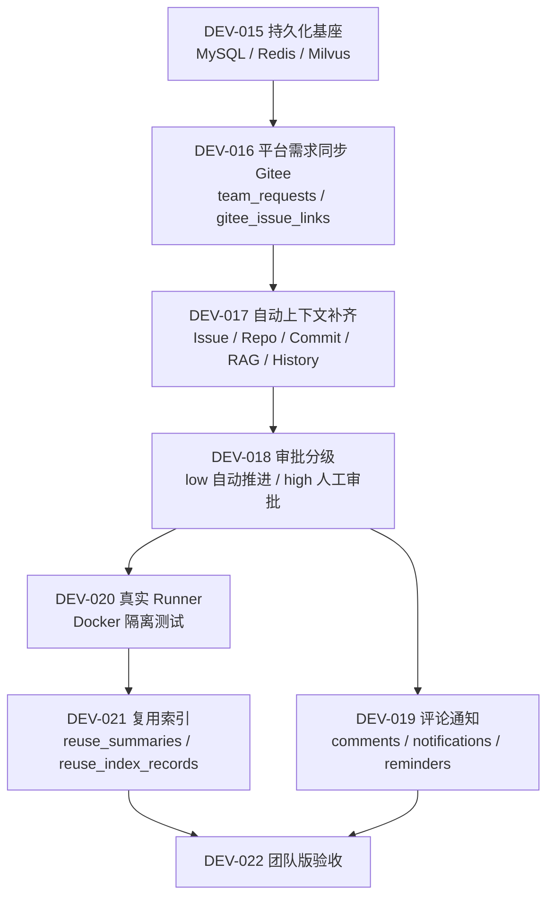

# 团队版开发计划

## 1. 文档定位

本文档用于把团队版 PRD 拆成可执行开发阶段。团队版从 MVP v0.1 内测基线继续，不重写主链路，优先补真实团队落地所需的持久化、协作、同步、自动分级和执行能力。

## 2. 推进原则

- 先保证数据不丢，再扩大自动化能力。
- 先接通 Gitee 单平台闭环，再扩展多平台。
- 先让低风险任务自动流转，再处理复杂审批策略。
- 先沉淀历史任务复用摘要，再让 RAG 检索使用历史经验。
- 每个阶段都必须同步 PRD、API、开发记录和真实截图。

## 3. 阶段拆分

| 阶段 | 模块 | 目标 | 交付物 |
| --- | --- | --- | --- |
| DEV-015 | 团队版持久化基座 | 将 MVP 内存态迁移到 MySQL/Redis/Milvus | 数据模型、迁移脚本、Repository 层、服务重启不丢数据验收 |
| DEV-016 | 平台需求与 Gitee Issue 同步 | 支持平台内创建需求/缺陷并同步到 Gitee | `REQ-*` 草稿、Gitee 映射、同步失败重试、审计事件 |
| DEV-017 | 自动上下文补齐 | 创建任务后自动抓 Issue、仓库、Commit、代码上下文和历史回放 | 上下文聚合接口、索引过期自动重建、空 Issue 转人工补充 |
| DEV-018 | 审批分级与自动推进 | 低风险自动推进，高风险/异常进入人工 | 自动分级规则、`AUTO_APPROVED` 事件、审批中心过滤 |
| DEV-019 | 评论、通知与催办 | 团队协作可见、可提醒、可追踪 | 评论、@提醒、通知中心、24 小时催办 |
| DEV-020 | 真实 Docker Runner | 将测试从 mock runner 切到真实容器执行 | 隔离执行、超时、日志、失败重试、环境不可用降级 |
| DEV-021 | 历史任务复用索引 | 已完成任务沉淀为可检索经验 | 复用摘要、历史相似任务、复用索引重建 |
| DEV-022 | 团队版验收与演示 | 跑通团队版端到端业务 | 真实截图、验收报告、部署清单、下一阶段建议 |

## 4. 主链路

## 5. DEV-015 优先级说明

团队版第一步建议先做持久化基座，而不是先做新页面。原因是团队协作会产生多人状态、审批、通知和审计记录，如果仍以内存态运行，服务重启后无法支撑真实使用。

DEV-015 最小验收标准：

- 服务重启后项目、仓库、任务、计划、审批、Diff、测试、PR 描述、回放事件仍可读取。
- Redis 锁替换 MVP 内存锁，覆盖并发创建、并发审批、并发索引。
- Milvus 至少保存代码索引，历史任务复用索引可先保留接口和空实现。
- 敏感配置和 Token 不在 API 响应中回显明文。
- 现有 MVP 自动化测试仍通过。

## 6. Qoder 实现边界

给 Qoder 的实现提示词应按单模块投递，不要一次要求做完整团队版。每次只要求：

- 实现当前 DEV 模块。
- 不破坏 MVP 已验收链路。
- 补后端测试、前端测试和必要文档。
- 跑通真实联调后再补开发文档和截图。

## 7. Claude 验收边界

给 Claude 的验收提示词应要求它只做审查和验收，不直接改代码。重点检查：

- 是否偏离团队版 PRD 和 API 设计。
- 权限、状态流转、审计事件是否完整。
- 异常边界是否有明确错误和恢复入口。
- 自动化测试和真实联调证据是否充分。
- 文档与截图是否和当前实现一致。

## 8. 当前推进状态

| 子阶段 | 模块 | 状态 | 说明 |
| --- | --- | --- | --- |
| DEV-016-A | 平台需求/缺陷草稿创建 | 已完成 | 已支持平台内创建、查看、修改 `REQ-*` 草稿；文档见 `docs/project-development/16-team-request-draft.md` |
| DEV-016-B | Gitee Issue 同步 | 已完成 | 已支持平台草稿同步创建 Gitee Issue，保存映射字段、失败重试和审计回放；文档见 `docs/project-development/17-team-request-sync-gitee.md` |
| DEV-016-C | Agent 任务自动创建 | 已完成 | 已支持已同步需求一键创建 Agent 任务、同步后自动创建开关、任务复用和来源闭环；文档见 `docs/project-development/18-team-request-create-task.md` |
| DEV-017 | 自动上下文补齐 | 已完成 | 已支持任务创建后自动拉 Issue/Commit、索引 fresh 分流与过期自动重建、自动检索代码片段、历史相似任务参考、空检索转 `context_missing` 且补充后恢复；文档见 `docs/project-development/19-team-context-fill.md` |
| 团队 7.5 | AI 分析与修改计划增强 | 已完成 | 已支持分析输入四源（Issue/代码上下文/历史相似任务/项目默认规则）、计划五要素结构化完整性门禁、版本重写上限、风险初判→重算与审批调整可见、历史任务仅参考；文档见 `docs/project-development/20-team-analysis-plan.md` |
