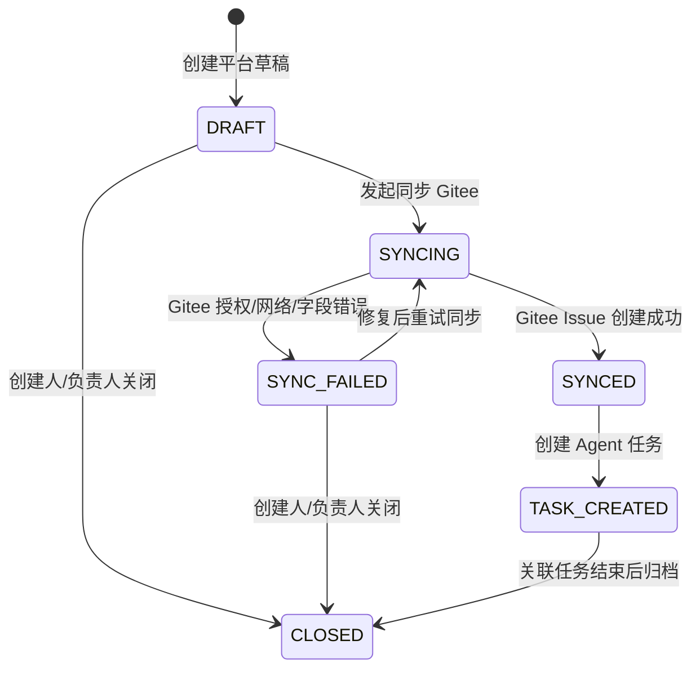

# 团队版 PRD

## 1. 文档定位

本文档定义 MVP 之后的团队版产品需求。团队版以 MVP v0.1 内测基线为基础，不推翻已有的 Issue 分析、RAG、计划、审批、Diff、测试、PR 描述和回放主链路，而是补齐真实团队使用时必须具备的协作、持久化、同步、分级、通知和复用能力。

MVP 的入口是已有 Gitee Issue；团队版要支持用户先在平台内创建需求或缺陷，由平台同步创建 Gitee Issue，再自动创建 Agent 任务并进入闭环。

本文档只写产品行为、业务规则和验收口径。接口细节见 `03-team-api-design.md`，数据、权限和审计见 `04-team-data-permission.md`，开发顺序见 `00-team-development-plan.md`。

## 2. 背景与问题

MVP 已证明单任务链路可跑通，但真实团队使用时还有几个缺口：

- 任务入口依赖外部 Gitee Issue，平台内不能直接创建需求。
- 任务、审批、回放等数据以内存态为主，服务重启后不适合团队协作。
- 低风险任务仍需要人工动作，团队使用时会放大审批噪音。
- 授权过期、索引过期、测试失败、重复任务等异常需要更清晰的恢复入口。
- 已完成任务的分析、Diff、测试和回放没有沉淀成可复用经验。
- 团队角色、通知、评论和催办能力不足，项目负责人难以统筹。

团队版的核心目标是让平台从“单人演示闭环”升级为“3 到 10 人研发团队可真实使用的协作工具”。

## 3. 版本目标

团队版 V0.2 优先达到以下目标：

| 目标 | 说明 |
| --- | --- |
| 平台内创建任务 | 用户在平台填写需求或缺陷，系统同步 Gitee Issue 并创建 Agent 任务 |
| 自动补齐上下文 | Issue、仓库、Commit、相关代码、历史回放和默认配置尽量自动拉齐 |
| 自动分流审批 | 低风险无异常任务自动推进，高风险、敏感、冲突和上下文不足任务交给人 |
| 自动生成产物 | 修改计划、Diff、测试摘要、PR 描述和回放摘要按模板生成 |
| 失败可恢复 | 授权失效、索引过期、测试失败、同步失败、重复任务有明确恢复入口 |
| 任务可复用 | 已完成任务沉淀为历史经验，下次同类问题可作为上下文参考 |
| 团队可协作 | 支持角色、审批人、评论、通知、催办和审计回放 |

## 4. 产品原则

### 4.1 默认自动化

- 自动拉 Issue。
- 自动找上下文。
- 自动复用或重建索引。
- 自动生成计划、Diff、测试摘要、PR 描述和回放摘要。
- 自动记录审计事件。

### 4.2 默认少人工

- 低风险、无敏感文件、命令安全、上下文充足的任务自动推进。
- 人只处理高风险、高影响、权限异常、信息不足、冲突和失败超限任务。
- 人工动作尽量收敛为通过、拒绝、要求重写、补充说明、重试。

### 4.3 默认少操作

- 创建任务只填一个入口。
- 项目、仓库、默认分支、测试命令、审批策略继承默认配置。
- 索引过期自动重建。
- Gitee 同步失败保留草稿，用户只需要修授权或重试。

### 4.4 默认可追溯

- 所有关键状态变化写入 `task_events`。
- Agent 节点输入输出写入 `execution_steps`。
- 自动审批、人工审批、风险调整、失败重试、Gitee 同步、通知催办均可回放。
- 审计日志普通用户不可修改。

## 5. 用户角色

| 角色 | 说明 | 主要诉求 | 核心权限 |
| --- | --- | --- | --- |
| 团队管理员 | 管理团队、项目配置和授权 | 统一配置、安全可控、审计可查 | 成员管理、项目配置、仓库授权、策略配置、审计查看 |
| 项目负责人 | 负责项目交付和任务推进 | 看清任务进度、处理阻塞、减少等待 | 查看项目全部任务、改派审批人、催办、调整策略、查看审计 |
| 开发者 | 创建需求/缺陷并跟进任务 | 少填信息、少重复操作、快速拿到产物 | 创建需求、同步 Issue、补充信息、触发执行、查看本人创建或参与的任务结果 |
| 审批人 | 审核高风险或异常计划 | 快速判断风险，只处理该处理的任务 | 审批、拒绝、要求重写、调整风险、填写意见 |
| 观察者 | 只读查看被授权项目进展 | 了解进展和结果，不参与操作 | 只读查看被授权项目的任务、回放、产物、通知和审计摘要 |

详细权限矩阵以 `04-team-data-permission.md` 为准。

权限口径：开发者默认可查看本人创建、被指派、被 @ 或关注的任务；若项目配置允许“项目内任务可见”，则可查看本项目任务。观察者只能查看被授权项目内的只读信息，不能创建、审批、评论或触发执行。

## 6. 典型场景

### 6.1 开发者平台内创建缺陷

1. 开发者选择项目和仓库。
2. 填写标题、问题描述、复现步骤和验收标准。
3. 平台生成 `REQ-*` 草稿。
4. 用户点击同步 Gitee，系统创建 Gitee Issue 并保存映射。
5. 系统自动创建 Agent 任务，拉取 Issue、仓库和 Commit。
6. RAG 自动找相关代码和历史相似任务。
7. 系统生成分析、计划、Diff、测试摘要和 PR 描述。

成功标准：开发者不需要手动复制 Gitee Issue 链接，也不需要手动找代码上下文。

### 6.2 低风险任务自动流转

1. 系统生成修改计划后重新计算风险。
2. 判断为 low 风险、无敏感文件、命令安全、上下文 fresh、无阻塞问题。
3. 系统写入 `AUTO_APPROVED` 事件。
4. 任务自动进入 Diff 生成阶段。
5. 回放中展示自动推进原因。

成功标准：审批中心不出现这类低风险噪音，但审计里能看到系统为什么放行。

### 6.3 高风险任务进入人工审批

1. 修改计划命中高风险、敏感路径、权限模块、危险命令或上下文不足。
2. 系统分配默认审批人。
3. 审批中心只展示当前用户可审批任务；团队管理员保留全量待审批兜底能力。
4. 审批人查看计划摘要、文件范围、步骤、风险原因和历史调整记录。
5. 审批人选择通过、拒绝或要求重写。

成功标准：人只看需要判断的任务，审批动作有明确署名、意见和时间。

### 6.4 授权过期恢复

1. Gitee API 返回 Token 过期或无权限。
2. 系统将任务或草稿置为 `manual_required=auth_expired`。
3. 页面提示更新授权。
4. 用户更新授权后从失败节点重试。
5. 重试过程写入审计事件。

成功标准：任务不被直接打死，用户能看到为什么失败、该做什么、从哪里继续。

### 6.5 历史任务复用

1. 任务完成后系统生成复用摘要。
2. 摘要包含 Issue 摘要、分析、计划、Diff、测试、PR 描述和回放摘要。
3. 摘要进入历史任务复用索引。
4. 新任务检索上下文时返回相似历史任务。
5. 页面展示历史任务参考，但不自动套用旧 Diff。

成功标准：团队经验被沉淀，新任务能参考旧任务，但不会因为旧 Diff 误改代码。

## 7. 功能需求

### 7.1 平台需求/缺陷创建

功能目标：用户可以在平台内创建需求或缺陷，不再必须先去 Gitee 创建 Issue。

需求项：

- 平台需求类型复用 MVP 任务类型枚举：`demand`、`bug`、`refactor`、`test`、`doc`。
- `demand` 表示新需求或功能增强；不再单独使用 `feature`。
- 禁止使用 `task` 作为平台需求类型，避免和 Agent Task 对象混淆。
- 必填字段：项目、仓库、标题、正文。
- 可选字段：复现步骤、验收标准、优先级、标签、期望分支、测试命令。
- 任务创建时填写的测试命令必须命中项目或仓库命令白名单，否则返回 422；若项目配置允许回退，则自动使用默认测试命令并记录原因。
- 创建后生成内部 `REQ-*` 编号，初始状态为 `DRAFT`。
- 草稿未同步 Gitee 前允许创建人、项目负责人或管理员修改。
- 正文过短时允许保存草稿，但同步或创建 Agent 任务前必须提示补充信息。

验收标准：

- 能创建、查看、修改平台草稿。
- 草稿有明确创建人、创建时间和所属项目。
- 字段校验失败返回 422，并给出中文错误原因。
- 观察者不能创建或修改草稿。

### 7.2 Gitee Issue 同步

功能目标：平台需求可以同步创建 Gitee Issue，并保存平台与 Gitee 的映射关系。

需求项：

- 支持从 `REQ-*` 草稿同步创建 Gitee Issue。
- 同步成功后保存 `gitee_issue_id`、`gitee_issue_number`、`gitee_issue_url`。
- 同步成功后草稿状态变为 `SYNCED`。
- 同步失败时草稿状态变为 `SYNC_FAILED`，保留失败原因。
- 同步失败允许在修复授权或字段后重试。
- 不允许重复同步同一个已成功草稿。
- 同步事件进入回放和审计。

验收标准：

- 同步成功后能从平台跳转到 Gitee Issue。
- 同步失败不丢草稿、不创建 Agent 任务。
- Gitee Token 过期要明确提示重新授权。
- 重复点击同步不会创建多个 Gitee Issue。

### 7.3 Agent 任务自动创建

功能目标：Gitee Issue 同步成功后，系统自动创建或引导创建 Agent 任务。

需求项：

- 已同步 Gitee Issue 可以一键创建 Agent 任务。
- 可配置为同步成功后自动创建 Agent 任务。
- 创建任务时自动绑定项目、仓库、Issue、Commit、创建人。
- 同一仓库同一 Issue 存在未结束任务时返回已有任务。
- 已结束任务允许新建任务版本。
- 空 Issue 或上下文不足不直接失败，进入人工补充。

验收标准：

- 同步成功后能生成 Agent 任务。
- 重复创建返回已有任务和跳转信息。
- 任务详情能看到平台需求、Gitee Issue 和当前 Commit。
- 并发创建同一 Issue 不产生重复未结束任务。

### 7.4 自动上下文补齐

功能目标：任务创建后自动抓齐 Agent 需要的上下文，减少人工翻仓库和翻历史。

需求项：

- 自动拉取 Issue 标题、正文、评论、标签。
- 自动拉取仓库默认分支和最新 Commit。
- 自动判断代码索引是否 fresh。
- 索引缺失或过期时自动创建索引任务。
- 自动检索相关代码片段。
- 自动检索历史相似任务。
- 上下文不足时进入 `manual_required=context_missing`，页面给出补充入口。

验收标准：

- 常规 Issue 创建后无需人工操作即可进入分析。
- 索引过期时系统自动重建，用户能看到等待状态。
- 上下文不足时任务不失败，能补充信息后继续。
- 回放能看到 Issue 拉取、Commit 选择、索引和检索事件。

### 7.5 AI 分析与修改计划

功能目标：沿用 MVP 已完成能力，并补齐团队版默认配置和历史复用输入。

需求项：

- AI 分析输入包含 Issue、代码上下文、历史相似任务和项目默认规则。
- 分析输出包含问题摘要、影响范围、风险初判、阻塞问题。
- 修改计划包含目标、文件范围、步骤、风险、测试建议。
- 修改计划继续支持版本化。
- 要求重写时生成新版本。
- 重写次数达到上限后进入人工终止或新任务版本流程。

验收标准：

- 计划版本可追溯。
- 历史任务参考在分析或计划里可见，但不能直接替代当前判断。
- 风险重算原因和调整记录可见。
- 计划进入审批或自动推进前必须结构化完整。

### 7.6 审批分级与自动推进

功能目标：降低人工审批负担，让审批人只处理异常和高影响任务。

需求项：

- 系统在计划生成后执行二次风险判断。
- 低风险且无异常任务由系统自动推进。
- 高风险、敏感文件、危险命令、上下文不足、模型输出异常进入人工审批。
- 默认审批人来自项目配置，也可以由风险等级规则或项目负责人手动改派。
- 审批中心只展示当前用户可审批任务；团队管理员保留 MVP 的全量可见和兜底审批能力，所有兜底动作必须署名并写入审计。
- 人工审批支持通过、拒绝、要求重写。
- 拒绝和要求重写必须填写意见。
- 风险等级调整必须填写原因。
- 并发审批只接受第一条有效动作。

自动推进必须满足：

- 风险等级为 low。
- 不命中敏感文件。
- 测试命令在白名单内。
- 上下文 fresh。
- 无阻塞问题。
- 模型输出结构完整。

验收标准：

- low 风险任务可自动进入 Diff 阶段，并写入 `AUTO_APPROVED`。
- 不满足任一条件时不得自动推进。
- 审批动作记录审批人、时间、意见、计划版本。
- 普通用户不能修改审批记录。

### 7.7 Diff、测试和 PR 描述自动生成

功能目标：团队版延续 MVP 闭环，同时逐步从演示兜底升级到真实执行。

需求项：

- 审批通过或自动推进后生成 Diff。
- Diff 关联任务、计划版本和执行步骤。
- 测试命令来自项目配置、仓库配置或任务创建时填写。
- 任务创建时填写的测试命令不能绕过安全策略，必须通过命令白名单校验；未命中白名单时返回 422 或按项目策略回退默认命令。
- 团队版默认优先使用真实 Docker Runner。
- Docker Runner 不可用时明确标记为降级或跳过。
- 测试失败不覆盖已有 Diff。
- PR 描述按六段式结构生成。
- Diff 或测试结果变化后支持重新生成 PR 描述。

验收标准：

- 未审批、未自动推进的任务不能生成 Diff。
- 测试记录包含命令、退出码、stdout、stderr、状态和耗时。
- PR 描述可复制，且关联当前计划版本、Diff 和测试结果。
- 降级或模拟产物必须明确标记，不能伪装真实执行。

### 7.8 评论、通知与催办

功能目标：让团队协作发生在任务上下文内，而不是散落在聊天工具里。

需求项：

- 任务详情支持评论。
- 评论可关联计划、Diff、测试记录或回放事件。
- 支持 @ 成员并生成站内通知。
- 任务进入待审批时通知审批人。
- 高风险待审批显示强提示。
- 超过 24 小时未审批时显示催办入口。
- 审批完成后通知任务发起人。
- 通知可标记已读。

验收标准：

- 当前用户只能看到自己有权限的通知。
- 评论修改和删除只允许本人或管理员操作。
- 催办事件写入审计。
- 通知不要求实时推送，MVP 后第一版允许拉取式刷新。

### 7.9 回放摘要与审计

功能目标：团队可以复盘每个任务的完整过程。

需求项：

- 回放聚合 `task_events`、`execution_steps`、检索记录、计划、审批、Diff、测试、PR 描述和评论。
- 回放页支持按时间线查看。
- 失败节点能展开失败原因。
- 自动推进、人工审批、风险调整、同步失败、重试和催办都能看到。
- 自动生成回放摘要，可复制到周报或复盘材料。

验收标准：

- 每个关键节点都有事件。
- 事件与产物可关联。
- 普通用户不能修改审计日志。
- 回放摘要不替代原始审计记录。

### 7.10 历史任务复用索引

功能目标：把已完成任务沉淀为团队知识库。

需求项：

- 任务进入完成态后生成复用摘要。
- 复用摘要包含 Issue 摘要、上下文、分析、计划、Diff 摘要、测试结果、PR 描述和回放摘要。
- 复用摘要进入向量索引。
- 新任务检索时展示历史相似任务。
- 用户可以打开历史任务详情。
- 系统不得自动套用旧 Diff。

验收标准：

- 完成任务后能生成复用摘要。
- 相似任务能在新任务上下文中展示。
- 历史任务引用来源清晰。
- 复用索引失败不阻断当前任务主链路，但要记录失败原因。

## 8. 状态模型

### 8.1 平台需求状态

| 状态 | 说明 |
| --- | --- |
| `DRAFT` | 已创建平台草稿，尚未同步 Gitee |
| `SYNCING` | 正在同步 Gitee Issue |
| `SYNCED` | 已同步 Gitee Issue |
| `SYNC_FAILED` | 同步失败，可重试 |
| `TASK_CREATED` | 已创建 Agent 任务 |
| `CLOSED` | 需求关闭，不再推进 |

### 8.2 任务新增语义

MVP 任务状态继续沿用，团队版重点补充以下语义：

| 状态或字段 | 说明 |
| --- | --- |
| `manual_required=true` | 需要人工处理，但任务不一定失败 |
| `AUTO_APPROVED` | 系统自动通过低风险计划的审计事件 |
| `REUSE_SUMMARY_GENERATED` | 已生成任务复用摘要 |

团队版合并 MVP 与新增场景后的 `manual_reason` 枚举如下：

| manual_reason | 说明 |
| --- | --- |
| `high_risk` | 高风险任务需要人工审批 |
| `answer_required` | AI 分析提出阻塞问题，需要用户回答 |
| `auth_expired` | Gitee 或仓库授权过期，需要重新授权 |
| `context_missing` | Issue、代码上下文或必要信息不足 |
| `conflict` | 检测到状态、任务版本或并发冲突 |
| `command_blocked` | 测试命令或执行命令被安全策略拦截 |
| `gitee_fetch_failed` | 拉取已有 Gitee Issue 失败，常见于 Issue 不存在、无权限或网络异常 |
| `gitee_sync_failed` | 平台需求同步创建 Gitee Issue 失败 |
| `duplicate_unfinished` | 同仓库同 Issue 已存在未结束任务 |

命名边界：`gitee_fetch_failed` 只用于“已有 Gitee Issue 拉取失败”；`gitee_sync_failed` 只用于“平台草稿创建 Gitee Issue 失败”。

## 9. 异常边界

| 场景 | 团队版处理方式 |
| --- | --- |
| Issue 不存在或无权限 | 阻止创建任务，提示不存在或无权限 |
| 平台草稿正文过短 | 可保存草稿，创建任务前要求补充 |
| Gitee Token 过期 | 进入 `manual_required=auth_expired`，提示重新授权后重试 |
| Gitee Issue 创建失败 | 保留草稿和失败原因，允许重试 |
| 仓库为空 | 提示无可索引文件，进入人工补充或停止 |
| 超大仓库 | 提示索引范围受限，允许分批索引或缩小分支 |
| Embedding 失败 | 索引任务失败，可重试 |
| 索引过期 | 自动重建索引 |
| 同一 Issue 重复创建 | 未结束任务跳转已有任务，已结束任务可新建版本 |
| 并发创建同一 Issue | 以仓库、Issue、未结束状态做幂等 |
| 并发审批同一计划 | 只接受第一条有效审批，后续返回状态冲突 |
| 低风险自动推进失败 | 转人工审批并记录原因 |
| 审批长期未处理 | 保持待审批，任务列表高亮，可催办 |
| 测试失败 | 保留 Diff，允许有限重试 |
| 重试次数超限 | 进入人工终止或新任务版本流程 |
| 历史复用索引失败 | 不阻断任务完成，记录失败原因 |

## 10. 数据与权限要求

团队版必须从 MVP 内存态升级为持久化：

- MySQL 保存项目、仓库、任务、计划、审批、测试、PR 描述、评论、通知、回放和审计。
- Redis 承担队列、锁、短期任务状态缓存。
- Milvus 保存代码 RAG 和历史任务复用索引。
- Gitee Token 使用加密引用保存，不在响应中回显明文。

权限要求：

- 前端隐藏无权限入口。
- 后端必须做真实权限校验。
- 审计日志只读，不提供普通用户修改接口。
- 自动审批只允许系统身份触发。
- 项目负责人和管理员可以改派审批人，改派必须写审计。

## 11. 非功能需求

| 类别 | 要求 |
| --- | --- |
| 可用性 | 单机团队部署稳定，服务重启后核心数据不丢 |
| 性能 | 平台草稿创建小于 2 秒；同步成功后创建 Agent 任务小于 10 秒 |
| 安全 | Token 不明文回显；危险命令拦截；敏感文件触发审批 |
| 可观测 | 关键任务、同步、索引、测试、通知和审计有日志 |
| 兼容性 | 不破坏 MVP 已验收接口和页面 |
| 可演示 | 每个核心模块有真实页面截图和端到端验收记录 |

## 12. 不进入团队版范围

- 企业多租户隔离。
- SSO / LDAP。
- GitHub、GitLab、Jira、禅道多平台统一同步。
- 多人会签和复杂审批流引擎。
- 按组织架构、目录负责人、风险等级组合生成复杂审批流。
- 高可用集群、灾备和跨地域部署。
- 合规留存策略、法务审计报表和企业级报表中心。
- 自动创建 Gitee PR 并合并代码。

## 13. 成功指标

| 指标 | 团队版目标 |
| --- | --- |
| 任务创建耗时 | 从平台提交到生成 Agent 任务小于 10 秒 |
| 自动上下文补齐率 | 常规 Issue 自动拉齐 Issue、仓库、Commit、RAG 上下文 |
| 低风险自动推进率 | 低风险且无异常任务自动进入执行阶段 |
| 人工处理收敛 | 审批中心只展示当前用户可处理任务 |
| 失败可恢复率 | 授权、同步、索引、测试类失败有明确恢复入口 |
| 可追溯性 | 关键动作全部进入回放和审计 |
| 数据可靠性 | 服务重启后任务、配置、审计和产物不丢 |

## 14. 分阶段验收

| 阶段 | 验收重点 |
| --- | --- |
| DEV-015 持久化基座 | 服务重启后核心数据不丢；Redis 锁替换内存锁；MVP 测试仍通过 |
| DEV-016 平台需求与 Gitee 同步 | 平台创建草稿、同步 Gitee、失败重试、映射可查 |
| DEV-017 自动上下文补齐 | 自动拉 Issue、仓库、Commit、RAG、历史任务；索引过期自动重建 |
| DEV-018 审批分级 | 低风险自动推进；高风险和异常进入审批；审计原因完整 |
| DEV-019 评论通知 | 评论、@提醒、待办、催办和通知已读可用 |
| DEV-020 真实 Runner | Docker 隔离执行、超时、失败重试和日志保存 |
| DEV-021 复用索引 | 完成任务生成复用摘要，新任务可检索历史相似任务 |
| DEV-022 团队版总验收 | 平台创建需求到 PR 描述和回放摘要完整跑通 |

## 15. 总体验收标准

- 可以在平台创建需求/缺陷，并同步生成 Gitee Issue。
- Gitee Issue 创建成功后自动创建 Agent 任务。
- Gitee Issue 同步失败时保留平台草稿和失败原因，可重试。
- 创建任务后自动拉 Issue、仓库、Commit、代码上下文和历史回放。
- 低风险任务可以按策略自动推进，高风险任务必须进入审批。
- 审批中心只展示当前用户可审批任务。
- 自动生成修改计划、Diff、测试摘要、PR 描述和回放摘要。
- 已完成任务可以进入历史复用索引。
- 不同角色看到的任务、按钮、评论和通知符合权限矩阵。
- 服务重启后任务、审计、审批、产物和配置不丢。
- 普通用户不能修改审计日志。
- 团队版文档、接口文档、开发记录和真实截图同步更新。

## 16. 版本记录

| 版本 | 日期 | 说明 |
| --- | --- | --- |
| v0.1 | 2026-09-05 | 基于 MVP 验收结果创建团队版 PRD，明确平台内创建 Issue、审批分级、自动化产物、失败处理和任务复用沉淀 |
| v0.2 | 2026-09-05 | 扩展为详细 PRD，补充背景问题、产品原则、典型场景、分模块需求、状态模型、异常边界、非功能需求和分阶段验收 |
| v0.3 | 2026-09-06 | 根据 PRD 验收修正枚举和权限口径：统一 manual_reason、sync_status、平台需求类型、测试命令白名单、管理员审批兜底和平台需求状态机 |
