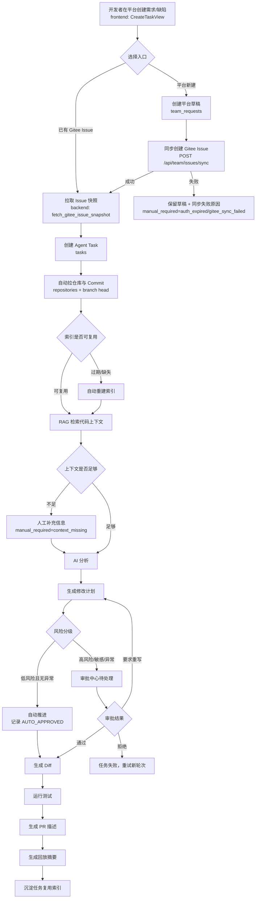
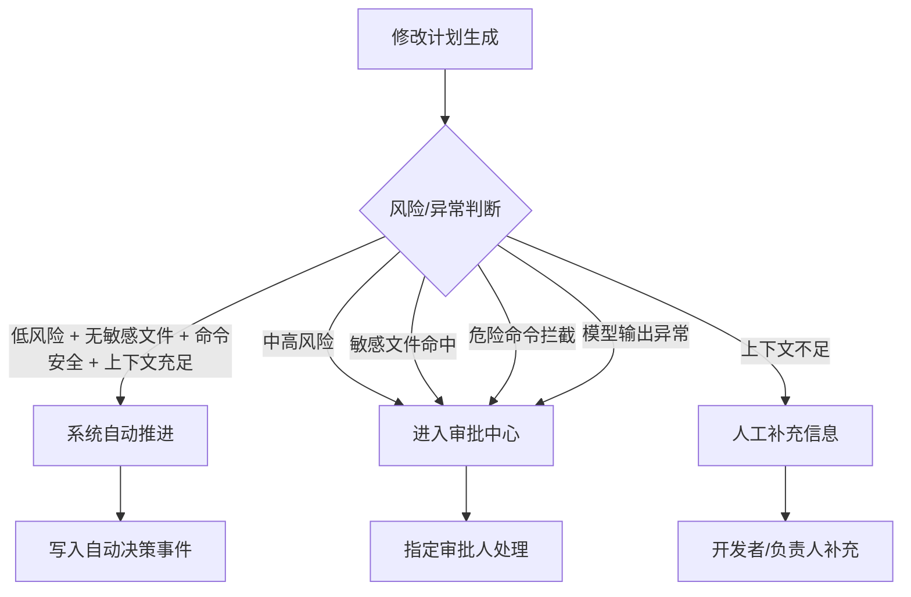

# 团队版业务流程

## 1. 主流程

## 2. 入口规则

| 入口 | 团队版处理 |
| --- | --- |
| 已有 Gitee Issue ID | 沿用 MVP，平台拉取 Issue 后创建任务 |
| 平台内新建需求/缺陷 | 先保存平台草稿，再同步创建 Gitee Issue |
| 空 Issue | 允许创建任务，但进入人工补充信息 |
| 重复 Issue | 有未结束任务时跳转已有任务；已结束可新建版本 |

## 3. 审批分级规则

团队版允许低风险任务自动推进，但必须满足：

- 计划风险为 low。
- 不命中敏感文件。
- 测试命令在白名单内。
- RAG 上下文 fresh。
- 没有阻塞问题。
- 系统写入自动决策事件，说明自动推进原因。

## 4. 异常与恢复

| 场景 | 处理方式 |
| --- | --- |
| Gitee Token 过期 | 任务进入 `manual_required=auth_expired`，提示更新授权后从失败节点重试 |
| 已有 Issue 拉取失败 | 任务进入 `manual_required=gitee_fetch_failed`，提示 Issue 不存在、无权限或网络异常 |
| 平台 Issue 创建同步失败 | 平台草稿保留，标记 `manual_required=gitee_sync_failed`，允许重新同步 |
| 索引过期 | 自动重建索引，任务进入等待索引 |
| Embedding 失败 | 索引进入失败态，可重试索引 |
| 上下文不足 | 任务暂停，要求补充 Issue 信息或手动指定文件 |
| 测试失败 | Diff 不被覆盖，允许有限重试 |
| 并发审批 | 第一条有效审批生效，后续返回冲突 |
| 并发创建 | 以 `repository_id + issue_id + 未结束状态` 做幂等 |

## 5. 回放沉淀

任务完成后自动生成复用摘要：

- Issue 摘要。
- 命中的代码上下文。
- 修改计划最终版本。
- Diff 文件范围和摘要。
- 测试命令与结果。
- PR 描述。
- 审批与风险调整记录。

复用摘要进入历史任务索引，下次检索时作为辅助上下文展示。
