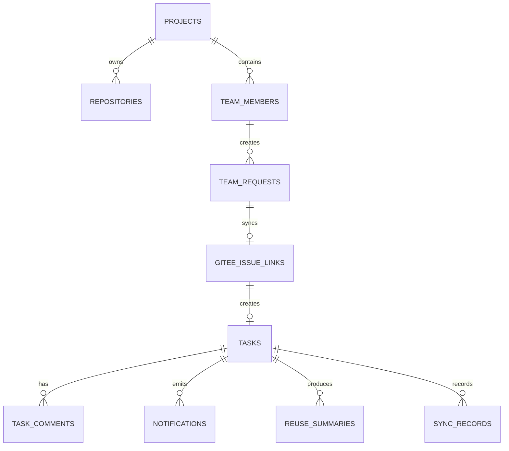

# 团队版数据、权限与审计

## 1. 新增数据对象

| 对象 | 说明 |
| --- | --- |
| `team_members` | 团队成员、角色、状态 |
| `team_requests` | 平台内创建的需求/缺陷草稿 |
| `gitee_issue_links` | 平台需求、Gitee Issue 和 Agent Task 映射 |
| `task_comments` | 任务评论和 @ 提醒 |
| `notifications` | 站内通知 |
| `reuse_summaries` | 完成任务后的复用摘要 |
| `reuse_index_records` | 历史任务复用索引记录 |
| `sync_records` | Gitee 同步记录 |

## 2. 核心关系

## 3. 权限矩阵

| 功能 | 团队管理员 | 项目负责人 | 开发者 | 审批人 | 观察者 |
| --- | --- | --- | --- | --- | --- |
| 查看项目 | 是 | 是 | 是 | 是 | 是 |
| 创建平台需求 | 是 | 是 | 是 | 否 | 否 |
| 同步 Gitee Issue | 是 | 是 | 是，限本人草稿 | 否 | 否 |
| 创建 Agent 任务 | 是 | 是 | 是，限本人草稿或被授权需求 | 否 | 否 |
| 查看任务 | 是，项目内全部 | 是，项目内全部 | 是，限本人创建、参与、被 @ 或关注任务 | 是，限可审批、参与或关注任务 | 是，被授权项目只读 |
| 审批计划 | 是，兜底审批 | 是，按项目配置 | 否 | 是，限指派任务 | 否 |
| 自动审批配置 | 是 | 是 | 否 | 否 | 否 |
| 修改项目配置 | 是 | 是，限审批策略、默认分支、测试命令等项目级配置 | 否 | 否 | 否 |
| 评论任务 | 是 | 是 | 是，限可见任务 | 是，限可见任务 | 否 |
| 查看审计 | 是 | 是 | 是，限本人可见任务摘要 | 是，限可审批或参与任务摘要 | 是，被授权项目只读摘要 |
| 管理成员 | 是 | 否 | 否 | 否 | 否 |

说明：

- 团队管理员保留 MVP 的全量待审批兜底能力，审批动作必须署名并写入审计。
- 项目负责人的审批权限由项目配置控制；默认可查看全项目任务，可改派审批人和催办。
- 开发者默认不查看全项目所有任务，只查看本人创建、参与、被 @ 或关注任务；若项目开启“项目内任务可见”，可扩展为项目内可见。
- 观察者只读查看被授权项目，不具备创建、审批、评论、执行或配置权限。

## 4. 审批分配

团队版默认仍保留 MVP 的单审批人生效模式，但分配来源扩展为：

1. 任务创建时显式指定。
2. 项目默认审批人。
3. 风险等级规则指定。
4. 文件目录负责人。
5. 项目负责人手动改派。

第一阶段只实现 1 到 3，目录负责人作为后续增强。若未配置默认审批人，团队管理员和项目负责人可手动指定审批人，改派必须写入审计事件。

## 5. 自动审批边界

自动审批不是绕过审批，而是系统在满足固定条件时写入一条可审计的系统审批事件。

必须满足：

- 计划风险为 low。
- 文件范围不命中敏感路径。
- 测试命令在白名单内。
- 上下文 fresh。
- 无阻塞问题。
- 无模型结构化输出错误。

不满足任一条件时进入审批中心。

## 6. 通知模型

| 场景 | 通知对象 | 是否可聚合 |
| --- | --- | --- |
| Gitee Issue 同步成功 | 创建人 | 是 |
| Gitee Issue 同步失败 | 创建人、项目负责人 | 否 |
| 任务进入人工补充 | 创建人、负责人 | 否 |
| 高风险待审批 | 审批人、项目负责人 | 是 |
| 审批超过 24 小时 | 审批人、项目负责人 | 是 |
| 测试失败 | 创建人、负责人 | 是 |
| PR 描述生成完成 | 创建人、关注人 | 是 |
| @成员 | 被 @ 成员 | 否 |

## 7. 审计要求

必须写入审计事件：

- 平台需求创建、修改、同步 Gitee。
- Gitee 同步失败和重试。
- 审批人分配和改派。
- 自动审批通过及其原因。
- 人工审批通过、拒绝、要求重写。
- 风险调整和原因。
- 评论新增、修改、删除。
- 通知催办。
- 复用摘要生成和索引更新。

普通用户不能修改审计日志。

## 8. 持久化要求

团队版需要从 MVP 内存态升级为持久化：

- MySQL 保存项目、仓库、任务、计划、审批、测试、PR 描述、回放和审计。
- Redis 承担队列、锁、短期任务状态缓存。
- Milvus 保存代码 RAG 和历史任务复用索引。
- Gitee Token 使用加密引用保存，不在响应中回显明文。

## 9. 验收标准

- 团队成员权限在前端和后端同时生效。
- 平台需求、Gitee Issue、Agent Task 映射可查。
- 自动审批事件可在回放中看到原因。
- 评论和通知能关联任务、计划、Diff 或执行步骤。
- 服务重启后任务、审计和配置不丢失。
