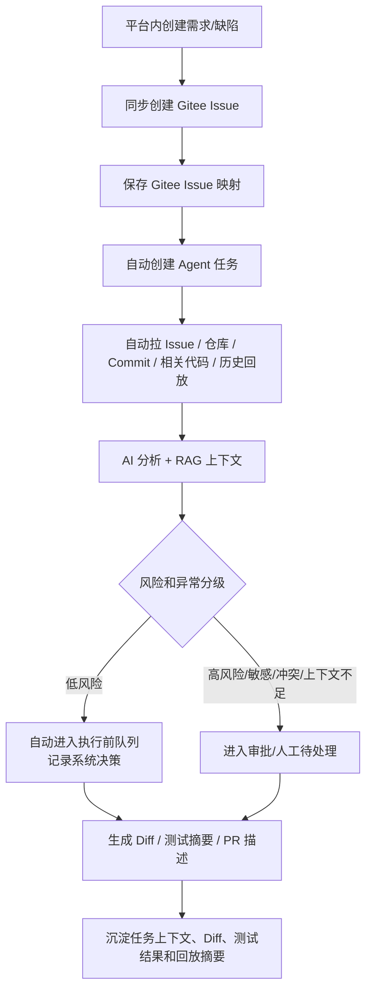

# 团队版文档索引

## 版本定位

团队版基于 MVP `v0.1 内测基线` 继续演进，目标是让一个小研发团队可以真实协作使用。当前团队版 PRD 已更新到 `v0.3`，已统一 DEV-015 前置需要定稿的枚举、状态和权限口径。

团队版不推翻 MVP 的 Agent 主链路，而是补齐团队协作、平台内创建需求、Issue 同步、审批分级、真实执行环境、持久化和通知闭环。

## 推荐阅读顺序

| 顺序 | 文档 | 说明 |
| --- | --- | --- |
| 00 | `00-team-development-plan.md` | 团队版阶段拆分、开发顺序和 Qoder/Claude 协作边界 |
| 01 | `01-team-prd.md` | 团队版详细 PRD、典型场景、功能需求、异常边界和分阶段验收 |
| 02 | `02-team-workflow.md` | 团队版业务流程、状态与异常分流 |
| 03 | `03-team-api-design.md` | 团队版新增 API 与 MVP 接口变更 |
| 04 | `04-team-data-permission.md` | 团队版数据模型、权限和审计边界 |
| 05 | `05-team-deployment-acceptance.md` | 部署、测试和验收清单 |

## 团队版第一阶段主线

## 团队版不做的事

- 不做企业级多租户计费。
- 不做 SSO、LDAP、细粒度组织架构。
- 不做多平台全量适配，第一阶段优先 Gitee。
- 不做高可用集群交付，先保证单机团队部署稳定。

## 和企业版的边界

团队版解决“一个团队如何协作使用”；企业版解决“多个组织、合规、安全、高可用和平台治理”。
