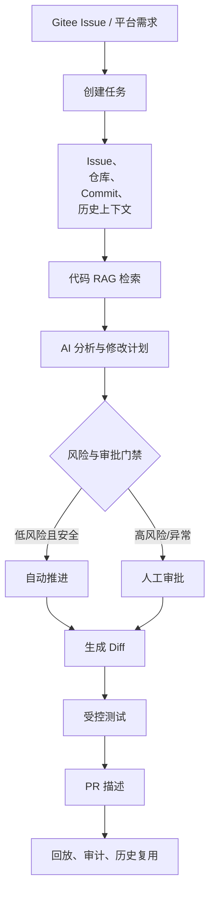

# 项目4：司契（Siqi）面试速记

> 用途：面试前快速复习。以下内容以当前源码、测试和开发记录为准。  
> 核对日期：2026-09-18  
> 原则：只讲已经实现或有测试证据的内容，规划中的能力要明确说明。

## 1. 项目一句话

司契（Siqi）是一个面向企业研发团队的 AI Agent 协作平台：从 Gitee Issue 或平台需求出发，经过代码 RAG、AI 分析、修改计划、风险审批、Diff、测试、PR 描述和任务回放，形成可控、可审计的研发闭环。

## 2. 30 秒介绍

> 项目主要解决 AI 编程过程中修改范围不可控、结果难审核、过程不可追溯的问题。用户可以从 Gitee Issue 或平台需求创建任务，系统同步 Issue 和仓库代码，用 LlamaIndex 加 Milvus 检索相关代码，再由 Agent 生成分析和结构化修改计划。计划经过风险判断和审批后才能生成 Diff 和执行测试，最后生成 PR 描述。任务状态、节点输入输出、审批和测试结果都会写入事件日志，支持回放和审计。

## 3. 主流程



## 4. 技术架构速记

| 层次 | 技术 | 主要职责 |
| --- | --- | --- |
| 前端 | Vue 3、TypeScript、Pinia、Element Plus | 任务、审批、Diff、测试、回放页面 |
| API | FastAPI、Pydantic | 接口、校验、权限和状态流转 |
| 持久化 | SQLAlchemy、SQLite/MySQL | 任务、审批、产物、事件和索引元数据 |
| Agent | LangGraph、LangChain、DeepAgents | 节点编排、暂停、恢复和重试 |
| RAG | LlamaIndex、Embedding、Milvus | 代码解析、切片、向量检索 |
| 异步 | Redis、Celery | 索引、同步、Agent 和测试长任务 |
| 执行 | Docker Runner | 隔离工作区、命令控制和测试执行 |
| 外部系统 | Gitee OpenAPI、LLM Provider | Issue、仓库和模型服务 |

记忆方式：

```text
LlamaIndex：加工和组织 RAG 数据
Embedding：把文本转换为向量
Milvus：保存向量并检索
LangGraph：编排 Agent 状态
Celery：执行长任务
MySQL：保存业务真源
```

## 5. 经典问题复盘

### 5.1 Worker 写库后，API 仍读到旧状态

**现象**

Worker 已经把任务推进到新状态，但 API 进程中的 `TASKS` 字典还是旧数据，接口可能错误返回 409 或 404。

**根因**

API 和 Worker 是两个进程。早期系统使用“内存字典 + 数据库镜像”，Worker 写数据库不会自动刷新 API 内存。

**解决**

- 持久化开启时，修改型接口统一通过 `task_for_mutation()` 读取数据库真源。
- 读取后刷新内存缓存。
- 本地测试保留内存模式，生产明确以数据库为准。

**面试回答**

> 这是典型的缓存与数据库不一致问题。关键不是简单 reload，而是先定义数据真源：生产以数据库为准，内存只作为缓存。我们统一收敛修改接口的读路径，读取数据库后再更新缓存，避免 API 根据旧状态做业务判断。

**代码/测试**

- `backend/app/db/reads.py`
- `backend/app/main.py::task_for_mutation`
- `backend/tests/test_reads_layer.py`

---

### 5.2 Celery Worker 重启后找不到任务

**现象**

Worker 能收到消息，但执行时找不到任务、项目或团队需求，出现 missing/404。

**根因**

Worker 不会执行 FastAPI 的 `lifespan`。如果只依赖 Web 进程启动时的内存恢复，Worker 自己就是空运行时。

**解决**

- 增加 `init_worker_runtime()`，Worker 启动时从数据库恢复运行时数据。
- 每个任务开始前调用幂等的 `ensure_worker_runtime_ready()`。
- 恢复失败转换为可序列化的 Worker 错误，不让进程直接崩溃。

**面试回答**

> Worker 是独立进程，不能复用 Web 进程的生命周期。因此我们让 Worker 具备独立初始化和恢复能力，启动时恢复一次，任务入口再做幂等兜底，保证重启后仍能消费真实业务数据。

**代码/测试**

- `backend/app/workers/runtime.py`
- `backend/tests/test_celery_worker_runtime.py`

---

### 5.3 Celery 重试时任务提前失败或无法恢复

**现象**

任务第一次失败就进入最终失败，或者异常对象无法序列化，导致 Worker 异常退出；恢复/审批后也可能无法再次投递。

**根因**

- 没区分“本次失败”和“达到最大重试次数”。
- 直接跨 Worker 边界传递 `HTTPException` 等复杂异常。
- `_AGENT_ENQUEUED` 去重标记没有在恢复和终态时清理。

**解决**

- 用 `WorkerTaskError` 只传递状态码、错误码和资源 ID。
- 非最后一次失败只记录可恢复状态和下一步动作。
- 最后一次失败才进入 `FAILED` 终态并写审计。
- 审批通过、恢复、重试和终态时清理投递标记。

**面试回答**

> 重试不能简单理解成再次抛异常。我们把队列重试和业务状态分开：中间失败保持可恢复，重试耗尽才进入终态；同时把异常转换成可序列化结构，避免业务异常导致 Worker 崩溃。

**代码/测试**

- `backend/app/workers/tasks.py`
- `backend/app/workers/dispatch.py`
- `backend/tests/test_celery_retry_and_config.py`

---

### 5.4 RAG 使用了过期代码

**现象**

仓库已经产生新 Commit，但旧索引仍能召回。Agent 可能基于旧代码生成错误 Diff。

**根因**

只判断“有没有检索结果”，没有判断索引对应的代码版本是否与任务基线一致。

**解决**

- 索引绑定 `repository_id + commit_sha`。
- 任务保存 `base_commit_sha` 和索引 ID。
- 检索结果返回 `commit_sha` 和 `fresh`。
- 过期索引可以人工查看，但自动 Diff 前必须通过 freshness 门禁。

**面试回答**

> RAG 正确性不只是相似度，还包括版本一致性。我们把 Commit SHA 纳入索引和任务上下文，过期结果可以用于人工排查，但不能直接驱动自动修改。

**代码/测试**

- `backend/app/main.py::assert_fresh_index_for_auto`
- `backend/app/retrieval/llamaindex_backend.py`
- `backend/tests/test_dev008_rag_index.py`

---

### 5.5 敏感文件和危险命令如何防护

**问题**

如果 `.env`、Token、证书、`node_modules` 或构建产物进入向量库，后续可能被检索并传给模型；如果测试命令不受限制，Agent 可能执行危险操作。

**解决**

- 索引前过滤 `.env`、`.git`、密钥、二进制、依赖目录和构建目录。
- 测试命令必须命中项目/仓库白名单。
- 执行前再次检查危险命令，如删除根目录、关机、远程脚本执行和宿主机挂载。
- Docker Runner 增加隔离、超时和工作目录清理。
- 高风险、敏感文件和危险命令只能进入人工审批。

**面试回答**

> 安全控制必须前置。不能只在前端隐藏敏感内容，也不能只相信模型判断。项目在索引前做文件过滤，在执行前做命令校验，并把敏感路径、危险命令和审批门禁作为确定性规则。

**代码/测试**

- `backend/app/retrieval/parsing.py::path_blocked`
- `backend/app/services/test_runner.py`
- `backend/app/services/approval_policy.py`
- `backend/tests/test_approval_policy.py`

---

### 5.6 并发审批或重复创建导致数据重复

**问题**

两个审批请求同时到达，可能都认为任务仍在待审批状态；用户重复点击创建任务，也可能创建多个未结束任务。

**解决**

- 后端加锁并重新校验当前状态。
- 第一条有效审批改变状态，后续请求返回冲突。
- 同一仓库、同一 Issue 存在未结束任务时直接复用。
- 任务版本、索引 Commit、Diff 版本和审计事件都保留。

**面试回答**

> 不能只依赖前端按钮禁用，因为请求可能重试，也可能来自多个客户端。后端通过锁、状态校验和幂等条件保证只有一条有效操作，重复请求返回已有资源或状态冲突。

**代码/测试**

- `backend/app/services/approval_policy.py`
- `backend/app/main.py`
- `backend/tests/test_approval_policy.py`
- `backend/tests/test_dev016c_create_task.py`

---

### 5.7 Gitee 创建 Issue 返回 404

**现象**

创建 Issue 返回 `404 project or enterprise`，一开始看起来像 Token 或权限问题。

**根因**

接口路径理解错误。错误写法是：

```text
POST /repos/{owner}/{repo}/issues
```

实际调用需要：

```text
POST /repos/{owner}/issues
{ "repo": "...", "title": "...", "body": "..." }
```

**解决**

- 修正 endpoint。
- 把 `repo` 放进请求体。
- 增加路径和 payload 回归测试。
- 使用真实 Gitee 仓库验证返回 201。

**面试回答**

> 我没有直接把 404 归因于权限，而是对照接口文档、请求路径和返回信息定位。修复后同时补了请求参数测试，并用真实仓库复验，避免测试桩掩盖外部接口问题。

**代码/测试**

- `backend/app/main.py::create_gitee_issue`
- `backend/tests/test_dev016b_sync_gitee.py`

---

### 5.8 Milvus 跨进程查询失败

**现象**

进程 A 写入 Collection 后退出，进程 B 查询同一 Collection 时出现 `collection is in state 'released'`。

**根因**

新进程虽然重新创建了 VectorStore，但没有主动加载已有 Collection。

**解决**

- 查询前调用 `ensure_milvus_collection_loaded()`。
- 对不同客户端字段做兼容处理。
- 加载操作设计为幂等。
- 用“进程 A 写入、退出，进程 B 查询”的测试验证，而不是只测同进程。

**面试回答**

> 同进程能查通不代表服务重启后能查通。我们专门做跨进程验证，定位到 Collection 生命周期问题，最终在查询前主动 load，并对异常按环境选择显式降级或抛错。

**代码/测试**

- `backend/app/retrieval/llamaindex_backend.py::ensure_milvus_collection_loaded`
- `backend/tests/test_milvus_realtime.py`

## 6. 高频追问速答

### 为什么不把整个仓库直接交给大模型？

仓库可能超过上下文窗口，而且噪声、成本和敏感内容都很多。RAG 先检索相关代码，只把必要上下文交给模型，同时保留文件路径、行号和 Commit 来源。

### LlamaIndex、Embedding、Milvus 有什么区别？

LlamaIndex 负责解析、切片和检索编排；Embedding 负责把 Issue 和代码转换成向量；Milvus 负责保存向量和执行相似度检索。

### 为什么模型不能直接决定是否执行？

模型输出具有不确定性。模型负责分析和生成建议，风险、敏感文件、危险命令、审批和执行权限由规则和后端门禁决定。

### 为什么长任务不用 FastAPI 请求直接执行？

仓库同步、索引、Embedding、模型调用和测试耗时不可控，直接放在 HTTP 请求里容易超时。FastAPI 负责创建和查询状态，Celery Worker 负责长任务。

### 模型调用失败怎么办？

本地或测试环境可以显式回退到规则分析，并记录 provider 和回退原因；生产环境不能把回退结果伪装成真实模型结果。

### 如何证明项目不是 Demo？

可以从三个方面回答：有真实状态机和审批门禁；有数据库、Worker、重试和恢复机制；有 pytest/Vitest、真实 Gitee、Milvus 跨进程和页面联调证据。

## 7. 面试时要主动说明的边界

- 团队版重点是单团队协作，企业版多租户、审计和治理能力仍在持续演进。
- 本地环境允许明确标记的 Mock/Fallback，生产环境要求真实 MySQL、Redis/Celery 和 Milvus。
- RAG 已有索引、过滤、freshness 和检索链路，但完整 Hybrid Search、Cross-Encoder 和云端质量评测不能说成全部完成。
- 历史任务只作为参考上下文，不自动复制旧 Diff。

## 8. 关键源码导航

| 需要复习的内容 | 位置 |
| --- | --- |
| API、任务状态和团队版主流程 | `backend/app/main.py` |
| Agent 工作流 | `backend/app/agent/workflow.py` |
| RAG 解析和切片 | `backend/app/retrieval/parsing.py` |
| Milvus 索引和检索 | `backend/app/retrieval/llamaindex_backend.py` |
| 审批门禁 | `backend/app/services/approval_policy.py` |
| 测试执行安全 | `backend/app/services/test_runner.py` |
| DB 读路径 | `backend/app/db/reads.py` |
| Celery Worker | `backend/app/workers/tasks.py`、`backend/app/workers/runtime.py` |
| 前端工作区和项目筛选 | `frontend/src/stores/workspace.ts` |
| 详细问题复盘 | `docs/project-development/93-project-problem-interview-review.md` |
| RAG 专题复盘 | `docs/project-development/92-rag-llamaindex-interview-review.md` |

## 9. 最后复习顺序

```text
先背 30 秒介绍
→ 画出主流程
→ 讲清 RAG 三件套
→ 重点准备 5.1、5.3、5.4、5.5、5.6
→ 最后看 Gitee 和 Milvus 两个真实故障
```
