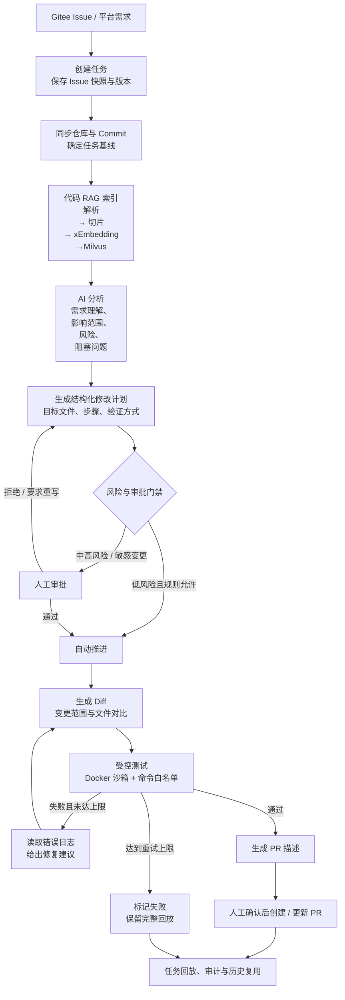
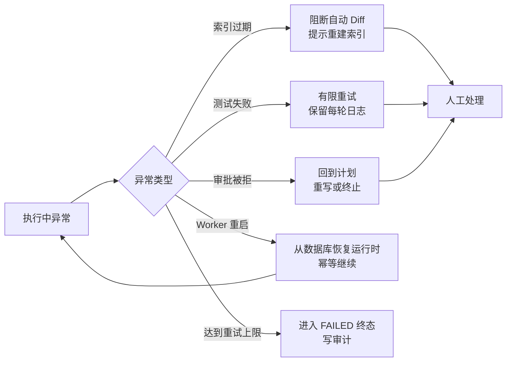
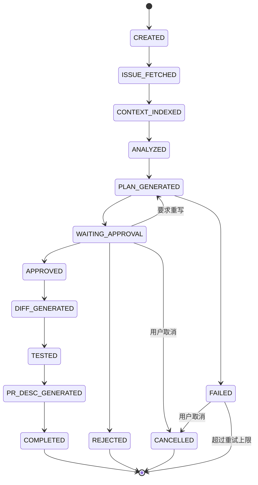
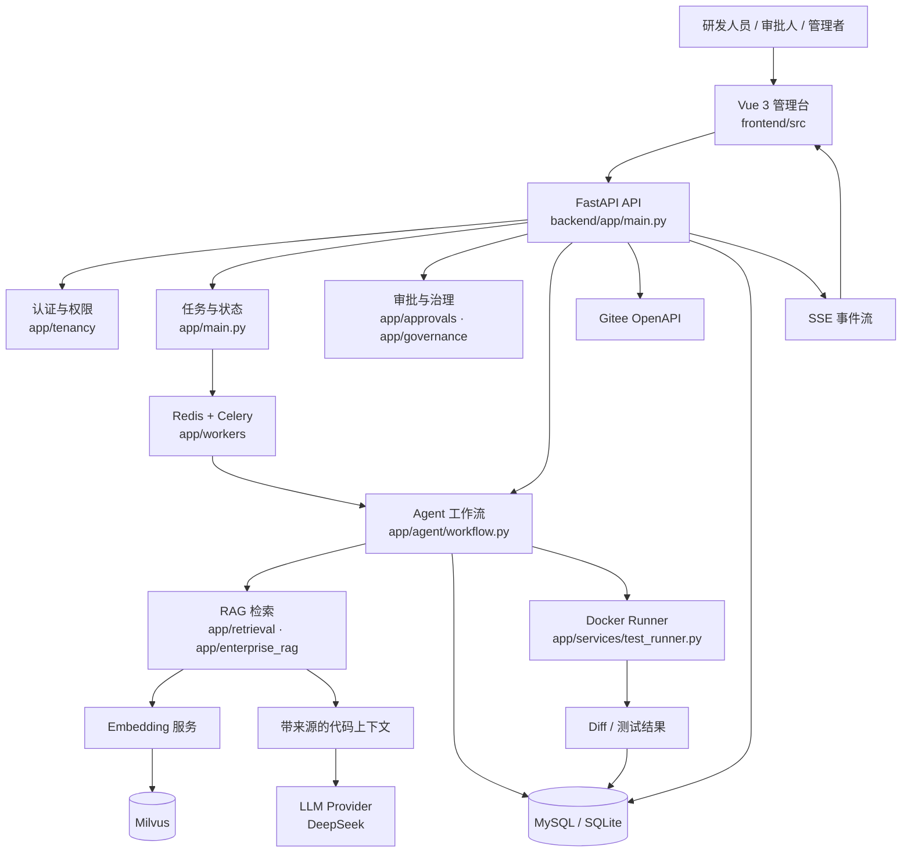
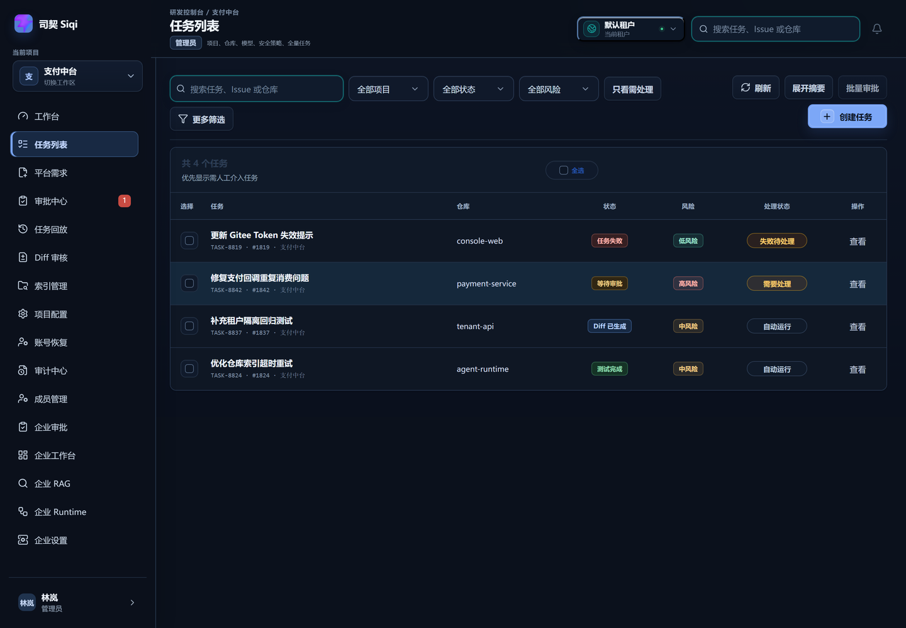
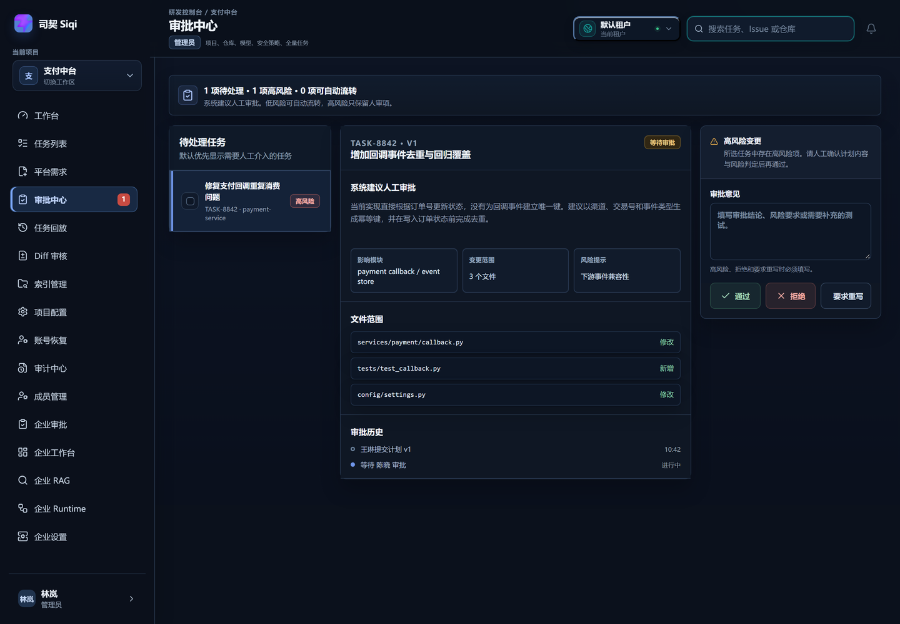
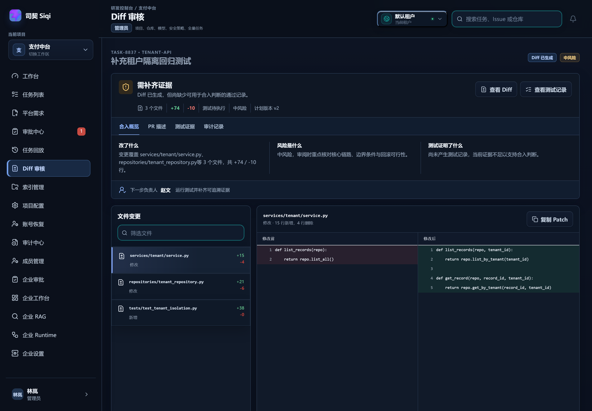
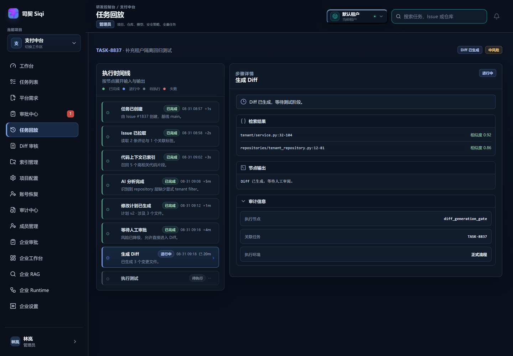

# 项目介绍：司契（Siqi）

> 用途：向老师完整介绍这个项目——它是什么、为什么做、怎么运转、用什么技术实现。
> 口径日期：2026-10-20
> 依据：`docs/01-project-initiation.md`、`docs/品牌定名方案-司契.md`、`README.md`、`docs/项目核心功能清单.md`

---

## 1. 先用一句话认识它

**司契（Siqi）是一个面向企业研发团队的 AI Agent 研发协作平台。**

它以 Gitee Issue 为任务入口，把一次代码变更拆成可管理的步骤：

```text
Issue → 代码检索 → AI 分析 → 修改计划 → 人工审批 → Diff → 测试 → PR 描述 → 回放审计
```

它要解决的不是"AI 能不能写出代码"，而是"企业敢不敢让 AI 的代码进入真实研发流程"。

一句话版本：

> 把 Gitee Issue 转化为可审核、可测试、可追踪的代码变更和 PR 协作任务。

---

## 2. 名字的由来：为什么叫「司契」

### 2.1 两个字分别是什么意思

| 字 | 含义 | 落到产品上 |
| --- | --- | --- |
| **司** | 执掌、主管。古语「有司」即主管部门 | 平台是任务的执掌者：管状态、管权限、管流程 |
| **契** | 契据、符契、券书 | 每一次变更都要有据可查、有人确认、事后可验 |

「司契」合起来就是**掌管契据的人**。

这里最关键的是「符契」这个意象：古时符契一分为二，双方各执一半，**合而验真才生效**。这正好对应项目里的**人工审批门禁**——AI 拟好的方案，必须由人"合契"才能继续执行。

### 2.2 出处

《道德经》第七十九章：

> 是以圣人执左契，而不责于人。有德司契，无德司彻。

取的是「有德司契」这一句：**执契存证，而不苛责于人**。

翻成产品语言就是：过程要留底、责任要可追，但工具本身不应该成为对人的苛责。这也是整个平台的设计底色——审计是给流程用的，不是给开发者添堵的。

### 2.3 四段式品牌叙事，正好对应主链路

| 环节 | 含义 | 对应的产品动作 |
| --- | --- | --- |
| **拟契** | Agent 拟一份待批的契 | AI 分析 → RAG 检索 → 结构化修改计划 |
| **成契** | 人落章，契始成 | 人工审批通过 / 调整风险 / 要求重写 |
| **存契** | 每一步都留底 | Diff、测试结果、事件与审计日志持久化 |
| **复契** | 以旧契证新事 | 任务回放、历史复用摘要、相似任务参考 |

### 2.4 读法与标语

- 读法：**Sī qì**（"司"阴平，"契"取"契约"的 qì）
- 主标语：**执契不苛，落笔有据。**
- 备选：事事有契，全局可复 / 拟契在机，成契在人。

### 2.5 定名过程（一句话带过）

项目早期只用品类名"企业级 AI Agent 研发协作平台"。2026-10-12 先定名"弈谱"，当天复核发现与工商实体及围棋产品生态存在冲突风险，同日更名"司契"。命名不是拍脑袋，是查过商标、读过出处、并且能对应主链路的。

---

## 3. 项目背景：企业不是不用 AI，而是不敢直接用

### 3.1 三层落差

AI 编程工具的能力已经足够强，但企业落地时卡住的往往不是模型能力，而是下面这三层：

| 表面问题 | 真实问题 | 造成的后果 |
| --- | --- | --- |
| AI 改了什么看不懂 | 分析过程和决策依据不透明 | 出问题无法定位，只能整段回滚 |
| AI 改得太多、太散 | 变更边界不清晰，可能越界改文件 | 代码评审成本高于自己写 |
| 关键操作没人把关 | 缺少审批门禁和权限约束 | 不满足团队研发规范，无法上生产 |
| 失败后不知道怎么复现 | 日志分散，没有完整任务回放 | 同样的坑反复踩 |
| 工具之间是割裂的 | Issue、代码、测试、PR 各在一处 | 研发过程没有统一入口 |
| 代码和密钥有外泄风险 | 敏感文件、危险命令缺少确定性防护 | 安全与合规过不了 |

一句话总结：

> **AI 已经能写代码了，但企业还没有一套机制，能放心地让 AI 写的代码进入自己的研发流程。**

### 3.2 现有工具的空白

- 聊天式工具：能给建议，但不承担流程责任，也不留下可审计的痕迹。
- IDE 补全工具：提升个体效率，但不解决团队级的审批、边界和追责。
- 通用 Agent 平台：能跑任务，但通常不针对研发场景做代码 RAG、测试执行和 PR 协作。

这个项目选择的空白点不是"更强的代码模型"，而是**研发过程的治理层**。

### 3.3 场景切口：为什么是 Gitee

- 国内大量研发团队使用 Gitee，但主流 AI 研发工具普遍以 GitHub 为先。
- Gitee Issue 天然就是"任务"的载体，适合作为流程起点。
- 首阶段只做 Gitee，是为了把一条链路做深，而不是铺开做集成。

Gitee 是切入口，核心差异化仍然是流程治理、任务回放和受控执行。

---

## 4. 我为什么做这个项目

### 4.1 四个"不满足"

1. **不满足于"能生成"**
   用过不少 AI 编程工具，它们大多停在"给你一段代码"。但真实研发里，代码只是中间产物，前后还有需求理解、方案确认、评审、测试和交付。只做生成，等于只做了流程的一小段。

2. **不满足于"黑盒自动化"**
   Agent 越自动，人越需要知道它做了什么。如果一次任务结束后只剩一个"成功/失败"，那这个自动化在企业里是不可用的。所以项目从第一天就把事件日志和任务回放当作核心功能，而不是附属功能。

3. **不满足于"Demo 级闭环"**
   很多演示能跑通一次，但经不起重启、并发、失败重试和权限校验。我想做的是一条**能部署、能验收、能解释失败**的链路，所以后面才有 Celery 独立运行时、数据库真源、审批幂等、Milvus 跨进程加载这些工程工作。

4. **不满足于"只服务个人"**
   个人用 AI 写代码，错了自己改；团队用 AI 写代码，错了要有人负责。这两件事对系统的要求完全不同。项目从 MVP 一路做到团队版、企业版，本质上是在补"团队协作"这一层。

### 4.2 我想验证的一个判断

> 企业缺的不是更强的模型，而是**把模型放进流程里的工程能力**。

如果这个判断成立，那么真正有价值的工作应该是：

- 用状态机约束 Agent，而不是让它自由发挥；
- 用 RAG 给它**带来源、带版本**的上下文，而不是把整个仓库塞进去；
- 用确定性规则控制风险和权限，而不是相信模型自己会守规矩；
- 用沙箱执行代码，而不是让 Agent 直接在宿主机上跑命令；
- 用事件日志支撑回放和审计，而不是只留一个最终结果。

这个项目就是这套判断的一次完整落地。

### 4.3 对我自己的意义

把分散的知识串成一个系统：RAG、Agent 编排、异步任务、数据库事务、权限模型、沙箱执行、前端联调、部署运维。

不是"学一个框架写一个 demo"，而是**从需求、架构、实现、测试到部署，完整走一遍企业级项目的生命周期**。这也是它从 MVP 长到 34 个企业版里程碑的原因。

---

## 5. 它是什么，不是什么

**它是：**

- 一个以研发任务为中心的工作流平台，不是聊天窗口。
- 一个把 AI 输出纳入审批和审计的治理系统。
- 一个可以本地跑、可以云端部署、有真实测试和验收记录的工程作品。

**它不是：**

- 不是代码补全插件，不追求"打字更快"。
- 不是全自动改代码机器人，主分支变更必须人工确认。
- 不是通用知识库，RAG 只面向研发任务的代码上下文。
- 不是一个已经商用成熟的 SaaS，边界会在第 9 节如实说明。

---

## 6. 主要业务流程

### 6.1 主链路



### 6.2 每一步在做什么

| 步骤 | 系统动作 | 关键约束 |
| --- | --- | --- |
| 任务创建 | 从 Issue 或平台需求建任务，保存快照与版本 | 同一仓库同一 Issue 有未结束任务时复用，避免重复创建 |
| 仓库同步 | 拉取仓库、分支、Commit | 任务绑定 `base_commit_sha`，后续检索和 Diff 都以它为基线 |
| 代码索引 | 解析代码、切片、生成 Embedding 写入 Milvus | 索引绑定 `repository_id + commit_sha`，过滤 `.env`、密钥、依赖和构建目录 |
| AI 分析 | 识别任务类型，提取目标、约束、影响范围和风险 | 只使用检索到的相关上下文，不整库投喂 |
| 修改计划 | 输出结构化计划：目标文件、操作步骤、风险、验证方式 | 计划版本化，重写有次数上限 |
| 审批门禁 | 按风险等级决定自动推进还是人工审批 | 未审批不得进入代码执行阶段；审批带锁与状态校验，防并发重复 |
| Diff 生成 | 展示文件级变更和修改前后对比 | 过期索引的结果只能人工查看，不能驱动自动修改 |
| 测试执行 | 在 Docker 隔离工作区执行测试命令 | 命令必须命中白名单；危险命令拦截；超时与工作区清理 |
| PR 描述 | 生成标题、描述和变更摘要 | 多版本保存；是否真实创建远端 PR 取决于配置 |
| 回放审计 | 记录状态、节点输入输出、审批、测试和产物 | 关键节点记录率是验收指标，不是可选日志 |

> **「生成 Diff」的准确口径**：主任务链路的 Diff 是**结构化变更产物**，不是模型直接吐出的 patch。产物绑定任务、计划 ID、计划版本和执行步骤，每个文件包含 `patch`（统一 diff）、`before/after` 行和增删行数。默认模式是**显式标记的演示兜底**（固定构造 add / modify / delete 三类样例，路径优先取自计划的文件范围），不写工作区、不冒充真实执行；真实 `git diff` 仅在专用 scratch 仓库 + `ALLOW_SCRATCH_REAL_CHANGE` 白名单下启用。企业 Runtime 的 6-Agent 链路则在隔离工作区真实写文件并执行 `git diff`，已产出真实 Gitee PR #3。两种模式都会在页面横幅、事件和回放中如实标注。

### 6.3 异常怎么分流



### 6.4 任务状态机



状态机的意义：**任何时刻任务处于什么阶段、下一步能做什么、什么人有权做，都是确定的**，而不是靠 Agent 自由决定。

---

## 7. 技术栈

### 7.1 总表

| 层次 | 技术 | 在本项目中的职责 |
| --- | --- | --- |
| Web 管理台 | Vue 3.5、TypeScript、Vite、Pinia、Element Plus | 任务、审批、Diff、测试、回放、审计、RAG 控制台等页面 |
| API 与业务 | FastAPI、Pydantic、SQLAlchemy 2.0 | REST 接口、参数校验、认证鉴权、状态流转、事务 |
| 业务数据库 | MySQL 8（团队/生产）、SQLite（本地） | 用户、项目、任务、审批、产物、事件、索引元数据的真源 |
| 异步任务 | Redis、Celery | 仓库同步、索引、Embedding、Agent 长任务、测试任务 |
| Agent 编排 | LangGraph、LangChain、DeepAgents | 节点编排、审批暂停、恢复、重试与失败分流 |
| 代码 RAG | LlamaIndex、Embedding、Milvus | 解析、切片、向量化、相似检索，返回带来源的上下文 |
| 模型服务 | DeepSeek（兼容 OpenAI 接口） | 需求分析、修改计划、修复建议、PR 描述 |
| 向量模型 | 智谱 Embedding（2048 维） | 代码切片与查询的向量化 |
| 受控执行 | Docker Runner | 隔离工作区、命令白名单、超时控制、测试执行 |
| 外部系统 | Gitee OpenAPI | 仓库、分支、Issue、PR 的读写 |
| 实时通信 | SSE + Redis Pub/Sub | 索引进度、Agent 节点状态、通知与未读计数 |
| 部署 | Docker Compose、Nginx、TLS | 本地一键启动、团队版、企业版私有化部署 |

### 7.2 系统架构



### 7.3 六个关键设计取舍

**① 用状态机，而不是让 Agent 自由对话**

Agent 的每一步都对应明确状态和允许的下一步。好处是可恢复、可测试、可审计；代价是灵活性下降，但这正是企业场景需要的。

**② RAG 绑定 Commit，而不是只判断"有没有检索结果"**

索引记录 `repository_id + commit_sha`，任务记录 `base_commit_sha`。检索结果返回 `commit_sha` 和 `fresh` 标记。过期索引可以人工查看，但**不能驱动自动 Diff**。正确性不只是相似度，还包括版本一致性。

**③ 模型建议，规则决策**

模型负责分析、生成计划和修复建议；风险等级、敏感文件、危险命令、审批和执行权限由确定性规则和后端门禁决定。模型输出不确定，不能让它自己决定"能不能执行"。

**④ 长任务异步化**

仓库同步、索引、Embedding、模型调用和测试耗时不可控，全部交给 Celery。FastAPI 只负责创建任务和查询状态，避免 HTTP 超时。

**⑤ 业务数据以数据库为真源**

早期 API 和 Worker 共享内存字典，Worker 写库后 API 仍读到旧状态。现在持久化开启时，修改型接口统一从数据库读取，内存只作为缓存。API 和 Worker 的职责边界因此变得清晰。

**⑥ 执行必须隔离**

测试命令在 Docker 工作区执行，限制目录、网络和资源；命令必须命中白名单；危险命令在执行前拦截；任务结束清理工作区。安全控制前置，不能只靠前端隐藏或模型自觉。

---

## 8. 做出来的东西

### 8.1 当前阶段

| 阶段 | 状态 | 关键结果 |
| --- | --- | --- |
| MVP | 完成 | 跑通 Issue → 分析 → 计划 → 审批 → Diff → 测试 → PR 描述 → 回放 |
| 团队版 | 完成并云端验收 | 多人协作、角色权限、审批指派、评论通知、历史复用；2026-09-12 部署验收 |
| 企业版 E1–E7 | 34/34 里程碑 DONE | 多租户 RBAC、治理门禁、企业 RAG、Multi-Agent Runtime、企业前端、私有化部署、试点交付包 |
| 品牌 | 2026-10-12 定名 | 司契（Siqi），文档、UI、云端同步 |

### 8.2 验证证据

| 维度 | 证据 |
| --- | --- |
| 后端测试 | 814 passed / 24 skipped（2026-09-30 基线） |
| 前端测试 | 264 passed，`vue-tsc` 0 错，`vite build` 通过 |
| 真实 Gitee 闭环 | 6-Agent Runtime 真实执行，产出 Gitee PR #3，ReleaseEvidence 状态 VERIFIED |
| 真实 RAG 评测 | health-middle（commit `73e7e54`）四模式 verified：recall 0.8955 / MRR 0.8172 / prec@K 0.3396 |
| 跨进程验证 | Milvus 跨进程写入—退出—查询通过，不是只测同进程 |
| 部署 | 团队版云端 `http://<YOUR_SERVER_IP>:8080`；企业版 8081；公网 `https://agentforge.ltd` HTTPS 200 |

### 8.3 界面（真实运行截图）

| 任务列表 | 审批中心 |
| --- | --- |
|  |  |

| Diff 审核 | 任务回放 |
| --- | --- |
|  |  |
